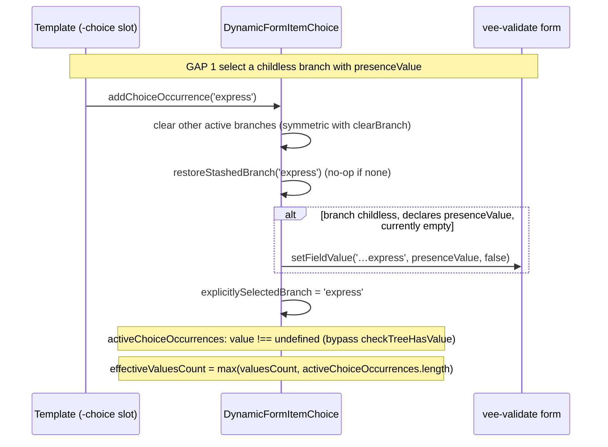
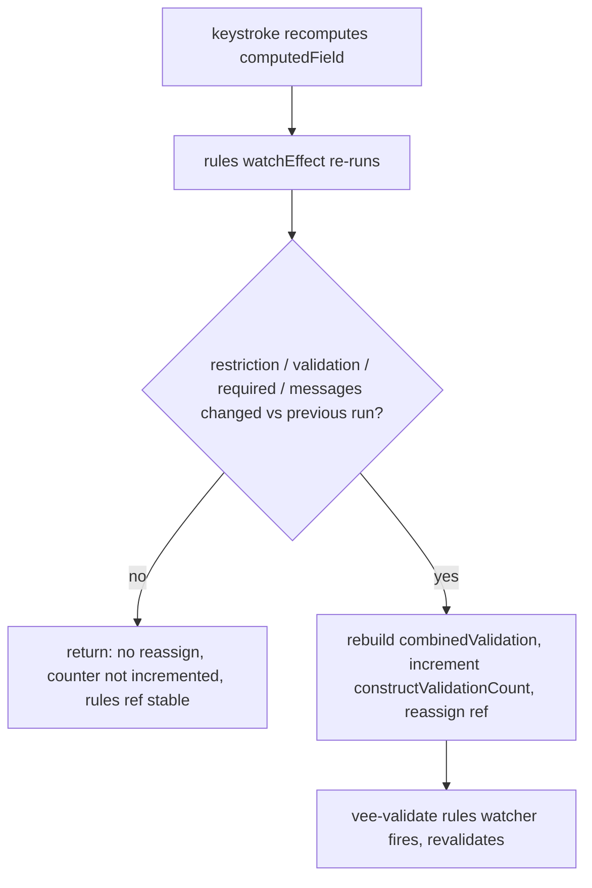
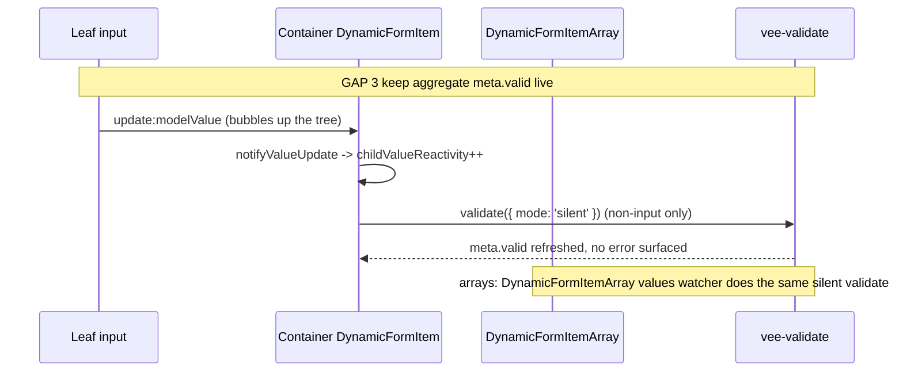

<!-- epic: optional. Set to the parent EPIC-XXX id when this feature belongs to an
     epic; leave "" for a standalone feature. Features are never nested under the
     epic folder, they only reference it here (flat model). -->


# Feature: Close three engine validation gaps (choice-branch presence, computed-props rule rebuild, live form validity)

## Decided without Jeroen (research)

Settled from research during the pre-approval chain, not reviewed by Jeroen. Override any of these freely.

- AR-1 (blocker) → GAP 3 silent validate runs ungated on every `childValueReactivity` increment (the drafted `checkTreeHasValue` gate left `meta.valid` stuck `true` on fill-then-clear)
- AR-2 → GAP 2 guard rationale corrected (`createValidation` is memoized; the guard's real reasons are effect re-runs, non-memoized `RuleExpression` closures, counter meaning)
- AR-5 → both new silent-validate sites adopt the `isValidationSuppressed` reset guard
- AR-6 → documented: a swapped `restriction.enumeration` should reuse a stable array reference
- AR-7 → prose/diagram order aligned; `presenceValue` is hashed as a constant and must be JSON-serializable

AR-3 (any marker shape allowed; the `removeNullValues` interaction is documented at both ends) and AR-4 (live `meta.valid` qualified to the default timing) were subsequently DECIDED (Jeroen) in discussion; every adversarial finding is now resolved.

## Problem & goal

Three gaps in the validation engine were confirmed by hand, both with throwaway tests against `TestForm` (the library's internal vee-validate test harness) and in the browser against the checkout docs example (`docs/examples/checkout.md`, `docs/.vitepress/theme/components/CheckoutFormExample.vue`). All three force template authors into userland workarounds that reach past the engine's own stated contract. This feature closes the gaps in `packages/core/src/`, and proves it by deleting the workarounds from the checkout example.

**Who this is for:** template authors building `explicitChoiceSelection` choices with a childless branch (an "Express checkout" or "PayPal" option with nothing to fill in), any consumer whose `computedProps` swaps a field's `restriction` or `validation` in response to other fields (a per-country postal pattern, a toggle-revealed character limit), and any consumer who reads the form's own aggregate `meta.valid` (via `useDynamicForm`/vee-validate's `useForm`) to drive a submit button or a completeness indicator.

**GAP 1 (presence of a childless explicit-choice branch).** An explicitly selected branch with no `children` (`explicitChoiceSelection: true`, `maxOccurs: 1`) already satisfies `xsd_choiceMinOccurs`: `DynamicFormItemChoice`'s `effectiveValuesCount` counts an explicit selection (`explicitlySelectedBranch.value`) even before any value exists. But the branch is also rendered as an ordinary leaf `DynamicFormItem`, which applies the default `xsd_required` check (`minOccurs` defaults to 1) against its own value, undefined, because `addChoiceOccurrence` never writes anything into the branch's own form value for the newly selected branch (only `clearBranch` writes `undefined` on deselection). The result: selecting the branch and submitting fails with "Express is required", and the selection is never represented in submitted or reloaded values.

Jeroen has already chosen the fix (option C of three considered; this part of the design is decided, not open):

- (A) waiving the leaf's own required check was rejected: the selection would no longer persist in submitted values, and loaded data carrying no value would no longer read back as selected.
- (B) the engine writing a hardcoded `true` was rejected: it invents a value the consumer never declared.
- (C), **adopted**: a new opt-in branch-level metadata property, `presenceValue` (the consumer's own marker, e.g. `true`, `{}`, or `'express'`). On selection, the engine writes it through the form context (`formContext.setFieldValue`), symmetric with `clearBranch` already writing `undefined` on deselection. The marker's type is entirely the consumer's choice, so a branch that later gains children or changes shape carries no stale, wrongly-typed value.

**GAP 2 (the rule set ignores `computedProps` output for `restriction`/`validation`).** `DynamicFormItem.vue`'s rules `watchEffect` (around line 322) builds `combinedValidation` from `field.value.restriction` and `field.value.validation`, where `field` is `computed(() => props.fieldMetadata)`, the raw metadata prop. It never reads `computedField` (around line 201), the object `computedProps` functions actually mutate. A `computedProps` function that swaps `thisField.restriction` or `thisField.validation` in response to another field's value (a per-country postal pattern, a toggled character limit) therefore has no effect on what the field actually validates against; template authors currently route around this with closures that read mutable module-level state plus a manual `validateField()` call on the one transition that needs it (see `createChangeTracker` usage in the checkout example).

**GAP 3 (the form's own aggregate `meta.valid` goes stale).** `DynamicFormItem.vue`'s value watcher (around lines 392-417) bails immediately for any non-input field (`if (!isInput.value) return;`), so a group, choice-anchor, or array field's own `fieldContext` is validated once (typically against its still-empty subtree at mount) and never again as its descendants change. Confirmed: with every field filled in and `errors` empty, the form-level `meta.valid` from `useDynamicForm`/`useForm()` stays `false` until a full submit-time `validate()` runs. Consumers currently route around this with their own hand-rolled completeness check (`formIsComplete` in the checkout example, roughly 50 lines re-deriving what should already be answered by `meta.valid`) and gate `onSubmit` on that instead of vee-validate's own `handleSubmit`.

A related bug, confirmed in the same investigation and scoped into this gap: after switching away from a branch that contains a **nested** explicit choice, then filling in the other branch completely, `handleSubmit` silently refuses to submit even though `validate()` resolves with an **empty** `errors` object, success callback never called. This looks like a stale field registration surviving the branch's unmount, and is why the checkout example's `onSubmit` bypasses `handleSubmit` entirely in favor of its own `canSubmit`/`formIsComplete` check (see the comment above `onSubmit` in `CheckoutFormExample.vue`).

**Success looks like:** all three gaps closed in `packages/core/src/`, each covered by tests using the existing harness conventions, GAP 1 additionally demonstrated in a Storybook story (an explicit Jeroen requirement, so he can try it by hand), and the checkout docs example rebuilt to delete `markChildlessBranchActive`, `createChangeTracker`, and (pending the stale-registration investigation) most of `formIsComplete` and the `handleSubmit` bypass, with every previously browser-verified flow in that example still working.

## Scope

### In scope

- **GAP 1:** a new opt-in `FieldMetadata` property, `presenceValue`, meaningful on a childless branch of an `explicitChoiceSelection: true`, `maxOccurs: 1` choice. On `addChoiceOccurrence(branchKey)` selecting that branch, the engine writes `presenceValue` through the form context into the branch's own value, the same way `clearBranch` already writes `undefined` on deselection. Loaded/reloaded data carrying that marker reads back as selected with no extra wiring, through the existing value-driven path in `activeChoiceOccurrences`.
- **GAP 2:** the rules `watchEffect` in `DynamicFormItem.vue` reads `restriction`/`validation` (and `required`, since it already depends on `minOccurs`) from `computedField` instead of the raw `field` prop, guarded by an equality check so `combinedValidation` is only reassigned when a rule-relevant input actually changed (a shallow compare on `restriction`, a reference compare on `validation`, a value compare on `required`). The guard exists because `computedField` recomputes on every keystroke that a `computedProps` function reads the field's own value for, and an unguarded rebuild would create a new `createValidation` closure each time, which fails vee-validate's `isEqual` check on the rules ref and forces a revalidation on every input regardless of `validateOnValueUpdate`.
- **GAP 3:** for non-input fields (group/choice-anchor/array), the value watcher in `DynamicFormItem.vue` calls `fieldContext.validate({ mode: 'silent' })` on value change, so the field's own `meta.valid` stays live without writing a visible error or touching `meta.touched`/`meta.validated`. Investigation (and, if the root cause is confirmed related, a fix) of the stale-registration bug described above, so a full `validate()`/`handleSubmit()` reliably succeeds once every visible field is valid.
- Updating `docs/.vitepress/theme/components/CheckoutFormExample.vue` to delete `markChildlessBranchActive` and `createChangeTracker` entirely, and to collapse `formIsComplete` and the `onSubmit` `handleSubmit`-bypass down to a `meta.valid`-based gate, as this feature's own acceptance proof. Every flow already browser-verified against that example (payment-method disable/deselect on the split-payment toggle, VAT/gift-message error stand-down, per-country postal revalidation, both order-placement paths) must still work after the rewrite.
- A Storybook story (`playgrounds/storybook/stories/testCases/Choices.stories.ts` and a matching test case under `packages/core/src/examples/`, following the existing pattern e.g. `explicitChoiceTestCase`) demonstrating `presenceValue` on a childless branch, so Jeroen can try it by hand.
- Tests for all three gaps under `packages/core/src/components/__tests__/`, using the existing harness (`TestForm`, the analytics setup-state counters such as `_analytics_constructValidationCount`) including a regression test that pins the GAP 2 guard: an unrelated keystroke must not increase the construct-validation count for a field whose `computedProps` output didn't change in a rule-relevant way.
- `specs/components.md` updated for `presenceValue` and for the GAP 2/GAP 3 behavior changes, per the file's own update rule.
- A changeset for every change under `packages/core/src/`, per `CLAUDE.md`. `presenceValue` is additive (new optional metadata property): minor. GAP 2 and GAP 3 are behavior fixes with no change to any public export's shape; see Open questions for the exact bump, since GAP 3 in particular changes a value (`meta.valid`) some consumer could already be reading.

### Out of scope (explicit)

- `presenceValue` for a repeatable (`maxOccurs > 1`) explicit choice branch. There, presence is already representable: `addChoiceOccurrence` pushes a real (possibly empty) occurrence into the branch's own field array (`push(null)` or, under `preserveOrder`, `push({ order })`), so the occurrence already exists in the value tree the moment it's added. Confirmed out of scope (DECIDED (Jeroen), open question 1): `presenceValue` is a no-op on a `maxOccurs > 1` branch, stated in its doc comment.
- Any change to `xsd_choiceMinOccurs`, `xsd_choiceMaxOccurs`, `vdf_maxOccursTotal`, `preserveOnSwitch`, `displayOrder`, or `preserveOrder` semantics; GAP 1 only changes what a selected childless branch's own value becomes, not how the choice counts occurrences.
- Any change to `xsd_required`'s own semantics for an ordinary leaf field (`value !== null && value !== undefined && value !== ''`); GAP 1 only changes what value a childless branch's required check runs against.
- A general-purpose "mark any leaf field as present without a real value" mechanism outside the `explicitChoiceSelection` branch context. `presenceValue` is scoped to choice branches.
- Any new template-facing slot prop beyond what writing `presenceValue` through the existing `addChoiceOccurrence(branchKey)` call already requires; no new slot, no new required template markup.
- Rewriting any part of the checkout example not touched by the three gaps (the split-payment ledger math, the order summary, the sticky cart layout).
- A new public composable or `DynamicFormSettings` flag exposing `meta.valid` differently; GAP 3 only makes the existing aggregate accurate. If architecture concludes a new surface is genuinely needed to deliver that, it must say so explicitly rather than assume it.
- Any rework of `vee-validate`'s own `validate({ mode: 'silent' })` semantics; the feature only calls it where the engine currently does not.

## Functional overview

- **Childless explicit-choice branch, selected and submitted.** A template author gives a childless branch of an `explicitChoiceSelection: true` choice a `presenceValue` (any value the consumer chooses, e.g. `true` or `'express'`). Selecting that branch (calling the existing `addChoiceOccurrence(branchKey)` slot prop) writes the marker into the branch's own value immediately; the branch's default-required check now has something real to validate, so submitting with that branch selected succeeds, and the selection survives into `values` and into a reload (the branch reads as selected again with no extra wiring, through the same value-driven check that already makes a filled branch read as selected).
- **`computedProps`-driven restriction/validation swaps actually take effect.** A consumer's `computedProps` function that changes `thisField.restriction` (e.g. a toggled `maxLength`) or `thisField.validation` (e.g. a per-country pattern) in response to another field's value now changes what the field is actually validated against. The field's rule set is rebuilt only when something rule-relevant changed, so unrelated keystrokes elsewhere in the form cause no extra validation work and no extra revalidation.
- **The form's own `meta.valid` is a trustworthy live signal under the default validation timing.** A consumer reading `meta.valid` off `useDynamicForm`'s return value, with the default `validateOnValueUpdate: true`, sees it flip to `true` as soon as every visible field is actually valid, without needing a prior full `validate()`/`handleSubmit()` call, regardless of whether the invalid-until-now field sat under a plain group, a choice, or an array. Under `validateOnValueUpdate: false`, leaf validity refreshes on the consumer's chosen timing (blur, submit), and the aggregate follows it (DECIDED (Jeroen), adversarial finding 4).
- **The checkout example demonstrates all three with no workarounds.** Picking "Express checkout" (a childless branch) and submitting succeeds without a hidden marker field. Typing a German postal code after switching country from Netherlands revalidates against the German pattern without a manual `validateField()` call tucked into a change-tracker closure. The submit button's enabled state, and the actual submit decision, both come from `meta.valid` (or logic built directly on it) rather than a hand-rolled walk of every nested field.

## Design (feature level)

No visual surface of its own: `presenceValue` has no new rendered shape (it reuses the existing `-choice`/`default-choice` slot and the existing `addChoiceOccurrence` call), and GAP 2/GAP 3 are pure validation-timing fixes with no template-facing change. The design phase is skipped per the workflow (see `specs/README.md`): status goes straight to `architecture`.

The one net-new demonstration, the `presenceValue` Storybook story, reuses the existing `playgrounds/storybook/stories/testCases/Choices.stories.ts` pattern (a plain test-case component exported from `packages/core/src/examples/`, paired with a sample-data story via `sampleDataStory`), the same shape as the existing `ExplicitChoice`/`PreserveOnSwitch` stories. It introduces no new visual language, so it needs no prototype of its own.

## Architecture (feature level)

Verified against the installed versions: `vee-validate@4.15.1` (from `pnpm-lock.yaml`; the catalog range is `>=4.12`), Vue `3.5.44`. Two behaviors the design rests on were read from the installed vee-validate source, not recalled:

- A field's `validate({ mode: 'silent' })` runs `validateValidStateOnly()`, which sets only `meta.valid = result.valid` and never calls `setFieldError`, never touches `meta.touched`/`meta.validated`. This is exactly GAP 3's needed primitive.
- `useField` runs `watch(rules, …, { deep: true })` guarded by `isEqual`; when the rules ref is reassigned to a new array carrying fresh function references, `isEqual` returns false and it re-runs validation (`validateWithStateMutation` once the field is validated, else `validateValidStateOnly`). This confirms both GAP 2's equality-guard requirement (an unguarded per-keystroke rebuild forces a revalidation each keystroke) and a GAP 3 corollary: the rules watcher fires only on rule changes, so a container node whose rule set is static (just `xsd_required`) is never revalidated when its subtree fills, which pins down the field whose `meta.valid` goes stale.

### Component / composable plan (against specs/components.md)

Reused unchanged: `DynamicForm`, `DynamicFormTemplate` and its slot contract, `DynamicFormItemWizard`, `useDynamicForm`/`useForm` (GAP 3 makes the existing aggregate `meta.valid` accurate; it adds no new accessor), `checkTreeHasValue`, `createValidation`, `hashField`, all `xsd_*`/`vdf_*` rules (no rule logic changes; `xsd_required` keeps `value !== null && value !== undefined && value !== ''`).

Modified (all backward compatible):
- `DynamicFormItem.vue` (GAP 2 and GAP 3). GAP 2: the rules `watchEffect` reads `restriction`/`validation`/`required` from `computedField` instead of the raw `field` prop, behind an equality guard. GAP 3: a new, non-input-only watcher runs silent revalidation on subtree change.
- `DynamicFormItemArray.vue` (GAP 3): a silent revalidation added to the existing `values` watcher so an array's own `meta.valid` stays live (its `fieldContext` in `DynamicFormItem` is a stub, so the DynamicFormItem-level GAP 3 watcher cannot cover it).
- `DynamicFormItemChoice.vue` (GAP 1): `addChoiceOccurrence`'s `maxOccurs === 1` path writes `presenceValue`; `activeChoiceOccurrences` and `effectiveValuesCount` special-case a presence-declaring childless branch; a dev-mode warning for `presenceValue` on a branch with children.
- `FieldMetadata.ts` (GAP 1): new optional `presenceValue?: unknown`, added to the `ComputedPropsFieldType` exclusion list.

No genuinely new component or composable is needed. Every new capability reaches templates through an established channel: GAP 1 through a new `FieldMetadata` property consumed by the existing `addChoiceOccurrence(branchKey)` slot prop (no new slot, no new markup); GAP 2 and GAP 3 through the existing engine behavior with no API surface at all.

### Public API impact

- **`FieldMetadata.presenceValue?: unknown`** (additive, optional, default `undefined`). Meaningful only on a childless branch of an `explicitChoiceSelection: true`, `maxOccurs: 1` choice. Doc comment states: no-op on a `maxOccurs > 1` branch (presence is already representable by a pushed occurrence); inert with a dev-mode warning on a branch that declares `children`; scoping to `explicitChoiceSelection` lives in the doc comment. Added to the `ComputedPropsFieldType` `Omit` list, alongside `explicitChoiceSelection`/`preserveOnSwitch`/`maxOccursTotal`/`displayOrder`/`preserveOrder`/`wizard`: it is static branch metadata read from the choice's `choice` array (itself already excluded), so `computedProps` is not its channel. `hashField` needs no code change: `presenceValue` is not in its exclusion list, so it IS hashed, but as static metadata it never changes and never perturbs the hash (finding 7b). Because `hashField` runs the value through `JSON.stringify`, the doc comment also cautions that the marker must be JSON-serializable (no circular structures).
- **No change** to any exported type's required shape, to `DynamicFormSettings`, to `defineMetadata`'s generics, to any slot, or to any rule signature. Existing consumers compile and run unchanged.
- **GAP 2** changes no export shape; it makes `computedProps`-swapped `restriction`/`validation` actually take effect.
- **GAP 3** changes no export shape; it makes the existing `meta.valid` live.

**Changeset / bump.** One cohesive changeset, **minor**, three sub-bullets (per CLAUDE.md's "one per cohesive user-facing capability", written for a release-notes reader):
1. `presenceValue` for childless explicit-choice branches (new capability).
2. `computedProps` can now swap a field's `restriction`/`validation` and have it validated against (GAP 2; Jeroen DECIDED minor, open question 4).
3. The form's aggregate `meta.valid` is now live for group/choice/array shapes without a prior `validate()`. This bullet carries the prominent behavior note Jeroen required (open question 5): any code that depended on the previously stuck-`false` aggregate is relying on a bug, and should re-check its assumptions. Minor, not major (open question 5 DECIDED).

The checkout-example cleanup story adds no changeset (`docs/` only, per CLAUDE.md). If the stale-registration bug splits to a QUICK spec (open question 6), that spec carries its own changeset.

### GAP 1 data flow (presenceValue)

Write on selection, symmetric with `clearBranch`'s deselection write. In `addChoiceOccurrence`'s `maxOccurs === 1` path, after `restoreStashedBranch(branchKey)` and immediately before setting `explicitlySelectedBranch.value = branchKey` (both happen in the same synchronous call, so the relative order is not observable; stated here to match the sequence diagram, finding 7a), and only when the branch is childless, declares `presenceValue`, and currently holds no value (`branchValueRefs[index].value === undefined`, so a restored stash or loaded data is never clobbered):

```
formContext?.setFieldValue(branchPath, branch.presenceValue, false);
```

`shouldValidate: false` mirrors `clearBranch`, so selecting a branch does not flash the just-written marker as validated.

Read-back on reload. `activeChoiceOccurrences` currently decides a childless branch's selection purely via `checkTreeHasValue(branchValueRefs[index].value)`, which is `false` for `{}`/`[]`. Per Jeroen's open-question-2 decision (option b), a presence-declaring branch instead reads as selected whenever its value is not `undefined`:

```
const declaresPresence = (child.children?.length ?? 0) === 0 && child.presenceValue !== undefined;
const branchValue = branchValueRefs[index]?.value;
const valueDriven = declaresPresence ? branchValue !== undefined : checkTreeHasValue(branchValue);
```

Occurrence counting. A reloaded presence-marked childless branch must also count toward `xsd_choiceMinOccurs`, otherwise it would read as selected yet still fail "required" on reload (the `explicitlySelectedBranch` ref that covers the same-session case is `null` after a reload). The faithful reading of "counts as selected whenever its value is not `undefined`" is to source the explicit-single count from `activeChoiceOccurrences` (which now honors `presenceValue`) rather than from `explicitlySelectedBranch` alone:

```
if (explicitChoiceSelection && maxOccurs.value === 1)
  return Math.max(valuesCount.value, activeChoiceOccurrences.value.length);
```

For same-session selection this is identical to today (`activeChoiceOccurrences` already includes the explicitly-selected branch); it only adds the reload case. This touches `effectiveValuesCount`, which feeds `xsd_choiceMinOccurs`. The scope note says GAP 1 does not change "how the choice counts occurrences"; this change is the minimal consequence of Jeroen's decision that a presence-marked branch counts as selected, and is called out explicitly so the reviewer can confirm it is in-bounds. See the residual-risk note below for truthy-marker guidance.

Inert-with-children warning. Mirror the existing `preserveOrder` scalar-branch warning block (bottom of `DynamicFormItemChoice.vue`): once per component lifetime in `import.meta.env.DEV`, warn when a branch declares both `presenceValue` and `children` (the two presence signals could disagree; the filled child value is authoritative and `presenceValue` is not written for a branch with children).

### GAP 2 data flow (computedProps rule rebuild)

Today the `watchEffect` reads `field.value.restriction`/`field.value.validation` (raw prop) but `required` already reads `computedField` transitively (via `minOccurs`/`maxOccurs`). So `computedField` is **already** a dependency of this effect, and `combinedValidation` is a plain ref populated asynchronously by the effect (never read during `useField` setup). The circular chain noted at the `combinedValidation` declaration (`combinedValidation → computedField → value → fieldContext → combinedValidation`) is already broken by that ref indirection at setup time, and moving the `restriction`/`validation` reads onto `computedField` adds no new dependency and no new init-order hazard: it only aligns two reads with the one (`required`) that already uses `computedField`.

Equality guard.

DECIDED (research): finding 2's PROPOSED correction is adopted; the guard stays, with its rationale corrected as follows.
Why: the earlier draft justified the guard by claiming an unguarded rebuild always hands vee-validate's `deep`+`isEqual` rules watcher a never-equal array. That is wrong for the `xsd_*` rules: `createValidation` is memoized per `(rule, param, customMessage)` and returns the identical closure for identical inputs (verified in `createValidation.ts`, whose own comment states exactly this purpose), so a rebuild with unchanged `restriction` yields identical references and `isEqual` no-ops.
Sources: `packages/core/src/utils/createValidation.ts` (memoization cache), `packages/core/src/utils/splitValidationFunctions.ts` (fresh closures per call), `vee-validate@4.15.1` installed source (rules watcher `deep` + `isEqual`).

The guard's real justifications: (a) `computedField` recomputes on every keystroke whose `computedProps` reads the field's own value, and because the effect now reads `restriction`/`validation` off that computed it re-runs on every such recompute; (b) user `validation` supplied as a string or object `RuleExpression` is NOT memoized (`splitToValidationFunctions` builds fresh closures per call), so an unguarded reassign does force a revalidation per keystroke for those fields; and (c) the guard keeps `_analytics_constructValidationCount` meaningful and the `combinedValidation` ref identity stable. The effect therefore keeps the previous run's inputs and only rebuilds-and-reassigns when a rule-relevant input changed:

- `restriction`: shallow value compare across its keys (a new object with identical contents is treated as unchanged).
- `validation`: reference compare (deep-comparing a `RuleExpression` is infeasible; consumers swapping `validation` via `computedProps` should use stable function references to benefit from the guard, which the checkout cleanup does).
- `required`: boolean value compare.
- `settings.messages`: reference compare (preserves today's "reconstructs when settings messages change" behavior).

When all are equal, the effect returns without reassigning `combinedValidation.value` (so the rules ref keeps the same array reference and vee-validate's watcher does not even fire) **and without incrementing `_analytics_constructValidationCount`**. Moving the counter behind the guard changes its meaning from "effect ran" to "rule set actually rebuilt"; this is deliberate and is what the GAP 2 regression test asserts (an unrelated keystroke on a field whose `computedProps` output is rule-irrelevant leaves the count flat). The existing analytics tests (`DynamicFormItem.analytics.test.ts`: mount `=1`, value change `=1`, sibling change `=1`, restriction-change `=2`, messages-change `=2`) all remain satisfied because each of those still flips a guarded input (or, for the value/sibling cases, does not re-run the effect at all).

### GAP 3 data flow (live meta.valid)

The naive "add a silent `validate` to the value watcher" is insufficient, and the design deviates from that framing for a concrete reason: `DynamicFormItem`'s value watcher watches the shallow `value` ref, which for a container (group/choice-anchor) only changes identity on the empty-to-populated boundary (its nested object proxy keeps the same reference as descendants mutate). It therefore misses every intermediate subtree change, which is exactly when a container's own validity (or a custom `validation` reading nested values) can change. The engine already has the right signal: `childValueReactivity`, incremented by `notifyValueUpdate`, which fires for a container on every descendant update (children emit `update:modelValue` up the tree). The fix adds a dedicated, non-input-only watcher in `DynamicFormItem`, with no `checkTreeHasValue`/`initialUpdate` gate and with the same reset-suppression guard every other validate call in these components carries:

```
if (!isInput.value) {
  watch(childValueReactivity, () => {
    if (!isValidationSuppressed())
      fieldContext.validate?.({ mode: 'silent' });
  });
}
```

DECIDED (research): the blocker's PROPOSED edit is adopted; the originally drafted `!initialUpdate.value || checkTreeHasValue(value.value)` gate is dropped.
Why: for a container the value watcher returns at `if (!isInput.value) return;` before `initialUpdate.value = false` ever runs (verified in `DynamicFormItem.vue`), so the gate collapses to `checkTreeHasValue` and skips the silent validate on the fill-then-clear transition, leaving a required container's `meta.valid` stuck `true`, a worse failure than the stale-`false` this gap fixes. The gate is also unnecessary: vee-validate runs its own mount-time silent validate, and `childValueReactivity` only increments on real descendant updates. The suppression guard (finding 5) matches the existing visible-validate call sites, and skipping during a reset is safe because vee-validate's `resetField` runs its own silent validate.
Sources: `DynamicFormItem.vue` (watcher ordering, suppression guard on the existing validate), `vee-validate@4.15.1` installed source (mount-time silent validate, `resetField` silent validate).

A regression test is required: fill a required container (optional children, or a cross-field `validation`), clear it, and assert the form-level `meta.valid` returns to `false` without a submit.

DECIDED (Jeroen): option (a), qualify the claim. The live `meta.valid` guarantee holds under the default `validateOnValueUpdate: true` timing; under `validateOnValueUpdate: false` the consumer has deliberately deferred validation to submit, and a deferred aggregate matches that model. Extending the silent validate to the leaf hot path stays available later as a purely additive follow-up. The Functional overview wording carries the qualifier.

`fieldContext.validate?.(…)` is optional-chained because an array node's `fieldContext` in `DynamicFormItem` is a stub (`{ value: ref(undefined) }`). Arrays are covered instead in `DynamicFormItemArray`'s existing `values` watcher (whose `useFieldArray` `values` IS deeply reactive), adding a silent `validate({ mode: 'silent' })` beside the existing gated visible `validate()`, so the array's own `meta.valid` stays live regardless of `validateOnValueUpdate`. "Unconditional" here means not gated by the `shouldValidateOnValueUpdate` timing settings; like the container watcher above it still carries the `isValidationSuppressed` reset-suppression guard (finding 5), which is a different gate with a different job.

The specific field this heals: a container's `useField` registration whose rule set is static (`xsd_required` only). vee-validate's rules watcher never fires for it (rules do not change), and its value watcher bailed, so its `meta.valid` was validated once (empty, invalid) and stuck. Silent revalidation on subtree change refreshes it without surfacing an error. The choice-occurrence registration in `DynamicFormItemChoice` is already kept live by vee-validate itself (its `combinedValidation` computed changes as `effectiveValuesCount`/`usedChoiceOccurrences` change, and the rules watcher re-runs `validateValidStateOnly`); the GAP 3 story verifies this holds rather than assuming it.

#### Stale-registration investigation (GAP 3, bundled per open question 6)

Symptom (verified against `TestForm`): after switching away from a branch containing a nested explicit choice and fully filling the other branch, `handleSubmit` silently refuses while `validate()` resolves `{ valid: false, errors: {} }` (valid false, errors empty, success callback never called). An empty `errors` with `valid: false` points at a `pathState` whose `valid` flag is stuck `false` while carrying no current error message, i.e. a registration that outlived the unmount of the branch it belonged to. The silent-revalidation fix above refreshes live fields and does not by itself clear a stale unmounted registration, so this is investigated as its own root cause.

Where to look, in order:
1. `DynamicFormItemChoice`'s `useField(normalizedPath, …)` anchored at the choice's closest (parent) path: a nested choice anchors at a path that can coincide with or nest under an ancestor's, producing multiple ids on one `pathState`. Confirm the inner choice's registration actually unregisters when its branch unmounts.
2. `DynamicFormItem.onBeforeUnmount` (writes `value = undefined` for non-array fields): check its interaction when a choice-anchor `DynamicFormItem` and the `DynamicFormItemChoice` it hosts tear down together.
3. vee-validate's `pathStates` multiple-id aggregation and `pendingUnmount`/`keepValuesOnUnmount` flags: a lingering id with `valid: false`, `validated: false`, no error yields precisely `valid: false, errors: {}` at the form level.

Approach: reproduce in `TestForm` (nested explicit choice inside a branch), switch away, fill the other branch, call `validate()` and inspect the form's `errorBag`/results/`pathStates` to name the surviving path; instrument the unmount paths to confirm whether the inner choice's `useField` cleanup runs. Do not prescribe the fix here. Per Jeroen's decision, if the root cause proves unrelated to silent validation or the fix balloons, split it into its own QUICK spec referencing this feature so it cannot stall the feature.

### Checkout-example cleanup (acceptance proof, docs-only)

Deletions enabled by the three gaps, each matched to the workaround's own explanatory comment:
- GAP 1: delete `markChildlessBranchActive`; give each childless branch (`express`, `homeDelivery`, `payPal`) `presenceValue: true` (a `checkTreeHasValue`-truthy marker, so it both persists and reads back as selected).
- GAP 2: delete `createChangeTracker` and both call sites (`countryChanged`, `giftMessageActiveChanged`) plus the manual `validateField()` calls; move the per-country postal pattern and the gift-message length into `computedProps`-set `thisField.validation`/`thisField.restriction` (using stable function references so the GAP 2 guard holds), letting the engine's own rule rebuild revalidate. The module-level `vatNumberIsActive`/`giftMessageIsActive`/`currentCountry`/`postalIsActive` mutable closures collapse accordingly.
- GAP 3: collapse `formIsComplete` and the `handleSubmit`-bypassing `onSubmit` to a `meta.valid`-based gate (both the button's `:disabled` and the submit decision), pending the stale-registration fix landing; if that bug splits to a QUICK spec, this collapse waits on it and the story says so.

Every flow already browser-verified in that example (payment disable/deselect on the split toggle, VAT/gift-message error stand-down, per-country postal revalidation, both order-placement paths) must still pass after the rewrite.

### ADR notes

- **GAP 1 marker write location.** Context: the selection must persist and read back. Decision: write `presenceValue` in `addChoiceOccurrence`'s single-branch path via `setFieldValue(branchPath, presenceValue, false)`, guarded by "branch currently has no value", symmetric with `clearBranch`. Alternative: writing in a `computedProps`/watch on the branch (what the example does today via `markChildlessBranchActive`). Rejected: it pushes engine responsibility into userland, the gap this closes.
- **GAP 1 read bypasses checkTreeHasValue (option b).** Context: `{}`/`[]` markers satisfy `xsd_required` but are `checkTreeHasValue`-false. Decision (Jeroen): a presence-declaring branch reads as selected on "value not `undefined`". Alternative (option a): document a truthy-only marker with a dev warning. Rejected by Jeroen: a docs-only restriction is missed.
- **GAP 1 effectiveValuesCount via activeChoiceOccurrences.** Context: a reloaded empty-object marker would read selected yet fail choiceMinOccurs. Decision: source the explicit-single count from `activeChoiceOccurrences`, so "selected" and "counts" agree. Alternative: leave counting on `valuesCount` and document truthy-only. Rejected: it reintroduces the inconsistency option b was chosen to avoid.
- **GAP 2 equality guard with the counter behind it.** Context: `computedField` churns per keystroke, and the effect now reads rule inputs off it. Decision: rebuild only when `restriction`/`validation`/`required`/`messages` changed, and move `_analytics_constructValidationCount` inside the guard. Alternative: rebuild every time and rely on vee-validate's `isEqual` to no-op. Rejected: the no-op only holds for the memoized `xsd_*` closures from `createValidation`; a string/object `RuleExpression` in `validation` builds fresh closures per rebuild (`splitToValidationFunctions`) and would force a revalidation per keystroke, the effect would still re-run per keystroke doing wasted rebuild work, and the analytics counter would stop meaning "rule set actually changed" (corrected per finding 2, DECIDED (research) in the data-flow section above).
- **GAP 3 keyed on childValueReactivity, not the value watcher.** Context: the shallow `value` ref misses intermediate subtree mutations for containers. Decision: a dedicated non-input watcher on `childValueReactivity` running `validate({ mode: 'silent' })`; arrays handled in `DynamicFormItemArray`'s `values` watcher. Alternative: `{ deep: true }` on the value watcher. Rejected: a deep watch over large subtrees is costly and redundant with the signal the engine already maintains.
- **No new public surface for GAP 3.** Context: open question whether a new composable/setting is needed. Decision: none; the existing `meta.valid` is made accurate. Confirmed in-scope (spec's own out-of-scope note).

### Residual risks

- A `presenceValue` that is not `checkTreeHasValue`-truthy (`{}`, `[]`) reads back as selected (option b) and, with the `activeChoiceOccurrences`-sourced count above, also counts toward `choiceMinOccurs` on reload. The Storybook story and docs should still use a truthy marker (`true`/a string) as the idiomatic shape; the empty-marker path is supported but unusual.
  - DECIDED (Jeroen): any `presenceValue` is allowed, no shape restriction and no dev-mode warning. `removeNullValues` is an optional, user-invoked cleanup: a consumer who does not call it gets a fully working marker of any shape, so the conflict only exists for the consumer who combines an empty marker with that cleanup. The interaction is documented at both ends (one line in the `FieldMetadata.presenceValue` doc comment and one in `removeNullValues`' doc comment stating that an empty-object/array marker is stripped by the cleanup), and the Storybook story and docs use a truthy marker as the idiomatic shape.
- GAP 2's `validation` guard is reference-based, so a consumer rebuilding a `validation` closure inside `computedProps` on every run defeats the guard (falls back to per-change rebuild). Documented in the `presenceValue`-adjacent guidance and demonstrated correctly in the checkout cleanup.
- The GAP 2 `restriction` guard is a shallow value compare across keys, so `restriction.enumeration` (an array) is compared by reference. A `computedProps` that rebuilds the enumeration array each run with identical contents defeats the guard and rebuilds every keystroke; a swapped `enumeration` should reuse a stable array reference, same as the `validation`-reference caveat above (finding 6, DECIDED (research): documented here and in the consumer guidance).
- The checkout GAP 3 collapse depends on the stale-registration bug being resolved (here or in a split QUICK spec); if it splits, ST sequencing must reflect the dependency.

### Slicing seams (input for the scrum-master)

Four stories. GAP 1/2/3 are independently deliverable engine slices; the cleanup depends on all three.

- **ST-01 GAP 2** (engine): `DynamicFormItem.vue` rules `watchEffect` + guard; analytics-counter regression test. Independent. Minor changeset.
- **ST-02 GAP 1** (engine + type + Storybook): `FieldMetadata.presenceValue` + `ComputedPropsFieldType`; `DynamicFormItemChoice.vue` write/read/count/warning; a test case in `packages/core/src/examples/` plus a `Choices.stories.ts` story (Jeroen requirement); `specs/components.md` entry. Independent. Minor changeset.
- **ST-03 GAP 3** (engine + investigation): `DynamicFormItem.vue` non-input watcher + `DynamicFormItemArray.vue` silent validate; the stale-registration investigation, with standing permission to split its fix to a QUICK spec. Independent of ST-01/ST-02. Minor changeset (the `meta.valid` behavior-note bullet).
- **ST-04 checkout cleanup** (docs, acceptance proof): depends on ST-01, ST-02, ST-03 all landed (deletes workarounds for all three). No changeset.

ST-01 and ST-03 both edit `DynamicFormItem.vue` but in different regions (the rules `watchEffect` vs. a new value/subtree watcher), so conflict risk is low; sequence them if implemented on the same branch. The single cohesive changeset can be authored in whichever of ST-01/ST-02/ST-03 lands first and extended, or split per story and merged at release; either satisfies CLAUDE.md as long as the three bullets end up in one entry.

### Flow diagrams







## Adversarial review

Filled by adversarial-reviewer at feature level. Findings and resolutions. Grounded in the installed code: `DynamicFormItem.vue`, `DynamicFormItemChoice.vue`, `DynamicFormItemArray.vue`, `createValidation.ts`, `splitValidationFunctions.ts`, `checkTreeHasValue.ts`, `hashField.ts`, `removeNullValues.ts`, `useIsValidationSuppressed.ts`, and `vee-validate@4.15.1`'s installed source. The two vee-validate behaviors the architecture rests on were confirmed by reading the installed bundle: `validate({ mode: 'silent' })` resolves to `validateValidStateOnly`, which sets only `meta.valid` and never `setState({ errors })` nor `meta.touched`/`meta.validated`/`meta.pending` (lines 1672-1683); and `useField`'s rules watcher is `watch(rules, …, { deep: true })` guarded by `isEqual`, which re-runs validation when a reassigned rules array is not deeply equal (lines 1757-1766). `isEqual` compares two differing function references as unequal (functions are not `typeof === 'object'`, so the deep branch is skipped and it falls through to reference inequality, lines 249-252).

1. **[BLOCKER] GAP 3's `checkTreeHasValue(value.value)` gate leaves a container's `meta.valid` stuck `true` when its subtree is cleared back to empty, which is worse than the stale-`false` bug it fixes: it can enable a submit button for an invalid form.** The proposed watcher is `if (!initialUpdate.value || checkTreeHasValue(value.value)) fieldContext.validate?.({ mode: 'silent' })`. For a container the value watcher bails at `if (!isInput.value) return;` *before* `initialUpdate.value = false` ever runs (DynamicFormItem.vue line 398 vs line 412), so `initialUpdate` stays `true` forever and the guard collapses to `checkTreeHasValue(value.value)`. Consider a required group (`minOccurs >= 1`) with only optional children: user fills a child (silent validate -> `meta.valid = true`), then clears it. `childValueReactivity` increments, the watcher runs, `checkTreeHasValue(value.value)` is now `false`, so it SKIPS the silent validate. The group's own `xsd_required` now fails against the empty subtree, but its `meta.valid` is never refreshed and stays `true`; the children are all optional-and-valid, so nothing else drags the aggregate down and the form-level `meta.valid` is wrongly `true`. The same applies to a container carrying a custom cross-field `validation`. Since this feature's whole point is driving the checkout submit button off `meta.valid`, a stuck-`true` aggregate is a correctness/safety regression. Root cause: the gate is unnecessary. vee-validate already runs a mount-time silent validate (lines 1690-1699), and `childValueReactivity` only increments on real descendant updates, so there is no spurious empty-at-mount validate to suppress. Resolution routed as a PROPOSED edit in the GAP 3 data flow section: run the silent validate on every `childValueReactivity` increment, with no `checkTreeHasValue`/`initialUpdate` gate.

   RESOLVED, DECIDED (research): the proposed edit is adopted in the GAP 3 data-flow section (gate dropped, regression test required). The watcher-ordering claim and the mount-time silent validate were verified against `DynamicFormItem.vue` and the installed `vee-validate@4.15.1` source.

2. **[SHOULD-FIX] The GAP 2 equality-guard rationale is factually wrong about `createValidation`, and the error could lead an implementer to mis-scope (or drop) the guard.** The ADR and data-flow text state the unguarded alternative is rejected because "`isEqual` compares the fresh `createValidation` closures by reference and always sees a change." But `createValidation` (`createValidation.ts` lines 7-33) is memoized per `(rule, param, customMessage)` and returns the identical closure for identical inputs, precisely so that rebuilding does NOT look like a rules change. So for a field whose rules come from `restriction` (the `xsd_*` rules) with unchanged param values, an unguarded rebuild yields an array of identical function references, `isEqual` returns `true`, and NO revalidation is forced. The guard's real justifications are different and should be stated correctly: (a) GAP 2 makes the `watchEffect` read `restriction`/`validation` off the `computedField` computed, whose value is a fresh object identity on every recompute, so the effect now re-runs on every keystroke that `computedField` subscribes to; (b) user `validation` supplied as a string or object `RuleExpression` is NOT memoized, since `splitToValidationFunctions` (splitValidationFunctions.ts lines 28-42) builds fresh closures per call, so rebuilding does force a revalidation for those; and (c) moving `_analytics_constructValidationCount` behind the guard keeps the regression counter meaningful and keeps the `combinedValidation` ref identity stable. The chosen design (the guard) is correct and should stay; only the stated reason is wrong. Resolution routed as a PROPOSED edit in the GAP 2 data flow section.

   RESOLVED, DECIDED (research): the correction is adopted; the GAP 2 data-flow rationale and the matching ADR note are rewritten. `createValidation`'s memoization was verified directly in `createValidation.ts` (its own comment states the purpose), and `splitToValidationFunctions`'s fresh-closures-per-call behavior in `splitValidationFunctions.ts`.

3. **[SHOULD-FIX] A non-`checkTreeHasValue`-truthy `presenceValue` (`{}`, `[]`) does NOT survive `removeNullValues`, so option (b) does not actually deliver "any marker shape works" across a submit/reload round-trip.** `removeNullValues` (removeNullValues.ts lines 12-24) returns `undefined` for an empty object or empty array (and the engine's own `clearBranch` comment tells callers to run `removeNullValues` at submit). So a consumer who picks a `{}` marker, submits through the recommended cleanup, and reloads the saved payload gets `undefined` at the branch path: the branch no longer reads as selected, and no longer counts toward `choiceMinOccurs`. Option (b) fixes the in-memory "loaded values" read but the submit boundary still strips the marker. Jeroen rejected a docs-only restriction (option a), but option (b) as specced leaves exactly the `{}`/`[]` markers it was meant to rescue broken on the one path consumers are told to use. Resolution routed as a PROPOSED edit in the GAP 1 read-back / residual-risks sections: either exempt a presence-declaring branch's key from `removeNullValues`, or state that a `presenceValue` must be `removeNullValues`-surviving (a non-empty primitive, object, or array) for the round-trip guarantee and have the Storybook story and docs use a truthy marker.

   RESOLVED, DECIDED (Jeroen): neither restriction. `removeNullValues` is an optional, user-invoked cleanup, so any marker shape is allowed and nothing warns; the interaction is documented in both the `presenceValue` and `removeNullValues` doc comments, and the Storybook story and docs use a truthy marker as the idiomatic shape. See the residual-risks entry.

4. **[SHOULD-FIX] GAP 3's "trustworthy live `meta.valid`" claim holds only under the default `validateOnValueUpdate: true`; under `validateOnValueUpdate: false` (a documented, tested setting) leaf `meta.valid` is never refreshed on value change, so the aggregate stays stale regardless of the container/array silent validates.** A leaf's `meta.valid` only updates when `DynamicFormItem`'s value watcher calls the visible `fieldContext.validate()`, which is gated by `shouldValidateOnValueUpdate` (lines 408-409). With `validateOnValueUpdate: false` a filled leaf keeps the mount-time `meta.valid = false`, so the form aggregate is stuck `false` no matter how live the containers are, and the DynamicFormItemArray reasoning ("stays live regardless of `validateOnValueUpdate`") does not rescue it because the array's own leaf children are still stale. This makes the unqualified Functional-overview and Success claims ("a trustworthy live signal", "flips to true as soon as every visible field is actually valid") false for that configuration. Resolution routed as a PROPOSED edit in the GAP 3 section: either qualify the claim to the default timing, or add an unconditional silent `validate({ mode: 'silent' })` to the leaf branch of the value watcher too (mirroring the array), so every registration's `meta.valid` is live independent of timing settings. The latter is more invasive (hot leaf path, render-count analytics) and is a scope/perf call for Jeroen.

   RESOLVED, DECIDED (Jeroen): qualify the claim to the default `validateOnValueUpdate: true` timing; under `false` the consumer has deliberately deferred validation and the aggregate follows their timing. Extending the silent validate to leaves remains a possible additive follow-up. Functional overview updated.

5. **[NICE-TO-HAVE] The GAP 3 silent validates are not guarded by `useIsValidationSuppressed`, unlike every other validate call in these components.** The existing visible `validate()` in both `DynamicFormItem` and `DynamicFormItemArray` is wrapped in `!isValidationSuppressed()` so a `resetForm`/`resetField`/`setFieldValue(…, false)` flush does not fight the caller. The proposed container watcher and the "unconditional" array silent validate omit this. It is benign in practice (silent validate only sets `meta.valid`, and `resetField` already runs its own silent validate on reset, lines 1703-1715), but it is an inconsistency worth either adopting (`if (!isValidationSuppressed()) fieldContext.validate?.({ mode: 'silent' })`) or justifying in a comment, so a future reader does not "fix" the missing guard and change behavior. Note "unconditional" should mean "not gated by `shouldValidateOnValueUpdate` timing", which is distinct from "not gated by reset suppression".

   RESOLVED, DECIDED (research): the `isValidationSuppressed` guard is adopted on both new silent-validate sites (the container watcher and the array watcher), matching the existing call sites; the GAP 3 data-flow section reflects it. Consistency with the codebase pattern is the reason; skipping during a reset is safe because vee-validate's `resetField` runs its own silent validate.

6. **[NICE-TO-HAVE] The GAP 2 `restriction` shallow compare treats `restriction.enumeration` (an array) by reference, so a `computedProps` that rebuilds the enumeration array each run with identical contents defeats the guard and rebuilds every keystroke.** Narrow: most `computedProps` swaps toggle a scalar facet (`pattern`, `maxLength`). Worth one line in the residual-risk note alongside the existing `validation`-reference caveat, so consumers know a swapped `enumeration` should reuse a stable array reference.

   RESOLVED, DECIDED (research): documented in the residual-risks note.

7. **[NICE-TO-HAVE] Two cosmetic inconsistencies.** (a) The GAP 1 data-flow prose writes `presenceValue` "after setting `explicitlySelectedBranch.value = branchKey`" while the sequence diagram writes it before the `explicitlySelectedBranch = 'express'` step; harmless (both are set in the same synchronous call) but align them. (b) `presenceValue` is NOT in `hashField`'s exclusion list (hashField.ts lines 9-23), so it IS included in the hashed `mutableProps`, as a constant; the Public-API claim "No `hashField` change: it is static, so it never perturbs the hash" is true in effect (the value never changes) but reads as if `presenceValue` were excluded. Also, a non-serializable or circular `presenceValue` would make `hashField`'s `JSON.stringify` throw; worth a one-line caution in the doc comment that the marker should be JSON-serializable.

   RESOLVED, DECIDED (research): both fixed. The GAP 1 data-flow prose now matches the sequence diagram (the write happens immediately before `explicitlySelectedBranch` is set, same synchronous call), and the Public API section now states `presenceValue` IS hashed as a constant and requires a JSON-serializable marker in the doc comment.

## Constraints & assumptions

- `checkTreeHasValue` (`packages/core/src/utils/checkTreeHasValue.ts`) returns `false` for an empty object (`{}`) or an empty array (`[]`): it recurses into every member and finds nothing. It returns `true` for every other defined, non-null value, including falsy primitives (`false`, `0`, `''`). `DynamicFormItemChoice`'s `activeChoiceOccurrences` computed decides whether a childless branch reads as selected on mount/reload purely via `checkTreeHasValue(branchValueRefs[index].value)` (the `explicitlySelectedBranch` ref that covers the same-session case starts `null` on every mount, so it cannot help on reload). **A consumer who picks an empty-object or empty-array `presenceValue` would pass the branch's own `xsd_required` check but NOT read back as selected after a reload**, silently breaking the stated "loaded data reads back as selected" guarantee. Resolved (DECIDED (Jeroen), open question 2): the selected-branch read for a branch that declares `presenceValue` checks "value is not `undefined`" directly, bypassing `checkTreeHasValue` for that one case so any marker shape works.
- `xsd_required` (`packages/core/src/core/validation.ts`) is exactly `value !== null && value !== undefined && value !== ''`; any `presenceValue` other than `null`, `undefined`, or `''` already satisfies it on its own, independent of the `checkTreeHasValue` concern above.
- `clearBranch` (`DynamicFormItemChoice.vue`, around line 576) writes `undefined` through `formContext.setFieldValue(branchPath, undefined, false)` on deselection; GAP 1's fix is symmetric, writing `presenceValue` through the same mechanism on selection, inside `addChoiceOccurrence`'s `maxOccurs === 1` branch (around line 654 onward).
- The rules `watchEffect` in `DynamicFormItem.vue` (around line 322) currently reads only from `field` (`computed(() => props.fieldMetadata)`), never from `computedField` (around line 201), which is the object `computedProps` functions actually mutate (via a reduce over a shallow copy of `field.value`). This is a plain oversight, not an intentional boundary: nothing in the documented `computedProps` contract (`FieldMetadata.ts`) excludes `restriction` or `validation` from being changed reactively.
- `computedField` recomputes on every keystroke a `computedProps` function reads the field's own value for (`fieldValue` is a `Ref` passed into every `computedProps` call); each recompute creates a fresh object (and, if `validation`/`restriction` close over anything, a fresh function reference for `validation`). Any fix that assigns a new `combinedValidation.value` on every `computedField` change, without a guard, would create a fresh `createValidation(...)` closure every time, which vee-validate's internal `isEqual` on the rules ref would always see as changed, triggering the rules-watcher-driven revalidation on every keystroke regardless of `validateOnValueUpdate`. The analytics counter `_analytics_constructValidationCount` (already exposed via `DynamicFormItem.test-helpers.ts`'s `constructValidationCount`) is the existing regression guard for this.
- The value watcher in `DynamicFormItem.vue` (around lines 392-417) is the only place `fieldContext.validate()` is called outside of mount/submit; it bails on `!isInput.value` before reaching that call, which is the exact mechanism GAP 3 targets. `isInput` is `!isArray && !isChoice && !isParent && !isWizard`.
- `vee-validate` 4.15.1's `validate({ mode: 'silent' })` runs the same rules but writes no visible `errorMessage`/`errors`, and does not touch `meta.touched`/`meta.validated`, while still updating `meta.valid`; this is the documented (and already relied upon by GAP 1/GAP 2's reasoning) behavior the fix is built on.
- The checkout example's workarounds, with their own explanatory comments already in place, are: `markChildlessBranchActive` (GAP 1), `createChangeTracker` plus its two call sites, per-country postal revalidation and gift-message toggle revalidation (GAP 2), and `formIsComplete` plus the `handleSubmit`-bypassing `onSubmit` (GAP 3). All carry a comment at their definition explaining exactly which engine gap they exist to cover; those comments are the acceptance criteria for "this workaround is now deletable."
- `docs/.vitepress/theme/components/CheckoutFormExample.vue` belongs to `FEAT-001-shopify-style-checkout-example`, whose spec status is `in-progress` (not `done`), so it is not protected by the "never reopen a done spec" rule; editing it directly is permitted, but see the open question on where that edit should be tracked.

## Open questions

Questions for Jeroen. Must be resolved before approval.

1. **`presenceValue` scope: `maxOccurs: 1` only, or also repeatable explicit choices?** The idea text leans toward "probably out of scope, since presence there is already representable via a pushed placeholder occurrence," but that is a lean, not a decision. Confirm `presenceValue` is meaningful only on a `maxOccurs: 1` childless branch, with the doc comment on `FieldMetadata.presenceValue` stating that explicitly (ignored/no-op on a `maxOccurs > 1` branch), or decide it should also apply there.

   DECIDED (Jeroen): `maxOccurs: 1` only. Repeatable explicit occurrences already exist as field-array entries the moment they are added, so presence is already representable there. The doc comment on `FieldMetadata.presenceValue` states it is a no-op on a `maxOccurs > 1` branch.
2. **`presenceValue` marker shape vs `checkTreeHasValue`.** As detailed in Constraints above, an empty-object or empty-array `presenceValue` would satisfy the branch's own `xsd_required` but fail to read back as selected after a reload, contradicting the stated design goal. Pick one: (a) document that the marker must be `checkTreeHasValue`-truthy (a non-empty primitive, object, or array), optionally with a dev-mode `console.warn` when it isn't; or (b) make the selected-branch read for a branch that declares `presenceValue` check "value is not `undefined`" directly, bypassing `checkTreeHasValue` for that one case so any marker shape works.

   DECIDED (Jeroen): option (b). A branch that declares `presenceValue` counts as selected whenever its key is present (value not `undefined`), regardless of `checkTreeHasValue`'s emptiness rules, so any marker shape works. A docs-only restriction would get missed.
3. **`presenceValue` on a branch that also declares `children`.** Is it simply inert there (presence is already naturally representable by a filled child value), or should the engine warn in development that the two signals could disagree, the way `preserveOrder` already warns about a scalar branch?

   DECIDED (Jeroen): inert at runtime, with a dev-mode warning, matching the existing `preserveOrder` misconfiguration-warning pattern.
4. **GAP 2 changeset bump.** Making `restriction`/`validation` actually respond to `computedProps` is a behavior fix for something that silently never worked; per `CLAUDE.md` that reads as patch (no API shape change), but it's also "the contract finally doing what its own doc comment always promised." Patch, or minor with a changelog note calling out the newly-working behavior?

   DECIDED (Jeroen): minor. It makes `computedProps`-swapped `validation`/`restriction` actually work, which is new capability for consumers, not just a fix.
5. **GAP 3 changeset bump, the `meta.valid` behavior change.** Today, any form using a group/choice/array shape has an aggregate `meta.valid` that goes stale false after the first validation of a non-input field, even once every error clears; fixing this makes it live and accurate. This is exactly the kind of "behaviour change an existing consumer might have relied on" `CLAUDE.md`'s major-bump criterion describes (a consumer could have built their own workaround, like the checkout example itself, on the assumption that `meta.valid` is unusable). Patch (the aggregate was simply wrong before), minor (call it out prominently in the changelog even though no export's shape changed), or major?

   DECIDED (Jeroen): minor, with a prominent behavior note in the changeset. A live `meta.valid` is the intended reading of the API; relying on the stuck-false value is relying on a bug. Major is too heavy for this library's consumer base.
6. **The stale-registration bug's scope.** The idea scopes investigating, and if related, fixing the "`handleSubmit` silently refuses after switching away from a branch with a nested explicit choice" bug inside this feature's GAP 3. If the investigation (during architecture) finds a root cause unrelated to silent validation (e.g. a `useField` unregistration/cleanup timing issue independent of this feature's fix), should the fix still ship inside this feature, or should it split into its own quick-lane fix referencing this feature?

   DECIDED (Jeroen): investigate inside the GAP 3 story, with standing permission to split the fix into its own QUICK spec referencing this feature if the root cause proves unrelated or the fix balloons, so it cannot stall the feature.
7. **Where does the checkout-example cleanup live?** `CheckoutFormExample.vue` belongs to `FEAT-001` (`in-progress`). Should this feature's own stories edit that file directly as its acceptance proof (as the idea describes), or should the cleanup land as a follow-up story under `FEAT-001` (or a quick-lane fix) once this feature ships, to avoid two features touching the same in-progress file at once?

   DECIDED (Jeroen): a story of this feature. The cleanup is this feature's acceptance proof; FEAT-001's scope was building the example, not the engine.
8. **Is `presenceValue` the final public name?** It sits alongside `maxOccursTotal`/`preserveOnSwitch` as a property meaningful only on a choice branch. Confirm the name itself (not just the design) is final, or whether it should be scoped more explicitly in its own name (e.g. a name that makes "only meaningful under `explicitChoiceSelection`" obvious without reading the doc comment).

   DECIDED (Jeroen): `presenceValue` is the final name: it says what it is, the value that represents presence. Scoping lives in the doc comment.

## Stories

Filled by scrum-master AFTER approval. Links to story folders with implementation order and dependency notes.
