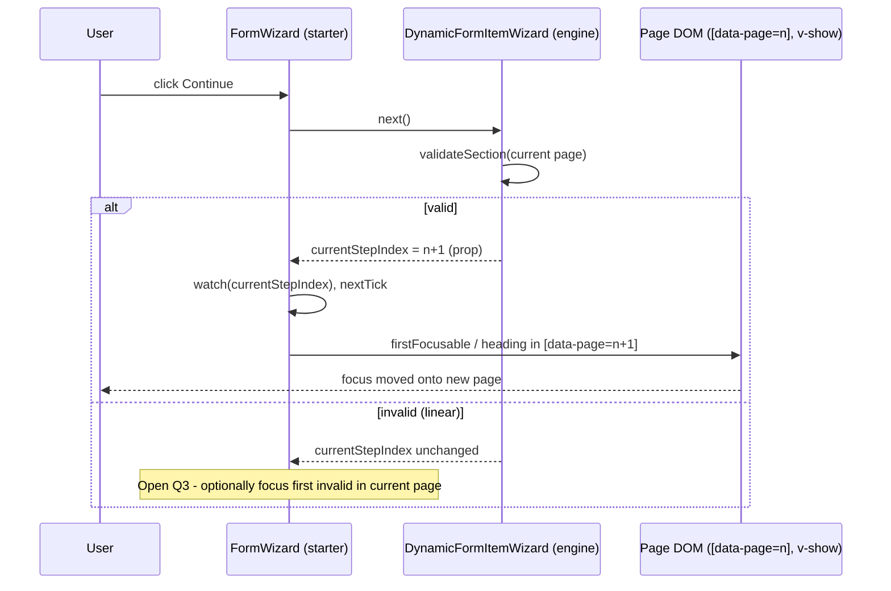

<!-- epic: optional. Set to the parent EPIC-XXX id when this feature belongs to an
     epic; leave "" for a standalone feature. Features are never nested under the
     epic folder, they only reference it here (flat model). -->

# Feature: Starter template accessibility (WCAG 2.2 AA)

## Decided without Jeroen (research)

Settled from research during the pre-approval chain, not reviewed by Jeroen. Override any of these freely.

- AR-1 (partial) → the "focus the wizard heading" option is dropped as not implementable (the only `<h1>` is constant, outside `[data-page]`, sometimes absent); the real choice, first field vs named `[data-page]` container, stays Open question 2
- AR-2 → behavioural focus/keyboard unit tests are mandatory alongside axe (axe under jsdom asserts static ARIA only)
- AR-3 → `CheckboxField`'s error and description move out of the clickable `<label>` (clicking a `role="alert"` error must not toggle the control)
- AR-4 (nit) → "private package" claims corrected: no `private` field, `publishConfig.access: "public"`, version `0.0.0`
- Q6 (partial) → axe violations fail `pnpm ci` (blocking), per the feature's own goal statement; the test shape (per-component vs whole-template) stays open

## Problem & goal

`@bach.software/vue-dynamic-form-starter` exists so a consumer can hand `DynamicForm` a template and get a complete, good-looking form with no CSS framework and no template of their own to write. Right now that form is not reliably usable by keyboard-only or screen-reader users, which means anyone who adopts the starter package to save themselves the work of writing a template is also, unknowingly, shipping an inaccessible form to their own end users. A form library's whole value is that the consumer doesn't have to think about this field-by-field; accessibility gaps in the one template meant to be dropped in as-is undermine that promise for every consumer who uses it, and for every end user who fills in a form built on it.

The goal is for every control the starter template renders (inputs, selects, checkboxes, toggle switches, password fields, choice cards, repeatable arrays, the wizard and its stepper) to meet WCAG 2.2 AA from a keyboard and screen-reader perspective, and for that to be checked automatically going forward rather than relying on manual review each time the template changes.

This is for:
- **Consumers of the starter package**, who get an accessible form without doing any accessibility work themselves.
- **End users of those consumers' forms**, specifically keyboard-only users and screen-reader users, who are the ones who actually hit these gaps today.

## Scope

### In scope

- **Label, description, and error association on every control**: every input, select, checkbox, toggle switch, and password field gets a correct `aria-describedby` chain covering its description and its error message, and `aria-invalid` reflecting its actual validation state. `ErrorMessage.vue` gets an `id` so it can be the target of that `aria-describedby`.
- **Error announcements**: `ErrorMessage.vue` currently renders a bare `` with no `role="alert"`/`aria-live`, so a screen reader never hears a validation error appear. Give per-field errors a live announcement, consistent with how `FormWizard.vue`'s step-errors banner already uses `role="alert"`.
- **Async/dynamic status announcements**: `PasswordStrengthBar.vue` updates a strength label as the user types with no announcement; decide and implement an appropriate `aria-live` treatment (politeness level, debouncing so it doesn't spam the user on every keystroke).
- **Full keyboard operability** across:
  - Wizard navigation (`FormWizard.vue`) and the stepper (`Stepper.vue`): already largely keyboard-reachable (native `<button>`s); confirm and close any remaining gaps.
  - Choice cards (`ChoiceCard.vue`, `ChoiceSectionCard.vue`): the `radiogroup`/`radio` ARIA roles are already in place, but there is no roving-tabindex/arrow-key navigation between cards, which is the native keyboard pattern screen reader users expect from that role combination. Decide whether to implement the full pattern or document the deviation (see Open questions).
  - Repeatable arrays, add and remove (`ArrayField.vue`, array/repeater chrome): add/remove buttons are native buttons and already reachable; the gap is what happens to focus after a remove, since the removed item's button disappears and focus is currently dropped to the document body.
  - Toggle switch (`ToggleSwitch.vue`): already has `role="switch"`, keyboard handlers for Space/Enter, and a `tabindex` that respects `disabled`; confirm there is no remaining gap.
  - Password reveal (`PasswordInput.vue`): the toggle button has `tabindex="-1"`, making it keyboard-unreachable. Remove that and make it a normal tab stop.
- **Focus management**:
  - On wizard step change: move focus to a sensible target on the new page (the page heading or its first focusable field) so a keyboard/screen-reader user isn't left focused on a `Back`/`Continue` button that just moved pages without feedback.
  - On validation failure: move focus to the first invalid field so the user is taken straight to what needs fixing instead of having to hunt for it.
- **Visible focus indicators and sufficient contrast**, in both light and dark mode, for every interactive control the template renders, including ones that currently have no explicit focus style defined (for example the password reveal button, which has no `focus-visible` rule in `style.css` today).
- **Automated axe-core checks** added to the existing Vitest suite (`packages/starter`), so a future regression is caught by `pnpm ci` rather than by manual review.

### Out of scope (explicit)

- **Formal conformance documentation or statements** (e.g. a VPAT or accessibility conformance report). This feature fixes the engineering gaps; writing a formal statement about the result is a separate concern.
- **Third-party accessibility audits.** Automated axe-core coverage plus the manual fixes above is the bar for this feature; an external audit is not part of it.
- **WCAG AAA.** Target is AA.
- **The engine package (`packages/core`).** `DynamicFormItemWizard`'s "pages stay mounted, visibility toggled with `v-show`, never `v-if`" contract and vee-validate's own field registration/validation timing are constraints this feature works within, not things it changes. Where a gap genuinely originates in the engine rather than the starter template, this feature documents it as a constraint rather than patching engine behaviour; a true engine-level fix would be its own feature.
- **Consumer-authored slot overrides.** A consumer who overrides `default-input`, `#icon`, or any other slot with their own markup owns that markup's accessibility; this feature only fixes the built-in chrome the starter template renders itself.
- **The Element Plus template package** (`packages/element-plus`) and any accessibility already provided by Element Plus itself; `FEAT-004`'s spec already scoped that out for the same reason (it inherits whatever Element Plus provides).

## Functional overview

A consumer who drops `StarterFormTemplate` into their app, with no accessibility work of their own, gets a form where:

- Every field's label, help text, and validation error are all programmatically associated with the control, so a screen reader announces the full context, not just the bare input.
- A validation error appearing after a blur or a failed submit is announced immediately, without the user needing to discover it visually or re-focus the field.
- A password strength change is announced as the user types, without being so chatty that it talks over every keystroke.
- Every interactive element, including the password reveal toggle and the choice cards, can be reached and operated with the keyboard alone, in a sensible order.
- Moving between wizard steps, or submitting a form with errors, moves keyboard focus to where the user needs to act next, rather than leaving it stranded.
- Every focused element has a visible focus indicator with sufficient contrast, in both light and dark mode.
- This behaviour is covered by automated axe-core checks that run as part of the existing Vitest suite, so a later change that regresses any of the above fails CI instead of shipping silently.

## Design (feature level)

Prototype: [`prototype.html`](./prototype.html) (self-contained, open in any browser; light/dark toggle top-right). It is a faithful flattening of the shipped `packages/starter/src/style.scss` with the real `--sft-*` tokens on `:root`/`:root.dark`, plus this feature's visual delta grouped under a clearly marked `FEAT-011 ADDITIONS` block. Keyboard-focus states are painted statically via a `.demo-focus` helper that mirrors the real `:focus-visible` rules; live-region copy (errors, password strength) is shown with a blue bar marking what a screen reader announces (offscreen in production). Sections carry stable anchor ids for story deep-links: `#text-field`, `#select-field`, `#password-field`, `#choice-cards`, `#array-remove`, `#wizard-step`, `#toggle-field`.

This feature is almost entirely attribute-level (`aria-*`, `role`, `id`, focus management in script). It touches the visual surface in only two ways: **focus indicators** (new rules for controls that had none, and a shared token) and **two small contrast corrections** to focus colours. No new visible UI element is introduced; error text and the password strength bar keep their exact shipped appearance.

### States policy (one policy, applied everywhere)

- **Focus indicator (new, unified).** Every interactive control shows a `:focus-visible` indicator: a 2px solid outline in a shared focus colour with a 2px offset (3px on the small stepper dot, 4px on a heading). `:focus-visible`, never `:focus`, so a mouse click never paints the ring, consistent with the package's existing primary-button/toggle use. Two focus colours, one per accent family: `--sft-focus-visible` (sky) for inputs, selects, buttons, toggle, stepper and the password toggle; `--sft-focus-visible-choice` (indigo) for choice cards.
- **Error (unchanged visual, new semantics).** Per-field errors keep the `.sft-error` look. `ErrorMessage.vue` gains an `id` and `role="alert"` and is wired as the tail of the control's `aria-describedby`. The visible red invalid-border state on inputs/selects/toggle field is unchanged.
- **Valid / pristine / disabled.** Unchanged from today (the opt-in `showValidState` green border; disabled dims to 0.6 opacity). Shown for completeness in `#text-field`.
- **Loading / empty.** No new loading state (the package's only spinner lives in `SubmissionSuccess`, out of this feature's surface). The array empty state is unchanged visually; the only change is that removing the last item moves focus to its `Add a {item}` button.

### Contrast corrections (the only colour changes)

Measured against the 3:1 non-text-contrast bar (WCAG 2.2 SC 1.4.11 / focus-appearance), three shipped focus colours fall short on a white card in light mode; dark mode already clears all three (near-black card gives 8:1+). The prototype shows the corrected rings:

- **Input/select/toggle focus border.** Shipped `#00a6f4` is ~2.7:1 on white. Light-mode focus indicator uses `#0084d1` (the existing accent, ~4.0:1); the pale `--sft-focus-ring` companion ring is kept. Dark mode uses `#38bdf8`.
- **Choice-card focus ring.** Shipped ring reused the pale hover colour `#a3b3ff` (~2.0:1 on white). Focus-visible now uses the strong indigo `#4f39f6`; dark mode keeps `#a3b3ff` (high contrast on the dark card).
- These are expressed as two new tokens (`--sft-focus-visible`, `--sft-focus-visible-choice`) declared on `:root` and `:root.dark`, so both modes come from the token and no rule hardcodes a mode-specific colour.

Everything else in the prototype renders identically in both modes because it uses the existing `--sft-*` tokens untouched; no section needs dark-specific styling beyond the two new tokens above (verified by walking the whole prototype under the dark toggle).

### Per-section design notes (maps to the spec's required coverage)

- **`#text-field` / `#select-field`.** Label stays associated via the existing `for`/`id` (`id = fieldMetadata.path`). New: the error span gets an `id`; the control's `aria-describedby` chains description then error (`"<path>-desc <path>-error"`), present only for the parts that exist. Focus ring shown on one field; invalid state shows `aria-invalid="true"` plus the announced error.
- **`#password-field`.** The reveal button loses `tabindex="-1"` and becomes a normal tab stop with the shared focus ring (it had no focus style at all). Its `aria-label` still toggles "Show password" / "Hide password". The strength bar becomes decorative (`aria-hidden`) and the tier is mirrored into an `aria-live` region (`"Password strength: Good"`). The live region's **politeness level and debounce / announce-on-blur are Open question 5**, so the prototype fixes only the shape, not the timing.
- **`#choice-cards`.** Keyboard focus ring strengthened to the indigo token; `radiogroup`/`radio` roles unchanged. Whether the group is one tab stop with arrow-key roving (ARIA APG) or keeps today's per-card tab stops is **Open question 1**; the ring looks identical either way, so the visual design is stable regardless of the answer.
- **`#array-remove`.** Remove buttons gain the shared focus ring. Focus target after a remove (a decision, not an open question): move to the **previous** item's Remove button; when the removed item was the first/only one, move to the array's `Add {item}` button (empty-state `Add a {item}` button when the list becomes empty). Both end states are drawn.
- **`#wizard-step`.** After navigation (pages stay mounted, `v-show`-toggled per the engine contract), focus moves to the new page. The prototype shows the page heading `<h1>` as target (`tabindex="-1"`, lighter heading-focus ring); the **heading-vs-first-field choice is Open question 2**, so both are described as consistent with the "focus first invalid field" behaviour. Stepper step buttons gain their own focus ring (shown on the current step).
- **`#toggle-field`.** Toggle focus ring routed through the shared sky token so light mode clears 3:1. `role="switch"`, Space/Enter handlers and the disabled-aware `tabindex` are unchanged. New: `aria-invalid` + `aria-describedby` to the error, matching the text inputs (the spec notes `aria-invalid` is not yet on `ToggleSwitch`/`CheckboxField`).

### Component / pattern mapping (`specs/components.md`)

All affected chrome is the starter package's internal, non-exported components (listed under "Non-published surfaces"). No change maps to the published `packages/core` surface. Mapping of design to existing components:

- `ErrorMessage.vue` — add `id` + `role="alert"` (semantics only, visual unchanged).
- `TextInput.vue`, `SelectInput.vue`, `PasswordInput.vue` — `aria-describedby`; `PasswordInput.vue` also removes `tabindex="-1"` on the reveal button.
- `ToggleSwitch.vue` / `CheckboxField.vue` — add `aria-invalid` + `aria-describedby`.
- `PasswordStrengthBar.vue` — `aria-hidden` on the visual bar + a new `aria-live` region.
- `ChoiceCard.vue` / `ChoiceSectionCard.vue` — focus ring colour; keyboard pattern pending Open question 1.
- `RepeaterCard.vue` / `ArraySectionCard.vue` / `ArrayField.vue` — focus management after remove (script).
- `FormWizard.vue` / `Stepper.vue` — focus on step change (script) + stepper focus ring.
- `StarterFormTemplate.vue` — wires the `aria-describedby` id composition from `fieldMetadata.path` into the per-type input slots.
- `style.scss` — the `FEAT-011 ADDITIONS` block: two new focus tokens on `:root`/`:root.dark`, a `.sft-sr-only` utility, and `:focus-visible` rules for the password toggle, all `.sft-btn` variants, `.sft-step`, and the corrected input/toggle/choice-card rings.

**New component / utility genuinely needed:** a visually-hidden `.sft-sr-only` CSS utility. The package has no offscreen-text helper today, and the password-strength live region (and any script-driven announcement) needs one. This is a new class in `style.scss`, not a new Vue component.

## Architecture (feature level)

Verified against the installed tree: `vue ^3.5.44`, `vee-validate >=4.12`, `vitest 3.2.6` + `jsdom 26.0.0`, `@lucide/vue >=1 <2`. The starter is `version: 0.0.0` and unpublished (no release has run; `package.json` has no `private` field and sets `publishConfig.access: "public"`), so there is no installed-consumer constraint; its only consumer-observable surface is the exported components, `StarterFormTemplate`'s slot contract, and the shipped `dist/style.css` (classes + `--sft-*` tokens). Confirmed in code: `aria-invalid` is already on `TextInput`/`SelectInput`/`PasswordInput`; `role=radiogroup/radio` on `ChoiceSectionCard`/`ChoiceCard`; `role=switch` + Space/Enter + disabled-aware `tabindex` on `ToggleSwitch`; the only `role="alert"` today is `FormWizard`'s step-errors banner; no `.focus()`, `autofocus`, or `aria-describedby` anywhere. The `<form>` and the submit handler are the **consumer's**, not the template's (see the `TestForm.vue` / docs examples): `handleSubmit`/`onInvalidSubmit` live outside this package. This single fact drives the biggest architecture call below and feeds a new Open question (7).

### Component / composable plan

Reused as-is: `AppButton`, `OptionalRequiredTag`, `StarterIcon`, `SelectInput` (its `$attrs` passthrough already carries a new `aria-describedby`), `SectionCard`, `GroupField`, `ArrayField`.

Modified (all backward compatible, all additive props/attributes with safe defaults):
- `ErrorMessage.vue` — gains an optional `id` prop and emits `role="alert"`. Visual unchanged. When `id` is absent it behaves exactly as today.
- `TextInput.vue` — no prop change; `aria-describedby` flows through the existing `$attrs` spread.
- `PasswordInput.vue` — removes `tabindex="-1"` on the reveal button (becomes a normal tab stop). `aria-describedby` flows through `$attrs`.
- `PasswordStrengthBar.vue` — adds `aria-hidden="true"` to the visual bar and renders a sibling `.sft-sr-only` live region mirroring the tier ("Password strength: {label}"). Gains an optional `announce` prop (`'change' | 'blur'`) and `politeness` prop; both default to the value Open question 5 settles (prototype fixes only the shape).
- `ToggleSwitch.vue` — gains optional `ariaInvalid?: boolean` and `ariaDescribedby?: string` props bound onto the `role=switch` span. Default off, so today's render is unchanged.
- `CheckboxField.vue` — gives its `ErrorMessage` an `id` (`${inputId}-error`). `DECIDED (research)`, from adversarial review finding 3: move `ErrorMessage` (and ideally the description `
`) *out* of the `<label>` element and render them as siblings inside `.sft-switch-field`, keeping the `id` for the `aria-describedby` target. As shipped the error and description are children of the clickable `<label>`, so once the error carries `role="alert"` a user clicking it to read it toggles the control (accept-the-terms, 2FA). The prototype's `#toggle-field` invalid card has the same structure and should be redrawn the same way.
- `FormField.vue` — gives its description `
` and `ErrorMessage` deterministic ids derived from the existing `inputId` (`${inputId}-desc` / `${inputId}-error`). No new prop.
- `ChoiceCard.vue` / `ChoiceSectionCard.vue` — CSS ring only if Open question 1 keeps today's per-card tab stops; if it chooses the APG pattern, `ChoiceSectionCard` owns group-level arrow-key handling and roving `tabindex`, and `ChoiceCard` gains an optional `tabindex` prop (default `0`, i.e. unchanged).
- `RepeaterCard.vue` / `ArraySectionCard.vue` — no markup change; focus-after-remove is handled by the shared util below, triggered from `StarterFormTemplate`'s remove wiring.
- `FormWizard.vue` — gains a template ref on `<main>` and a `watch(currentStepIndex)` that, after `nextTick`, moves focus into the now-visible `[data-page="<index>"]`. Skips its first run so mount never steals focus. No prop/slot change.
- `StarterFormTemplate.vue` — composes the conditional `aria-describedby` string per field and binds it onto the per-type input slots; wraps `s.removeItem` so focus is restored after a remove. No slot-contract change.
- `style.scss` — the `FEAT-011 ADDITIONS` block exactly as prototyped: `.sft-sr-only`, two tokens on `:root`/`:root.dark`, and the `:focus-visible` rules.

Genuinely new (justified against `specs/components.md`, which lists no focus helper):
- `focus.ts` (internal util module, **not** a component, not exported) — `focusWithTemporaryTabindex(el)` (adds `tabindex="-1"`, focuses, removes it on blur, so a non-interactive heading can be a landing target without permanent markup), `firstFocusableWithin(container)`, `firstInvalidWithin(container)`. Reused by `FormWizard` (step change), the array-remove handler, and whatever triggers focus-first-invalid (Open question 7). One module, no new public surface.
- `.sft-sr-only` CSS utility (new class in the shipped stylesheet, as the Design states). Consumer-observable, documented.

No new Vue component is required: `FormWizard` already owns navigation state, so the step-change watch lives there rather than in a new per-page wrapper (the inline `default-wizard-page` div stays markup-only).

### Public API impact

- **Exports:** none added or removed. `index.ts` is untouched. **Caveat:** this claim is conditional on Open question 7; its option (a) (an exported focus-first-invalid helper/composable for non-wizard forms) would add one export.
- **`StarterFormTemplate` slot contract:** unchanged. Slot prop shapes and `defineMetadata` generics are unchanged. The new behavior is internal chrome + attributes.
- **`defineMetadata` / `FieldMetadata` / `DynamicFormSettings`:** no new metadata or settings property is required by the core design. **Exception:** if Open question 4 chooses an opt-out, it is one new optional `DynamicFormSettings` property (e.g. `manageFocus?: boolean`, default `true`) added through the established `defineMetadata` settings-extension channel, never a side channel; still additive/minor. If Open question 5 wants the password timing consumer-configurable, it is one optional property under the existing `starterMetadata` `password` group (`password.announce`), again additive.
- **Validation rules:** none changed.
- **Consumer-observable CSS:** two new `--sft-*` tokens (retheme-able, additive) and one new `.sft-sr-only` utility class in `dist/style.css`; three shipped focus colours are corrected for contrast. Existing custom properties are untouched, so an existing consumer theme keeps working.
- **Backwards compatibility:** every change is additive or a pure fix. The only behavior a consumer could theoretically have relied on is the password toggle being skipped in tab order; making it tabbable is a correctness fix, not a contract. **No breaking change.**
- **Changeset bump: minor.** Rationale: a new consumer-visible capability (the template now ships accessible markup + focus management + the two new retheme tokens), fully backward compatible. (CLAUDE.md step 7 requires a changeset because `packages/starter/src` changes; the package is publishable, not private, so Changesets will track it, and "new capability" maps to minor.) `specs/components.md` needs a one-line note on the new `.sft-sr-only` utility, the two focus tokens, and that the starter now emits an accessible label/description/error chain and manages focus; no core-surface edit.

### Documentation impact

- `docs/guide/starter-template.md` — add an "Accessibility" section: what the template guarantees out of the box (label/description/error association, error + strength announcements, keyboard operability, focus management), the two new retheme tokens (`--sft-focus-visible`, `--sft-focus-visible-choice`) in the theming subsection, and any opt-out (Open question 4) once settled. Required because this is consumer-facing behavior, not just a signature.
- `packages/starter/README.md` — mirror a short "Accessibility" subsection (it ships in the tarball and is the primary consumer doc). It currently has none.
- `docs/reference/*` — **no change**: no core (`packages/core`) public API changes, and the reference pages document the core surface, not the starter's internal chrome.
- `docs/examples/wizard.md` — only if Open question 2/3 lands behavior worth showing; noted as conditional, not assumed.

### Data flow

State lives where it already does; this feature adds no new reactive store.

1. **aria-describedby composition.** Ids are a deterministic convention off `fieldMetadata.path`: description = `${path}-desc`, error = `${path}-error`. `FormField`/`CheckboxField` stamp those ids on the elements they render; `StarterFormTemplate` (which renders the actual control into those wrappers' slots) computes the `aria-describedby` string from the same `path`, including a token **only when that part exists** (`fieldMetadata.description` present; `fieldContext.errorMessage.value` truthy). This avoids a dangling idref, which axe flags as `aria-valid-attr-value`. The string reaches the control through the existing `$attrs` passthrough (`TextInput`/`SelectInput`/`PasswordInput`) or the new explicit props (`ToggleSwitch`). The split (ids rendered by the wrapper, attribute set by the template) is reconciled purely by the shared `path` convention, no new prop plumbing.
2. **Error announcement.** `role="alert"` on `ErrorMessage` is an implicit assertive live region; vee-validate already drives `errorMessage` reactively, so the span mounting/updating is the announcement trigger. No debounce needed (errors appear on blur/submit, not per keystroke). Mirrors the existing wizard banner precedent.
3. **Password strength announcement.** `PasswordStrengthBar` already computes the tier reactively from `password`. The `.sft-sr-only` region re-renders with the tier string. Politeness/debounce/on-blur is Open question 5; if "on blur" wins, the trigger must come from the input's blur, so `StarterFormTemplate` passes an `announce="blur"` signal and the input's `@blur` drives it (the bar cannot see the input's blur itself). Designed for both.
4. **Focus on wizard step change.** The engine (`DynamicFormItemWizard`, out of scope) owns `currentStepIndex` and passes it as a prop to the starter's `FormWizard`; pages never unmount (`v-show` on `isCurrent`). `FormWizard` `watch(() => props.currentStepIndex)` (skipping the first run) → `nextTick` → `firstFocusableWithin` / heading target inside `main [data-page="<index>"]`, using `focusWithTemporaryTabindex` for a heading. This satisfies the Constraints' "react to the prop, not to mount/unmount" requirement: `currentStepIndex` is the reactive equivalent of `isCurrent` and is a prop. Heading-vs-first-field is Open question 2; the same helper serves both.

   `DECIDED (research)`, from adversarial review finding 1 (the choice between the two remaining options stays Open question 2) — correct the heading target: The `<h1 class="sft-wizard-title">` is *not* inside `[data-page]`: it lives in `FormWizard`'s header, outside `<main>`, is bound to the wizard-level `subTitle` (constant across steps), and is `v-if`-gated so it may be absent. There is no guaranteed per-page heading inside `[data-page]`. So "heading target" cannot be "the same helper" as `firstFocusableWithin`. Two workable options, to be chosen at Open question 2: (a) **always focus the first focusable field** inside the now-visible `[data-page]` (the element is always present; simplest), or (b) **focus the `[data-page]` container itself** given `tabindex="-1"` and an accessible name tied to the step (e.g. `aria-label` or `aria-labelledby` pointing at the step title), so a screen reader announces *which* step the user landed on. "Focus the wizard `<h1>`" should be dropped: it is constant, often absent, and conveys no step change. If a per-page heading is desired it is a new visible element, which contradicts the Design's "no new visible UI element"; option (b) achieves the screen-reader announcement without one.
5. **Focus after array remove.** `StarterFormTemplate` wraps the engine's `s.removeItem`: at click time the triggering remove button is `document.activeElement`; the wrapper records its position among the section's remove buttons, calls the engine remove, then on `nextTick` focuses the previous item's remove button, or the section's Add button when the removed item was first/only, or the empty-state Add button when the list is now empty (all three states drawn in the prototype). Uses `focus.ts` DOM queries scoped to the array section; no engine change, no new component.
6. **Focus first invalid field.** The template controls this only where it owns the trigger: the wizard's `next()` forward-validation failure (Open question 3). For a plain non-wizard form the submit and its validation are the consumer's `handleSubmit`/`onInvalidSubmit`, which this package cannot intercept; the available mechanism is the exported helper from `focus.ts` wrapped as a tiny composable the consumer calls, which contradicts the "zero consumer work" goal. This tension is new Open question 7.

### axe-core test integration plan

- **Engine:** `axe-core` `4.14.0` (MPL-2.0, zero runtime dependencies) added as a **devDependency of `packages/starter`** only, so it never reaches consumers. Chosen over `vitest-axe`: the stable `vitest-axe` is `0.1.0` (stale, peer `vitest >=0.16.0`, pulls `chalk`/`lodash-es`/`redent`); a ~15-line in-repo matcher/helper over `axe-core.run(container)` avoids that transitive surface and the pre-release gamble, and runs cleanly under the existing `jsdom` + `vitest 3.2.6` setup (added to `src/tests/test-setup.ts` or a dedicated helper).
- **jsdom limitation (verified):** axe's `color-contrast` rule cannot run under jsdom (no layout engine) and auto-disables there. Therefore the two contrast corrections and focus-ring visibility are **not** covered by the axe unit tests; they are verified by `prototype.html`, the existing `prototypeParity.test.ts`, and a Playwright screenshot in both modes. The axe suite covers roles, names, `aria-*` validity, idref integrity, and the describedby chain.
- **Shape is Open question 6.** Designed for either: a per-component assertion inside the relevant `*.test.ts`, and/or a whole-template `StarterFormTemplate` render with representative metadata (closest to what ships). `DECIDED (research)`: the blocking half of Q6 is settled, axe violations fail `pnpm ci` outright. Why: the feature's own goal statement and Functional overview already promise that a regression "fails CI instead of shipping silently"; a warn-only mode would contradict the spec's stated goal. Source: this spec's Problem & goal, Functional overview.
- `DECIDED (research)`, from adversarial review finding 2 — behavioural focus/keyboard tests, not only axe: axe under jsdom asserts static ARIA only. It cannot verify the behaviour that is the bulk of this feature: focus moving on step change, focus after an array remove, focus-first-invalid, roving tabindex, or that `Space`/`Enter`/arrow keys operate a control. So the "regression caught by `pnpm ci`" promise only covers the attribute layer unless the automated-check story *also* mandates behavioural unit tests: `@vue/test-utils` with `document.activeElement` assertions after each focus move, and `trigger('keydown.*')` for the keyboard handlers. These run cleanly in jsdom (no layout needed) and belong alongside the axe assertions. The contrast/focus-ring visibility remains screenshot-only, as already stated.

### ADR notes

- **ADR 1 - Step-change focus in starter `FormWizard`, watching `currentStepIndex`.** Context: pages never unmount (engine `v-show` contract), so lifecycle hooks cannot drive focus. Decision: a `watch` in `FormWizard`, which already owns navigation and contains all `[data-page]` DOM. Alternative: a new per-page wrapper component watching `isCurrent` (closer to the Constraints' wording) - rejected as an extra component for no gain; `currentStepIndex` is the same reactive signal and the single-locus watch avoids N watchers and per-page initial-mount false triggers.
- **ADR 2 - Temporary `tabindex="-1"` for non-interactive focus targets.** Context: a heading landing target (Open Q2) must be programmatically focusable without entering tab order. Decision: the helper adds `tabindex="-1"` at focus time and removes it on blur. Alternative: permanent `tabindex="-1"` in `SectionCard`/`GroupField` markup - rejected as markup noise on every heading for a rarely-used target, and it would commit to Open Q2 prematurely.
- **ADR 3 - Deterministic path-derived idrefs, conditionally emitted.** Context: description/error live in the field wrapper, the control in the template slot. Decision: both sides derive `${path}-desc`/`${path}-error`; the `aria-describedby` string includes a token only when that element is actually rendered. Alternative: pass ids as props through the slot - rejected as plumbing the shared `path` convention already makes unnecessary; emitting ids unconditionally - rejected because a dangling idref is itself an axe violation.
- **ADR 4 - `role="alert"` on `ErrorMessage`, not a standalone `aria-live` region.** Context: per-field errors must announce. Decision: `role="alert"` matches the existing wizard-banner precedent and needs no polite/debounce handling because errors do not fire per keystroke. Alternative: `aria-live="assertive"` wrapper - equivalent semantics, more markup, no precedent in the package.
- **ADR 5 - `axe-core` direct as devDependency over `vitest-axe`.** Context/decision/alternative covered in the test plan above; recorded here as the auditable call. Key facts: `axe-core` MPL-2.0, no runtime deps, dev-only so zero consumer bundle impact; `vitest-axe` stable is stale `0.1.0`.

### Slicing seams (input for the scrum-master)

Largely independent, dependency noted:
1. **Attribute wiring (label/description/error association + `aria-invalid` on toggle/checkbox).** `ErrorMessage` id + `role=alert`, `FormField`/`CheckboxField` ids, `StarterFormTemplate` describedby composition, `ToggleSwitch` props. Self-contained, no new util. Highest-value, lowest-risk; good first slice.
2. **Focus-visible CSS + contrast tokens + `.sft-sr-only`.** Pure `style.scss` delta; depends on nothing; verified by prototype parity + screenshot. Slices alone.
3. **Password strength announcement.** `PasswordStrengthBar` + `.sft-sr-only` (needs slice 2's utility). Blocked on Open question 5 for timing.
4. **Focus management util (`focus.ts`) + wizard step-change + array-remove focus.** Shared util first, then the two consumers. Independent of slices 1-3. Array-remove and step-change can be separate stories over the same util.
5. **Choice-card keyboard pattern.** CSS-only (slice 2) unless Open question 1 chooses APG, which makes it a self-contained `ChoiceSectionCard`/`ChoiceCard` script slice.
6. **axe-core test harness + coverage.** Depends on slices 1-5 landing the markup it asserts; blocked on Open question 6 for shape/blocking. Natural last slice.
7. **Docs (guide + README accessibility sections).** Depends on the behavior being final; slices after 1-6, blocked on Open questions 1-5 for exact copy.

Slices 1 and 2 are immediately deliverable. The focus-first-invalid-on-submit path for non-wizard forms is deliberately **not** scheduled until Open question 7 is answered.

## Adversarial review

Filled by adversarial-reviewer at feature level. Findings and resolutions.

Verification done against the shipped components (`packages/starter/src/*.vue`), the prototype, and `package.json`. Confirmed true: `aria-invalid` already on Text/Select/Password inputs; `role=radiogroup/radio` on choice cards; `role=switch` + Space/Enter + disabled-aware tabindex on `ToggleSwitch`; `tabindex="-1"` on the password reveal button; the only `role="alert"` is the wizard banner; `$attrs` passes through to the `<input>`/`<select>`/password input (so `aria-describedby` will land on the control); `[data-page]` exists on the wizard page wrapper; `prototypeParity.test.ts` exists. The axe-core jsdom `color-contrast` limitation is also confirmed (jsdom has no layout engine, so the rule cannot run). Open question 7's premise is correct: `StarterFormTemplate` renders no `<form>` and no submit handler, so the non-wizard submit path genuinely belongs to the consumer. Q7 is well-posed.

1. **(should-fix) The wizard step-change "page heading" focus target does not exist as drawn.** Data flow 4, ADR 1, the prototype `#wizard-step`, and Open question 2 all present "focus the page heading" as a viable option on a par with "first focusable field". But the only heading element is `<h1 class="sft-wizard-title">` in `FormWizard.vue`, which (a) is bound to `subTitle = fieldMetadata.description`, a single value fixed for the whole wizard, (b) is rendered *outside* `<main>`, so it is outside every `[data-page]`, and (c) is conditionally rendered (`v-if="subTitle"`), so it may not exist at all. There is no per-page heading inside `[data-page]`; a page is a bare `
` of fields (as the prototype itself draws). The prototype depicting the constant wizard `<h1>` "Your profile" as the per-step target is misleading: focusing it on every step change announces the same text each time and conveys no step change to a screen-reader user. The architect's own CSS hedges this by also adding `:focus-visible` to `.sft-section-title` (an `<h2>` that *is* inside `[data-page]` when the page's top node is a `heading`-shape group), but that is not guaranteed either. Resolution routed into Data flow 4 and Open question 2 below. `DECIDED (research)`, partial: the wizard-`<h1>` option is dropped (verified not implementable as drawn); choosing between first-field and the named `[data-page]` container stays Open question 2.
2. **(should-fix) The axe-core suite cannot verify the feature's core behaviour; focus-movement and keyboard operability need explicit behavioural tests.** Under jsdom axe covers static ARIA only (roles, names, `aria-*` validity, idref integrity). It cannot evaluate focus order, roving tabindex, whether `Space`/`Enter`/arrow keys operate a control, or whether focus actually moved after a step change, an array remove, or a failed submit, which is the majority of this feature. The "caught by `pnpm ci` instead of manual review" promise in the goal and functional overview only holds for the attribute layer unless the plan also mandates behavioural unit tests (`@vue/test-utils` + `document.activeElement` assertions and `trigger('keydown.*')`). Resolution routed into the axe-core test integration plan below. `DECIDED (research)`: accepted; without behavioural tests the goal's CI promise is false for the feature's core, and the tests run cleanly under the existing jsdom setup.
3. **(should-fix) The per-field `role="alert"` error is rendered inside a clickable `<label>` on the checkbox/toggle field.** `CheckboxField.vue` (and the prototype's `#toggle-field` invalid example) renders `ErrorMessage` inside `<label>`, which wraps the label text, description, and error. Adding `role="alert"` makes a live region a child of a clickable label whose click toggles the control, so a user clicking the error text to read it flips 2FA / "accept the terms". The description has the same problem. Resolution routed into the component plan below. `DECIDED (research)`: accepted; a clickable live region that toggles the control is a concrete defect with no defensible alternative.
4. **(nit) The starter package is not `private`.** The architecture (lines 116, 228) calls it "private, unpublished". `package.json` has no `"private": true` and sets `publishConfig.access: public`; it is publishable, merely at `version: 0.0.0`. This makes the "patch/minor line is academic" aside slightly off (changesets *will* track it), though the `minor` bump is still the right call. No change required beyond not relying on "private". `DECIDED (research)`: the "private" wording in the Architecture section is corrected.
5. **(nit) Public API impact "Exports: none added" is conditional on Open question 7.** Option (a) of Q7 (an exported focus-first-invalid helper/composable) would add an export to `index.ts`, contradicting the flat "none added or removed" claim. The section already carries the Q4/Q5 exceptions inline; Q7(a) deserves the same caveat so the API-impact summary is not read as final before Q7 is settled.
6. **(nit) Double announcement risk when focus-first-invalid lands on a `role="alert"` field.** When focus moves to the first invalid field whose error is both a `role="alert"` live region and the tail of its `aria-describedby`, some screen readers announce the message twice (once as the alert fired, once as the description on focus). Acceptable and common; worth a line in the focus-management story so it is a known trade-off, not a surprise.
7. **(nit) If Open question 1 adopts the APG radio pattern, roving tabindex must handle disabled cards.** `ChoiceCard` is a native `<button :disabled>`, which cannot hold roving focus; the group must always keep exactly one tab stop and arrow-key roving must skip disabled options. Flag for the choice-card story if Q1 chooses APG.

## Constraints & assumptions

- **The engine's wizard page contract cannot change.** `DynamicFormItemWizard` keeps every page mounted and toggles visibility via `v-show` on `isCurrent`; it is documented in `packages/starter/README.md` that a consumer overriding `default-wizard-page` must preserve this. Focus management on step change must therefore react to the `isCurrent` prop changing (e.g. a `watch`), not to mount/unmount lifecycle hooks, since pages never unmount on navigation.
- **No existing focus-management code exists anywhere in `packages/core` or `packages/starter` today** (confirmed: no `.focus()` call, no `autofocus` attribute, no `aria-live` attribute outside `FormWizard.vue`'s step-errors banner). This is new behaviour, not a fix to something half-built.
- **`aria-invalid` is already wired** on `TextInput.vue`, `SelectInput.vue`, and `PasswordInput.vue` (all three set it from `!!errorMessage`). The gap is `aria-describedby`, the live announcement, and extending the same `aria-invalid` coverage to `ToggleSwitch.vue`/`CheckboxField.vue`, not introducing `aria-invalid` from scratch everywhere.
- **`role="radiogroup"`/`role="radio"` are already wired** on `ChoiceSectionCard.vue`/`ChoiceCard.vue`. The gap is the keyboard interaction pattern (arrow-key roving tabindex) that ARIA authoring practice expects alongside those roles, not the roles themselves.
- **The toggle switch's accessible name gap was already fixed** in FEAT-007 at Jeroen's request (`StarterFormTemplate.vue` now passes `:label` to `ToggleSwitch`); this feature does not need to repeat that fix, only verify it holds.
- **`packages/starter` is not yet published** (per its README: "The package is not published yet"), so there is no installed-consumer backwards-compatibility constraint blocking a markup or attribute change the way there would be for the published `packages/core`. The architecture phase should still note whether the fixes amount to a public-surface change worth flagging in `specs/components.md`.
- Any CSS changes (new focus-visible rules, contrast adjustments) should follow the existing `--sft-*` custom-property theming convention in `style.css` (`:root` plus `:root.dark` overrides) rather than introducing a parallel styling mechanism.

## Open questions

Questions for Jeroen. Must be resolved before approval.

1. **Choice-card keyboard pattern**: implement the full ARIA APG radio pattern (single Tab stop into the group, arrow keys move selection among cards) to match the `radiogroup`/`radio` roles already present, or keep today's "every card is its own Tab stop, Enter/Space activates" behaviour and document it as an intentional, simpler deviation? The former is more correct for the roles used but is a bigger, more invasive change to `ChoiceCard.vue`/`ChoiceSectionCard.vue`.
2. **Focus target on wizard step change**: focus the new page's heading, or its first focusable field? Different libraries make different calls here; whichever is chosen should probably be consistent with the "focus first invalid field on validation failure" behaviour below rather than picked independently. **(Reframed by adversarial review, finding 1.)** The "page heading" option as drawn is not implementable: the only heading is the wizard-level `<h1>` (constant, outside `[data-page]`, sometimes absent), and pages have no guaranteed per-page heading. The real choice is (a) first focusable field in `[data-page]`, or (b) the `[data-page]` container with `tabindex="-1"` and an accessible name naming the step (so the screen reader announces the step change). See the PROPOSED note in Data flow 4.
3. **Should focus-on-first-invalid-field fire only on a failed submit, or also on a step's forward-navigation validation failure (`FormWizard`'s `next()`)?** The wizard already surfaces per-step errors via the stepper and the last-step banner; whether a failed step transition should also move focus, or only final submit should, is a product decision.
4. **Should any of this be an opt-out setting** (consistent with this package's existing pattern of opt-in/opt-out flags like `showValidState`, `falseAsUndefined`), or should it be unconditional default behaviour with no escape hatch? An opt-out adds API surface for a feature meant to be "on by default and correct"; no opt-out is simpler but removes a consumer's ability to roll their own focus management if they want to.
5. **Password strength announcement politeness and timing**: `aria-live="polite"` announced on every keystroke risks being disruptive; is a debounce (and if so, roughly how long) acceptable, or should the strength tier only be announced on blur?
6. **axe-core integration shape**: run it as assertions inside the existing `*.test.ts` files component-by-component, or as a small number of broader "render the whole starter template with representative metadata and run axe against the mounted DOM" tests? The former gives more precise failure attribution; the latter more closely matches what a consumer actually ships. Also: should an axe violation fail `pnpm ci` outright (blocking), or only the dedicated accessibility test file in a non-blocking warn mode? The feature's own goal statement wants it blocking; confirming that is still desired once the real tool is wired in is worth a deliberate yes.

   `DECIDED (research)`, partial: blocking. The goal statement and Functional overview already promise regressions "fail CI instead of shipping silently"; warn-only would contradict the spec itself. The shape half (per-component vs whole-template render, or both) stays open for Jeroen.
7. **Focus-first-invalid on a non-wizard form submit** (surfaced by the architecture): the `<form>` and its submit/`onInvalidSubmit` are the consumer's, not this package's, so for a plain (non-wizard) form the starter template cannot intercept submit to move focus to the first invalid field. The wizard case is fully in-template (via `next()` / Open question 3). For the non-wizard case, which do we want: (a) a small exported helper/composable the consumer calls in their own `onInvalidSubmit` (adds API surface and breaks "zero consumer work" for this one path), (b) scope focus-first-invalid to the wizard only and document the non-wizard case as the consumer's responsibility, or (c) something else? This blocks nothing in slices 1-6 but must be settled before any focus-first-invalid-on-submit story is scheduled.
