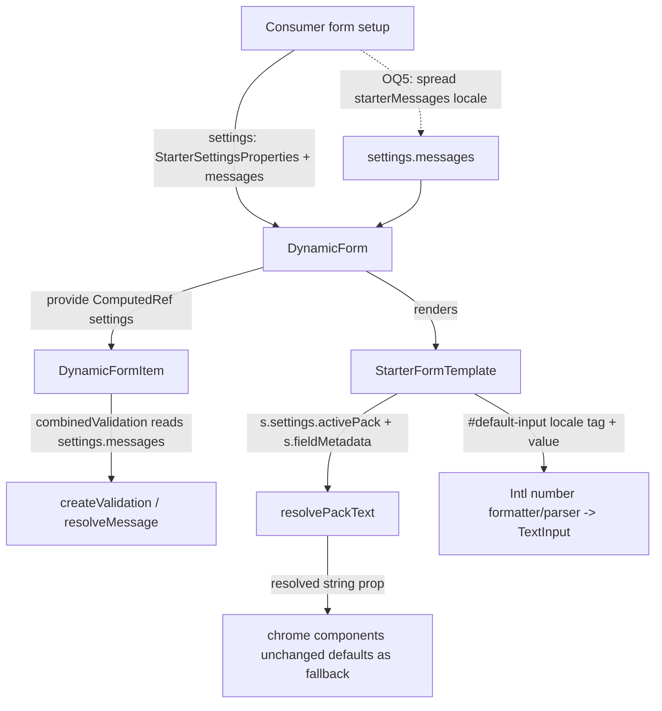

<!-- epic: optional. Set to the parent EPIC-XXX id when this feature belongs to an
     epic; leave "" for a standalone feature. Features are never nested under the
     epic folder, they only reference it here (flat model). -->


# Feature: Internationalization for the starter template

## Decided without Jeroen (research)

Settled from research during the pre-approval chain, not reviewed by Jeroen. Override any of these freely.

- AR-1 → message dictionaries keyed by the 18 unprefixed `DynamicFormSettings.messages` keys, not the `xsd_*`/`vdf_*` rule names
- AR-4 → Problem section corrected to the real nested field-property shape (`array.*`, `choicePicker.*`, `wizardTexts.*`, `password.*`, `wizardSummary.*`)
- AR-6 → `password.strengthLabels` resolves per tier (`{ ...pack, ...explicit }`), not whole-object
- AR-7 (nit) → "seventeen" message strings corrected to 18
- Constraints → the `packages/starter` "`private: true`" claim corrected: the tree has no `private` field (version `0.0.0`, `publishConfig.access: "public"`)

## Problem & goal

**Problem.** `@bach.software/vue-dynamic-form-starter` renders every piece of chrome it owns (wizard navigation, array add/remove, choice add/remove, the optional/required tag, the password show/hide toggle, the review and submission-success screens) with a hardcoded English default. Confirmed by reading the source:

- Every one of these strings is already individually overridable, but only one field (or one component instance) at a time: `StarterFieldProperties` (`packages/starter/src/metadata.ts`) carries them nested by feature group: `array.*` (`addButtonText`, `addFirstButtonText`, `noItemsTitle`, `newItemTitle`, `removeButtonText`, `removeAriaLabel`), `choicePicker.*` (`addButtonText`, `limitReachedText`, `ariaLabel`), `wizardTexts.*` (`submitButtonText`, `nextButtonText`, `prevButtonText`, `stepText`, `stepperAriaLabel`, `stepAriaLabel`, `stepErrorsText`), `password.*` (`strengthLabels`, `showAriaLabel`, `hideAriaLabel`), `wizardSummary.*` (`confirmationTitle`), and more, each read off a single `FieldMetadata` node (`StarterFormTemplate.vue`) and each defaulting to English inside its own component (`FormWizard.vue`, `ArrayField.vue`, `ChoiceField.vue`, `PasswordInput.vue`, `ReviewGroup.vue`, `SubmissionSuccess.vue`). The pack shape and the story slicing must mirror this real nesting.
- `showRequiredOrOptional` and its `optionalText` sit one level up, as `StarterSettingsProperties` on `DynamicFormSettings`, so at least the required/optional tag is already a single form-wide setting (`OptionalRequiredTag.vue` reads it via props threaded down from settings), but every other string above is per-field, which means a consumer targeting a non-English audience has to repeat the same translated string on every field, array, choice, and wizard-page node in their metadata tree, by hand, with no shared source of truth and no way to notice a field they forgot.
- The engine's own validation messages (`xsd_required`, `xsd_minLength`, `xsd_pattern`, `xsd_fractionDigits`, and the rest of the rules in `packages/core/src/core/validation.ts`) are a separate, pre-existing override channel: `DynamicFormSettings.messages`, typed `ValidationMessage` (`string | ((ctx) => string)`), resolved `settings.messages → vee-validate generateMessage → rule default`. Today a consumer who wants Dutch error text has to write out every one of the eighteen message strings themselves (17 `xsd_*` rules plus `maxOccursTotal`, keyed by the unprefixed names in `DynamicFormSettings.messages`); there is no shipped translation and nothing that reuses this channel as a destination for a pack.
- Numbers and dates typed into or displayed by restricted fields (`xsd_fractionDigits`, `xsd_totalDigits`) go through plain native `<input>` elements (`TextInput.vue`) with no locale-aware formatting at all: no grouping separator, no decimal-comma handling, nothing built on `Intl`. A Dutch user typing "1.234,56" into a number-like field gets whatever the browser's native `type="number"`/`type="text"` behavior happens to do, not a formatting choice the library makes.

A consumer shipping a form to a non-English audience today either accepts English chrome, or re-translates every string on every field by hand with no shared pack, no single switch, and no translated validation messages to go with it.

**Goal.** Give the starter template a language-pack mechanism: one setting selects the active pack and supplies a default for every chrome string above across the whole form at once, while every existing per-field/per-instance override keeps winning exactly as it does today (the same precedence philosophy `extendMetadata` already uses: the more specific declaration wins on a collision). Ship at least an English pack (the current hardcoded defaults, made inspectable and swappable rather than scattered across component `withDefaults` blocks) and a Dutch pack. Extend translated coverage to the engine's validation messages through the existing `settings.messages`/`ValidationMessage` channel, not a new parallel message system. Add locale-aware number and date formatting, preferably via native `Intl`, for fields where `fractionDigits`/`totalDigits` make the separator and grouping convention visible to the user.

**Who this is for.**
- **Library consumers** building a form for a non-English-speaking audience (or one that must support several languages), who want to flip one setting instead of translating dozens of per-field strings by hand.
- **Template authors** who want a well-defined extension point for adding a language this feature does not ship, following the same shape the two shipped packs use.
- **Existing consumers** of the starter package who have already set individual chrome-string props or field properties: this feature must not change what they see today, since their explicit values already win and must keep winning.

## Scope

### In scope

- A language-pack mechanism that supplies a default value for every one of the starter package's current hardcoded-English chrome strings (the full list in the Problem section above, spanning `FormWizard.vue`, `ArrayField.vue`/`ArraySectionCard.vue`, `ChoiceField.vue`/`ChoiceSectionCard.vue`/`ChoiceArraySectionCard.vue`, `PasswordInput.vue`/`PasswordStrengthBar.vue`, `ReviewGroup.vue`, `SubmissionSuccess.vue`, `OptionalRequiredTag.vue`), activated by one setting rather than per-field repetition.
- A defined, documented precedence: an explicit per-field property (e.g. a field's own `nextButtonText`) or an explicit settings-level property (e.g. `optionalText`) keeps winning over the active pack's value, which in turn wins over the package's own built-in fallback. No consumer who has already set any of these strings sees a different value after this feature ships.
- At least two shipped packs: English (extracted from today's hardcoded defaults, so the built-in fallback and the English pack agree) and Dutch (new translations for the same string set).
- A documented extension point for a consumer-authored pack covering a language this feature does not ship, using the same shape the two shipped packs use.
- Translated validation messages for every `xsd_*` rule and `vdf_maxOccursTotal` (the full rule set in `packages/core/src/core/validation.ts`), delivered through the engine's existing `DynamicFormSettings.messages`/`ValidationMessage` channel rather than a parallel message system, with an English and a Dutch set shipped alongside the chrome-string packs.
- Locale-aware number and date formatting (decimal separator, digit grouping) for display and input on fields where `fractionDigits`/`totalDigits` restrictions make the convention visible, preferably implemented with native `Intl` rather than a bundled formatting library.
  - **PROPOSED (adversarial review, finding 3):** scope **date** formatting out of this feature, or make it an explicit, separately-sized addition. The starter has no date field type (`StarterValueTypes` is `wizardSummaryPage | heading | grid | text | select | checkbox | password`) and no `Intl.DateTimeFormat` usage; "date-shaped fields where the locale is known" currently have no home. Number formatting over the existing `text` input is the real deliverable here; a date field type + input is a larger piece of work that should not ride in silently under "number and date formatting".
- Documentation (README and/or a docs guide page) and at least one example/story showing how to select a pack, how precedence works, and how to author a custom pack.
- Updating `specs/components.md` for the new public surface this feature adds to `packages/starter`.

### Out of scope (explicit)

- No changes to `packages/core`'s engine beyond what is strictly needed to deliver translated messages through the already-existing `settings.messages` channel; this feature does not add a new engine-level i18n system, and does not touch the `xsd_*` validation rule logic itself (only the message text associated with a rule's failure).
- No translation of the VitePress docs site's own prose, navigation, or non-form content. Only the starter package's chrome strings and the shipped example(s)/story demonstrating this feature are in scope.
- No translation of consumer-authored content: a consumer's own field labels, descriptions, help text, option lists, and any other value they put directly into their metadata stay exactly as they write them. This feature only supplies defaults for strings the starter package itself currently hardcodes.
- No automatic locale detection from the browser or the user's system; the active pack is selected explicitly by the consumer through the mechanism this feature defines (automatic detection, if wanted later, layers on top and is not required for this feature to be useful).
- No general-purpose ICU message format, pluralization engine, or gender/number agreement system. Packs only need to support the same placeholder substitution style the engine's `ValidationMessage` and the starter's existing per-string placeholders (e.g. `{current}`/`{total}`, `{option}`, `{number}`) already use.
- No machine-translation pipeline or translation-management tooling; the shipped packs are hand-written and reviewed like any other source file.

## Functional overview

- A consumer who wants Dutch chrome sets one setting (exact shape is an open question below, e.g. a `locale`/`languagePack` value passed to `StarterFormTemplate` or `DynamicFormSettings`) and every built-in string across the whole form (wizard buttons and progress text, array add/remove labels, choice add/limit text, the password toggle's aria labels, the optional tag, the review screen's edit button, the submission-success screen's labels) renders in Dutch, with no change to their metadata tree.
- A consumer who has already set a field's own `nextButtonText`, or the form-wide `optionalText` setting, keeps seeing exactly that string regardless of which pack is active; the pack only fills in strings nobody has already specified. This is a purely additive change: a consumer who sets nothing new today sees no behavior change at all, English stays the default.
- A consumer who wants to add a language this feature does not ship authors their own pack following the same shape as the English and Dutch packs and activates it the same way a shipped pack is activated.
- The same consumer's validation errors (required, length, pattern, numeric range, digit restrictions, and the rest of the `xsd_*`/`vdf_*` rules) also render in the active pack's language, through the exact `settings.messages` mechanism a consumer already uses today to override one message string; the pack supplies a full translated default set for that same channel instead of requiring the consumer to write every message themselves. A consumer's own `settings.messages` entry for a specific rule keeps winning over the pack's entry for that rule.
- A numeric or decimal-restricted field (an `xsd_fractionDigits`/`xsd_totalDigits`-governed text field) displays and accepts numbers using the active locale's decimal separator and grouping convention (comma-grouped, period-decimal for English; period-grouped, comma-decimal for Dutch), rather than always behaving like a plain English-formatted string. The same applies to date-shaped fields where the library already knows the locale.
- Switching packs is demonstrated in at least one docs example or Storybook story, so a reader can see the mechanism working end to end rather than only reading about it.

## Design (feature level)

Prototype: [`prototype.html`](./prototype.html) (open in a browser; top-right has a light/dark toggle and a "Highlight pack text" toggle).

This feature ships no new chrome: visually it is the existing starter template (`packages/starter/src/style.scss`, the `--sft-*` tokens, and the components that own the strings). The design work is therefore not new layout but a clear way to **see** three otherwise-invisible things: which strings a pack owns, how precedence resolves a collision, and how a locale changes a number. The prototype is a faithful flattened port of the shipped stylesheet so it matches the real look in both modes; no new `sft-` class or component is introduced or needed.

### The one design device: "Highlight pack text"

The single deliberate addition is a harness-level toggle that outlines every string the active pack supplies. This is not decoration: it encodes the exact information this feature is about, and it is the through-line of the whole prototype. Three visual tiers map one-to-one to the precedence model in Constraints:

- **Indigo dashed outline** = string resolved from the active pack (the pack's default).
- **Amber solid outline** = an explicit per-field or settings value that wins over the pack.
- **No outline** = consumer content (field labels, descriptions, option names, values). A pack never touches these, so they must read as visibly "not ours".

A legend at the top states this mapping. With the toggle off, every section is just the normal shipped form; with it on, pack coverage and precedence become literally visible. This is the states policy for the feature: the same form, the same chrome, only the resolved source of each string differs.

### What the prototype covers (anchors for story deep-links)

- `#pack-english` - full chrome in the English pack (the current hardcoded defaults, now inspectable): wizard head + stepper mid-flow, a section of fields (required `*` tag, pack `Optional` tag), a password field with strength label and the show/hide toggle (its aria-label is annotated, not visible), a filled repeatable array with a `Remove` button and an `Add another` button, and a repeatable-choice add bar including a disabled branch showing the `limit reached` helper text, then the wizard footer (`Back` / `Continue`, `Step 2 of 4` progress).
- `#pack-dutch` - the identical metadata tree with one setting changed, rendered in Dutch. It deliberately shows the **complementary** chrome states so the two packs together cover the full string set: the array **empty state** (`noItemsTitle` + first-add button), the **review** card (`Edit` button, `Ready to submit?` confirmation), the last-step **submit** button + the **step-errors** alert banner, and (`#pack-dutch-success`) the **submission-success** screen (reference label, timeline title, view-JSON and reset buttons). Consumer content stays identical to the English form on purpose, so the only thing that changes is the outlined chrome; the prototype annotates that a real Dutch consumer would localize their own labels separately.
- `#precedence` - Dutch pack active, two sibling repeatable sections side by side. The left reads its add-button text from the pack (indigo); the right declares its own `array.addButtonText` and that value wins (amber). Resolution order is stated in the annotation: explicit value -> active pack -> built-in English fallback.
- `#validation` - the same four fields in both packs, showing the pristine->invalid-with-message->valid progression. Messages flow through the engine's existing `settings.messages` / `ValidationMessage` channel; the prototype shows `required`, `minLength`, `fractionDigits`, and a valid (opt-in `showValidState`) field. The `{field}` placeholder resolves from the consumer's label, the message template from the pack.
- `#number-formatting` - a decimal field (`fractionDigits: 2`) and an integer field rendered under `en-US` (`1,234.56` / `1,500`) and `nl-NL` (`1.234,56` / `1.500`). Same underlying value, swapped grouping and decimal separators.

### States policy (applies feature-wide)

- **Pristine / hover / focus / disabled / invalid / valid** inputs reuse the shipped `sft-input` states unchanged (`:focus` ring, `.is-invalid`, `.is-valid`, `:disabled`); this feature adds none. Pristine and focus appear in sections 1 and 5; invalid-with-message and valid in section 4; disabled appears as the limit-reached add button in section 1.
- **Empty** state: the array empty state (`sft-empty`) is the one empty surface in scope and is shown (Dutch) with its pack-supplied title and first-add button.
- **Loading** state: the only loading affordance in the package is the submission-success timeline's pending spinner (`sft-spin`), shown in `#pack-dutch-success`.
- **Error** state: field-level (`sft-error` message, `.is-invalid` border) in section 4, and form-level (the wizard `sft-wizard-alert` banner + a red `is-error` stepper step) in `#pack-dutch`.
- Every one of these is verified in both light and dark; all colours resolve through `--sft-*` tokens that are redeclared under `html.dark`, so dark mode comes from the toggle with no section-specific styling. No section needs dark-specific work beyond the token redeclaration the stylesheet already ships.

### Mapping to existing components (`specs/components.md`)

Every surface maps to an existing, shipped chrome component; this design asks for **no new component**. The feature's work is a new source of defaults feeding strings these components already accept as props:

- Wizard chrome -> `FormWizard` / `Stepper` (`nextButtonText`, `prevButtonText`, `submitButtonText`, `stepText`, `stepErrorsText`, and the aria labels).
- Repeatable arrays -> `ArrayField` / `ArraySectionCard` / `RepeaterCard` (`array.*` texts, empty-state title, add/remove labels).
- Repeatable choice -> `ChoiceArraySectionCard` (`choicePicker.addButtonText`, `limitReachedText`).
- Password -> `PasswordInput` / `PasswordStrengthBar` (`password.strengthLabels`, show/hide aria labels).
- Optional/required tag -> `OptionalRequiredTag` (`optionalText`, the one already-form-wide setting).
- Review / success -> `ReviewGroup` / `SubmissionSuccess` (edit button, confirmation title, reference label, JSON toggle, reset button, timeline title).
- Validation messages -> the engine's `DynamicFormSettings.messages` / `ValidationMessage` channel (unchanged); the pack is a translated source spread into it.
- Number formatting -> `TextInput` display/input (a locale-aware formatting layer over the native input; no markup change, `sft-input` and the `sft-input-suffix` unit label are untouched).

The only genuinely new public surface is non-visual: the pack objects themselves, the setting that selects the active pack, and (open) a helper to feed the pack's messages into `settings.messages`. Those shapes are architecture questions (Open questions 1, 5, 6, 7) and are intentionally not decided by this prototype; the prototype only fixes the agreed visible behaviour so the architect can choose the API against a settled picture of what the user sees.

## Architecture (feature level)

Three channels, resolved in three different places, held together by one precedence philosophy. This is the single most important fact for the whole feature and the reason the work slices the way it does:

- **Chrome strings** are read today in `StarterFormTemplate.vue` off `s.fieldMetadata.<group>.<key>` and `s.settings.<key>`, then passed as props into internal chrome components whose `withDefaults`/inline literals hold the English fallback. These are resolved **inside the template**, below `DynamicForm`, and the template already has `s.settings` (which carries `StarterSettingsProperties`) and the per-field metadata in hand.
- **Validation messages** are resolved by the **engine**, not the template: `DynamicFormItem.vue` builds `combinedValidation` from `settings.value.messages` (verified at `DynamicFormItem.vue:366/397`, which feed `createValidation(rule, param, messages?.<rule>)` and `resolveMessage`). The template sits *below* the point where messages are consumed, so it physically cannot inject them. A translated message set must therefore live on the `DynamicFormSettings.messages` object the consumer passes into `DynamicForm`/`useDynamicForm` at form-creation time.
- **Number/date formatting** is a display/input transform applied at the `#default-input` wiring (`TextInput`), orthogonal to the two string channels.

This split is a hard constraint discovered by reading the code, not a preference, and it bounds Open questions 5 and 6 (noted below) without resolving them.

### Component / composable plan (against `specs/components.md`)

**Reused unchanged (no visual work, confirmed by the prototype which introduces no new `sft-` class):** every chrome component that owns a string: `FormWizard`/`Stepper`, `ArrayField`/`ArraySectionCard`/`RepeaterCard`, `ChoiceField`/`ChoiceSectionCard`/`ChoiceArraySectionCard`, `PasswordInput`/`PasswordStrengthBar`, `OptionalRequiredTag`, `ReviewGroup`, `SubmissionSuccess`. Their `withDefaults` blocks (e.g. `ArrayField` `addButtonText: 'Add another'`, `FormWizard` `nextButton: 'Continue'`, `OptionalRequiredTag` `optionalText = 'Optional'`) **stay as-is and become the lowest precedence tier** (built-in English fallback). Because the shipped English pack is extracted to equal these exact strings, a consumer who selects no pack or the English pack observes no change: this is what keeps the feature additive.

**Modified (backward compatible):**
- `StarterFormTemplate.vue`: the lines that today pass `:addButtonText="s.fieldMetadata.array?.addButtonText"` (and the ~25 sibling bindings, plus the inline literals `'Ready to submit?'`, `` `New ${itemName}` ``, `` `New ${branchKey}` `` in the `wizardSummaryPage`/`*-array-item` blocks) change to pass a **resolved** value: `explicit ?? pack ?? (fall through to component default)`. No prop signatures change; only the value flowing in. The inline template literals must be routed through the pack too, otherwise they remain untranslatable islands; this is a concrete item, not a detail to leave to a story.
- `metadata.ts`: `StarterSettingsProperties` gains the active-pack selector and (if Open question 7 lands that way) a locale tag. Additive optional fields, surfaced to the template through the existing `s.settings` slot prop with no new plumbing.

**Genuinely new (all non-visual):**
- **Pack objects** (e.g. `enStarterPack`, `nlStarterPack`) and a `StarterLanguagePack` type. Justification: `specs/components.md` has no construct that supplies form-wide chrome defaults; today every default is scattered across component `withDefaults` and template literals. The pack is the single inspectable source the Goal requires.
- **A pure resolver** (`resolvePackText`-style, internal). Justification: precedence (`explicit ?? pack ?? fallback`) must live in exactly one place rather than being re-expressed as `??` chains across 25 template bindings. Keeps the precedence rule testable in isolation and identical for every string.
- **Translated message dictionaries** keyed to the `DynamicFormSettings.messages` shape (one entry per rule in `packages/core/src/core/validation.ts`), plus (per Open question 5) possibly a `starterMessages(locale)` helper returning a ready-to-spread `messages` object. Justification: nothing ships translated `xsd_*`/`vdf_*` text today; the channel exists but is empty.
  - `DECIDED (research)`, from adversarial review finding 1: the dictionary must be keyed by the **unprefixed** `messages` keys (`required`, `minOccurs`, `maxOccurs`, `choiceMinOccurs`, `choiceMaxOccurs`, `maxOccursTotal`, `minLength`, `maxLength`, `length`, `pattern`, `minInclusive`, `maxInclusive`, `minExclusive`, `maxExclusive`, `enumeration`, `whiteSpace`, `fractionDigits`, `totalDigits`), **not** the `xsd_*`/`vdf_*` rule names used in `validation.ts`. These are 18 keys, not "seventeen". A dictionary keyed by rule name would never be read by the engine.
- **A locale-aware number/date formatter + parser** (internal util over native `Intl`). Justification: no formatting layer exists; `TextInput` is a bare native `<input>`.

### Public API impact

This feature touches **only `packages/starter`**. `packages/core` needs **no change**: `DynamicFormSettings.messages`/`ValidationMessage` already expose a key for every rule (verified against `DynamicFormSettings.ts`), so translated messages reuse that surface verbatim. State explicitly: no new core export, prop, slot, `defineMetadata` generic, or validation rule.

New/changed starter surface (all additive):
- `StarterSettingsProperties` (the 4th `defineMetadata` generic, `ExtendedSettingsProperties`) gains an active-pack selector, shape per Open questions 1/6/7. It is optional with a safe default (absent = English = today's behaviour). Flows to templates through the sanctioned `DynamicFormSettings` channel, not a side channel. `extendMetadata`'s `Omit`-merge already propagates any `StarterSettingsProperties` addition to consumer configurations, so no change to `extendMetadata` itself.
- New exports from `packages/starter/src/index.ts`: the pack objects, `StarterLanguagePack` type, and the message dictionaries / `starterMessages` helper. Update `specs/components.md`'s starter row accordingly.
- No change to any chrome component's prop contract (they are internal, unexported); no change to `StarterFieldProperties` (every per-field override already exists and keeps winning).

**Backwards compatibility:** fully additive. A consumer who selects nothing sees English via the unchanged component fallbacks. A consumer who already set any per-field string or `optionalText` keeps that value because explicit still wins. No removed or renamed export, no changed signature, no behaviour an existing consumer relied on changes.

**Changeset bump:** **minor**, scoped to `@bach.software/vue-dynamic-form-starter` only (new backwards-compatible capability). `packages/core/src` is untouched, so **no core changeset**. Note the package is unpublished (version `0.0.0`, no release has run) but not marked private: `package.json` has no `private` field and sets `publishConfig.access: "public"`. Per CLAUDE.md a `packages/starter/src` change warrants a changeset, written as one user-facing entry for the whole i18n capability with sub-bullets (pack selection, translated messages, locale number formatting).

### Documentation impact

Derived from the API impact above. There is **no `docs/reference/*` page for the starter package** (reference pages are core-only); the starter's prose home is the guide/examples. So:
- `docs/guide/starter-template.md`: new section covering selecting a pack, the precedence rule, authoring a custom pack (the documented extension point), and how the locale tag drives number/date formatting.
- `docs/guide/validation.md`: note that the starter ships translated message sets feeding `settings.messages`, and that a consumer's own per-rule override still wins.
- At least one example page or Storybook story demonstrating a live pack switch end to end (Scope requires it); the prototype's five sections are the storyboard.
- `specs/components.md`: update the starter row for the new exports and the new `StarterSettingsProperties` field.
- `packages/starter/README.md`: add pack selection + custom-pack authoring to the consumer docs (it ships in the tarball).

No core reference page needs touching, because core gains no surface. State this reason in the stories so it is not mistaken for an omission.

### Precedence / merge model

Chrome strings (resolved in the template):

```
explicit per-field value (fieldMetadata.<group>.<key>)
  or explicit settings value (e.g. optionalText)
    > active pack's value
      > built-in English fallback (component withDefaults / template literal)
```

`?? ` semantics: a value is "set" when it is not `null`/`undefined`, so a field override of `''` is honoured as explicit (matches today's `??` behaviour and avoids a pack silently reappearing when a consumer deliberately blanks a label). This mirrors `extendMetadata`'s documented "more specific wins" philosophy (Constraints).

Validation messages (resolved in the engine, composed by the consumer):

```
consumer settings.messages[rule]
  > pack's message[rule]
    > vee-validate generateMessage
      > rule default
```

The pack only fills rules the consumer has not set. The *shape* that guarantees this (a spread helper the consumer orders, versus auto-population) is **Open question 5** and is designed-for-both below, not decided here.

**PROPOSED (adversarial review, finding 2):** the "English = no observable change" guarantee that holds for chrome strings does **not** hold for this channel, because there are no shipped English message defaults today (a consumer with no `settings.messages` falls through to vee-validate's generic `result.errors[0]`, verified in `createValidation.ts`). The English *message* set is new, improved text. Make it a hard rule that the English message set is **opt-in only**: neither the "absent pack = English" default nor an explicit English pack selection may auto-populate `settings.messages`, so a consumer who does not spread `starterMessages(...)` sees exactly today's validation text. If OQ5 lands on auto-population (Shape B), it must apply only to non-English packs, or only to rules the consumer has not set, and this asymmetry must be documented.

`DECIDED (research)`, from adversarial review finding 6: the `??` precedence above is correct for flat string values but wrong for `password.strengthLabels`, the one object-valued chrome string (`{ weak, fair, good, strong }`, all tiers optional per `metadata.ts`). Resolve it per tier, `{ ...pack.strengthLabels, ...explicitStrengthLabels }`, so overriding one tier does not blank the pack's other three, and confirm `PasswordStrengthBar` backfills any tier still left undefined from its own English `withDefaults`.
Why: per-tier merge follows directly from the Constraints' own precedence philosophy (a consumer overriding one tier has been explicit about that tier only); whole-object replace has the concrete, nameable defect the reviewer verified.
Sources: `packages/starter/src/metadata.ts` (optional per-tier type), `StarterFormTemplate.vue:532`, the Constraints precedence rule.

### Data flow



- **Active-pack setting location (Open question 6).** Because validation messages are consumed on `DynamicFormSettings` at the engine level (above the template), a *template-prop-only* selector cannot reach the message channel. A `DynamicFormSettings`-level selector (via `StarterSettingsProperties`) reaches both the template chrome and sits beside the `messages` the consumer already supplies. Design for both alternatives; if both a prop and a setting are offered, the prop wins (local > form-wide, consistent with existing precedence), but the message side always keys off the form-level setting. This is architecture input to Open question 6, not a resolution of it.
- **Reactivity / live switch (Open question 3).** Under this design, chrome strings re-resolve for free when the active pack changes, because the template reads `s.settings` reactively and passes resolved values as reactive props (no `withDefaults` is read once-and-frozen for pack values). Messages re-resolve on the next validation pass because `combinedValidation` is a `watchEffect` over `settings.messages`. So a fixed-vs-live-switch decision does **not** force a remount or a reactivity redesign here; this lowers the stakes of Open question 3 and should be reported as such.
- **Loop-guard / render-count:** `resolvePackText` is a pure function of `(explicit, pack, key)`; it introduces no new reactive source beyond `settings` and `fieldMetadata`, both already tracked, so it adds no render passes and cannot feed the `computedProps` loop guard.

### Locale-aware number/date formatting (`Intl`)

- Native `Intl.NumberFormat` / `Intl.DateTimeFormat`, no bundled library. `Intl` is ambient in every supported runtime; no dependency lands on consumers.
- `Intl` formats but does not parse. Parsing a localized string back to the canonical value is done by deriving the locale's group and decimal separators from `Intl.NumberFormat(locale).formatToParts(11111.1)` and stripping/replacing, then handing a **canonical string** to `handleChange`. This preserves the existing contract (the `#default-input` block already passes the raw string, not `valueAsNumber`, to avoid number coercion; see the memory note and `StarterFormTemplate.vue:458`).
- **Hard constraint to carry into stories:** `xsd_fractionDigits`/`xsd_totalDigits` validate the stored value. The formatting layer must convert only at the display/input boundary and keep the stored value in the exact canonical form those rules expect, or a Dutch-formatted entry would fail validation spuriously. The formatter is applied for display; the parser normalizes on input; the model value the rules see is unchanged. This is the main correctness risk of the feature.
  - **PROPOSED (adversarial review, finding 5):** "the parser normalizes on input" is under-specified and, taken literally, is hostile to typing. The `#default-input` block fires `handleChange` on `@input` (`StarterFormTemplate.vue:458/474`), i.e. every keystroke, with the display bound to the raw model value; re-inserting grouping separators on each keystroke makes a controlled input fight the caret. Format for **display on blur only**; while the field is focused show the plain canonical value (no grouping), and parse to canonical on blur. This keeps `fractionDigits`/`totalDigits` validating a clean canonical string and avoids caret jumps. The separator-derivation via `Intl.NumberFormat(locale).formatToParts` must also handle non-ASCII group separators (e.g. U+202F / U+00A0) for consumer-authored packs, even though the two shipped locales (`en-US`, `nl-NL`) use `,`/`.`.
- Which fields format: those whose `fractionDigits`/`totalDigits` restriction makes the convention visible (per Functional overview), plus date-shaped fields where the locale is known. The locale tag source (per-pack default vs separate setting) is **Open question 7**; design the formatter to accept an explicit BCP 47 tag so either wiring feeds it unchanged.

### Designing for the open-question alternatives

- **OQ1 (plain dict vs `vue-i18n`):** the pack is modelled as a plain, JSON-serializable dictionary keyed by the existing string names, carrying the same placeholder tokens (`{current}`/`{total}`, `{option}`, `{number}`, `{itemNamePlural}`, ...). A `vue-i18n` user can source those same keys from their message tree; a dependency-free consumer uses the shipped object directly. The architecture does not require `vue-i18n`; whether a `vue-i18n` adapter also ships is a product call left to OQ1.
- **OQ5 (message merge shape):** both shapes are supported by the same dictionary. Shape A, a `starterMessages(locale)` helper the consumer spreads (`messages: { ...starterMessages('nl-NL'), ...myOverrides }`), keeps merge order explicit and consumer-wins by construction. Shape B, auto-population, would require the starter to own form creation (a wrapper around `useDynamicForm`/`DynamicForm`), a materially larger surface; flagged as the heavier option. The dictionary export is the shared primitive either shape builds on, so slice 2 can land the dictionaries before the shape is fixed.
- **OQ7 (locale tag):** the formatter takes an explicit tag; whether that tag rides on the pack or on a separate setting changes only the one line that reads it.

### ADR notes

- **ADR 1 - Resolve chrome strings in the template, keep component defaults as the English fallback tier.** Context: 25+ strings already flow template -> chrome props with English `withDefaults`. Decision: insert pack resolution in the template, leave `withDefaults` untouched as the lowest tier. Alternative: strip component defaults and require a pack always. Rejected: breaks bare `<DynamicForm :template="StarterFormTemplate">` usage and is not backwards compatible.
- **ADR 2 - Deliver translated messages only through `settings.messages`, composed at form creation.** Context: the engine resolves messages from injected settings, above the template (`DynamicFormItem.vue:366/397`). Decision: ship translated dictionaries that land on `settings.messages`; do not add a parallel message system. Alternative: have the template inject messages. Rejected: physically impossible, the template is below the consumption point, and it would duplicate the engine's resolver.
- **ADR 3 - Native `Intl`, no formatting library.** Context: this is a published (if currently private) library; every dependency lands on consumers. Decision: `Intl.NumberFormat`/`DateTimeFormat` for formatting, `formatToParts` to derive separators for parsing. Alternative: `numeral`/`vue-i18n` number formatting. Rejected: added bundle weight and a dependency for something the platform already does; parsing is a small, testable util.
- **ADR 4 - Active-pack selector keyed off `DynamicFormSettings` (via `StarterSettingsProperties`).** Context: the message channel only exists at the form-settings level. Decision: make the form-wide setting the authoritative source so chrome and messages share one switch; a template prop, if added, is a convenience that wins for chrome only. Alternative: template-prop-only. Rejected: cannot reach the message channel, splitting the single-switch promise. (Final shape deferred to OQ6.)
- **ADR 5 - Plain serializable dictionary as the pack primitive.** Context: OQ1 is an open product call. Decision: build on a plain dictionary that any i18n approach can feed, so the shipped mechanism and a future `vue-i18n` adapter share one data shape. Alternative: couple the pack to `vue-i18n` now. Rejected (for the primitive): would exclude non-`vue-i18n` consumers and add a dependency before the product decision is made.

### Natural slicing seams (input for the scrum-master)

1. **Chrome-string packs + resolver + active-pack setting** (template-local, English + Dutch). Independently deliverable; depends on OQ1/OQ6 landing the pack shape and selector location.
2. **Translated validation-message dictionaries + `settings.messages` composition** (engine-side channel, consumer-composed). Shares the pack-shape decision with slice 1 but is otherwise independent; depends on OQ5 for the final helper shape (the dictionaries themselves can land first).
3. **Locale-aware number/date formatting** over `Intl`. Independent of 1/2; depends only on OQ7 for where the locale tag is read.
4. **Docs + example/story + `specs/components.md` + README.** Slices separately per CLAUDE.md; depends on 1-3 being present to document.

Slices 1-3 are all additive and non-overlapping in the files they touch (1 and 3 both edit `StarterFormTemplate.vue` but in different blocks: string bindings vs the `#default-input` wiring), so they can proceed in parallel once the shared pack/locale shapes are fixed by the open questions.

### Open risks for Jeroen

- The feature cannot be built end to end until Open questions 1, 5, 6, 7 are answered: they fix the pack shape, the message-merge API, the selector location, and the locale-tag home. The architecture is designed so each answer changes a small, localized surface, but the public exports (slice 1/2) cannot be finalized before OQ1/OQ5.
- Number parsing correctness (ADR 3 / the `fractionDigits` constraint) is the one place a bug would be user-visible as a spurious validation failure; it needs dedicated tests across both locales.
- OQ2 (RTL) and OQ3 (live switching) remain Jeroen's calls, but this architecture shows OQ3 is low-cost under the chosen design; RTL (OQ2), if ever in scope, is genuinely out-of-band CSS work this spec does not cover.

## Adversarial review

Produced by the adversarial-reviewer (feature level, full mode). Findings verified against the installed source, not only reasoned about.

1. **(should-fix) The validation-message dictionary is keyed by the unprefixed `messages` keys, not the `xsd_*`/`vdf_*` rule names, and the architecture conflates the two.** The architecture says the dictionaries are "keyed to the `DynamicFormSettings.messages` shape (one entry per rule in `packages/core/src/core/validation.ts`)". Those two keyings are different: `validation.ts` registers `xsd_required` / `vdf_maxOccursTotal`, but `DynamicFormSettings.messages` (verified in `packages/core/src/types/DynamicFormSettings.ts`) uses the stripped keys `required`, `minOccurs`, `maxOccurs`, `choiceMinOccurs`, `choiceMaxOccurs`, `maxOccursTotal`, `minLength`, `maxLength`, `length`, `pattern`, `minInclusive`, `maxInclusive`, `minExclusive`, `maxExclusive`, `enumeration`, `whiteSpace`, `fractionDigits`, `totalDigits`. A pack keyed by the rule names (`xsd_required`, `vdf_maxOccursTotal`) would silently never be picked up by the engine. Resolution routed into the Architecture section. `DECIDED (research)`: accepted; purely factual, verified against `DynamicFormSettings.ts`, and the alternative is a silent no-op bug.

2. **(should-fix) The "English pack = no observable change" promise holds for chrome strings but not for the validation-message channel, and OQ5's two shapes differ sharply here.** Verified in `createValidation.ts`: today, with no `settings.messages` and no `configure({ generateMessage })`, a field falls through to `result.errors[0]`, i.e. vee-validate's generic fallback text. The shipped English *message* pack is therefore genuinely new text, not an extraction of a current default (unlike the chrome packs, where the English pack equals the component `withDefaults`). Under OQ5 Shape B (activating a pack auto-populates `settings.messages`) combined with ADR 4 (the form-level pack selector, with "absent = English = today's behaviour"), a consumer who explicitly selects the English pack, or who is defaulted into it, would see their validation text change from vee-validate's generic string to the starter's English set. That contradicts the Functional-overview promise that "a consumer who sets nothing new today sees no behavior change at all." The feature needs an explicit rule that the English message set is opt-in and never replaces a message a consumer has not opted into. Resolution routed into the Precedence/merge model.

3. **(should-fix) Locale-aware *date* formatting is specified for a field type the starter does not have.** `StarterValueTypes` (`packages/starter/src/metadata.ts`) is `wizardSummaryPage | heading | grid | text | select | checkbox | password`: there is no date type, and the starter source contains no `Intl.DateTimeFormat` usage. Scope, Functional overview, and Architecture all repeatedly promise date formatting "where the locale is known", and the prototype's section 5 shows numbers only, no dates. Either drop date formatting from this feature, or state explicitly that it requires first adding a date field type and input (a materially larger scope than number formatting over the existing `text` input). Resolution routed into Scope.

4. **(should-fix, accuracy) The Problem section enumerates flat field-property names that no longer exist.** It lists `arrayAddButtonText`, `arrayAddFirstButtonText`, `arrayNoItemsTitle`, `arrayNewItemTitle`, `arrayRemoveButtonText`, `arrayRemoveAriaLabel`, `choiceAddButtonText`, `choiceLimitReachedText`, `choiceAriaLabel`, `nextButtonText`, `prevButtonText`, `stepText`, etc. as flat keys. The actual shape (`packages/starter/src/metadata.ts`, after commit d1c667f grouped them) is nested: `array.addButtonText`, `array.addFirstButtonText`, `array.noItemsTitle`, `array.newItemTitle`, `array.removeButtonText`, `array.removeAriaLabel`, `choicePicker.addButtonText`, `choicePicker.limitReachedText`, `choicePicker.ariaLabel`, `wizardTexts.nextButtonText`, `wizardTexts.prevButtonText`, `wizardTexts.stepText`, `password.strengthLabels`, `wizardSummary.confirmationTitle`, etc. The architecture uses the correct nested paths (`s.fieldMetadata.array?.addButtonText`), so this is a Problem-section accuracy defect, but it is the canonical "string set the pack must cover", so the pack shape and the scrum-master's slicing must mirror the real nesting. Note routed into Problem. `DECIDED (research)`: accepted; the Problem section now lists the real nested shape, verified against `metadata.ts` after commit d1c667f.

5. **(should-fix) Live number input with grouping separators is undefined, and the current wiring makes the naive implementation hostile to typing.** The `#default-input` block passes `handleChange` on `@input` (verified `StarterFormTemplate.vue:458/474`), i.e. on every keystroke, with the display bound to the raw model value. If the formatter inserts group separators and the parser reformats on each keystroke, a controlled input fights the caret (jumps, lost cursor) while the user types a grouped decimal. The spec and prototype only show static formatted values; neither states format-on-blur vs format-on-input, nor caret handling. Because `xsd_fractionDigits`/`xsd_totalDigits` validate the canonical stored value, the parse boundary must be exact and well-defined. Proposed: format for display on blur only, show the plain canonical value while the field is focused/being edited, parse on blur. Routed into the number-formatting architecture and added as an open question.

6. **(should-fix) Per-key precedence is undefined for the one object-valued chrome string, `password.strengthLabels`.** It is an object `{ weak, fair, good, strong }` passed whole (`:labels="s.fieldMetadata.password?.strengthLabels"`, `StarterFormTemplate.vue:532`). A resolver of the form `explicit ?? pack` at the object level drops the pack's other three tier labels the moment a consumer overrides a single tier (e.g. only `good`). The precedence model as written (`??` over a value) is correct for the flat strings but wrong for this one nested object: it needs per-tier merge (`{ ...pack.strengthLabels, ...explicit.strengthLabels }`), and the verification must confirm `PasswordStrengthBar` still backfills any tier left undefined. Routed into the Precedence/merge model. `DECIDED (research)`: accepted; per-tier merge follows from the spec's own precedence constraint and the per-tier-optional type in `metadata.ts`.

7. **(nit) "seventeen `xsd_*`/`vdf_*` message strings" undercounts by one.** There are 18 message keys (17 `xsd_*` rules plus `maxOccursTotal`), per `DynamicFormSettings.messages`. The Scope line "every `xsd_*` rule and `vdf_maxOccursTotal`" is correct; only the "seventeen" count in the Problem section is wrong. Fixing it matters because an off-by-one here is exactly how a pack ships 17 messages and silently misses one rule. `DECIDED (research)`: fixed in the Problem section (eighteen).

8. **(nit) The prototype translates consumer content in the Dutch section, contradicting the Design section's claim.** Design (around the `#pack-dutch` description) states "Consumer content stays identical to the English form on purpose, so the only thing that changes is the outlined chrome." But the prototype's Dutch review card uses Dutch consumer labels (`Deelnemers`, `Hoofddeelnemer`, `BTW-nummer`) and a Dutch `confirmation` body, none outlined. The "Highlight pack text" device exists precisely to teach that packs never touch consumer content; translating that content (un-outlined) in the same prototype muddies the lesson. The annotation half-acknowledges it ("a real Dutch consumer would localize their own labels"), which directly contradicts the "stays identical" sentence. Keep the two pack sections' consumer content identical, or drop the "stays identical" claim. Low impact (prototype teaching aid), but the two statements cannot both stand.

Status note: this feature carries seven unresolved Open questions, so it lands in `awaiting-discussion` regardless of the findings above. No blocker was found; the should-fixes are routed as PROPOSED edits (findings 1, 2, 3, 4, 5, 6) and finding 5 additionally seeds a new open question.

## Constraints & assumptions

- The precedence model must match the philosophy already documented for `extendMetadata` in `packages/starter/README.md`: a more specific, explicitly-set value always wins over a less specific default; the pack is a source of defaults, never a forced override.
- The English pack's values must match today's hardcoded defaults exactly, so adopting this feature with no pack selected (or the English pack selected) changes nothing a consumer can observe.
- The validation-message translations must flow through `DynamicFormSettings.messages`/`ValidationMessage` (`packages/core/src/types/DynamicFormSettings.ts`, `packages/core/src/types/ValidationMessage.ts`), per the resolution order already documented in `CLAUDE.md` (`settings.messages → vee-validate generateMessage → rule default`); this feature adds a translated source that can feed that channel, it does not add a competing one.
- Every placeholder already used by an existing string (e.g. `{current}`/`{total}` in `stepText`, `{option}` in `choiceAddButtonText`/`choiceLimitReachedText`, `{number}` in `arrayRemoveAriaLabel`, the positional/named placeholders `ValidationMessage` already supports) must keep working identically when its value comes from a pack instead of a hardcoded default or a per-field override.
- `packages/starter` is unpublished (version `0.0.0`, no release has run) but not marked private: `package.json` has no `private` field and sets `publishConfig.access: "public"`, and `.changeset/config.json` does not ignore it. This feature ships inside that package and follows whatever publication state `packages/starter` is in when this feature ships. (`DECIDED (research)`: corrects the earlier "`private: true` per FEAT-007" claim, which does not match the tree; verified in `packages/starter/package.json`.)

## Open questions

Questions for Jeroen. Must be resolved before approval.

1. **Pack format: a plain, dependency-free message dictionary, or an integration with `vue-i18n`?** A plain object/dictionary setting keeps the package dependency-free and gives every consumer freedom to plug it into whatever i18n solution (or none) they already use in their app, but means consumers already using `vue-i18n` get a second, unrelated translation mechanism sitting next to it. A `vue-i18n` integration could feel more natural to that large slice of the Vue ecosystem but adds a dependency (or at least a peer) and locks out consumers who do not use `vue-i18n`. Need a decision on which one this feature builds, or whether it builds the dependency-free dictionary now and leaves a `vue-i18n` adapter as an explicit future extension.
2. **Is RTL layout in scope?** The two shipped packs (English, Dutch) are both left-to-right, so nothing in the shipped packs requires RTL support, but "internationalization" sometimes implies it. If an RTL language is wanted (now or as a known-future pack), the CSS/layout work is materially different from the string-substitution work this spec otherwise describes, and would change the architecture's scope substantially.
3. **Is runtime language switching without remounting the form (and without losing in-progress data) a hard requirement for this feature, or is "set the pack once, typically at app/form setup" sufficient for v1?** Supporting a live switch while a user has partially filled in a form is a materially larger architecture problem (every chrome string must be reactive to the active pack, not read once) than supporting only a fixed pack chosen before the form mounts.
4. **Which packs ship at launch beyond English and Dutch?** The prompt that originated this feature named English and Dutch as the minimum; confirm whether any other language ships in the same release or whether English and Dutch alone satisfy this feature's "done," with other languages left as consumer-authored packs following the documented extension point.
5. **How does a pack's validation-message set compose with a consumer's own `settings.messages`?** `DynamicFormSettings.messages` is passed by the consumer into `useDynamicForm`/`DynamicForm` today. This feature needs the active pack's translated messages to land there too, which raises a concrete merge question: does the starter package expose a helper that returns a ready-to-spread `messages` object for the active pack (which the consumer merges with their own overrides in whatever order they choose), or does activating a pack automatically populate `settings.messages` for every rule the consumer has not already set? The two have different public-API shapes and different risk of silently overriding a consumer's own message if the merge order is wrong.
6. **Where does the "active pack" setting live?** A `DynamicFormSettings`-level extended property (alongside `showRequiredOrOptional`/`optionalText`, consistent with the one existing form-wide string setting), a prop on `StarterFormTemplate` itself, or both (with the usual precedence) are all plausible; this affects whether selecting a pack also needs to reach the engine's own `messages` channel (which lives on `DynamicFormSettings`, not on the template component) cleanly, which is related to question 5.
7. **Does locale-aware number/date formatting also need a documented default locale, or is it always explicitly chosen together with the pack?** `Intl` needs a BCP 47 locale tag (e.g. `'en-US'`, `'nl-NL'`), which is a finer-grained concept than "the English pack" or "the Dutch pack"; confirm whether each pack carries its own default locale tag (used unless the consumer overrides it) or whether locale is always a separate, explicit setting from the chrome-string pack.
8. **(raised by adversarial review, finding 5) When does the locale number formatter convert, and does it reformat while the user is typing?** The existing input fires `handleChange` on every `@input`. Confirm the formatter formats for display on **blur** only (showing the plain canonical value while editing), rather than re-inserting grouping separators on each keystroke, which would fight the caret and risk spurious `fractionDigits`/`totalDigits` failures mid-edit. The adversarial review proposes format-on-blur as the safe default; this needs Jeroen's confirmation since it is a visible interaction choice.

## Stories

Not yet produced. Filled by the scrum-master after this feature is approved.
