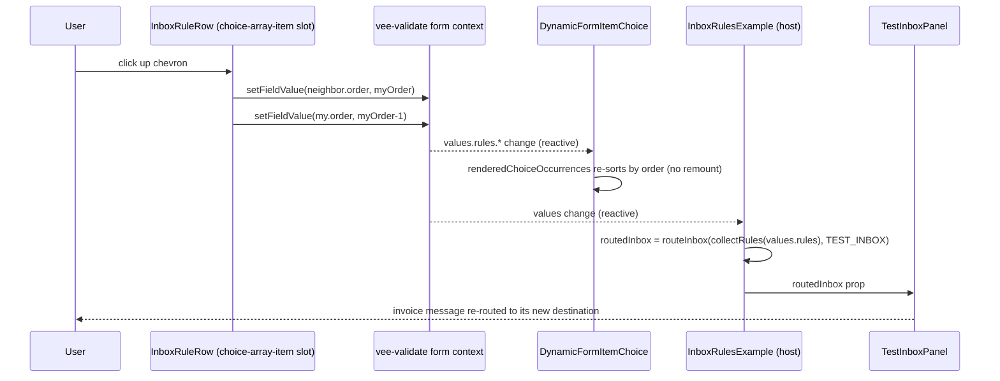

<!-- epic: optional. Set to the parent EPIC-XXX id when this feature belongs to an
     epic; leave "" for a standalone feature. Features are never nested under the
     epic folder, they only reference it here (flat model). -->

# Feature: Docs example: an inbox rules builder (repeatable ordered choice, center stage)

## Decided without Jeroen (research)

Settled from research during discussion prep, not reviewed by Jeroen. Override any of these freely.

- AR-1 → per-occurrence action reveal specified (ctx-based validation closures + per-occurrence-path transition tracker), adopted into data flow
- AR-4 → seam 4's sidebar corrected to the verified live list
- AR-5 → `_active` marker removed from the prototype JSON (matches ADR-2)
- AR-6 → prototype `computedProps` sketch aligned with the real engine signature
- AR-8 → `heading` dropped from the template generics; `rules` choice gets `minOccurs: 0`

## Problem & goal

Docs readers evaluating `@bach.software/vue-dynamic-form` (developers comparing schema-driven form libraries, and template authors learning the library's own advanced patterns) can currently find the repeatable ordered choice shape (`maxOccurs > 1` combined with `choice`, plus the `displayOrder`/`preserveOrder`/`explicitChoiceSelection` metadata FEAT-002 added) in two places, but never as the thing a page is actually about:

- `/examples/choices` ("A Repeatable Choice") demonstrates the mechanics generically, with CRM exports and API endpoints that have no visible consequence beyond their own fields.
- `/examples/checkout`'s split-payment section (FEAT-001) demonstrates the shape with a genuine cross-row consequence (a running remainder that redistributes on reorder), but it is opt-in behind a checkbox, sits at the bottom of the longest branch in the whole checkout, and its branches (gift card, voucher, card, PayPal) are inert demo fields whose only visible effect is a number.

Nobody landing on either page comes away thinking "order is the whole point." This feature adds a dedicated docs example, an inbox rules builder, where the repeatable ordered choice IS the form: every row is a rule (a choice of condition types with genuinely different fields per branch), the list is reorderable, and a live side panel routes a small, fixed test inbox through the rules in their current order, visibly re-routing messages the instant a rule moves. It leans on a mental model the audience already has (Gmail filters, firewall ACLs, routing tables: "first match wins"), the same way the checkout example leaned on Baymard/Shopify benchmarks to make its stakes concrete.

Success looks like: a published, linked docs page whose entire premise, structure, and payoff is "order matters, and here is exactly what reordering does," built as much as possible on the engine's existing primitives (metadata, choice, `computedProps`, validation, settings) rather than bespoke Vue code around it, with a working reorder-and-reroute interaction and a cross-row "rules below this one are unreachable" check that falls out of the same technique the checkout's hidden coverage field already uses.

## Scope

### In scope

- One new VitePress docs page under `docs/examples/` (working slug `/examples/inbox-rules`, final slug/title per Open question 4), reachable from the `/examples/` sidebar and from `docs/examples/index.md`'s "Available Demos" list.
- Narrative copy establishing the "order matters, first match wins" framing before the live form, drawing on a mental model the developer audience already has (Gmail filters, firewall ACLs, routing tables), and a short reveal that the whole thing is one metadata tree plus one template, matching the pattern the other advanced examples already use.
- One live, interactive metadata tree: a top-level repeatable ordered choice representing the ordered rule list (`maxOccurs > 1`, `choice`, `explicitChoiceSelection: true`, `displayOrder: 'added'`, `preserveOrder: true` per the Open question 1 decision and ADR-1). Each occurrence is one rule, a branch of condition type:
  - **From sender**: an email leaf (`xsd_pattern`).
  - **Subject contains**: a text leaf.
  - **Larger than**: a number leaf plus a unit select (e.g. KB / MB).
  - **Has attachment**: a branch with no filter field of its own, the same "childless branch" shape the checkout uses for express/home-delivery/PayPal (see Open question 1 for why this specific branch is load-bearing for scope).
  Each rule also carries an action (move to folder, label, forward, delete). The exact field composition for the action (a nested second-level choice vs. a single action `select` with conditionally revealed fields, mirroring the business/VAT toggle's `computedProps` pattern) is a design/architecture decision, not fixed here.
- A reorder control per rule (up/down buttons writing the two affected occurrences' persisted or in-memory order position, mirroring `SplitPaymentLedgerRow`'s technique exactly). Drag-and-drop is explicitly out of scope (see below), so this is the only reordering affordance.
- A live side panel: a small, fixed test inbox of about 6 sample emails (fictional demo content, authored for this page). For the rules' current order, each sample email is annotated with which rule caught it (by its displayed position) and where it landed (the matching rule's action), or "no rule matched, stays in inbox" if none applies. Reordering, adding, or removing a rule recomputes every email's routing live. Implemented as a small, pure, synchronous TypeScript module (mirroring `splitPaymentLedgerMath.ts`) consumed by a template-level computed that reads the form's values through vee-validate's own context, not through `computedProps` or any new engine capability.
- A cross-row check surfacing rules that can never fire because an earlier rule in the list already catches everything they would catch ("rules below a catch-all rule are unreachable"), using the same technique the checkout's hidden `splitPaymentCoverage` field uses (a `validation` closure plus a `computedProps` re-trigger). The exact definition of "catches everything" / "unreachable", and whether it blocks submit or only warns, are Open questions 1 and 2.
- A metadata-tree walkthrough below the live form, in the same style as the other advanced docs pages (VitePress `<<<` region excerpts, "What It Demonstrates", "How It Works", "Related Source").
- A short cross-link from this new page to `/examples/choices` (the generic mechanics this page specializes) and to `/examples/checkout`'s split-payment section (the other existing demonstration of the shape), explaining why this page exists as the dedicated showcase. This is a one-directional link added only to this new page; it does not reopen or modify the `done` FEAT-002 or `in-progress` FEAT-001 artifacts.
- Updates to `docs/examples/index.md` and `docs/.vitepress/config.ts`'s `/examples/` sidebar so the new page is discoverable.
- No Storybook story, matching the precedent already decided for this kind of example (FEAT-002's Q7: the docs example is the demonstration surface).

### Out of scope (explicit)

- Any change to `packages/core/src/`. The feature is expected to be buildable entirely on the engine's existing public surface, most of it shipped by FEAT-002 (`explicitChoiceSelection`, `maxOccurs > 1`, `displayOrder`, `preserveOrder`, `globalIndex`, `insertionOrder`, and reordering via `useFormContext().setFieldValue`, exactly as the checkout's split-payment ledger already does). If architecture work surfaces a genuine engine gap, that is a feature-level finding to raise back into this spec, not something a story works around silently.
- Drag-and-drop libraries or interactions. Reordering is up/down buttons only, mirroring the checkout's split-payment ledger.
- Persisting rules anywhere outside the form's own in-memory/submitted values: no backend, no `localStorage`, no save/load of rule sets.
- Real email anything: no mail server, API, IMAP/SMTP integration, or real message content. The test inbox is fixed, fictional demo data, computed client-side.
- Compound or boolean rule conditions (AND/OR combinations across condition types, "if sender is X and subject contains Y"). Each rule has exactly one condition, matching the four types listed above.
- Visually mimicking any specific email client (Gmail, Outlook, etc.). The example's own neutral template styling is used, the same posture the checkout example takes toward Shopify's branding; the mental model it borrows (filters, ACLs, routing tables) is conceptual, not visual.
- Internationalization of any field.
- Any change to the existing `/examples/choices` or `/examples/checkout` pages or their components, beyond the one-directional cross-link described above.

## Functional overview

**Page structure.** One docs page: narrative intro establishing "first match wins" and why order is causally decisive (not cosmetic, unlike the checkout's UI-only reordering warning), the live form with its side panel, then the metadata walkthrough below, matching the structure of `/examples/checkout` and `/examples/advanced`.

**The rule list.** The live form is a single repeatable ordered choice. An "Add rule" control per condition type adds a new rule at the end of the list (mirroring the checkout's `ChoiceArraySectionCard`-style add affordances). Each rule row shows its condition fields, its action, a position badge (the engine's `globalIndex + 1`, exactly like the checkout ledger and the Choices page's continuous-numbering example), and up/down/remove controls. Moving a rule up or down writes the two affected occurrences' order values directly (the same technique `SplitPaymentLedgerRow` uses), which the engine's `renderedChoiceOccurrences` picks up and re-sorts with no remount, consistent with how FEAT-002 documented the mechanism generically on `/examples/choices`.

**The live side panel.** Next to the rule list (stacking below it on narrow screens, mirroring the checkout's cart-rail responsive behavior), a small fixed test inbox lists about 6 sample emails. For each one, a pure routing function walks the rules in their current displayed order and reports the first rule that matches, and that rule's action (or "no match, stays in Inbox"). The panel re-renders live on every relevant change: adding, removing, editing, or reordering a rule. This is the page's whole payoff: reordering two rules visibly moves which folder a given sample email lands in.

**The `matches(rule, mail)` semantics (DECIDED (Jeroen), resolving adversarial finding 3's proposal unchanged).** The match predicate per condition type, the ground truth `inboxRoutingMath.ts` implements and its unit tests assert: **From sender** = case-insensitive comparison of the full sender address, matching if the rule value equals the address or, when the rule value starts with `@`, if the address ends with that domain; **Subject contains** = case-insensitive substring; **Larger than** = message size strictly greater than the threshold after converting the rule's KB/MB unit to bytes (1 KB = 1024, 1 MB = 1024 KB); **Has attachment** = the message's attachment flag is true. Empty / unfilled condition values match nothing, so an empty rule never silently becomes a catch-all.

**The unreachable-rule check.** Because order is causally decisive, a rule placed after another rule that already catches everything it would catch can never fire. The page surfaces this the same way the checkout surfaces "rows don't cover the total": a derived check that reads the live rule list and flags the specific unreachable rule(s). Whether this blocks submission (a hard validation error, mirroring the checkout's blocking coverage gate) or only shows an informational badge on the affected row is Open question 2; what counts as "catches everything" for each condition type is Open question 1.

**Disclaimers.** The page states plainly that the test inbox is fixed demo data, not a real mailbox, and that no rule or message is ever sent anywhere.

## Design (feature level)

Prototype: [`prototype.html`](./prototype.html) (open in any browser; top-right button toggles light/dark by adding `.dark` to `<html>`, exactly as VitePress drives it). It covers the entire visual surface as six anchored sections, stacked with labeled dividers. No `assets/` images were needed; the prototype is self-contained.

This is a docs-site feature, so the design targets a VitePress page and its embedded Vue components. It reuses the existing docs design system wholesale: the checkout page's two-column `aside:false` layout, `SectionCard`/`ChoiceArraySectionCard` card styling, `FormField`/`TextInput`/`SelectInput` field styling, the indigo position badge and ghost up/down reorder controls from `SplitPaymentLedgerRow`, the emerald/amber/rose state palette, and the `OrderSummary` sticky rail as the model for the inbox panel. The prototype's inline CSS is a faithful static restatement of those Tailwind classes; the real implementation uses the existing components, not new CSS.

### Anchored sections (stable ids for story deep-links)

- `#page-intro` — narrative intro: title, "first match wins" lede, the one-tree/one-template reveal, and the "demo only, nothing sent" tip callout (VitePress `tip` style).
- `#live-form` — the page's core: a two-column grid, rule list left + inbox rail right. Contains the add-rule toolbar, four rule rows, and the submit zone.
- `#test-inbox` — the live inbox rail (nested inside `#live-form`, own id so a story can target just the panel): six fixed demo messages, each with a routing badge.
- `#rule-states` — the states gallery: every field and control state (pristine, focus, invalid, valid, disabled, reorder boundary, budget-exhausted add, submitting), plus the mandatory empty state.
- `#unreachable` — the unreachable-rule surface, shown in both the non-blocking (Variant A) and blocking (Variant B) treatments that Open question 3 chooses between.
- `#reorder-payoff` — a before/after of the inbox proving the payoff: moving one rule re-routes the invoice message.
- `#metadata-walkthrough` — the below-the-fold metadata section: in-page nav, region-excerpt code blocks, What It Demonstrates / How It Works / Related Source, matching `/examples/checkout`.

### Layout

Two-column grid `minmax(0,1fr) 340px`, 24px gap, inbox rail sticky at `top:24px`, matching `checkout-layout`. Collapses to a single column below 1024px (the checkout breaks at 1280px because its form is denser; the inbox rail is narrower and reads fine down to 1024px). DECIDED (Jeroen), resolving adversarial nit 7: on collapse the inbox gets `order: -1` and sits above the rules, exactly as the checkout lifts its cart rail, so the reorder payoff stays visible without scrolling. The page sets `aside:false` and a `pageClass` so a custom rule widens the content column to ~1100px, exactly as `.checkout-page` does. Each rule is a bordered card (`rounded-xl border bg-white dark:bg-slate-900 p-4`) laid out as `[order column] [rule body] [remove]` with flex-wrap for narrow widths, lifted directly from `SplitPaymentLedgerRow`.

### Rule row anatomy

- **Order column**: indigo circular position badge (`globalIndex + 1`, the `bg-indigo-50 text-indigo-700` badge used on the checkout ledger and the Choices continuous-numbering example) above a vertical pair of ghost up/down chevron buttons. The top rule's up button and the bottom rule's down button are disabled (30% opacity), never hidden, so the control's position never shifts.
- **Rule body**: a small uppercase sky "kind" label (From sender / Subject contains / Larger than / Has attachment), then the condition fields for that branch, then a dashed-top-bordered action block (an action `select` plus its one conditionally revealed field).
- **Remove**: a `danger-light` bin button, right-aligned, matching the ledger row.

Condition field shapes per branch: From sender = one email input (`xsd_pattern`); Subject contains = one text input; Larger than = a `number` input paired with a KB/MB `select` in a `1fr 90px` sub-grid; Has attachment = no filter field, shown as a dashed muted "No filter to configure" note (the childless-branch treatment, pending Open question 1).

### Action modeling (design intent, final choice is architecture's)

Every rule carries an action: Apply label / Move to folder / Forward to / Delete. The prototype shows the `computedProps`-revealed-field approach (an action `select` whose companion field, folder name / label / forward address, appears only for the matching action, and vanishes for Delete), mirroring the checkout's business/VAT toggle. The spec leaves "single select + computedProps" vs "nested second-level choice" as an architecture decision; the prototype picks the select form because it keeps each rule a single visual block and avoids a nested-choice validation-registration quirk the checkout had to work around. If architecture prefers the nested choice, the row layout is unchanged.

### States policy (consistent across the whole feature)

One policy, applied to every field and control:

- **Field pristine**: neutral `border-slate-300` (dark `slate-600`), faint placeholder, no color.
- **Field focus**: sky border + 3px sky ring (`--brand-border` / `--brand-ring`), identical for mouse and keyboard; annotated in the prototype since static HTML cannot show real `:focus`.
- **Field invalid**: touched + failing shows a rose border, a rose ring, and a message below (`field-err`). Email branches fail via `xsd_pattern`; required fields via `xsd_required`.
- **Field valid**: touched + passing shows a subtle emerald border, no message, matching the valid-border convention the checkout template introduced.
- **Disabled**: panel background, faint text, `not-allowed`. Used only for reorder-boundary buttons and budget-exhausted add buttons. A conditionally irrelevant action field is removed (via `hide`), never shown disabled.
- **Loading**: the only load state is the save action; the submit button shows the checkout's inline spinner and reads "Saving…". The form data is all in-memory, so there is no field-level or panel-level loading state anywhere.
- **Empty**: mandatory and shown. With no rules, the rules card keeps its add toolbar and shows a dashed panel ("No rules yet. Until then, every message stays in the Inbox"), mirroring the split-payment ledger's empty state. The inbox panel in that state shows every message as "No rule matched, stays in Inbox".
- **Error**: two distinct error surfaces. (1) Per-field validation errors as above. (2) The cross-row unreachable-rule surface (see below). There is no network/error-fetch state because nothing is fetched.
- **Add toolbar budget**: the count tag reads `used of maxOccurs`; when the shared choice budget is exhausted every add button disables, following `canAddChoiceOccurrence`.

### Inbox panel and routing annotation

The rail reuses the `OrderSummary` card shell (`rounded-xl border bg-white dark:bg-slate-900`, sticky). Six fixed, fictional messages (newsletter digest, a billing invoice with attachment, a personal reply, a social notification, a large export with attachment, and an unknown sender). Each shows sender, subject, size, an optional attachment clip, and a routing badge: an emerald "matched" badge naming the destination and referencing the catching rule by its displayed position (`rule N`), or a dashed muted "No rule matched, stays in Inbox". The "no match" treatment is deliberately muted, never a color that reads as error, because no-match is a valid outcome. The fixed set is authored so three messages match and three do not, and so the invoice message is caught by an earlier rule that another later rule would also have caught, which is the reorder teaching case (see Open question 6; the prototype proposes exactly such a set).

### The reorder payoff

Section `#reorder-payoff` shows the inbox before and after moving the "Subject contains Invoice" rule above the "Has attachment" rule: the same invoice message flips from "Folder Attachments" to "Forward to accounting", proving order is causally decisive. In the live form this is one click of an up chevron; the engine's `renderedChoiceOccurrences` re-sorts with no remount and the template-level routing computed re-runs. Per the Open question 1 decision and ADR-1, ordering is durable (`preserveOrder: true`, order as reload-surviving data); nothing in the design depends on that choice visually.

### Unreachable-rule surfacing

DECIDED (Jeroen), Open question 3: Variant A (non-blocking) is the one that ships. The affected row gets an amber border and an inline amber badge ("Unreachable: rule N already catches every message this rule would"); submit stays enabled, because a dead rule is not invalid data; only a derived display flag is needed. Variant B (blocking, rose banner + hidden validation field) remains in the prototype's `#unreachable` section for reference only and is not built.

The visual surface is identical regardless of the subsumption definition (Open question 2, now decided: same-type subsumption); only which rows light up changes. The amber treatment reuses the existing emerald/amber/rose tokens so it carries through light and dark with no extra styling.

### Light and dark

Every color is a CSS variable overridden under `.dark`, so both modes come for free: cards, borders, text, the sky brand (links/labels lighten to sky-400 on dark for contrast; solid primary buttons stay sky-600 with white text in both modes, matching the real components, which never add a `dark:` override to the submit button background), and the emerald/amber/rose/indigo state colors all have dark variants taken from the existing components' own `dark:` classes. The prototype was walked in both modes; no section needs dark-specific treatment beyond these token swaps, and no section is light-only.

### Component mapping (to `specs/components.md` and existing docs components)

Everything maps to existing surfaces; no new library component is needed.

- Engine: `DynamicForm` + a new page-local template built on `DynamicFormTemplate`, using the `-choice-array` / `-choice-array-item` slot families (`ChoiceAttributes`, `ChoiceArrayItemAttributes`: `branchKey`, `globalIndex`, `removeItem`), `explicitChoiceSelection`, `displayOrder: 'added'`, and `computedProps` for the conditional action field and the childless-branch active marker. No engine change.
- Reused docs components (by analogy, new page-local equivalents in the same style): `ChoiceArraySectionCard` (add toolbar + count tag), `SectionCard` (the rules card shell), `SplitPaymentLedgerRow` (the order badge + up/down reorder + remove row, the reorder-by-writing-order technique), `OrderSummary` (the sticky inbox rail shell), `FormField`/`TextInput`/`SelectInput` (fields and states), `AppButton` (ghost/danger-light/primary variants), `AppIcon` (chevronUp/chevronDown/bin/plus).
- New page-local files (docs only, not library): `InboxRulesExample.vue` (metadata tree + host, like `CheckoutFormExample.vue`), `InboxRulesTemplate.vue` (neutral template, like `CheckoutFormTemplate.vue`), and `inboxRoutingMath.ts` (the pure, synchronous routing module, like `splitPaymentLedgerMath.ts`, consumed by a template-level computed reading `useFormContext`).

Dependencies on Open questions are called out inline in the prototype's annotations and above: Q1 (childless branch / `preserveOrder`), Q2 (unreachable definition), Q3 (blocking vs non-blocking), Q4 (slug/title/nav), Q5 (FEAT-007 cross-link), Q6 (inbox content). The design works under the stated working assumptions and leaves each question open for Jeroen.

## Architecture (feature level)

This is a docs-only feature. It ships entirely under `docs/.vitepress/theme/components/` plus prose and nav, reusing the engine's existing public surface exactly as the checkout example (FEAT-001) and the choices example (FEAT-002) already do. No file under `packages/core/src/` changes.

### Public API impact (the headline: none)

- **Exports consumed, none added or changed:** `DynamicForm`, `DynamicFormTemplate`, `defineMetadata`, `useDynamicForm`, `removeNullValues`, plus vee-validate's `useFormContext` (already used by `DynamicForm.vue` and `SplitPaymentLedgerRow.vue`). No new export, prop, slot, setting, `defineMetadata` generic, or validation rule is added to the published package.
- **Slot families used (existing):** the repeatable-explicit-choice families `*-choice-array` (the rule-list container) and `*-choice-array-item` (one rule row), driven by the choice node's own `type`, exactly as the checkout routes `splitPayment-choice-array` / `splitPayment-choice-array-item`. The branch leaf fields use `default-input` / `select-input`. The slot props consumed (`addChoiceOccurrence`, `canAddChoiceOccurrence`, `usedChoiceOccurrences`, `activeChoiceOccurrences`, `branchKey`, `globalIndex`, `removeItem`) are all existing `ChoiceAttributes` / `ChoiceArrayItemAttributes` members.
- **`defineMetadata` generics (page-local only):** `InboxRulesTemplate.vue` declares its own `defineMetadata<FieldValueTypes, ExtendedFieldProperties, SlotProperties, ExtendedSettingsProperties>()`, scoped to this template. `FieldValueTypes`: `{ rule: never, text: string, email: string, number: number | undefined, select: string }` (no `heading` entry; unlike the checkout, no node here declares `type: 'heading'`) (the choice node and every branch carry `type: 'rule'` so the occurrence slot family resolves, mirroring the checkout's `type: 'splitPayment'`). `ExtendedFieldProperties`: the existing docs set (`description?`, `placeholder?`, `options?`, `fullWidth?`, `hide?`, `disabled?`); no new property is needed (`inertPaymentDisclaimer` is dropped, it was checkout-specific). `SlotProperties`: `object`. `ExtendedSettingsProperties`: `{ messages?: ... }` only; the test inbox is a module constant, not a setting. None of this touches the published surface: `defineMetadata` is a pure type carrier and every call site here is docs-local.
- **Backwards compatibility:** total. Nothing existing changes behavior; the one-directional cross-links added to this new page do not modify the FEAT-001 or FEAT-002 pages.
- **Changeset bump type: none.** Per `CLAUDE.md` step 6, a changeset is only required when `packages/core/src/` changes. This feature does not touch it. (Confirmed against the whole design below; if a story surfaces a genuine engine gap, that is a feature-level amendment, not a silent story workaround.)

### Component & composable plan (reuse / new)

Everything maps to `specs/components.md` surfaces or existing docs components. No new library component.

**Reused as-is (engine):** `DynamicForm`, `DynamicFormTemplate`, `useDynamicForm`, `defineMetadata`, `removeNullValues`, and the `*-choice-array` / `*-choice-array-item` slot families with `explicitChoiceSelection: true`.

**Reused as-is (docs components):** `ChoiceArraySectionCard` (add-rule toolbar + count tag + budget disabling via `canAddChoiceOccurrence`), `SectionCard`, `FormField` / `TextInput` / `SelectInput` (fields + pristine/focus/invalid/valid/disabled states, via the checkout's `inputFieldState` helper and the `!border-[color:var(--vp-c-success-3)]` valid border), `AppButton` (ghost / danger-light / primary), `AppIcon` (chevronUp / chevronDown / bin / plus). `OrderSummary` is the model for the inbox rail's card shell, not reused directly (its data shape is checkout-specific).

**New page-local files (docs only, each justified because no existing docs component fits the inbox-rules data shape, mirroring the checkout trio):**
- `InboxRulesExample.vue` (host, like `CheckoutFormExample.vue`): declares the metadata tree, owns `useDynamicForm`, the test-inbox constant, the live `routedInbox` / `unreachableRuleKeys` computeds, `canSubmit`, `onSubmit`, and renders `<DynamicForm>` plus `<TestInboxPanel>` side by side.
- `InboxRulesTemplate.vue` (neutral template, like `CheckoutFormTemplate.vue`): the `defineMetadata` contract above and the slot wiring (`rule-choice-array` → list container, `rule-choice-array-item` → `InboxRuleRow`, `default-input` / `select-input`, `default`).
- `InboxRuleRow.vue` (one rule row, like `SplitPaymentLedgerRow.vue`): the order badge (`globalIndex + 1`), ghost up/down reorder (writing two `order` values via `setFieldValue` off `useFormContext`), remove button, branch-kind label, the condition slot, the action block, and the row-level unreachable badge.
- `TestInboxPanel.vue` (the sticky rail): renders the `routedInbox` prop (six fixed messages with routing badges / no-match treatment). Takes routed data as a prop computed in the host, mirroring how `OrderSummary` takes host-computed props rather than reading the form itself.
- `inboxRoutingMath.ts` (pure, synchronous, framework-free, like `splitPaymentLedgerMath.ts`): `collectRules(values)` (flattens the choice's per-branch arrays into one `Rule[]` ordered by each occurrence's `order`, like `collectSplitPaymentOccurrences`), `routeInbox(rules, inbox)` (first-match-wins), `findUnreachableRules(rules)` (the subsumption check), and a shared `matches(rule, mail)` predicate. This is the one non-trivial, independently testable unit; keeping it pure is what makes the routing and the unreachable check reasoned about and unit-tested without a form.

### Data flow

State lives in one vee-validate form created by `useDynamicForm` in the host. The choice node `rules` holds four branch arrays (`fromSender[]`, `subjectContains[]`, `largerThan[]`, `hasAttachment[]`); each occurrence is one rule object carrying a persisted `order` (see the reorder decision) plus its condition fields and its action fields.

- **Add / remove:** the `rule-choice-array` slot's `addChoiceOccurrence(branchKey)` pushes an occurrence; the row's `removeItem` removes it. The shared choice-level budget (`minOccurs: 0`, `maxOccurs: 20`, branch `maxOccurs: 1`) governs `canAddChoiceOccurrence` / `usedChoiceOccurrences`; the prototype's "4 of 20" count tag reads `usedChoiceOccurrences` of `maxOccurs`. `minOccurs: 0` makes the design's mandatory empty state (zero rules) a valid form, per the states policy.
- **Reorder:** `InboxRuleRow.moveUp/moveDown` read the occurrence list through `useFormContext().values`, find the order-neighbor, and swap the two `order` values with `setFieldValue(path.order, n, false)`, byte-for-byte the `SplitPaymentLedgerRow` technique. `renderedChoiceOccurrences` re-sorts by the persisted `order` with no remount; `globalIndex` renumbers live.
- **Live routing (the payoff):** the host computes `routedInbox = routeInbox(collectRules(values.rules), TEST_INBOX)` and passes it to `TestInboxPanel`. Because `values` is reactive and `collectRules` sorts by `order`, every add / edit / remove / reorder re-runs routing and re-renders the panel. This path uses the form's own reactive `values` (the same channel `DynamicForm` uses), never `computedProps` and never a new engine capability.
- **Conditional action field:** each branch carries the shared action block: an `action` `select` (folder / label / forward / delete) plus the three companion leaves `folder`, `label`, `forwardTo`, each hidden (`hide`) and de-required (`minOccurs: 0`) via `computedProps` unless its action is selected, visually mirroring the checkout's business/VAT toggle. `forwardTo` additionally carries the checkout's email `validation` closure. The reveal machinery itself is NOT a direct checkout carryover, because every checkout mechanism keys off a single global signal (`revalidateSplitPaymentFields` fires on the one `splitPaymentActive` transition; companion closures read a module-level `isActive` or a per-mount-point closure), while here each occurrence has its own `action`, so there is no global boolean to sweep off and no module-level flag that can represent N occurrences. The per-occurrence specification: (1) the companion-field `validation` closures (`folder`/`label`/`forwardTo`) read *their own* occurrence's `action` from the validation `ctx` (the engine passes `(value, ctx)` with `ctx.form` and `ctx.field` path, confirmed in `splitValidationFunctions.ts`) and stand down when their action is not selected, rather than reading a shared module boolean; (2) the revalidate-on-transition uses a *per-occurrence-path* transition tracker map (keyed by the occurrence path, in the spirit of the checkout's `seededSplitPaymentPaths` set), so each occurrence detects its own action change and revalidates only its own companion fields, with no single shared tracker to swallow siblings. This stays docs-local (no engine change) but it is new work, not a copy of the split-payment rows. (DECIDED (research): adversarial finding 1's proposed specification adopted verbatim; the reviewer confirmed the `ctx`-based closure channel against `splitValidationFunctions.ts` and the global-signal alternative cannot represent N occurrences. Sources: `docs/.vitepress/theme/components/CheckoutFormExample.vue` (`createTransitionTracker`, `seededSplitPaymentPaths`), `packages/core/src/utils/splitValidationFunctions.ts`.) UPDATE (2026-10-28, FEAT-010 landed): the checkout rebuild deleted `createTransitionTracker`, so that prior-art symbol no longer exists in the code (`seededSplitPaymentPaths` survives, but it is demo seeding, not validation machinery). More importantly, FEAT-010's GAP 2 now rebuilds and revalidates a field's ruleset automatically when `computedProps` swaps its `restriction`/`validation`/`minOccurs`, so the per-occurrence transition tracker map in (2) is expected to be unnecessary: swapping each companion leaf's rules via `computedProps` already revalidates it on its own occurrence's `action` change. Keep the ctx-based closures in (1) either way; build the tracker only if story-time verification shows GAP 2 does not cover the revalidation, per ADR-5.
- **Unreachable surface:** under the Variant A working assumption (non-blocking, Open question 3), the host computes `unreachableRuleKeys = findUnreachableRules(collectRules(values.rules))`; `InboxRuleRow` reads it (via a prop or `useFormContext`) and shows the amber badge when its own occurrence key is in the set. No hidden field, no validation rule, no engine involvement: a dead rule is not invalid data. If Open question 3 chooses Variant B (blocking), the same `findUnreachableRules` result is instead exposed through a hidden `unreachable` vehicle leaf whose `validation` closure returns an error and whose `computedProps` re-trigger pattern copies `splitPaymentCoverage` exactly, and the submit gate consumes it. The subsumption definition (Open question 2) is entirely inside `findUnreachableRules`; the surface above is identical whichever definition lands.
- **Submit gate:** submit is enabled by and acts on vee-validate's aggregate `meta.valid` (unreachable rules never gate it, per the Q3 decision). This relies on FEAT-010's GAP 3 fix, so FEAT-006 implements after FEAT-010 lands; see ADR-5 for the sequencing decision and the fallback if that order ever changes. (UPDATE 2026-10-28: FEAT-010 is `done` and archived; the gate is satisfied and the rebuilt checkout already gates its own submit on `meta.valid`.)

Path handling is dot/bracket notation throughout (`rules.hasAttachment[0].action`, `rules.hasAttachment[0].order`), identical to the checkout's split-payment paths; no new path concern arises.

### ADR notes

- **ADR-1: Reorder requires `preserveOrder: true`; Open question 1 assumption (a) is not buildable as worded.** Context: the up/down control is the page's flagship interaction. Decision: set `preserveOrder: true` (with `displayOrder: 'added'`) on the `rules` choice, exactly as the checkout does, so each occurrence gets a writable persisted `order` field. Alternative considered: `displayOrder: 'added'` alone (no `preserveOrder`), the prototype's and Open question 1's stated working assumption (a). Rejected because, per `specs/components.md`, with `preserveOrder` off the render sort key is the engine's instance-local `insertionOrders` map, assigned at add-press time and never in `values`; it is exposed to templates only read-only as the `insertionOrder` slot prop, with no write channel. The reorder-by-writing-`order` technique (`SplitPaymentLedgerRow`) therefore has nothing to write when `preserveOrder` is off, so a template cannot reorder occurrences in that tier at all. This is a constraint of the existing surface, not an engine gap (`preserveOrder: true` is supported and works), but it narrows Open question 1: a working reorder control forces `preserveOrder: true`, which makes `order` reload-surviving submitted data and requires every branch to declare `children`. Both conditions already hold in the prototype (every branch carries the action block, see ADR-3), so no metadata-shape change is needed, but the product framing ("order survives reload", and whether "Has attachment" additionally gets its own filter field) remains Jeroen's to settle under Open question 1. Flagged to Jeroen as the one architecture-level risk.
- **ADR-2: The childless-branch marker (`markChildlessBranchActive`) is not needed here.** Context: the checkout writes a trivial marker value into express / home-delivery / PayPal because those branches are true leaf nodes with no children and would otherwise fail the engine's default required check and be stripped on submit. Decision: omit the marker entirely. Alternative considered: carry it over defensively. Rejected because "Has attachment" is not a leaf: it carries the shared action block as `children`, so it is a group node whose value is non-empty once its required `action` is picked. This also satisfies `preserveOrder`'s "every branch declares `children`" requirement (ADR-1). One checkout quirk drops out of this feature cleanly.
- **ADR-3: The action is modeled as one `select` plus `computedProps`-revealed companion leaves, not a nested second-level choice.** Context: every rule needs an action with a conditionally relevant field. Decision: a single `action` select with three optional companion leaves (`folder` / `label` / `forwardTo`) revealed by `computedProps`, mirroring the business/VAT toggle. Alternative considered: a nested `choice` per rule (action as a second-level choice). Rejected for two reasons: (1) it would hit the checkout's documented quirk where a nested choice's validation registration outlives its unmount when the action is switched, forcing more `handleSubmit`-bypass machinery; (2) the select keeps each rule a single visual block. The companion leaves give every branch `children`, reinforcing ADR-1/ADR-2. UPDATE (2026-10-28): the stale-registration quirk behind reason (1) has since been fixed in the engine (QUICK-004, `done`), so reason (2) alone carries this decision now; the decision itself is unchanged.
- **ADR-4: The routing and unreachable logic live in a pure `inboxRoutingMath.ts`, read through the form's reactive `values`, not `computedProps`.** Context: the inbox must re-route live, and the unreachable check must read the whole rule list cross-row. Decision: a framework-free module (`collectRules` / `routeInbox` / `findUnreachableRules` / `matches`) consumed by a host-level computed over `useDynamicForm().values`, mirroring `splitPaymentLedgerMath.ts`. Alternative considered: driving routing from `computedProps` on a hidden field. Rejected because routing is a read-only projection for display, not field state; a pure module is unit-testable without a form and keeps the engine out of the display path. (`computedProps` is still used for the per-field action reveal, which is genuine field state.)
- **ADR-5 (superseded by Jeroen's sequencing decision): submit gates on `meta.valid`; FEAT-006 implements after FEAT-010.** Original decision: gate on a local `canSubmit` computed and bypass `handleSubmit`, inherited verbatim from the checkout, because an `explicitChoiceSelection` choice's aggregate `meta.valid` can stick invalid after first branch activation and a fresh full-form `validate()` can surface stale registrations from unmounted branches (FEAT-001's Risks). DECIDED (Jeroen): FEAT-010 (approved) fixes exactly those engine gaps (its GAP 3 repairs the stuck aggregate validity, and its acceptance criteria rebuild the checkout to delete the `formIsComplete`/`handleSubmit`-bypass machinery), so FEAT-006 is implemented **after FEAT-010 lands** and gates submit on `meta.valid` (or logic built directly on it) from day one, never carrying the bypass workarounds. Implementation stories must verify FEAT-010 is `done` before relying on this; if FEAT-006 is ever pulled forward, this ADR reverts to the checkout-style local gate. Note for implementers: FEAT-010's GAP 2 (computedProps-driven rule rebuild/revalidation) may also make the per-occurrence transition tracker in the data-flow "Conditional action field" bullet unnecessary; re-check at story time against the landed FEAT-010 behavior, keeping the ctx-based validation closures either way. UPDATE (2026-10-28): FEAT-010 is `done` (archived at `specs/archive/FEAT-010-engine-validation-gaps/`), so the sequencing gate is satisfied. What landed: GAP 3 makes the aggregate `meta.valid` live and trustworthy for group/choice/array fields (the rebuilt checkout now gates submit on `meta.valid` directly and its `formIsComplete`/`createTransitionTracker` machinery is deleted), and GAP 2 rebuilds and revalidates a field's ruleset when `computedProps` swaps its `restriction`/`validation`, which is expected to make the per-occurrence tracker unnecessary (see the data-flow bullet's update). QUICK-004 (`done`) additionally fixed the stale nested-choice registration that motivated the original `handleSubmit` bypass, so none of the checkout's old submit workarounds may be carried into this feature.
- **ADR-6: No field or child may be named `order`.** Context: `preserveOrder` writes an `order` child per occurrence and warns (dev mode) if a branch declares its own child named `order`. Decision: condition and action fields use `email` / `text` / `size` / `unit` / `action` / `folder` / `label` / `forwardTo`; none is `order`. Trivial but load-bearing given ADR-1.

### Slicing seams (input for the scrum-master)

Independently deliverable, in dependency order:

1. **Page scaffold + metadata tree + template.** The `rules` repeatable explicit choice renders through `InboxRulesExample.vue` / `InboxRulesTemplate.vue` / `InboxRuleRow.vue`; add / remove / per-field validation (email `xsd_pattern`, `xsd_required`) and the conditional action reveal all work; order is static. Depends on nothing. Delivers a working form minus the payoff.
2. **Reorder + live routing inbox (the payoff).** `preserveOrder: true`, up/down controls writing `order`, `inboxRoutingMath.ts` (`collectRules` / `routeInbox` / `matches`), and `TestInboxPanel`. The non-trivial build, analogous to the checkout's split-payment seam; most likely to surface any further engine subtlety (none anticipated beyond ADR-1). Depends on seam 1.
3. **Unreachable-rule surface.** `findUnreachableRules` plus the row badge (Variant A working assumption; Variant B swaps in the hidden-field pattern if Open question 3 blocks). Depends on seam 2's module. Can co-slice with seam 2 or stand alone.
4. **Metadata walkthrough prose + discoverability.** Below-the-fold narrative, `<<<` region excerpts against the seam-1/2 source, What It Demonstrates / How It Works / Related Source, the one-directional cross-links, and the `docs/examples/index.md` + `docs/.vitepress/config.ts` sidebar entry (working slug `/examples/inbox-rules`, placement per Open question 4). The live sidebar order is: Overview, Basic Form, Arrays And Groups, Choices, Dynamic Fields, Validation, Wizard, Checkout, Client Onboarding Wizard (`/examples/advanced`); note there are three entries (Dynamic Fields, Validation, Wizard) between Choices and Checkout, and "Wizard" is a separate page from "Client Onboarding Wizard". (DECIDED (research): adversarial finding 4's correction applied; the list above was verified against `docs/.vitepress/config.ts`.) Prose depends only on seam 1 existing for anchors; nav can land last.

### Dependencies on open questions (left open for Jeroen)

- **Q1:** DECIDED (Jeroen): `preserveOrder: true` (ADR-1's conclusion confirmed), no extra filter field on "Has attachment"; the action block alone gives every branch children. FEAT-010 is not involved (its `presenceValue` is a no-op on `maxOccurs > 1` branches).
- **Q2:** DECIDED (Jeroen): same-type subsumption across the four existing condition types (see Open question 2 for the per-type definition); it lives entirely in `findUnreachableRules`.
- **Q3:** DECIDED (Jeroen): Variant A, non-blocking derived flag. The Variant B hidden-field path is not built.
- **Q4 / Q5 / Q6:** all DECIDED (Jeroen): slug `/examples/inbox-rules` titled "Inbox Rules Builder" between Checkout and Client Onboarding Wizard; no FEAT-007 coordination (its own scope if it ever lands); the prototype's six-message inbox plus the Functional overview's `matches()` semantics. Prose/config work in seam 4, no structural dependency.

## Adversarial review

Filled by adversarial-reviewer at feature level (full mode). Verified against the checkout precedent (`CheckoutFormExample.vue`, `SplitPaymentLedgerRow.vue`, `splitPaymentLedgerMath.ts`), `specs/components.md`, `docs/examples/choices.md`, the live docs sidebar config, and the engine's validation wiring (`DynamicFormItem.vue`, `splitValidationFunctions.ts`). No blocker: ADR-1 already caught the one hard architecture risk. Findings below, by severity.

1. **should-fix — Per-occurrence conditional-action validation and revalidation is a genuinely new problem the checkout never solved, and the architecture claims it as a direct carryover.** The data-flow "Conditional action field" bullet says revalidation "must use the checkout's walk-the-values approach (a `revalidate…Fields` sweep keyed off the action change)". But every checkout carryover it leans on keys off a *single global* signal: `revalidateSplitPaymentFields` fires on the one `splitPaymentActive` toggle transition, and the companion-field validation closures (`vatValidation`, `splitAmountValidation`, ...) read a *module-level* `isActive` boolean or a per-mount-point closure (`createAddressFields()` is called once per mount). None of that transfers to a dynamic list where each rule has its *own* `action`: there is no single boolean to key a sweep off, a module-level `forwardToIsActive` cannot represent N different occurrences, and closures cannot be pre-created per occurrence because the count is dynamic. The shared-metadata-node per-node-tracker trap the checkout documents applies here to *both* the trigger and the swallowing. It is buildable (I confirmed the engine passes `validation` closures `(value, ctx)` with `ctx.form` and `ctx.field`, so a closure can read its own occurrence's `action` from the live values by path), but it is not the checkout's technique. RESOLVED — DECIDED (research): the proposed per-occurrence specification (ctx-based closures + per-occurrence-path transition tracker map) is adopted into the data-flow "Conditional action field" bullet; see there for sources.

2. **should-fix — Open question 2's "catch-all / Any email" candidates reference a condition type that is not among the four the scope fixes.** Scope says "Each rule has exactly one condition, matching the four types listed above" (From sender / Subject contains / Larger than / Has attachment). Q2 candidate (c) ("a single dedicated 'catch-all' condition type (e.g. 'Any email')") and part of candidate (a) ("a dedicated 'any email' condition") both require a fifth condition type that the scope does not include. Choosing either would silently expand scope. The prototype's own unreachable demo (two identical "Has attachment" rules) is actually candidate (b)/subsumption expressed with the existing four types, so the tension is only in Q2's prose. RESOLVED — DECIDED (Jeroen) under Open question 2: same-type subsumption across the existing four types, no fifth condition type, no scope expansion.

3. **should-fix — The `matches(rule, mail)` predicate semantics are never specified, yet they decide both the routing payoff and what "catches everything" means for Q2.** `inboxRoutingMath.ts` is described as the one non-trivial testable unit, but the spec never states whether "From sender" is exact / substring / domain, whether "Subject contains" is case-sensitive, whether "Larger than" compares bytes after KB/MB conversion and is inclusive or exclusive, or how "Has attachment" reads the flag. Without this the teaching inbox (e.g. "Invoice" matching "Invoice #4821 attached", 340 KB not matching "Larger than 1 MB") is not reproducible and the subsumption check in Q2 has no ground truth. RESOLVED — DECIDED (Jeroen): the proposed defaults accepted unchanged; now stated normatively in the Functional overview.

4. **should-fix — The stated current `/examples/` sidebar is factually wrong, and it feeds Open question 4.** Architecture seam 4 and Q4 say the sidebar "lists Choices then Checkout then Client Onboarding Wizard". The live `docs/.vitepress/config.ts` order is: Overview, Basic Form, Arrays And Groups, Choices, Dynamic Fields, Validation, Wizard, Checkout, Client Onboarding Wizard. There are three entries (Dynamic Fields, Validation, Wizard) between Choices and Checkout, and a standalone "Wizard" page distinct from "Client Onboarding Wizard" (`/examples/advanced`). The placement discussion for Q4 needs the real list. RESOLVED — DECIDED (research): seam 4 rewritten with the verified live sidebar list from `docs/.vitepress/config.ts`.

5. **nit — The prototype's live-values JSON contradicts ADR-2.** The `#live-form` values block shows `hasAttachment: [{ order: 3, _active: true, ... }]`, but ADR-2 decides the childless marker is *not* used (the branch carries the action block as `children`, so `{ order, action, folder }` is already non-empty). Drop the `_active: true` key from the prototype JSON so an implementer does not reintroduce the marker. RESOLVED — DECIDED (research): `_active` removed from the prototype's values JSON and the adjacent comment rewritten to match ADR-2.

6. **nit — Prototype `computedProps` sketch uses an API shape the engine does not use.** The `#the-action` snippet is `computedProps: (f) => ({ hide: f.parent.value?.action !== 'forward' })`. The engine/checkout pattern *mutates* `thisField` (`thisField.hide = ...; thisField.minOccurs = ...`) and returns nothing, and reads siblings via `readPath(values, \`${thisField.parent.path}.action\`)`, not `f.parent.value`. Harmless as an illustrative sketch, but worth aligning so it is not copied verbatim. RESOLVED — DECIDED (research): the prototype sketch now mutates `thisField` and reads the sibling via `readPath(values, ...)` with `values` captured from the host's closure, verified against `FieldMetadata.ts`'s `computedProps` signature and `CheckoutFormExample.vue`'s usage.

7. **nit — On narrow screens the inbox rail stacks below the rules, so the payoff is off-screen after a reorder tap.** The checkout cart-rail sets `order: -1` on collapse to sit above the form; the design deliberately stacks the inbox *below* instead. Because the whole point is "tap reorder, watch the inbox change", a mobile user taps a chevron and sees nothing move without scrolling. Consider `order: -1` (inbox above) on collapse, or a small "updated" cue, matching the checkout's own reasoning for lifting its rail. RESOLVED — DECIDED (Jeroen): `order: -1`, inbox above the rules on collapse; recorded in the design's Layout section.

8. **nit — `FieldValueTypes` carries `heading: never` but no node declares `type: 'heading'`.** The rule container and branches all carry `type: 'rule'`; the leaves are `text`/`email`/`number`/`select`. `heading` looks like a dead carryover from the checkout contract. Drop it unless a heading node is actually planned. Relatedly, the `rules` choice's `minOccurs` is never stated; the mandatory empty state implies `minOccurs: 0` (zero rules is valid) and it should be written down. RESOLVED — DECIDED (research): `heading` dropped from the generics bullet (no heading node is planned anywhere in the design) and `minOccurs: 0` written into the data-flow budget, following the design's mandatory empty state.

## Constraints & assumptions

- **Build on FEAT-002 (done), directly.** FEAT-002 already shipped every primitive this feature needs: `explicitChoiceSelection`, `maxOccurs > 1`, `displayOrder: 'added'`, `preserveOrder`, `globalIndex`, `insertionOrder`, and reordering through `useFormContext().setFieldValue` from a template-level component, exactly as `SplitPaymentLedgerRow.vue` and `splitPaymentLedgerMath.ts` already demonstrate end to end on the checkout page. No new engine capability is anticipated. This is the first page where that shape is the subject of the page rather than a generic demo (`/examples/choices`) or an opt-in footnote (`/examples/checkout`).
- **Sequencing: FEAT-006 implements after FEAT-010 (DECIDED (Jeroen), see ADR-5).** FEAT-010 closes the engine validation gaps behind the checkout's submit-gate workarounds; building this example afterwards means it gates on `meta.valid` and never carries the bypass machinery.
- **Historical engine quirks (UPDATE 2026-10-28: all three are now fixed in the engine, via FEAT-010 and QUICK-004, both `done`; the bullets below describe the pre-fix world only and none of the workarounds they mention may be carried into this feature). Full write-ups in `specs/archive/FEAT-001-shopify-style-checkout-example/spec.md`'s Risks section:**
  - A childless branch (here, "Has attachment") needs a `markChildlessBranchActive`-style marker value written via `computedProps` so it satisfies the engine's default required check, exactly as the checkout's express/home-delivery/PayPal branches do. (Now first-class: FEAT-010's `presenceValue` replaces hand-written markers, and the rebuilt checkout uses it. Note it is a no-op on `maxOccurs > 1` branches, so it does not apply to this feature's repeatable choice; here ADR-2 holds and no marker of any kind is needed.)
  - An `explicitChoiceSelection` choice's own aggregate `meta.valid` can get stuck invalid after first branch activation and never recover, even once every field underneath is valid. The checkout works around this by gating submit on a local `computed` rather than `meta.valid`; the same technique is expected to apply here.
  - A nested choice's validation registration can outlive its component's unmount when a branch is switched away from. The checkout works around this by bypassing vee-validate's own `handleSubmit` and gating the actual submit decision on the same local computed that drives the button's disabled state. The action field, if modeled as a nested choice per rule, may hit this when a rule's action is changed.
- **`preserveOrder` needs every branch to declare `children`.** Per the engine's documented behavior (`specs/components.md`, `docs/examples/choices.md`), a single scalar/childless branch in a repeatable explicit choice disables `preserveOrder` for the *whole* choice (a dev-mode warning, falling back to the ephemeral `displayOrder: 'added'` tier only). This is directly relevant here because "Has attachment" is described as childless; see Open question 1.
- **No Storybook story.** Matches the precedent FEAT-002 settled (Q7): the docs example itself is the demonstration surface for this kind of capability.
- **No public API or changeset impact expected.** Everything needed is already exported. If architecture finds otherwise, that is a feature-level amendment, not a silent story-level workaround.

## Open questions

Questions for Jeroen. Must be resolved before approval.

1. **Does the rule order need to survive a page reload, given the childless "Has attachment" branch?** The live reorder-and-reroute payoff (the page's whole point) works purely in-session off `displayOrder: 'added'` and does not strictly need `preserveOrder`. But `preserveOrder` (order as real, reload-surviving submitted data) requires every branch to have `children`, and a single childless branch disables it for the entire choice. "Has attachment," as described, has no filter field of its own, mirroring the checkout's childless branches. Options: (a) accept session-only ordering (no `preserveOrder`) and keep "Has attachment" childless, (b) give "Has attachment" a trivial child field (e.g. an optional minimum-size sub-filter, or a non-filtering note) purely so the branch is an object and `preserveOrder` can apply to the whole choice, or (c) something else. This changes the branch's own shape, so it needs a decision before design/architecture proceeds.

   DECIDED (Jeroen): `preserveOrder: true` (per ADR-1, the only buildable basis for the reorder control; order is real, reload-surviving data), and "Has attachment" gets no extra filter field: it keeps only the shared action block, which already gives every branch `children`, so the preserveOrder constraint is satisfied with nothing artificial. Clarified during discussion: FEAT-010 does not relax the "every branch needs children" rule for repeatable choices (its `presenceValue` is explicitly a no-op on `maxOccurs > 1` branches and its out-of-scope list excludes `preserveOrder` semantics), and FEAT-006 does not need it to.

2. **What exactly makes a rule "unreachable"?** Candidates: (a) a full subsumption check per condition type (e.g. a "From sender" rule with no value, or a dedicated "any email" condition, counts as catch-all for every later rule; an exact duplicate of an earlier rule's condition also counts) computed generically across the four condition types, which is the most honest reading but the most to build and explain; (b) a narrower, demo-friendly special case: only an exact duplicate condition earlier in the list makes a later rule unreachable; (c) a single dedicated "catch-all" condition type (e.g. "Any email") is the only thing that can make later rules unreachable, which keeps the logic simple and easy to narrate. This determines how much of the architecture's validation design is "real" cross-row subsumption logic versus a simple, explainable special case.

   DECIDED (Jeroen): same-type subsumption across the existing four condition types, no fifth "Any email" type (resolving the adversarial reconciliation note the same way: restricted to the four types, no scope expansion). A later rule is unreachable when an earlier rule of the same condition type catches a superset of what it would catch: From sender with an equal value, or an earlier `@domain` value covering a later full address on that domain; Subject contains where the earlier value is a substring of the later value; Larger than where the earlier threshold is lower than or equal to the later one (same-unit comparison after byte conversion); Has attachment duplicated. Entirely inside `findUnreachableRules`; cross-type subsumption stays out.

3. **Does an unreachable rule block submission, or only warn?** The checkout's analogous hidden-field pattern (`splitPaymentCoverage`) hard-blocks submit. Here, an unreachable rule is not invalid data, it is just dead configuration, so a non-blocking badge on the affected row may read better than a blocking error. Needs a decision either way since it changes whether a real `validation` rule is needed or only a derived display flag.

   DECIDED (Jeroen): warn only (design Variant A). The amber row badge with submit enabled; a derived display flag, no hidden validation vehicle. Variant B drops out of the feature.

4. **Final slug, title, and nav placement.** Working slug `/examples/inbox-rules`, working title "Inbox Rules Builder". Where should it sit in the `/examples/` sidebar relative to Choices (the generic mechanics it specializes), Checkout (the other existing demonstration), and the Wizard pages? A natural reading is directly after Choices, but the exact ordering and labels are Jeroen's call.

   DECIDED (Jeroen): slug `/examples/inbox-rules`, title "Inbox Rules Builder", placed between Checkout and Client Onboarding Wizard. The sidebar's tail groups the complete scenario examples, and this page's cross-link to `/examples/choices` covers the concept adjacency.

5. **Relationship to the sibling trip-itinerary-builder feature (FEAT-007).** Both features showcase the same repeatable-ordered-choice shape with a live side panel of consequences, built concurrently. Should the two pages cross-link each other once both exist, should one be positioned as the primary/flagship ordered-choice showcase (linked from `/examples/choices`) with the other as a secondary example, or are they independent enough that no coordination is needed? Not blocking either feature individually, but worth a steer before both land.

   DECIDED (Jeroen): independent for now. No FEAT-007 spec exists yet; FEAT-006 does nothing about it. If and when FEAT-007 is spec'd and lands, adding the mutual cross-link belongs to FEAT-007's own scope.

6. **Test inbox content and tone.** The ~6 sample emails are assumed to be entirely fictional, invented for this page (no real brand or person references), matching the checkout's "demo only, nothing real" posture. Flagging in case there are specific scenarios Jeroen wants the sample inbox to hit (for example, one email that matches no rule, or one that would match two rules in different orders) to make sure the fixed set earns its keep as a teaching tool.

   DECIDED (Jeroen): the prototype's six-message set is accepted as the test inbox (newsletter digest, billing invoice with attachment, personal reply, social notification, large export with attachment, unknown sender), tuned so three messages match and three do not, with the invoice caught by an earlier rule that a later rule would also catch (the reorder teaching case). The `matches()` defaults in the Functional overview are accepted with it.

## Stories

Filled by scrum-master AFTER approval. Split along the architecture's slicing seams, in dependency order:

1. [ST-01: Page scaffold, rule metadata tree, and the four condition branches](./stories/ST-01-page-scaffold-and-rule-form/spec.md) - depends on nothing. The rule list renders, add/remove/validation/conditional action reveal all work; order is static (seam 1). Carries the ADR-5/FEAT-010 sequencing gate; all later stories inherit it from here.
2. [ST-02: Reorder controls and the live test-inbox routing payoff](./stories/ST-02-reorder-and-live-routing/spec.md) - depends on ST-01. `preserveOrder: true`, up/down reorder, `inboxRoutingMath.ts` (`collectRules`/`routeInbox`/`matches`), and `TestInboxPanel` (seam 2, the flagship slice).
3. [ST-03: Unreachable-rule surface (non-blocking)](./stories/ST-03-unreachable-rule-surface/spec.md) - depends on ST-02. `findUnreachableRules` plus the amber row badge, Variant A only (seam 3).
4. [ST-04: Narrative, metadata walkthrough, and discoverability](./stories/ST-04-walkthrough-and-discoverability/spec.md) - depends on ST-01 for anchors; sequenced after ST-02/ST-03 so the walkthrough describes finished behavior. Prose, region excerpts, cross-links, and sidebar/index entries (seam 4).

## Final review

Filled by the final-reviewer over the whole branch delta (all four stories combined), with fresh eyes on the cross-story seams the per-story verifications could not see.

### Verdict: clean apart from the two documented nice-to-haves left for Jeroen

Final confirmation after fix round 2: every bug and every test gap is now confirmed resolved (the should-fix bug and test gap 1 in round 1, test gap 2 in round 2, each independently re-verified, see the resolved notes below). No blocker, no open test gap, no manual-test gap, no docs gap, and neither fix diff introduced a new finding. Only the two nice-to-haves remain, deliberately unfixed and left for Jeroen to rule on.

### Bugs

| # | Severity | Where | Failure scenario | Evidence | Suggested fix |
|---|---|---|---|---|---|
| 1 | should-fix | `docs/.vitepress/theme/components/TestInboxPanel.vue`, `destinationLabel()` (lines 15-28) | A matched rule whose companion field is still empty renders the literal text `undefined` in the inbox rail: add one "Has attachment" rule, pick "Move to folder", and before anything is typed the invoice and large-export badges read `→ Folder "undefined" rule 1`; picking "Forward to" reads `→ Forward to undefined rule 1`. Typing then clearing the companion gives `Folder ""`. Reachable with two clicks on the page's flagship panel. | Reproduced live (Playwright against `pnpm docs:dev`, `/examples/inbox-rules`): badge text captured verbatim as `→ Folder \"undefined\"` and `→ Forward to undefined`. Root cause: `destinationLabel` switches on `rule.action` and interpolates `rule.folder` / `rule.forwardTo`, which are `undefined` (or `''`) until the user types; nothing guards the empty case. | In `destinationLabel`, fall back when the companion value is empty, e.g. `case 'folder': return rule.folder?.trim() ? \`Folder "${rule.folder}"\` : 'Matched';` (same for `label` and `forward`). Consider moving `destinationLabel` into `inboxRoutingMath.ts` so the fix is unit-testable (see test gap 1); the function is already pure. |

Fix applied: `destinationLabel` moved from `TestInboxPanel.vue` into `inboxRoutingMath.ts` as an exported pure function, taking `Rule | undefined` and falling back to `'Matched'` for a blank or whitespace-only companion value (folder/label/forwardTo) and for no action chosen yet; `TestInboxPanel.vue` now imports and calls it. Verified live with Playwright against `pnpm docs:dev` in both light and dark mode: the invoice and large-export badges show "Matched" (not "undefined") before the companion field is filled in, and the correct destination text once it is.

RESOLVED (confirmed by final re-audit): the original two-click repro was re-run independently with Playwright against `pnpm docs:dev` in both light and dark mode. Add "Has attachment" + pick "Move to folder" with the companion empty: both badges read `→ Matched rule 1`; switching to "Forward to" (empty): `→ Matched rule 1`; typing a folder name: `→ Folder "Receipts" rule 1`; clearing it again: back to `→ Matched rule 1` (the old `Folder ""` case is also gone). The emerald badge renders legibly in both modes (screenshots taken of the rail). Hostile re-read of the fix diff (`inboxRoutingMath.ts` `destinationLabel` + its new `#region destination-label`, `TestInboxPanel.vue` import/call, the new tests): no new bug; the walkthrough's `<<<` region excerpts (`routed-badge`, `matches`, `route-inbox`) still resolve and still read correctly after the move; `docs:build` stays green.

Cleared suspicions (traced, not bugs): the `type="number"` size input stores a real number, not a string, because vee-validate's `normalizeEventValue`/`parseInputValue` returns `valueAsNumber` for number inputs, so `thresholdBytes`'s `Number.isFinite` guard holds (and an emptied input becomes `''`, which correctly never matches); `ctx.name`/`ctx.form` in `companionValidation` match vee-validate's `_validate` contract exactly (`ctx.name` is the registered path, `ctx.form` the nested values object); the unreachable badge's "rule N" and the row position badge can never disagree, because `globalIndex` iterates the engine's order-sorted `renderedChoiceOccurrences` and `collectRules` sorts by the same persisted contiguous `order` values the engine normalizes to 1..N; the scoped `.inbox-rail { position: static }` override at <1024px beats the component's own Tailwind `sticky` utility on specificity, so the collapse behavior is correct; `subsumes()` trims and lowercases identically to `matches()`, so the unreachable flag is consistent with actual routing, including the chain case (an earlier rule flagged unreachable still soundly subsumes later ones). A freshly revealed companion field shows no premature validation error (checked live).

### Test gaps

1. `destinationLabel` (the only non-trivial logic in `TestInboxPanel.vue`) has no test, and it is exactly where bug 1 lives. Suggested: move it into `inboxRoutingMath.ts` and add a `describe('destinationLabel')` block to `docs/.vitepress/theme/components/__tests__/inboxRoutingMath.test.ts` covering each action plus the empty-companion fallback (`undefined` and `''`), and the no-action default. This stays inside the pure-module vitest scope ST-02 established.

   Fix applied: `destinationLabel` moved into `inboxRoutingMath.ts` and exported; a `describe('destinationLabel')` block added to `inboxRoutingMath.test.ts` covering folder/label/forward/delete, an undefined companion value, a blank/whitespace companion value, no action chosen, and no rule at all (8 cases). `pnpm docs:test` passes 56/56 (48 pre-existing plus 8 new).

   RESOLVED (confirmed by final re-audit): the 8 new cases are real assertions (each pins an exact return string, including both `undefined` and blank/whitespace companions and the no-rule case), and `pnpm docs:test` passes 56/56.
2. (Minor, fold into the same file) `collectRules` tolerates `null` array entries via `(item ?? {})` but no test exercises it; one assertion like `collectRules({ hasAttachment: [null] })` pins the behavior. STILL OPEN after fix round 1 (not claimed fixed; no `null`-entry test exists in either docs test file). One-line addition to the existing `collectRules` describe block.

   Fix applied: added one test to the existing `collectRules` describe block in `inboxRoutingMath.test.ts` asserting `collectRules({ hasAttachment: [null] })` returns a single rule with only `key`, `branchKey`, and the fallback `order`, pinning the `(item ?? {})` null-tolerant behavior. `pnpm docs:test` passes 57/57.

   RESOLVED (confirmed by final re-audit): the new test is a real assertion, `toEqual` pins the exact full return shape `[{ key: 'hasAttachment[0]', branchKey: 'hasAttachment', order: 1 }]`, and that shape was traced against the implementation: `collectRules` turns the `null` entry into `{}` via `item ?? {}`, spreads it (adding nothing), and stamps `key`, `branchKey`, and the fallback `order: index + 1`, so no other property can appear and the assertion genuinely exercises the null path. `pnpm docs:test` passes 57/57 and `pnpm run ci:lint` is clean.

### Manual test gaps

None. Every behavior the branch adds (add/remove/validate rules, conditional action reveal, reorder, live routing, unreachable badge, empty state, budget cap, submit gate, dark mode, narrow-viewport collapse) is reachable by hand on `/examples/inbox-rules`, which is the feature's decided demonstration surface (no Storybook story, per the feature's own scope and the FEAT-002 precedent).

### Docs gaps

None. The published package's public surface is unchanged (verified: no `packages/core/src/` file differs), so no `docs/reference/*` update is owed. The new behavior is itself a prose docs page with a full walkthrough, cross-links, index and sidebar entries, and the new `pnpm docs:test` runner is documented in `CLAUDE.md`'s Before Every Push list.

### Nice-to-haves

1. A matched rule with no action chosen yet shows a bare emerald `→ Matched rule N` badge; once bug 1's fallback exists, consider a more honest muted "matched, action pending" treatment, since "Matched" with no destination is the same half-filled state as the `undefined` cases, just less broken-looking.
2. `rulesPathFor` (`InboxRulesTemplate.vue`) and `myKey` (`InboxRuleRow.vue`) are pure regex path parsing that reorder and the unreachable lookup silently depend on; they live in `.vue` files outside the vitest harness. Moving them next to `planReorderSwap` in `inboxRoutingMath.ts` would make them testable for free. Not required: both were exercised live and the engine's path format is stable.

### What was reviewed

Final confirmation (fix round 2): the one changed file (`__tests__/inboxRoutingMath.test.ts`, one added test in the `collectRules` block) re-read in full and the asserted return shape traced line by line against `collectRules` in `inboxRoutingMath.ts`. Re-ran `pnpm docs:test` (57/57) and `pnpm run ci:lint` (clean). No other file changed this round.

Re-audit (fix round 1): the three fix-touched files (`inboxRoutingMath.ts`, `TestInboxPanel.vue`, `__tests__/inboxRoutingMath.test.ts`) re-read in full, plus the walkthrough's region excerpts re-checked against the moved function. Re-ran `pnpm run ci:test` (972 passed), `pnpm run ci:lint`, `pnpm run ci:typecheck`, `pnpm docs:test` (56/56), `pnpm docs:build` (green), targeted eslint on the three files (clean), and the live Playwright repro in light and dark mode. The nice-to-haves were confirmed deliberately unfixed and stand as written for Jeroen.

Original audit. Base: commit `b0f2ac8` (detached HEAD; `origin/main` is one commit behind at `7ba2df0`, that delta is FEAT-010/FEAT-001 work outside this feature). The entire FEAT-006 delta is uncommitted: 8 modified tracked files (`CLAUDE.md`, root `package.json`, `docs/package.json`, `docs/pnpm-lock.yaml`, `docs/.vitepress/config.ts`, `docs/.vitepress/theme/index.ts`, `docs/.vitepress/theme/custom.css`, `docs/examples/index.md`) plus 9 untracked files (the four Vue components, `inboxRoutingMath.ts`, its fixtures, two test files, `docs/vitest.config.ts`, `docs/examples/inbox-rules.md`). All read in full with surrounding context, including the engine seams they lean on (`DynamicFormItemChoice.vue` order assignment/normalization and `globalIndex`, vee-validate's `normalizeEventValue` and `_validate` ctx, `ChoiceArraySectionCard`, `TextInput`). Re-ran against the working tree: `pnpm run ci:test` (green), `pnpm docs:test` (48/48), `pnpm docs:build` (green), eslint on all ten new/changed feature files (clean), plus live Playwright probing of the dev page. Skipped: re-walking the four stories' acceptance criteria (done by qa-verifier with evidence), `docs/pnpm-lock.yaml` beyond confirming it only adds the vitest dependency tree, and the spec files themselves.
