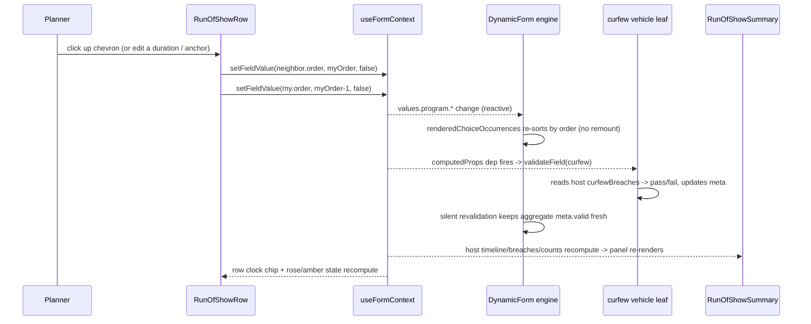

<!-- epic: optional. Set to the parent EPIC-XXX id when this feature belongs to an
     epic; leave "" for a standalone feature. Features are never nested under the
     epic folder, they only reference it here (flat model). -->

# Feature: Docs example: a wedding/party run-of-show builder (repeatable ordered choice, center stage)

## Decided without Jeroen (research)

Settled from research during chain 1 of `/spec:continue` (pre-approval), not reviewed by Jeroen. Override any of these freely.

- Q2 → `preserveOrder: true`, cake cutting gets the optional `note` child (follows Jeroen's own FEAT-006 Q1 ruling on the identical mechanism)
- Finding 1 → the curfew marker line is rendered by the row, not the container (the container's single passthrough slot has no insertion point)
- Finding 2 → the curfew anchor gets the same next-day rollover as the venue close; the breach check compares in one time frame
- Finding 4 → summary clock times and hint text move from slate-400 to slate-500 for WCAG AA contrast
- Finding 5 → FEAT-006 status references corrected to `in-progress`
- Finding 6, first half → every branch declares `type: 'program'` so all six route to one row component
- Finding 7 → duration select options store numeric-parseable keys
- ADR-7 "unit test" wording (story prep) → past-midnight case is a worked example in the ST-02 PR; promoted to a unit test only if `docs/` ever gets a test runner

## Problem & goal

Docs readers evaluating `@bach.software/vue-dynamic-form` (developers comparing schema-driven form libraries, and template authors learning the library's own advanced patterns) can see the repeatable ordered choice shape (`maxOccurs > 1` combined with `choice`, plus the `displayOrder`/`preserveOrder`/`explicitChoiceSelection` metadata from FEAT-002) demonstrated generically on `/examples/choices`, and used as an opt-in finale on `/examples/checkout`'s split-payment ledger. Neither page makes order itself the visible product of the form.

This feature replaces the cancelled trip-itinerary example (FEAT-007, deleted). That example's rows carried absolute dates, so a row's position was derivable from its own data and reordering degenerated into sorting: nothing about the form's validity ever depended on the order a reader chose, only on the dates they typed. The replacement idea, researched in `research/ordered-choice-example/` and ranked the strongest candidate there, is a wedding/party run-of-show builder: a planner builds the evening's program as an ordered list of items (speeches, dinner courses, a band set, open dancing, cake cutting, breaks). Rows carry only durations, never absolute times. Each row's clock time is computed by the engine's template layer from the event's start time plus the sum of every duration above it, structurally the same running-fold cascade the checkout's split-payment ledger already proves in production docs code. An amplified-music curfew then makes reordering causally decisive: dragging a band set earlier can fix a violation, and pushing a long dinner course above it can create one. That is the acid test the trip itinerary failed and this example is built to pass.

Who this is for: docs readers scanning the examples list for "does this library handle order-sensitive, computed-schedule forms," and template authors who want a worked reference for the running-cascade-plus-cross-row-validation pattern before building their own.

Success looks like: a published, linked docs page whose premise, structure, and payoff are "order changes the clock, and the clock decides what is valid," built entirely on the engine's shipped primitives (the same inventory FEAT-006 already leans on: `explicitChoiceSelection`, `maxOccurs > 1` choice, `displayOrder: 'added'`, `preserveOrder`, `computedProps`, reordering via `useFormContext().setFieldValue`), with a working reorder-recomputes-the-timeline interaction and a cross-row curfew check that reuses the checkout's hidden-vehicle-leaf-plus-`validateField` technique. No `packages/core/src/` change and no changeset are expected; if architecture finds a genuine engine gap, that is a feature-level finding to raise back into this spec rather than a silent story-level workaround.

## Scope

### In scope

- One new VitePress docs page under `docs/examples/` (working slug `/examples/run-of-show`, final slug/title/placement per Open question 1), reachable from the `/examples/` sidebar and `docs/examples/index.md`'s "Available Demos" list.
- Narrative copy establishing "order changes the clock" before the live form: the planner edits a schedule of durations, not times, and the page computes every row's start/end live. A short reveal that the whole thing is one metadata tree plus one template, matching the other advanced examples' structure.
- Three top-level, editable scalar leaves alongside the repeatable list: event start time, venue close time, amplified-music curfew time. Editable so a reader can move the curfew and watch rows flip between valid and invalid, an interaction axis the checkout's split-payment ledger does not have.
- One live, interactive metadata tree: a repeatable ordered choice representing the evening's program (`maxOccurs > 1`, `choice`, `explicitChoiceSelection: true`, `displayOrder: 'added'`; whether `preserveOrder: true` is also used depends on Open question 2, mirroring FEAT-006's Q1/ADR-1 finding that a working reorder control needs `preserveOrder: true` because the ephemeral `insertionOrders` tier has no write channel a template can use). Each occurrence is one program item. Six branches with genuinely different fields (exact field names are architecture's to finalize; shape fixed here per Open question 3):
  - **Speech / toast**: speaker name, duration (select), on the mic (yes/no).
  - **Dinner course**: course (select: starter/main/dessert), duration.
  - **Band / DJ set**: act name, duration. Amplified by definition (no separate "amplified" toggle; the branch itself implies it).
  - **Open dance floor**: duration, music style. Amplified by definition.
  - **Cake cutting**: near-childless branch (a fixed short duration, an optional note), the same shape the checkout exercises for its childless express/home-delivery/PayPal branches, with the same `preserveOrder`-needs-`children` tension FEAT-006 flagged for its own childless branch; see Open question 2.
  - **Break / room turn**: duration only.
- Each row displays its own computed start and end clock time: event start plus the running sum of every duration above it. This is the same running-fold cascade as the checkout's split-payment remainder, read live off the form's own reactive values, not `computedProps`.
- A reorder control per item (up/down buttons writing the two affected occurrences' order values through `useFormContext().setFieldValue`, mirroring `SplitPaymentLedgerRow.vue` exactly). Drag-and-drop is out of scope (see below).
- Cross-row validation, via the checkout's hidden-vehicle-leaf-plus-`validateField`-retrigger pattern (prior art: checkout's `splitPaymentCoverage`):
  1. **Curfew rule (the star, hard-blocking)**: every amplified item (band/DJ set, open dance floor, a mic'd speech) must end before the curfew. Whether it does depends only on the summed duration of everything above it, so this is genuinely order-sensitive and reorder-fixable, not merely order-flavored.
  2. **Cake after dinner**: cake cutting must come after every dinner course. Whether this is a hard block or a warning is Open question 4.
  3. **Boundary**: the program's first item is not a break. Whether this is a hard block or a warning is Open question 4.
  4. **Venue-close overflow**: shown only in the summary panel as an indicator, never as a blocking rule, because total program length is order-independent (reordering alone can never fix or break it). The page states this plainly, mirroring the checkout's "Ordering is UI-level, not XSD" candor box.
- A live summary side panel (model: `OrderSummary.vue`): the computed evening timeline (every item's clock time at a glance), the program's end time versus venue close, curfew status naming the offending item(s) by position, and counts per item kind.
- A metadata-tree walkthrough below the live form, matching the other advanced docs pages' structure (VitePress `<<<` region excerpts, "What It Demonstrates", "How It Works", "Related Source").
- A short cross-link to `/examples/choices` (the generic mechanics this page specializes) and to `/examples/checkout`'s split-payment section (the other existing demonstration of the running-cascade pattern). Per Open question 5, the page copy should also state its relationship to FEAT-006's inbox-rules-builder example (the other ordered-choice showcase, itself `in-progress`: approved and being built) so a reader who finds both understands why two exist and does not read them as redundant. DECIDED (Jeroen) under Open question 5: the cross-links are mutual, equals with distinct angles. This page links Choices, Checkout, and Inbox Rules; `/examples/choices` and the inbox-rules page each gain a one-sentence link back to this page as part of seam 4. No other change to FEAT-002, FEAT-001, or FEAT-006 pages or specs.
- Updates to `docs/examples/index.md` and `docs/.vitepress/config.ts`'s `/examples/` sidebar so the page is discoverable.
- No Storybook story, matching the precedent FEAT-002 and FEAT-006 both settled: the docs example is the demonstration surface for this shape.

### Out of scope (explicit)

- Any change to `packages/core/src/`. The example is expected to be buildable entirely on the engine's existing public surface. If architecture surfaces a genuine engine gap, that is a feature-level finding to raise back into this spec, not something a story works around silently.
- Drag-and-drop libraries or interactions. Reordering is up/down buttons only.
- Persisting the program anywhere outside the form's own in-memory/submitted values: no backend, no `localStorage`, no save/load.
- Multi-day events, time zones, or any locale beyond what Open question 6 settles for time display.
- A second, independently clock-anchored hard rule (e.g. "the kitchen serves the main course no later than X") beyond the curfew rule. The research's final report flags this as the natural follow-up if Jeroen wants two hard clock rules instead of one; left for a future amendment, not built here.
- Guest list, seating, catering logistics, budget, or any wedding-planning concern beyond the ordered program itself.
- Internationalization of any field.
- Visually mimicking any specific event-planning product. The example's own neutral docs template styling is used, the same posture the checkout and inbox-rules examples take.
- Any change to the existing `/examples/choices`, `/examples/checkout`, or FEAT-006 inbox-rules pages/specs, beyond the cross-links described above (this page's outbound links, plus the one-sentence links back to this page from `/examples/choices` and the inbox-rules page per the Open question 5 decision).

## Functional overview

**Page structure.** One docs page: narrative intro establishing "durations in, clock times out, and the curfew makes order decisive," the live form with its summary panel, then the metadata walkthrough below, matching `/examples/checkout` and `/examples/advanced`.

**The top-level schedule leaves.** Three editable scalar fields above the program list: event start time, venue close time, amplified-music curfew time. Changing any of them live-recomputes every row's clock time and the curfew check, without touching the program's order or content.

**The program list.** The live form is a single repeatable ordered choice. An "Add item" control per item kind adds a new item at the end of the list. Each row shows its kind, its own fields, its computed start/end clock time, a position badge, and up/down/remove controls. Moving an item up or down writes the two affected occurrences' order values directly (the `SplitPaymentLedgerRow` technique), which the engine's `renderedChoiceOccurrences` re-sorts with no remount.

**The live summary panel.** Next to the program list (stacking below it on narrow screens), the panel shows the computed timeline end time versus venue close, curfew status naming any offending item(s) by position, and a per-kind item count. It re-renders live on every add, remove, edit, or reorder.

**The curfew payoff.** This is the page's whole point: moving an amplified item earlier in the list, or moving a long item above it, visibly flips that item's end time across the curfew line and its validation state with it, with no field edited.

**Disclaimers.** The page states plainly that venue-close overflow is a duration total, not an order effect, and that reordering alone can never fix or break it, so readers do not mistake it for another order-sensitive rule.

## Design (feature level)

Prototype: [`prototype.html`](./prototype.html) in this folder. Single self-contained file, no build, no CDN. Fixed top-right button toggles the `.dark` class on `<html>` exactly as VitePress drives dark mode. Every section is wrapped in an element with a stable anchor id so stories can deep-link to their slice: `#intro`, `#schedule-anchors`, `#add-toolbar`, `#program-timeline`, `#summary-panel`, `#submit-bar`, `#row-states`, `#add-toolbar-full`, `#empty-program`, `#summary-variants`, `#metadata-walkthrough`.

### Posture and reuse

The page is a standard advanced docs example and must look like `/examples/checkout`, not like generic HTML. It reuses the checkout's visual system wholesale: `rounded-xl border bg-white/dark:bg-slate-900 shadow-sm` section cards, the slate text ramp, indigo count tags/badges, the sky primary button, and the emerald/amber/rose state triad. The prototype reproduces these with CSS variables so the `.dark` toggle flips the whole page; production reuses the Tailwind utilities directly. Component mapping (from `specs/components.md` and the checkout's own docs components):

- The repeatable choice container reuses **`ChoiceArraySectionCard`** (the per-branch Add buttons, the `used of maxOccurs` count tag, the `aria-describedby` disabled-reason text). Rendered through the `-choice-array`/`default-choice-array` slot.
- Each program row is the **`SplitPaymentLedgerRow` pattern**, rendered through the `-choice-array-item`/`default-choice-array-item` slot: position badge, up/down (`AppButton variant="ghost"` + `AppIcon chevronUp/chevronDown`), remove (`variant="danger-light"` + `AppIcon bin`), and the reorder writes two `order` values via `useFormContext().setFieldValue` exactly as that component does. New here: the per-kind icon node and rail chrome, and the computed clock-time label replacing the ledger's amount column.
- The summary panel is the **`OrderSummary` pattern** (sticky `aside`, `rounded-xl` card, bordered sub-blocks), adapted from money lines to a timeline + status banners + count chips.
- Row/field states reuse the checkout's existing `SectionCard`/`ErrorMessage`/field styling and its emerald/amber/rose banner classes verbatim.
- Page shell mirrors checkout: `aside: false`, a two-column `demo-layout` grid (`minmax(0,1fr) 320px`) that collapses to one column with the summary moving above the builder (`order:-1`) below ~1100px, VitePress `tip`/`warning` callouts, `<<<` region excerpts, and the "What It Demonstrates / How It Works / Related Source" trailer.

One genuinely new visual element: the **vertical timeline** (rail + per-kind circular icon nodes + per-row position badge + an inline curfew marker line), carried over from the cancelled FEAT-007 design per Constraints. The absolute-date label FEAT-007 put on each node is replaced by the engine-computed start/end clock time; the rail/node/badge chrome transfers unchanged. No new library component is needed; this is template-and-docs-component CSS only.

### Layout

Narrative intro (two paragraphs establishing "durations in, clock times out, and the curfew makes order decisive", a `tip` box, and the "reordering is UI-level, not XSD" `warning` box that also frames the Choices / Inbox-Rules relationship). Then the live demo in the two-column layout: left column stacks three cards (schedule anchors, add toolbar, timeline), right column is the sticky summary. Below the live form, the metadata walkthrough.

- **Schedule anchors**: one card, three editable `<input type="time">` leaves in a 3-up grid (`event start`, `amplified-music curfew`, `venue closes`), collapsing to 1-up under ~560px. These are top-level scalar leaves, siblings of the program list, not inside it.
- **Add toolbar**: a card header with the choice-level count tag (`8 of 20`), then one Add button per branch kind in a wrapping row.
- **Timeline**: a `44px | 1fr` grid per row. Column 1 is the rail (a 2px line behind the nodes) with a circular per-kind icon node; column 2 is the row card. Row head: position badge, kind name, optional `Amplified` pill, and a right-aligned tabular clock-time chip. Then a 2-up field grid (1-up for duration-only kinds), then a footer holding kind-specific toggles and the reorder/remove controls. A dashed rose curfew marker line appears between rows at the point where the computed clock crosses the curfew time; it moves as durations above it change. DECIDED (research), resolving finding 1: each row renders the marker as its own trailing element when the curfew falls between its end and the next row's start, because the container cannot place anything between two specific rows (see Architecture); the visual result is unchanged.
- **Summary**: timeline-at-a-glance list (item label + computed start, offenders tinted rose), an ends-vs-venue-close block with a non-blocking overflow indicator, a curfew-status banner naming offenders by position, and a per-kind count-chip row.

### States policy (applies feature-wide)

One triad everywhere, matching the checkout:

- **Error (hard-blocking rules)**: rose card border + inline rose message with an alert icon + rose clock-time chip. Used by the curfew rule (the star). Blocks submit; the summary panel shows a rose banner naming the offending item(s) by position; the disabled submit button carries a rose helper line.
- **Warning (domain conventions, non-blocking)**: amber card border + inline amber message with a triangle icon + a `Convention` pill. Used by cake-after-dinner and no-leading-break *if* Open question 4 keeps them as conventions; if Q4 promotes either to hard-blocking, it flips to the rose error style. Never blocks submit.
- **OK / valid**: emerald input border (field) and emerald banners (summary), no message.
- **Field validation**: pristine (plain), invalid (rose input border + message below, per-occurrence), valid (emerald input border). Shown on the speech branch's speaker field.
- **Disabled**: Add buttons disable as a group when the choice budget is exhausted (reason tied via `aria-describedby`); per-row up disables at the top, down at the bottom, remove disables when a lone item sits at the `minOccurs` floor.
- **Empty**: a dashed-border muted panel in the builder ("No items yet, use Add above") with a parallel empty summary; `minOccurs: 0` makes this a valid state. Mandatory and shown (`#empty-program`).
- **Loading**: the only genuine loading state is the submit button spinner (there is no async data on this page); shown in `#submit-bar`. Called out so its near-absence is deliberate, not forgotten.
- **Venue-close overflow**: summary-only amber indicator, explicitly non-blocking, with the candor sentence inline ("a duration total, not an order problem; reordering cannot fix it"). Shown in both within-hours (emerald) and over (amber) variants.

### Light and dark

Every color is a CSS variable with a `.dark` override, including the six per-kind node tints, so both modes come for free; I walked the whole prototype in dark and fixed the per-kind node backgrounds (the only hardcoded-looking values) to have explicit dark variants. No section needs dark-specific structural styling beyond the token flip. Focus state uses a 3px ring via `color-mix` on the sky primary and is shown statically (annotated) since a still cannot capture real focus.

DECIDED (research), resolving finding 4: lift the summary clock times and hint text off the `text-3` / slate-400 token. The at-a-glance times (`.sum-tl .r .t`), the `(optional)` hint, and the empty-panel copy currently use `--text-3` (`#94a3b8`), roughly 2.6:1 on the white card, below WCAG AA's 4.5:1 for normal text. The clock times are meaningful data. Use slate-500 (`#64748b`, ~4.6:1) or darker for them in production (and the equivalent lighter dark-mode token), keeping slate-400 only for genuinely decorative text.

### Dependence on open questions

The design uses the spec's own working assumptions and does not resolve any question: 24-hour time display (Q6), `20` cap and `minOccurs: 0` (Q7), branch field shapes and duration selects as sketched (Q3), curfew hard-blocks while rules 2/3 render as non-blocking warnings (Q4, with the prototype showing the error-style fallback if either is promoted), `preserveOrder: true` with cake given an optional `note` child so every branch has `children` (Q2), and placeholder cross-links/slug (Q1, Q5). Final field names, option increments, slug/title, and component file names are the architect's to finalize; the prototype's `RunOfShow*` names are placeholders.

### Realistic data

A wedding reception: start 18:00, curfew 23:00, venue close 01:00. Program: welcome speech (mic'd), starter, main, band set "The Night Owls", cake cutting, open dance floor. The dance floor at position 6 ends 23:35 and breaches the curfew, demonstrating the star rule live; the walkthrough annotates that moving it earlier fixes it.

DECIDED (Jeroen), resolving finding 3: option (a), reshape the dataset so the headline fix is a genuine single reorder. The default data must contain exactly one breaching amplified item with one obvious single up-move that clears the breach (for example the band set sitting below a long dinner course), and the walkthrough names that move. Acceptance criterion for the implementing story: making the named move clears the curfew error with no field edited. Exact durations are tuned at story time against `runOfShowMath`, within the per-kind increment lists decided under Open question 3; any second amplified item in the default data must not breach on its own.

## Architecture (feature level)

Scope recap for the reader: this feature adds no `packages/core/src/` code and no changeset. It is a docs-only example built entirely on the shipped public surface, verified below against `specs/components.md` and the two proven production precedents in `docs/.vitepress/` (the checkout and the near-identical sibling FEAT-006). Everything here is a decision; where a decision rests on an unresolved Open question, the dependence is stated and the question is left for Jeroen.

### Verification basis (what settled the load-bearing calls)

- Every engine capability this example leans on is already exported and already exercised by production docs code against the installed versions: `explicitChoiceSelection`, `displayOrder: 'added'`, `preserveOrder`, `maxOccurs > 1` choice, the `-choice-array`/`-choice-array-item` slot families with `addChoiceOccurrence`/`canAddChoiceOccurrence`/`usedChoiceOccurrences`/`branchKey`/`globalIndex`/`removeItem`, `useDynamicForm`, `useFormContext().setFieldValue(path, value, false)`, `removeNullValues`, and the hidden-vehicle-leaf + `validateField` cross-row pattern. The checkout's `SplitPaymentLedgerRow.vue`/`splitPaymentLedgerMath.ts`/`CheckoutFormExample.vue` and FEAT-006's architecture (`InboxRuleRow`/`inboxRoutingMath.ts`/`TestInboxPanel`) are byte-for-byte the shapes reused here, so no new verification against the raw engine was needed beyond reading those files and `specs/components.md`.
- `<input type="time">`: its submitted value is always a 24-hour `HH:MM` string with leading zeros, independent of the locale the browser renders the picker in (verified against MDN). This is load-bearing for the clock-cascade math parser and it also means Open question 6 governs only the computed display chips, never the editable anchor inputs themselves.
- No engine gap was found. Nothing in this feature requires a change to the published package. If the adversarial review or a story later surfaces one, it is a feature-level amendment back into this spec, never a silent story workaround.

### Component / composable plan (all docs-only, none published)

Reused as-is (no change): `ChoiceArraySectionCard` (add-per-branch toolbar + `used of maxOccurs` count tag + `aria-describedby` disabled reason), `SectionCard`, `AppButton` (`ghost`/`danger-light`/primary), `AppIcon` (`chevronUp`/`chevronDown`/`bin`/`plus`; the six per-kind node glyphs are plain emoji in the row, not `AppIcon`, since `AppIcon` has no event-kind set and adding one is out of scope), `ErrorMessage`, `FormField`, `SelectInput`, `TextInput`, `ToggleSwitch`, `CheckboxField`. The checkout's emerald/amber/rose banner and input-state classes are reused verbatim.

New docs-only files (mirroring the checkout trio one-to-one; justification: these are page-specific hosts/templates/rows, exactly the per-example unit the checkout and FEAT-006 each already introduce, so nothing in `specs/components.md` is meant to cover them):

- `runOfShowMath.ts` (pure, no Vue/form dependency, modeled on `splitPaymentLedgerMath.ts`): `collectProgramOccurrences(programValues, branches)` → `{ key, branchKey, order, durationMinutes, amplified }[]`; `computeTimeline(occurrences, eventStartMinutes)` → entries sorted by `order` with `startMinutes`/`endMinutes` and the program-end minute, running-fold over durations (the clock analogue of the ledger's remaining-amount fold); `findCurfewBreaches(timeline, curfewMinutes)` → the breaching occurrence keys (amplified and `endMinutes > curfew`); plus `parseTime`/`formatTime` helpers handling the past-midnight wrap (see ADR-7). Justification: the one piece of real logic, kept framework-free so it is unit-testable exactly like `splitPaymentLedgerMath.ts`.
- `RunOfShowExample.vue` (host, like `CheckoutFormExample.vue`): the metadata tree, `useDynamicForm`, the three anchor leaves, the host `timeline`/`curfewBreaches`/`counts` computeds, `canSubmit = meta.valid`, `onSubmit`, and renders `<DynamicForm :template="RunOfShowTemplate">` beside `<RunOfShowSummary>`.
- `RunOfShowTemplate.vue` (neutral template, like `CheckoutFormTemplate.vue`): the `defineMetadata` contract and slot wiring (`program-choice-array` → `RunOfShowTimeline`, `program-choice-array-item` → `RunOfShowRow`, a hidden `curfew`-type vehicle slot rendering only the summary-side banner the way `splitPaymentCoverage` does, `select-input`/`default-input`/`checkbox`/`default`).
- `RunOfShowTimeline.vue` (the `-choice-array` container, like `SplitPaymentLedger.vue`): wraps `ChoiceArraySectionCard` for the add toolbar + count tag, owns the rail chrome and the dashed empty state; rows render through its default slot.

  DECIDED (research), resolving finding 1: the curfew marker line is not owned by this container. Like `SplitPaymentLedger`, the container receives all occurrences as one opaque passthrough `<slot />` and cannot position a marker between two specific rows. The marker renders from within `RunOfShowRow` instead: each row already computes the full timeline, so it renders a trailing dashed curfew marker directly after itself when the curfew time falls between this row's `endMinutes` and the next occurrence's `startMinutes`. The empty-program and rail chrome stay on the container.
- `RunOfShowRow.vue` (one occurrence, like `SplitPaymentLedgerRow.vue`): position badge (`globalIndex + 1`), per-kind node, the kind-specific field slot, the computed clock chip, the `Amplified` pill, up/down reorder (two `order` writes via `setFieldValue(path.order, n, false)`), remove, and the derived per-row state (rose when this row's key is in `curfewBreaches`; amber for a convention warning under the Q4 assumption).
- `RunOfShowSummary.vue` (sticky `aside`, like `OrderSummary.vue` + FEAT-006's `TestInboxPanel`): takes the host-computed `timeline`/`curfewBreaches`/`programEnd`/`counts` as plain props (ADR-4), renders the at-a-glance timeline, the non-blocking venue-overflow indicator, the curfew banner naming offenders by position, and the per-kind count chips.

No composable is added; the host uses `useDynamicForm` and the row/container use `useFormContext` exactly as the checkout does.

### Public API impact

None. No export, prop, slot, setting, `defineMetadata` generic, or validation rule in `packages/core/src/` changes. All six branch shapes, the ordered-choice flags, the slot props, and the reorder/validation channels already ship (see `specs/components.md`). The template's `defineMetadata` adds only page-local field-value types (`time: string`, a `program` choice-container type carrying `never`, a `curfew` vehicle type carrying `never`) and page-local extended field props (`amplified?`, `kindIcon?`, `durationOptions?` etc. as the template finalizes), which live in the docs template and never touch the published surface. **Changeset bump type: none** (docs-only, per CLAUDE.md step 7). Backwards compatibility is total: no consumer code is affected because no published code is affected.

### Documentation impact

This feature *is* documentation, so the "impact" is the deliverable:

- New page `docs/examples/run-of-show.md` (final slug/title per Open question 1): narrative intro, the live `<RunOfShowExample />`, the `tip` and the "reordering is UI-level, not XSD" `warning` box (which also frames the Choices / Inbox-Rules relationship per Open question 5), then the walkthrough (`<<<` region excerpts over the new `#region` markers in `RunOfShowExample.vue`, "What It Demonstrates / How It Works / Related Source").
- `docs/examples/index.md`: one new bullet in "Available Demos".
- `docs/.vitepress/config.ts`: one new entry in the `/examples/` sidebar (placement per Open question 1; the live order today ends Checkout, Client Onboarding Wizard).
- No `docs/reference/*` page changes, and this is deliberate: there is no public-API delta to document. Stated explicitly so the qa-verifier does not treat the absent reference edit as a gap.

### Library API rules (self-check)

Every capability reaches the template through a sanctioned channel: ordered-choice behavior through the `preserveOrder`/`displayOrder`/`explicitChoiceSelection` metadata flags and the `-choice-array*` slot contract; the clock cascade through the form's own reactive `values` read via `useFormContext` (never a side channel); the curfew gate through a real `validation` closure on a declared field. No new prop or setting is introduced on the published package, so the "optional with a safe default" rule is satisfied vacuously. No breaking change, no major changeset.

### Data flow

- **State location.** All state lives in the vee-validate form context owned by `useDynamicForm` in the host: the three anchor leaves (`eventStart`, `curfew`, `venueClose`, top-level `time` siblings of the program), the `program` repeatable choice (each occurrence carrying its branch fields plus a persisted `order` child written by `preserveOrder`), and the hidden `curfew`-vehicle leaf. Settings (per-kind branch metadata, messages) travel through the engine's `provide/inject` as usual.

  FLAGGED AMENDMENT (ST-01 implementation): the three anchors are nested one level under a `schedule` group node (`type: 'scheduleAnchors'`), giving paths `schedule.eventStart`/`schedule.curfew`/`schedule.venueClose` rather than bare root paths. The engine renders one output element per group/parent node, so the AC2 requirement (one bordered card, 3-up grid, around exactly the three anchors and nothing else) has no other way to share a single card across three otherwise-independent root leaves. `schedule` itself stays a sibling of `program` at the top of the metadata array, so the "top-level, alongside the program" framing holds at the group level. Every later story (and ST-01's own `RunOfShowRow`) reads the anchor via `schedule.eventStart`, not `eventStart`.
- **Paths.** Dot notation throughout; occurrence child paths are `program.band[0].order`, `program.speech[1].onMic`, etc., exactly the `splitPayment.giftCard[0].amount` shape. No complex-type bracket notation is needed (no `attributes`).
- **The clock cascade (read live, never `computedProps`).** `runOfShowMath.collectProgramOccurrences` + `computeTimeline` run inside a `computed` in the host (and inside `RunOfShowRow` for its own chip), reading `values` through `useFormContext`, sorted by the persisted `order`. Durations in, clock times out. This is the ledger's running-fold with a time unit and is structurally identical to `computeSplitPaymentLedger`. It writes nothing back into `values` (ADR-3).
- **Reorder.** `RunOfShowRow.moveUp/moveDown` find the order-neighbor in the occurrence list and swap the two `order` values with `setFieldValue(path.order, n, false)` (the `false` suppresses validation on the write), byte-for-byte `SplitPaymentLedgerRow`. `renderedChoiceOccurrences` re-sorts by the persisted `order` with no remount; `globalIndex` and the position badge renumber live.
- **Curfew gate.** The hidden `curfew` vehicle leaf (`minOccurs: 0`, so it never fails on occurrence count) carries one `validation` closure that reads the host's reactive `curfewBreaches` computed and returns `true` when empty, else a single message naming the offending positions. Its `computedProps` touches `JSON.stringify(values.program)` plus the three anchor values to establish the reactive dependency, then calls `validateField(thisField.path)`, identical to `splitPaymentCoverage`. The engine's live aggregate `meta.valid` (FEAT-010 GAP 3) reflects the vehicle, so the submit button gates on `meta.valid` directly, with no `formIsComplete`/`handleSubmit`-bypass workaround (those were deleted in the checkout rebuild; `createTransitionTracker` no longer exists and is not reintroduced).
- **Per-row and summary display.** The per-row rose border + inline message is a derived display flag computed in `RunOfShowRow` from the same math module (display echo, like the ledger readout), not a per-occurrence validation leaf. The summary takes host-computed props (ADR-4). Both re-render reactively on every add/remove/edit/reorder/anchor change.
- **Reactivity / loop-guard impact.** The only `computedProps` on the whole page is the single curfew-vehicle re-trigger (one `assertNoComputeLoop` surface, already proven safe in the checkout). Row-field defaults come from metadata, not `computedProps`, so there is no per-keystroke rule rebuild and no seeding loop; this page is strictly simpler than the checkout on the reactivity axis.

### ADR notes

- **ADR-1: Reorder requires `preserveOrder: true`, so every branch must declare `children`.** Context: a template-driven up/down control needs a write channel for order; the ephemeral `displayOrder: 'added'` `insertionOrders` tier has none (it is instance-local, never in `values`). Decision: `preserveOrder: true`, writing a persisted `order` child per occurrence, exactly as the checkout and FEAT-006 (its ADR-1) concluded for the identical mechanism. Alternative: ship ephemeral session-only ordering with no reorder write-back. Rejected: the reorder payoff is the whole page. Consequence: cake cutting must gain a real child (the sketched optional `note`) so it is an object branch; break/room-turn already has its `duration` child and qualifies. Dependence: Open question 2, now DECIDED (research) in this ADR's favor (see Open questions): cake gets `note`, `preserveOrder: true`.
- **ADR-2: The curfew is one hidden vehicle leaf + `validateField` re-trigger, not per-occurrence validation.** Context: the star rule must hard-block submit and name offenders; multiple rows can breach at once. Decision: a single top-level `curfew` leaf whose own `validation` fails when any amplified row ends after the curfew (reusing `splitPaymentCoverage`), gating `meta.valid`; the per-row rose styling is a separate derived display flag off the same math. Alternative: a hidden validation leaf per occurrence. Rejected: more wiring, and the summary needs an aggregate message anyway, which one vehicle provides directly. Dependence: curfew is hard-blocking (Constraints, not an open question).
- **ADR-3: The clock cascade is read live off `values`, never written via `computedProps`.** Context: each row's clock is derivable from durations above it. Decision: compute it in a pure module consumed by host/row `computed`s reading `useFormContext`, mirroring `splitPaymentLedgerMath`. Alternative: have each row's `computedProps` write its computed start/end into `values`. Rejected: it pollutes submitted data with derived fields, is order-write-sensitive, and risks a compute loop; the checkout already proved the read-live approach.
- **ADR-4: The summary panel takes host-computed props, it does not read the form itself.** Context: the panel needs the full ordered timeline + breaches + counts. Decision: the host computes them once and passes them as props, as `OrderSummary` and FEAT-006's `TestInboxPanel` do. Alternative: the summary reads `useFormContext` directly (also valid). Rejected in favor of one source of truth and a trivially testable, form-agnostic panel.
- **ADR-5: Convention rules (cake-after-dinner, no-leading-break) are derived display flags only.** Context: the research frames them as conventions, not laws. Decision under the Open question 4 working assumption: amber row/summary flags computed from the math module, no vehicle leaf, never blocking. Alternative: give each its own hidden vehicle now. Rejected as premature. Dependence: Open question 4; if Jeroen promotes either to hard-blocking, that rule gains its own vehicle leaf exactly like ADR-2's, and its row/summary styling flips from amber to rose, a localized change the prototype already shows the fallback for.
- **ADR-6: No field or child is named `order`.** Context: `preserveOrder` writes an `order` child and dev-warns if a branch declares its own `order` child. Decision: branch fields use `speaker`/`duration`/`onMic`/`course`/`act`/`musicStyle`/`note`; the anchors use `eventStart`/`curfew`/`venueClose`; none is `order`. Same load-bearing triviality as FEAT-006 ADR-6.
- **ADR-7: Past-midnight clock arithmetic lives in the math module.** Context: the realistic data runs start 18:00 to a venue close of 01:00, so the program crosses midnight. Decision: `parseTime` yields minutes-from-midnight, `computeTimeline` works in absolute minutes-since-event-start, `formatTime` renders `(eventStart + elapsed) mod 1440` as 24-hour `HH:MM`, and the venue close is interpreted as the next day when its parsed minute is below the event start. Kept pure and unit-tested like `splitPaymentLedgerMath`. The editable anchors are native `<input type="time">`, whose value is always 24-hour `HH:MM` regardless of locale (verified), so Open question 6 governs only the computed display chips; the working assumption is 24-hour, no locale formatting, consistent with "No internationalization" in Out of scope.

  DECIDED (research), resolving finding 2: the curfew anchor gets the same next-day rollover ADR-7 grants the venue close, and `findCurfewBreaches` compares in one frame. The curfew is editable and moving it is the headline interaction, so a curfew set after midnight (parsed minute below the event start) is reachable; interpret it as the next day exactly like the venue close. `findCurfewBreaches` must lift the curfew into the same minutes-since-event-start (or absolute-elapsed) frame the timeline's `endMinutes` use before the `endMinutes > curfew` comparison, never compare an elapsed quantity against a raw minutes-from-midnight value. Add a unit test for a past-midnight curfew (e.g. start 20:00, curfew 00:30) so a reader moving the curfew across midnight is covered.

  DECIDED (research, story prep), reconciling the "unit test" wording above and the "unit-tested like `splitPaymentLedgerMath`" phrasing in this ADR: `docs/` has no test runner (no vitest, excluded from the pnpm workspace) and `splitPaymentLedgerMath.ts` itself ships with zero automated tests, so the past-midnight case is verified as a worked example documented in the implementing story's PR description (ST-02 AC5), promoted to an automated unit test if and when a `docs/` vitest setup is added. That infrastructure initiative is recorded for Jeroen in ST-01's QA plan finding 1; it is not a gate on any story of this feature.

### Slicing seams (input for the scrum-master)

Independently deliverable, with dependencies:

1. **Page scaffold + metadata tree + template + anchors + the six branches + add/remove + computed clock display.** Includes `runOfShowMath.ts` (needed by every later seam), `RunOfShowExample.vue`, `RunOfShowTemplate.vue`, `RunOfShowTimeline.vue`, `RunOfShowRow.vue` minus reorder, and the anchor leaves. Order is static (grouped). Depends on nothing. Delivers a working form whose rows already show computed clock times, minus the reorder payoff and the curfew gate.
2. **Reorder + the curfew star rule (the payoff).** `preserveOrder: true`, the up/down `order` writes, the hidden `curfew` vehicle leaf, the submit gate on `meta.valid`, the per-row rose styling, and the summary curfew banner. The non-trivial slice, analogous to the checkout's split-payment seam; most likely to surface any remaining engine subtlety (none anticipated beyond ADR-1). Depends on seam 1.
3. **Summary panel in full + convention warnings.** `RunOfShowSummary` timeline-at-a-glance, the non-blocking venue-overflow indicator, the per-kind counts, and the cake-after-dinner / no-leading-break amber flags (ADR-5, Q4 assumption). Depends on seam 1; co-sliceable with seam 2 since it shares the math module and the summary shell.
4. **Narrative, metadata walkthrough, cross-links, discoverability.** `docs/examples/run-of-show.md` prose, the `<<<` region excerpts, the Choices/Checkout/Inbox-Rules cross-links (Q5), and the `index.md` + `config.ts` entries (Q1). Depends on seam 1 for the `#region` markers and prototype anchor ids; sequenced after seams 2/3 so the walkthrough describes finished behavior.

Docs-site prose (seam 4) slices cleanly from the engine-adjacent component work (seams 1 to 3), the usual split for these example features. No Storybook work exists to slice (none is in scope).

### Dependence on open questions (left open for Jeroen, not resolved here)

Q1 (slug/title/nav) and Q5 (FEAT-006 / Choices framing) affect only seam-4 prose and config. Q2 (cake's `note` child) is DECIDED (research) in ADR-1's favor: `preserveOrder: true`, cake gets `note`. Q3 (exact field composition and duration increments, and whether a speech is amplified only when `onMic`) is taken as sketched: the `onMic` toggle is what makes a speech amplified for the curfew (so `collectProgramOccurrences` reads it); if Jeroen rules every speech amplified, that is a one-line change in the math's `amplified` derivation. Q4 (which rules hard-block) is built as ADR-2 (curfew blocks) + ADR-5 (conventions warn); a promotion is the localized change ADR-5 describes. Q6 (time format) is 24-hour per ADR-7. Q7 (`minOccurs: 0`, `maxOccurs: 20`) sizes the count tag and empty state as the prototype shows. None of these is settled by architecture.

## Adversarial review

Filled by adversarial-reviewer at feature level (full mode). Verified against the checkout precedent it claims to reuse byte-for-byte (`CheckoutFormExample.vue`, `CheckoutFormTemplate.vue`, `SplitPaymentLedger.vue`, `SplitPaymentLedgerRow.vue`, `splitPaymentLedgerMath.ts`), `specs/components.md`, the FEAT-006 sibling spec, and the `<input type="time">` value contract.

**Claims checked and confirmed true (not findings, recorded so Jeroen sees the basis):**

- No `packages/core/src/` change, no changeset. Every primitive the example needs (`explicitChoiceSelection`, `displayOrder: 'added'`, `preserveOrder`, the `-choice-array`/`-choice-array-item` slot family, `setFieldValue(path, value, false)`, `removeNullValues`, live aggregate `meta.valid`, the hidden-vehicle-leaf + `validateField` pattern) already ships per `specs/components.md` and is exercised by the checkout. The docs-only / no-changeset classification holds.
- `preserveOrder`-needs-`children`: all six sketched branches declare at least one child (cake gains `note`, break has `duration`), so `preserveOrder: true` is not silently disabled. Correct, under the Q2 assumption.
- The clock cascade is genuinely structurally identical to `computeSplitPaymentLedger`: both sort occurrences by the persisted `order` and run a fold. `renderedChoiceOccurrences` (preserveOrder on) and `collectProgramOccurrences` both sort by `order`, so the position badge sequence and the cascade agree. Confirmed.
- `canSubmit = meta.valid` gating a hidden `validateField`-retriggered vehicle leaf: confirmed working in the checkout (`splitPaymentCoverage`); the reorder write with `shouldValidate: false` still mutates `values` reactively, so the vehicle's `computedProps` dependency fires. Correct.

### Findings

1. **should-fix — The curfew marker cannot be "injected between rows" by the container as the design states.** Design/Layout says `RunOfShowTimeline` "owns ... the injected curfew marker line" placed "between rows at the point where the computed clock crosses the curfew time." But the proven container pattern (`SplitPaymentLedger.vue`) renders every occurrence through a single opaque passthrough `<slot />` (the engine feeds all `-choice-array-item` renders in as one fragment); the container cannot position a marker between two specific child rows. This is an internal design-vs-architecture inconsistency on a prominent, animated design element. RESOLVED. DECIDED (research): the row-rendered marker is adopted in the component plan and the Design Layout text. Verified that `SplitPaymentLedger.vue` renders rows through a single `<slot />`, so a container-placed between-row marker has no insertion point; the row is the only component holding both the timeline data and a position in the list. Sources: docs/.vitepress/theme/components/SplitPaymentLedger.vue.

2. **should-fix — ADR-7 specifies past-midnight rollover for the venue close but not for the curfew anchor, and `findCurfewBreaches` as described compares mismatched time frames.** The curfew input is editable and "move the curfew" is a documented interaction, so a curfew set after midnight (e.g. 00:30 at a late reception) is reachable. ADR-7 lifts only the venue close to the next day "when its parsed minute is below the event start"; it is silent on the curfew. `findCurfewBreaches(timeline, curfewMinutes)` is described as "amplified and `endMinutes > curfew`", comparing a since-event-start / absolute-elapsed quantity against a raw minutes-from-midnight curfew. With the default data (curfew 23:00 > start 18:00) it happens to work; a past-midnight curfew would flag every amplified item (or yield a negative offset). Since the curfew is the star rule, this is load-bearing. RESOLVED. DECIDED (research): ADR-7 now gives the curfew the same next-day rollover as the venue close and `findCurfewBreaches` compares minutes-since-event-start quantities only, with a past-midnight curfew unit test. A correctness fix with no defensible alternative: comparing an elapsed quantity against a raw minutes-from-midnight value misfires for any curfew past midnight.

3. **should-fix — The shipped "realistic data" does not afford the clean single-reorder fix the page's headline promises.** Problem & goal and Functional overview sell "dragging a band set earlier can fix a violation" and "move this item earlier ... fixes it." With the Design's realistic dataset there are three amplified items (mic'd speech 10, band 90, open dance floor 150; 250 min of amplified against a 300-min window to the 23:00 curfew). No single item relocation clears the breach: moving the dance floor up pushes the band past the curfew instead, so the breach jumps rather than resolves. Only clustering all amplified items ahead of all dinner/cake (several moves of several items) clears it. A reader who tries the obvious single move sees the violation move, which reads as "broken" rather than "order is decisive." RESOLVED. DECIDED (Jeroen): option (a), reshape the dataset for a one-move fix, recorded as an acceptance criterion in the Realistic data section.

4. **should-fix — Summary clock times (and hint text) at the `text-3` / slate-400 token fail WCAG AA contrast.** The summary's at-a-glance times (`.sum-tl .r .t`), the `.hint` "(optional)" text, and the empty-panel copy use `--text-3` (`#94a3b8`, slate-400), roughly 2.6:1 on the white card: below the 4.5:1 AA threshold for normal text. The clock times are meaningful data, not decoration. slate-500 (`#64748b`, ~4.6:1) passes. RESOLVED. DECIDED (research): production uses slate-500 or darker for the clock times, hints, and empty-panel copy (with the matching lighter dark-mode token), keeping slate-400 only for decorative text. WCAG AA's 4.5:1 minimum for normal text is normative and the current token measurably fails it, so there is no defensible alternative. Sources: WCAG 2.1 SC 1.4.3; contrast ratios computed from the prototype's own token values.

5. **nit — FEAT-006's status is stated as `awaiting-discussion` in two places; it is actually `in-progress`.** Scope ("still at `awaiting-discussion`") and Open question 5 both say so, but `specs/FEAT-006-inbox-rules-builder-example/spec.md` is `in-progress` (approved, being built, with Q1 DECIDED as `preserveOrder: true`). This affects only the seam-4 cross-link framing, but the premise of Q5 (two unsettled siblings) is now firmer than written. RESOLVED. DECIDED (research): verified `specs/FEAT-006-inbox-rules-builder-example/spec.md` frontmatter reads `status: in-progress`; both references in this spec corrected.

6. **nit — The single-row-component plan depends on every branch declaring a shared container type, which the metadata sketch omits.** Per the checkout's documented behavior, the `-choice-array-item` slot suffix is driven by each branch's own `type`, not the container's. For all six branches to route to one `RunOfShowRow` through `program-choice-array-item`, each branch must declare `type: 'program'` (as every split-payment branch declares `type: 'splitPayment'`). The Design/metadata sketch shows branches as `speech: { children: {...} }` with no `type`. Separately, the prototype places the speech `onMic` toggle in the row footer rather than the field grid, which means `RunOfShowRow` needs kind-aware child placement, not a plain passthrough `<slot />` like `SplitPaymentLedgerRow`. PARTIALLY RESOLVED. DECIDED (research) on the first half: every branch declares `type: 'program'` so all six route to `RunOfShowRow` through the `program-choice-array-item` slot, matching the checkout where every split-payment branch declares `type: 'splitPayment'` (verified in `CheckoutFormExample.vue`). The `onMic` placement (kind-aware child layout in the row) stays with Open question 3 for story-level finalization.

7. **nit — The duration selects must store a numeric-parseable key for `collectProgramOccurrences` to read `durationMinutes`.** The prototype options render as "10 min" labels; the math needs a number. Trivial (`{ key: '10', value: '10 min' }`), but worth stating since the whole cascade rests on it. RESOLVED. DECIDED (research): duration select options store numeric-parseable keys with human labels as values, matching the checkout's `{ key, value }` option shape (verified in `CheckoutFormExample.vue`); `collectProgramOccurrences` parses `durationMinutes` from the key. Q3 still owns the increments themselves.

### Status rationale

Seven Open questions are unresolved, so the mechanical outcome is `awaiting-discussion` regardless of findings. All should-fixes above are routed as `PROPOSED (adversarial review)` edits, so none independently forces discussion; the open questions do.

Post-review research (chain 1 of `/spec:continue`, pre-approval clear-winner bar): findings 1, 2, 4, 5, the type-declaration half of 6, finding 7, and Open question 2 are DECIDED (research), each inline above with sources; see the rollup under the title. Finding 3 stays open (it reshapes visible demo data and narrative, intertwined with Open questions 3 and 4), as do Open questions 1, 3, 4, 5, 6, 7 (slug/nav, field composition, blocking policy, sibling framing, time format, occurrence cap: all visible design, copy, or product calls). Re-applying the mechanical status rule leaves the spec at `awaiting-discussion`.

## Constraints & assumptions

- **Build on FEAT-002 (done) and the checkout's (FEAT-001, done) proven patterns directly.** FEAT-002 shipped `explicitChoiceSelection`, `maxOccurs > 1` choice, `displayOrder: 'added'`, `preserveOrder`, `globalIndex`, `insertionOrder`, and reordering through `useFormContext().setFieldValue`. The checkout's `SplitPaymentLedgerRow.vue` and `splitPaymentLedgerMath.ts` already demonstrate the running-cascade-plus-reorder pattern end to end; this feature's clock cascade is the same fold shape with a different unit (time instead of money).
- **Carry over the cancelled FEAT-007 prototype's design investment where it still fits.** Its vertical timeline design (rail, per-kind icon nodes, per-row position) was built for rows with absolute dates; here the computed clock time replaces the user-entered date as the row's time label, so the visual design is expected to transfer largely unchanged even though the underlying data model is the opposite of FEAT-007's.
- **Engine improvements landed since this spec was drafted (UPDATE 2026-10-28: FEAT-010 "Engine validation gaps" and QUICK-004, both `done`). The architect must build on the fixed engine; none of the checkout's old workarounds may be carried forward:**
  - The aggregate `meta.valid` is now live and trustworthy for group, choice, and array fields (FEAT-010 GAP 3), so submit gates on `meta.valid` directly, as the rebuilt checkout now does. The old stuck-invalid quirk and its local-`computed`/`formIsComplete`/`handleSubmit`-bypass workarounds are history.
  - For a childless branch, the engine now has a first-class `presenceValue` marker (FEAT-010 GAP 1), replacing the checkout's old hand-written `computedProps` marker. But it is a no-op on `maxOccurs > 1` branches, so it does not apply to this feature's repeatable choice: cake cutting must get a real child field (which `preserveOrder` requires anyway), see Open question 2 and FEAT-006's ADR-2 for the same conclusion.
  - The stale nested-choice registration that could outlive a branch's unmount is fixed (QUICK-004); flat branches are still the simpler shape, but this is no longer a correctness constraint.
  - `computedProps` can now swap a field's `restriction`/`validation` and the engine rebuilds the ruleset and revalidates automatically (FEAT-010 GAP 2). Prefer that over manual `validateField` re-triggers where it fits; the checkout's `splitPaymentCoverage` hidden vehicle leaf (which still re-triggers `validateField` from `computedProps` for its cross-row check) remains valid prior art for the curfew rule. The checkout's `createTransitionTracker()` helper was deleted in FEAT-010's rebuild and no longer exists; `resetForm()` now also resets explicit-choice selection state itself, so no reset bookkeeping is needed.
  - `docs/` already has `resolve.dedupe: ['vee-validate']` configured, needed for any page using vee-validate composables directly (as the hidden curfew vehicle leaf and the reorder controls do).
- **`preserveOrder` needs every branch to declare `children`.** Per `specs/components.md` and `docs/examples/choices.md`, a single scalar/childless branch in a repeatable explicit choice disables `preserveOrder` for the whole choice. This is directly relevant because cake cutting and break/room-turn are the thinnest branches here; see Open question 2.
- **The curfew rule is the one rule that must be hard-blocking for the acid test to hold.** The research's ranking depends on at least one rule being genuinely order-sensitive and reorder-fixable with real validation consequence, not just a summary indicator. Rules 2 and 3 (cake after dinner, no leading break) are domain conventions, not safety or legal constraints like the curfew; whether they also hard-block is Open question 4, but the curfew itself should not be softened to a warning without reopening this spec.
- **No Storybook story.** Matches the precedent FEAT-002 and FEAT-006 both settled.
- **No public API or changeset impact expected.** Everything needed is already exported. If architecture finds otherwise, that is a feature-level amendment, not a silent story-level workaround.
- **Does not depend on FEAT-006.** FEAT-006 (inbox rules builder) is a sibling example of the same underlying shape (repeatable ordered choice as the page's subject) built independently; this feature should not block on its approval or its open questions, only cross-reference it in page copy per Open question 5.

## Open questions

Questions for Jeroen. Must be resolved before approval.

1. **Final slug, title, and nav placement.** Working slug `/examples/run-of-show`, working title "Run of Show Builder" (alternatives: "Plan the Reception", "Event Timeline Builder"). Where should it sit in the `/examples/` sidebar relative to Choices (the generic mechanics it specializes), Checkout (the other running-cascade demonstration), and FEAT-006's inbox-rules page once that lands? The live sidebar order today is: Overview, Basic Form, Arrays And Groups, Choices, Dynamic Fields, Validation, Wizard, Checkout, Advanced Wizard.

   DECIDED (Jeroen): slug `/examples/run-of-show`, title "Run of Show Builder", placed directly after FEAT-006's Inbox Rules Builder entry, so the sidebar reads ... Checkout, Inbox Rules Builder, Run of Show Builder, Client Onboarding Wizard. The two ordered-choice showcases sit adjacent.

2. **Does cake cutting (and/or break/room-turn) need a trivial child field so `preserveOrder` can apply to the whole choice?** A working reorder control needs `preserveOrder: true` (the ephemeral `displayOrder: 'added'` tier alone has no write channel a template can use, per FEAT-006's ADR-1 finding on the identical mechanism). `preserveOrder` requires every branch to declare `children`; a single childless branch disables it for the whole choice. Cake cutting is described as "near-childless" (an optional note could satisfy this) and break/room-turn currently has only a duration, which is already one child field, so it likely already qualifies. Confirm: does cake cutting get a real child field (e.g. an optional note, as sketched) purely so the branch is an object, or is session-only ordering (no `preserveOrder`) acceptable here?

   DECIDED (research): `preserveOrder: true`, and cake cutting gets the sketched optional `note` child so every branch declares `children`.
   Why: Jeroen already decided the identical question for FEAT-006 (its Q1: `preserveOrder: true` as the only buildable basis for a reorder control, order being real reload-surviving data, with FEAT-010's `presenceValue` explicitly a no-op on `maxOccurs > 1` branches so it cannot substitute for a real child). Session-only ordering has a concrete named disadvantage: it removes the reorder write channel entirely, and the reorder payoff is this page's whole point per Problem & goal. The `note` field was already in the branch sketch, so no visible surface changes beyond what Scope describes.
   Sources: specs/FEAT-006-inbox-rules-builder-example/spec.md (Q1, DECIDED (Jeroen), and ADR-1), specs/components.md (preserveOrder requires children on every branch), docs/examples/choices.md

3. **Exact field composition per branch.** The six branches and their fields are sketched in Scope above, drawn directly from the research. Confirm the field list per branch (names, types, option lists for selects) before design/architecture proceeds, in particular: the duration select's exact increments (5/10/15/20 minutes was the research's sketch for speeches; should the same fixed increments apply to every duration field, or should some branches use a free-entry number of minutes instead) and whether "on the mic yes/no" on the speech branch is itself what makes a speech "amplified" for the curfew rule, or whether every speech counts regardless.

   DECIDED (Jeroen): branch field lists as sketched in Scope. Durations are selects on every branch with per-kind increment lists (speech 5/10/15/20, dinner course 30/45/60, band 45/60/90/120, dance floor 60/90/120/150, break 15/30, cake fixed 15; exact lists tunable at story time together with the finding 3 dataset). A speech is amplified for the curfew rule only when its `onMic` toggle is on, so `collectProgramOccurrences` reads `onMic` and flipping the toggle live-applies or lifts the curfew rule for that row.

4. **Which cross-row rules hard-block submission versus only warn?** The curfew rule (rule 1) is the star and is assumed hard-blocking per Constraints & assumptions above. Cake-after-dinner (rule 2) and no-leading-break (rule 3) are domain conventions rather than safety constraints: should they hard-block submit (mirroring the checkout's blocking coverage gate) or only show a non-blocking warning badge on the affected row (the research's own framing calls them "conventions rather than laws")? This determines whether they need a real `validation` rule plus hidden vehicle leaf, or only a derived display flag.

   DECIDED (Jeroen): warn only. Cake-after-dinner and no-leading-break are non-blocking amber flags (derived display, no vehicle leaf), exactly as ADR-5 assumed; the curfew stays the single hard-blocking rule. Consistent with the FEAT-006 Q3 ruling that a convention breach is not invalid data.

5. **How should the page copy frame its relationship to FEAT-006 (inbox rules builder) and to `/examples/choices`?** Both this feature and FEAT-006 showcase the same repeatable-ordered-choice-as-the-subject shape with a live side panel of consequences, researched and built independently (this feature's research explicitly treats FEAT-006 as the technical/benchmark sibling, not a predecessor). Should the two pages cross-link each other once both are published, should one be positioned as the primary/flagship ordered-choice showcase (linked from `/examples/choices`) with the other secondary, or are they independent enough that no coordination is needed? FEAT-006 is itself `in-progress` (status verified, see finding 5); this question does not block this feature, only its final page copy.

   DECIDED (Jeroen): equals with distinct angles, no flagship. Mutual one-sentence cross-links once both pages are live: Inbox Rules is "order decides which rule fires" (priority semantics), Run of Show is "order decides the clock and whether it is valid" (computed schedule). `/examples/choices` links both. The one-sentence additions to `/examples/choices` and the inbox-rules page land as part of this feature's seam 4; Scope's cross-link bullet is updated to match.

6. **Time format and locale for the clock displays.** Event start, venue close, curfew, and every computed row clock time need a display format (24-hour vs 12-hour with AM/PM, which locale's conventions). The example has no stated audience locale; confirm a default (e.g. 24-hour, no locale-specific formatting, consistent with "No internationalization" in Out of scope) before design proceeds.

   DECIDED (Jeroen): 24-hour `HH:MM` everywhere, no locale-specific formatting, matching the native `<input type="time">` value shape and ADR-7's working assumption.

7. **Occurrence cap for the program list.** What should `minOccurs`/`maxOccurs` be on the repeatable choice (e.g. `minOccurs: 0` so an empty program is a valid state, matching FEAT-006's mandatory-empty-state precedent, and some reasonable `maxOccurs` such as 20)? Needed before architecture sizes the add-toolbar budget UI.

   DECIDED (Jeroen): `minOccurs: 0` (an empty program is a valid state, matching FEAT-006's mandatory-empty-state precedent) and `maxOccurs: 20`, as the prototype already sizes the count tag and empty state.

## Stories

Split along the architecture's slicing seams. Implementation order is the listed order; each story extends the files the previous one(s) created.

1. [ST-01: Page scaffold, metadata tree, template, anchors, and the six branches](./stories/ST-01-page-scaffold-and-branches/spec.md). Depends on nothing. Builds `runOfShowMath.ts`, `RunOfShowExample.vue`, `RunOfShowTemplate.vue`, `RunOfShowTimeline.vue`, `RunOfShowRow.vue` (minus reorder), the three anchor leaves, and a minimal docs page stub. Delivers a working, order-static form whose rows already show computed clock times.
2. [ST-02: Reorder controls and the hard-blocking curfew rule (the payoff)](./stories/ST-02-reorder-and-curfew-rule/spec.md). Depends on ST-01. Flips `preserveOrder: true`, wires the up/down `order` writes, the hidden `curfew` vehicle leaf, the `meta.valid` submit gate, the per-row rose styling, the curfew marker, and the tuned single-move-fix default dataset (finding 3). Creates `RunOfShowSummary.vue` with only the curfew banner.
3. [ST-03: Summary panel in full, plus non-blocking convention warnings](./stories/ST-03-summary-panel-and-convention-warnings/spec.md). Depends on ST-01 and ST-02 (extends `RunOfShowSummary.vue` and `RunOfShowRow.vue`). Shares the math module and summary shell with ST-02, so it is co-sliceable with it per the architecture, but is sequenced after it here since both extend the same files. Adds the at-a-glance timeline, the venue-overflow indicator, per-kind counts, and the cake-after-dinner / no-leading-break convention flags.
4. [ST-04: Narrative, metadata walkthrough, cross-links, and discoverability](./stories/ST-04-walkthrough-and-discoverability/spec.md). Depends on ST-01 (page stub and anchors), and is sequenced after ST-02 and ST-03 so the walkthrough describes finished behavior. Writes the page's full narrative and walkthrough, the mutual cross-links to `/examples/choices` and the Inbox Rules Builder page, and the `index.md`/`config.ts` discoverability entries.

No `packages/core/src/` change and no changeset in any story; the feature's architecture confirmed nothing here needs a published-package change.

## Final review

Branch-wide audit of the combined ST-01..ST-04 delta (all four stories `done`), run with fresh hostile eyes across story boundaries. This audit ran on **opus** (the fable weekly model limit was exhausted, by Jeroen's explicit choice), held to the same standard.

### Verdict

**Findings (clean of fixable items).** No blockers, no should-fix findings, no test gaps that are not already tracked, no manual-test gaps, no docs gaps. Two nice-to-have observations only, recorded below for Jeroen; neither is a work order.

### Bugs

None. Every risky path named in the audit brief was traced and substantiated against the running code:

- **`runOfShowMath.ts` edge cases**: a standalone harness reproducing the exact module logic confirmed the default dataset (band at position 6 ends 23:55, the sole breach against a 23:00 curfew), the single-move fix (band up one swap with "main" ends 22:55, zero breaches), the past-midnight curfew differential (start 20:00, curfew 00:30 breaches at 01:55; raising the curfew to 04:00 clears it, so `liftToEventFrame` lifts both anchors into one frame as ADR-7 requires), the empty program (zero entries, program end equals event start), ties in `order` (stable sort preserves input order), zero/non-numeric duration (parses to 0), and the strict `endMinutes > curfew` boundary (an item ending exactly at the curfew does not breach). All match the worked numbers in ST-02's Implementation notes.
- **Reorder after removal**: the engine's `normalizeOrder()` runs after every removal (`DynamicFormItemChoice.vue:767`), re-ranking `order` to a contiguous 1..N, so the `moveUp`/`moveDown` neighbour search by `myOrder ± 1` (byte-for-byte `SplitPaymentLedgerRow`) never strands a visible row with a disabled arrow across a gap. No boundary or concurrent-click defect.
- **`curfewCheck` vehicle leaf**: verified live that reset re-triggers the breach correctly. After a successful submit, "Start a new program" (`resetForm()`) restores the seeded order, the curfew breach re-appears at position 6, `meta.valid` returns to false, and the submit disables again with no stuck-valid window. The `validateField` re-trigger and `meta.valid` gating behave as the checkout's `splitPaymentCoverage` precedent does.
- **`seedOccurrencePresence`**: seeds only when the duration value is `undefined` (idempotent, no loop, no value pollution; the empty string displays the same placeholder option a null would). `validateOnBlur` means a freshly added row shows no premature error until a field is blurred.
- **`FormField.vue` import fix (ST-01)**: a genuine correctness fix, not a cosmetic one. The template used `<AppButton>` (the `canRemoveItems` remove button) without importing it; the added import resolves that for every page that renders `FormField` with `canRemoveItems`, a net improvement with no regression (import-and-use locally, no double registration).
- **No runtime noise**: page load plus a reorder produced zero Vue warnings, zero `pageerror`s, zero `preserveOrder`/compute-loop dev warnings (one unrelated asset 404 only).

### Test gaps

None beyond the already-tracked infrastructure item. `docs/` has no test runner (excluded from the pnpm workspace), so the feature deliberately accepted worked examples in lieu of unit tests for `runOfShowMath.ts`, and ST-01's QA plan already routed "should `docs/` get a minimal vitest setup" to Jeroen as an epic-level call, not a story gate. This audit independently re-derived the worked examples against the real module and they hold, so the substitute is sound. See the first nice-to-have for the standing follow-up.

### Manual test gaps

None. Every behaviour the feature claims is reachable by hand on `/examples/run-of-show` and was exercised live (Playwright, both colour modes): the six add buttons, remove, reorder, the single-move curfew fix (invalid to valid with no field edited), the per-row rose breach state, the dashed curfew marker relocating, the two convention warnings (leading break and cake-before-dinner, both non-blocking), venue-close overflow (within-hours and over variants), the empty-program state (builder and summary), past-midnight anchors, and the submit/success/reset flow. Light and dark both render correctly.

### Docs gaps

None. This feature is itself documentation and the page is complete: narrative, `tip`/`warning` candor boxes, the live demo, the metadata walkthrough with `<<<` region excerpts, "What It Demonstrates / How It Works / Related Source", and the cross-links from `/examples/choices` and `docs/examples/index.md`. No `docs/reference/*` delta is needed because there is no public-API change. The one-sentence back-link from the Inbox Rules Builder page is correctly deferred: that page ships with FEAT-006, and this page frames the relationship as "shipping separately" rather than linking a missing slug.

### Nice-to-have observations (for Jeroen, not auto-fixed)

1. **Submit disables with no on-button explanation when a required row field is empty but untouched.** Verified live: fixing the curfew makes the form valid, then adding a blank Speech flips `meta.valid` to false and disables "Save run of show", but the rose helper line only renders for a curfew violation (`v-if="!canSubmit && curfewHelperMessage"`), so there is no submit-level reason shown. The per-field required errors still appear on blur. This is within the feature's own states policy (which promises the helper line only for the curfew) and matches the checkout precedent (submit gates on `meta.valid`; field errors are the indicator), so it is not a defect, only a possible polish if a generic "complete the required fields" helper were ever wanted.
2. **`runOfShowMath.ts` is genuinely pure and unit-testable but ships with zero automated tests.** Consistent with the accepted `docs/`-has-no-runner reality and `splitPaymentLedgerMath.ts`'s own zero-test precedent. If a `docs/` vitest setup ever lands (the standing ST-01 initiative), the four highest-value cases to lock in are the past-midnight curfew differential, the single-move fix arithmetic, the empty program, and the two convention checks, all of which this audit already verified by hand.

### What was reviewed

Merge base `7ba2df0`. Full uncommitted working-tree delta: 6 modified files (`docs/.vitepress/config.ts`, `docs/.vitepress/theme/components/FormField.vue`, `docs/.vitepress/theme/index.ts`, `docs/examples/choices.md`, `docs/examples/index.md`, the feature spec) and 7 new files (the six `RunOfShow*`/`runOfShowMath.ts` docs components plus `docs/examples/run-of-show.md`); the untracked story specs and prototype were read for context. Every changed source file was read in full, the `runOfShowMath.ts` logic was re-executed in a standalone harness, the engine's `DynamicFormItemChoice.vue` order/removal handling was read to confirm the reorder assumptions, and the page was driven live in both colour modes. ESLint is clean on all new files; `vue-tsc` surfaces only the three pre-existing, out-of-scope errors (`BasicFormExample.vue`, `CheckoutFormExample.vue`, `ChoiceSectionCard.vue`), none in any `RunOfShow*` file. No status field was changed.
