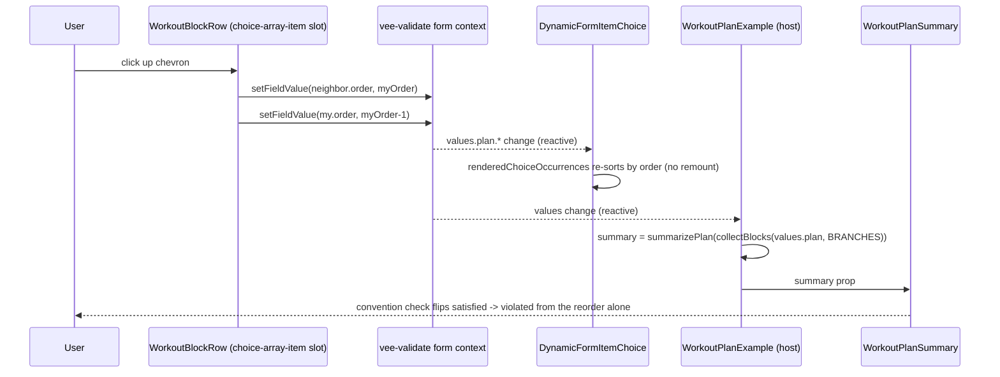

<!-- epic: optional. Set to the parent EPIC-XXX id when this feature belongs to an
     epic; leave "" for a standalone feature. Features are never nested under the
     epic folder, they only reference it here (flat model). -->

# Feature: Docs example: a workout plan builder (repeatable ordered choice)

## Problem & goal

Docs readers evaluating `@bach.software/vue-dynamic-form` (developers comparing schema-driven form libraries, and template authors learning the library's own advanced patterns) need a dedicated example where the repeatable ordered choice shape (`maxOccurs > 1` combined with `choice`, plus the `displayOrder`/`preserveOrder`/`explicitChoiceSelection` metadata FEAT-002 shipped) is the whole point of the page, not a generic mechanics demo (`/examples/choices`) or an opt-in footnote behind a checkbox (`/examples/checkout`'s split-payment section).

This feature is one of two candidate pages researched for that slot (`research/ordered-choice-example/final-report.md`), the runner-up to a wedding/party run-of-show builder (FEAT-008, being specced concurrently). Both replace the cancelled trip-itinerary example (FEAT-007), which failed the acid test every candidate was scored against: can a reorder alone, with no field edit, fix or break a validation? FEAT-007's rows carried absolute dates, so order was derivable from the data and reordering degenerated into sorting.

This candidate, a workout plan builder, passes that test differently from FEAT-008: instead of a computed-schedule cascade (durations in, clock times out), its rules are position-class and adjacency constraints over an ordered list of exercise blocks, drawn from published coaching orthodoxy (warm-up first, compound movements before isolation movements, no two high-intensity blocks adjacent) rather than invented for the demo. Reordering the list is literally how a reader fixes or breaks those rules; no field edit does the same thing.

Success looks like: a published, linked docs page whose premise, structure, and payoff are "order matters, and here is exactly what reordering does" for a domain (building a workout) that an ordinary gym-goer, not just a developer, recognizes on sight, built as much as possible on the engine's existing primitives rather than bespoke Vue code, mirroring the checkout's proven reorder-and-recompute pattern end to end.

Jeroen picks between this feature and FEAT-008, or keeps both; this spec stands on its own regardless of that choice.

## Scope

### In scope

- One new VitePress docs page under `docs/examples/` (working slug `/examples/workout-plan`, final slug/title/placement per Open question 1), reachable from the `/examples/` sidebar and from `docs/examples/index.md`'s "Available Demos" list.
- Narrative copy establishing that the ordering rules below are published coaching conventions (warm-up before working sets, compound movements before isolation movements, most demanding work while freshest), not house rules invented for the demo, with sources cited the way the checkout cites Baymard/Shopify.
- One live, interactive metadata tree: a top-level repeatable ordered choice representing the ordered list of exercise blocks (`maxOccurs > 1`, `choice`, `explicitChoiceSelection: true`, `displayOrder: 'added'`, `preserveOrder: true` so the up/down reorder control has a writable persisted `order` field to move, mirroring the checkout's split-payment ledger exactly). Four branches with genuinely different fields:
  - **Warm-up**: duration.
  - **Strength exercise**: name, muscle group select, sets, reps, compound/isolation select.
  - **Cardio**: type, duration, intensity select.
  - **Cooldown / stretch**: duration.
- A reorder control per block (up/down buttons writing the two affected occurrences' `order` values through `useFormContext().setFieldValue`, mirroring `SplitPaymentLedgerRow.vue`'s technique exactly). Drag-and-drop is explicitly out of scope, so this is the only reordering affordance.
- Cross-row validation, order-only and reorder-fixable, surfaced through the checkout's hidden-vehicle-leaf-plus-`validateField` pattern (or a non-blocking derived flag; hard-block vs. warn per rule is Open question 2):
  - Warm-up must be the first block (boundary rule).
  - Cooldown/stretch must be the last block (boundary rule).
  - No compound-type strength exercise may appear after any isolation-type strength exercise, anywhere in the list (a position-class rule over the whole list, not just adjacent rows).
  - No two consecutive strength exercises share the same muscle group.
  - No two cardio blocks with the same high intensity are adjacent.
- One honest line of page copy next to the compound-before-isolation rule naming the pre-exhaustion technique as a deliberate, published exception to that rule (source: `research/ordered-choice-example/raw/library-fit.md` and `raw/recognizability.md`), the same candour the checkout uses for its own "ordering is UI-level, not XSD" caveat.
- A live summary side panel (model: `OrderSummary.vue`) showing, computed from the current list: total duration, an intensity profile (count or breakdown by block type and cardio intensity; exact presentation is Open question 5), muscle group coverage across strength exercises, and the current rule violations (naming which rule and which block).
- A pure, synchronous TypeScript math module (model: `splitPaymentLedgerMath.ts`) that computes the summary figures and the rule violations from the form's values, consumed by a template-level computed, not by `computedProps` or any new engine capability.
- A metadata-tree walkthrough below the live form, in the same style as the other advanced docs pages (VitePress `<<<` region excerpts, "What It Demonstrates", "How It Works", "Related Source").
- A short cross-link to `/examples/choices` (the generic mechanics this page specializes). Relationship and cross-linking to FEAT-008 (if built) and FEAT-006 (the shelved inbox-rules sibling) is Open question 6.
- Updates to `docs/examples/index.md` and `docs/.vitepress/config.ts`'s `/examples/` sidebar so the new page is discoverable.
- No Storybook story, matching the precedent already decided for this kind of example (FEAT-002's Q7: the docs example is the demonstration surface).

### Out of scope (explicit)

- Any change to `packages/core/src/`. The feature is expected to be buildable entirely on the engine's existing public surface, all of it shipped by FEAT-001/FEAT-002 (`explicitChoiceSelection`, `maxOccurs > 1`, `displayOrder`, `preserveOrder`, `globalIndex`, `insertionOrder`, and reordering via `useFormContext().setFieldValue`, exactly as the checkout's split-payment ledger already does). If architecture work surfaces a genuine engine gap, that is a feature-level finding to raise back into this spec, not something a story works around silently. No `packages/core/src/` change means no changeset (per `CLAUDE.md` step 6).
- Drag-and-drop libraries or interactions. Reordering is up/down buttons only.
- Persisting a workout plan anywhere outside the form's own in-memory/submitted values: no backend, no `localStorage`, no save/load of plans, no actual workout tracking or history.
- Real fitness coaching, personalized programming, or any claim of medical/training advice. The page states plainly that the ordering rules reflect common published convention, not a guarantee of a correct or safe program for any individual.
- A computed-clock cascade or any cascading per-row derived value. This candidate's live payoff is a duration/intensity/coverage summary and a violations list, not a running total that redistributes, which is FEAT-008's (or the checkout's) territory, not this one's.
- Exercise libraries, instructional content (form cues, videos, images), or any attempt to be a real workout-builder app.
- Internationalization of any field, and unit systems beyond one default (exact units, e.g. minutes for duration, is Open question 4).
- Any change to the existing `/examples/choices`, `/examples/checkout`, or FEAT-006/FEAT-008 pages or their components, beyond the one-directional cross-link described above.
- Building both this feature and FEAT-008 as the flagship ordered-choice showcase; Jeroen chooses which (or both) ships, per Open question 6.

## Functional overview

**Page structure.** One docs page: narrative intro establishing that the ordering rules are published coaching convention and that reordering alone can satisfy or violate them, the live form with its side panel, then the metadata walkthrough below, matching the structure of `/examples/checkout` and `/examples/advanced`.

**The exercise list.** The live form is a single repeatable ordered choice. An "Add block" control per block type (Warm-up / Strength exercise / Cardio / Cooldown) adds a new block at the end of the list. Each block row shows its own fields, a position badge (`globalIndex + 1`), and up/down/remove controls. Moving a block up or down writes the two affected occurrences' `order` values directly, which the engine's `renderedChoiceOccurrences` picks up and re-sorts with no remount.

**The live summary panel.** Next to the list, a sticky side panel shows the plan's total duration, an intensity profile, muscle group coverage, and the current rule violations by name and offending block. It recomputes on every add, remove, edit, or reorder.

**The payoff.** Because every validation rule above is order-only, a reader can trigger and clear a violation purely by pressing an up/down button: for example, moving a Cooldown block off the end, or reordering two strength exercises to create (or remove) a compound-after-isolation sequence, flips the summary's violations list and, depending on Open question 2, the field-level error state.

**Disclaimers.** The page states that the ordering rules are common published convention (with the pre-exhaustion exception called out honestly), not personalized or medical advice, and that no data is saved anywhere.

## Design (feature level)

Prototype: [`prototype.html`](./prototype.html) (open in any browser; top-right button toggles light/dark by adding `.dark` to `<html>`, exactly as VitePress drives it). It covers the entire visual surface as six anchored sections, stacked with labeled dividers. No `assets/` images were needed; the prototype is self-contained.

This is a docs-site feature, so the design targets a VitePress page and its embedded Vue components. It reuses the existing docs design system wholesale, the same way FEAT-006 did: the checkout page's two-column `aside:false` layout, `SectionCard`/`ChoiceArraySectionCard` card styling, `FormField`/`TextInput`/`SelectInput` field styling, the indigo position badge and ghost up/down reorder controls from `SplitPaymentLedgerRow`, the emerald/amber/rose state palette, and the `OrderSummary` sticky rail as the model for the summary panel. The prototype's inline CSS is a faithful static restatement of those Tailwind classes; the real implementation uses the existing components, not new CSS.

### Anchored sections (stable ids for story deep-links)

- `#page-intro` — narrative intro: title, the "order is the plan" lede, the one-tree/one-template reveal, an `info` callout sourcing the coaching conventions (the Baymard/Shopify-style citation), and a `warning` callout carrying the not-training-advice and nothing-is-saved disclaimers.
- `#live-form` — the page's core: a two-column grid, block list left + summary rail right. Contains the add-block toolbar (four block types), seven block rows (one Warm-up, three Strength, two Cardio, one Cooldown), and the submit zone. The default plan is deliberately clean (no violations) but rigged so every one of the five rules is one reorder away from firing (DECIDED (Jeroen), review nit 6): two non-adjacent strength blocks share a muscle group, and both cardio blocks are high intensity, separated by strength. A reader starts valid and can break any rule by reordering alone.
- `#plan-summary` — the live summary rail (nested inside `#live-form`, own id so a story can target just the panel): total duration, intensity profile, muscle coverage, and convention checks.
- `#block-states` — the states gallery: every field and control state (pristine, focus, invalid, valid, disabled, reorder boundary, caps-reached add, submitting), plus the mandatory empty state (list and rail together).
- `#violations` — the convention-violation surface: the five rules listed, the pre-exhaustion exception callout, and both the non-blocking (Variant A, working assumption) and blocking (Variant B, reference) treatments that Open question 2 chooses between.
- `#reorder-payoff` — a before/after proving the payoff: moving the isolation block above a compound block breaks the compound-before-isolation convention from the reorder alone.
- `#metadata-walkthrough` — the below-the-fold metadata section: in-page nav, region-excerpt code blocks, What It Demonstrates / How It Works / Related Source, matching `/examples/checkout`.

### Layout

Two-column grid `minmax(0,1fr) 340px`, 24px gap, summary rail sticky at `top:24px`, matching `checkout-layout`. Collapses to a single column below 1024px (same breakpoint FEAT-006 landed on; the rail is narrow enough to read down to 1024px). On collapse the summary rail gets `order: -1` and sits above the block list, exactly as the checkout lifts its cart rail, so the reorder payoff stays visible without scrolling. The page sets `aside:false` and a `pageClass` so a custom rule widens the content column to ~1100px, exactly as `.checkout-page` does. Each block is a bordered card (`rounded-xl border bg-white dark:bg-slate-900 p-4`) laid out as `[order column] [block body] [remove]` with flex-wrap for narrow widths, lifted directly from `SplitPaymentLedgerRow`.

### Block row anatomy

- **Order column**: indigo circular position badge (`globalIndex + 1`, the `bg-indigo-50 text-indigo-700` badge used on the checkout ledger) above a vertical pair of ghost up/down chevron buttons. The top block's up button and the bottom block's down button are disabled (30% opacity), never hidden, so the control's position never shifts.
- **Block body**: a small uppercase sky "kind" label with a leading emoji glyph (Warm-up / Strength exercise / Cardio / Cooldown / stretch), then the fields for that block type. Unlike the inbox-rules sibling there is no action footer: a workout block has no "then".
- **Remove**: a `danger-light` bin button, right-aligned, matching the ledger row.

Field shapes per branch: Warm-up = one `number` duration with a trailing "min" suffix (single-column, max-width constrained); Strength = exercise name (text, spans both columns) + muscle-group `select` + movement-type `select` (compound/isolation) + sets `number` + reps `number`, in a two-column grid; Cardio = type `select` + intensity `select` (low/moderate/high) + duration `number`+min; Cooldown / stretch = one `number` duration+min. No field in this feature is conditionally hidden, which keeps every row a single stable block.

### States policy (consistent across the whole feature)

One policy, applied to every field and control:

- **Field pristine**: neutral `border-slate-300` (dark `slate-600`), faint placeholder, no color.
- **Field focus**: sky border + 3px sky ring (`--brand-border` / `--brand-ring`), identical for mouse and keyboard; annotated in the prototype since static HTML cannot show real `:focus`.
- **Field invalid**: touched + failing shows a rose border, a rose ring, and a message below (`field-err`). Numeric fields (duration, sets, reps) fail via `xsd_required` and `xsd_minInclusive: 1`; text and select fields via `xsd_required`.
- **Field valid**: touched + passing shows a subtle emerald border, no message, matching the valid-border convention the checkout template introduced.
- **Disabled**: panel background, faint text, `not-allowed`. Used only for reorder-boundary buttons and caps-reached add buttons (no field is ever conditionally disabled, since none is conditionally hidden either).
- **Loading**: the only load state is the save action; the submit button shows the checkout's inline spinner and reads "Saving…". All form data is in-memory, so there is no field-level or panel-level loading state anywhere.
- **Empty**: mandatory and shown. With no blocks, the plan card keeps its add toolbar and shows a dashed panel ("No blocks yet. Add a block above to start building your plan"), mirroring the split-payment ledger's empty state, and the summary rail reads "Add a block to start" with every section neutral (0 min, "No strength blocks yet", "Nothing to check yet").
- **Error**: two distinct error surfaces. (1) Per-field validation errors as above. (2) The cross-row convention violations (see below). There is no network/error-fetch state because nothing is fetched.
- **Add toolbar budget and caps**: the count tag reads `used of maxOccurs`; when the shared choice budget is exhausted every add button disables, and a per-type cap (`maxOccursTotal: 1` on Warm-up and Cooldown, working assumption for Open question 3) disables just that one button. Follows `canAddChoiceOccurrence`; a disabled button exposes its reason as `aria-describedby` helper text, exactly as `ChoiceArraySectionCard` does.

### Summary rail and violation surfacing

The rail reuses the `OrderSummary` card shell (`rounded-xl border bg-white dark:bg-slate-900`, sticky). It stacks four sections separated by hairline rules: **Total duration** (a large tabular number, summing only blocks that carry a duration (warm-up, cardio, cooldown), with a note that strength blocks are counted but not timed); **Intensity profile** (DECIDED (Jeroen), Open question 5 and review finding 3: count-only rows for warm-up/strength/cooldown, an intensity word only on the cardio row, which is the single branch that declares an `intensity` field, plus the low→moderate→high colored dot sequence in session order; the prototype rail's invented "Warm-up 1 · low" / "Cooldown 1 · low" rows must be corrected before build); **Muscle coverage** (distinct muscle groups across strength blocks as slate chips, with an italic empty chip when there are none); and **Convention checks** (an emerald "all satisfied" row when clean, otherwise a list of amber violation rows). Each violation row names the rule in bold, a plain-language reason, and the offending block by its displayed position (`block N`, the same indigo `ref` pill FEAT-006 used). The rail recomputes on every add, edit, remove, or reorder.

Open question 5 (intensity visual): DECIDED (Jeroen), the dot sequence is part of the baseline. The intensity profile ships the text rows plus the low→moderate→high colored dot sequence in session order that makes the rise-and-fall of effort legible at a glance (blue/amber/rose dots reusing the state palette), as annotated in the prototype.

### Convention-violation treatment (Open question 2)

Five order-only rules are checked: Warm-up first, Cooldown last (the two boundary rules), compound-before-isolation (a position-class rule scanning the whole list), no back-to-back same muscle group, and no adjacent high-intensity cardio. The pre-exhaustion exception to compound-before-isolation is named honestly in a `warning` callout, the same candour the checkout uses for its "ordering is UI-level" caveat.

**PROPOSED (adversarial review): pin the boundary-rule semantics so they stay reorder-fixable.** The prototype's `checkConventions` fires `warmUpFirst` whenever the first block is not a warm-up, including when the plan has no warm-up at all, and Variant A (Section 4) shows exactly that. A plan with no warm-up (or no cooldown) then shows a violation that no reorder can clear (the reader must *add* a block), which contradicts this feature's whole acid test for those two rules. Proposed reading: check **order among present blocks only** - if a warm-up block exists it must be first, and if a cooldown block exists it must be last; absence is not itself a violation. The alternative (warm-up/cooldown are mandatory, so absence *is* a violation and is deliberately not reorder-fixable) is a legitimate call for Jeroen but must be stated explicitly, and it changes the copy next to the rule. This also informs Open question 2 (which rules, if any, block submit).

DECIDED (Jeroen): Order among present blocks only. If a warm-up exists it must be first; if a cooldown exists it must be last; absence is never a violation. All five rules stay strictly reorder-fixable. Correct `checkConventions` and the prototype's Variant A examples accordingly.

DECIDED (Jeroen, Open question 2): **non-blocking warnings** (Variant A), for all five rules. An out-of-convention plan is not corrupt data, so each violation surfaces as an amber row border plus an inline amber badge naming the rule, and in the summary rail's convention-checks list; submit stays enabled. This needs only derived display flags, no real `validation` rules. Variant B (blocking, rose row + banner + disabled submit) is shown in `#violations` for reference, built on a hidden-leaf `validation` rule re-triggered the way the checkout's `splitPaymentCoverage` is; it is there so architecture can cost both and so Jeroen can answer Open question 2 per-rule (e.g. the two boundary rules block, the other three warn). The visual surface is identical regardless of which rules block; only the color (amber vs rose) and whether submit disables changes, and both reuse the shared tokens so light and dark carry through unchanged.

### The reorder payoff

Section `#reorder-payoff` shows the summary before and after moving the isolation "Seated leg curl" block above the compound "Bench press" block: the compound-before-isolation check flips from satisfied (emerald) to violated (amber), from the reorder alone with no field edit. In the live form this is one click of a chevron; the engine's `renderedChoiceOccurrences` re-sorts with no remount and the template-level summary computed re-runs. Because every branch declares at least a duration child, `preserveOrder: true` applies and the order survives reload as real submitted data; nothing in the design depends visually on that.

### Light and dark

Every color is a CSS variable overridden under `.dark`, so both modes come for free: cards, borders, text, the sky brand (links/labels lighten to sky-400 on dark for contrast; solid primary buttons stay sky-600 with white text in both modes, matching the real components), the indigo position badge, the slate muscle chips, and the emerald/amber/rose state colors all have dark variants taken from the existing components' own `dark:` classes. The optional intensity dots (blue/amber/rose) are chosen to read in both modes. The prototype was walked in both modes; no section needs dark-specific treatment beyond these token swaps, and no section is light-only.

### Component mapping (to `specs/components.md` and existing docs components)

Everything maps to existing surfaces; no new library component is needed.

- Engine: `DynamicForm` + a new page-local template built on `DynamicFormTemplate`, using the `-choice-array` / `-choice-array-item` slot families (`ChoiceAttributes`, `ChoiceArrayItemAttributes`: `branchKey`, `globalIndex`, `removeItem`), `explicitChoiceSelection`, `displayOrder: 'added'`, `preserveOrder: true`, and per-branch `maxOccursTotal` for the Warm-up/Cooldown caps. No engine change.
- Reused docs components (by analogy, new page-local equivalents in the same style): `ChoiceArraySectionCard` (add toolbar + count tag), `SectionCard` (the plan card shell), `SplitPaymentLedgerRow` (the order badge + up/down reorder + remove row, and the reorder-by-writing-`order` technique), `OrderSummary` (the sticky summary rail shell), `FormField`/`TextInput`/`SelectInput` (fields and states), `AppButton` (ghost/danger-light/primary variants), `AppIcon` (chevronUp/chevronDown/bin/plus).
- New page-local files (docs only, not library), the quartet the Architecture section anticipates: `WorkoutPlanExample.vue` (metadata tree + host, like `CheckoutFormExample.vue`), `WorkoutPlanTemplate.vue` (neutral template, like `CheckoutFormTemplate.vue`), `WorkoutBlockRow.vue` (the reorder row, like `SplitPaymentLedgerRow.vue`), and `workoutPlanMath.ts` (the pure, synchronous summary + convention module, like `splitPaymentLedgerMath.ts`, consumed by a template-level computed reading `useFormContext`).

Dependencies on Open questions are called out inline in the prototype's annotations and above: Q1 (slug/title/nav), Q2 (blocking vs warning, shown both ways), Q3 (occurrence cap + per-type caps), Q4 (minutes only), Q5 (text-only intensity, optional dot visual noted), Q6 (relationship to FEAT-006/FEAT-008). The design works under the stated working assumptions and leaves each question open for Jeroen.

## Architecture (feature level)

This is a docs-only feature. It ships entirely under `docs/.vitepress/theme/components/` plus one new prose page and the nav/index entries, reusing the engine's existing public surface exactly as the checkout example (FEAT-001/FEAT-002) already does. No file under `packages/core/src/` changes. Verified against the checkout prior art (`CheckoutFormExample.vue`, `CheckoutFormTemplate.vue`, `SplitPaymentLedger.vue`, `SplitPaymentLedgerRow.vue`, `splitPaymentLedgerMath.ts`, `ChoiceArraySectionCard.vue`, `OrderSummary.vue`), `specs/components.md`, the live docs sidebar (`docs/.vitepress/config.ts`), and FEAT-006's architecture (the sibling this mirrors). vee-validate in `docs/` is `4.15.1` (its own lockfile), so `useFormContext().values` / `setFieldValue` behave exactly as the checkout ledger already relies on.

### Public API impact (the headline: none)

- **Exports consumed, none added or changed:** `DynamicForm`, `DynamicFormTemplate`, `defineMetadata`, `useDynamicForm`, `removeNullValues`, plus vee-validate's `useFormContext` (already used by `DynamicForm.vue`, `SplitPaymentLedger.vue`, and `SplitPaymentLedgerRow.vue`). No new export, prop, slot, setting, `defineMetadata` generic, or validation rule is added to the published package.
- **Slot families used (existing):** the repeatable-explicit-choice families `*-choice-array` (the plan-list container) and `*-choice-array-item` (one block row), driven by the choice node's own `type`, exactly as the checkout routes `splitPayment-choice-array` / `splitPayment-choice-array-item`. The container and all four branches carry one shared `type: 'block'` so the single occurrence slot resolves for every branch; the per-branch field set differs through each branch's own `children`, which render into the row's nested default slot via `default-input` / `select-input`. The slot props consumed (`addChoiceOccurrence`, `canAddChoiceOccurrence`, `usedChoiceOccurrences`, `activeChoiceOccurrences`, `branchKey`, `globalIndex`, `index`, `canRemoveItems`, `removeItem`, plus `fieldMetadata.path` / `fieldMetadata.parent?.path` for writing the two `order` values, completed per review finding 5) are all existing `ChoiceAttributes` / `ChoiceArrayItemAttributes` / `ItemAttributes` members, exactly what `#splitPayment-choice-array-item` already destructures.
- **`defineMetadata` generics (page-local only):** `WorkoutPlanTemplate.vue` declares its own `defineMetadata<FieldValueTypes, ExtendedFieldProperties, SlotProperties, ExtendedSettingsProperties>()`, scoped to this template. `FieldValueTypes`: `{ block: never, text: string, select: string, number: number | undefined }` (the container and the four branches carry `type: 'block'`, which never holds a value of its own; the leaves are `text` / `select` / `number`; no `heading` node exists anywhere in this page, so no `heading` entry). `ExtendedFieldProperties`: the existing docs set (`description?`, `placeholder?`, `options?`, `fullWidth?`, `hide?`, `disabled?`) plus one small additive `suffix?: string` for the "min" unit label on duration fields (page-local presentational flag, no published impact). `SlotProperties`: `object`. `ExtendedSettingsProperties`: `{ messages?: ... }` only; no setting carries data (unlike the checkout's `orderTotal`, the summary reads the form directly). None of this touches the published surface: `defineMetadata` is a pure type carrier and every call site is docs-local.
- **Backwards compatibility:** total. Nothing existing changes behavior; the one-directional cross-links this page adds to `/examples/choices` and `/examples/checkout` do not modify those pages.
- **Changeset bump type: none.** Per `CLAUDE.md` step 7, a changeset is only required when `packages/core/src/` changes. This feature does not touch it. If a story surfaces a genuine engine gap, that is a feature-level amendment, not a silent story workaround.

### `preserveOrder` / `children` / no-`order`-field confirmation (required by the spec)

- **Every branch declares `children`, so `preserveOrder: true` is valid for the whole choice and the dev-mode disable warning never fires.** Warm-up = one `duration` child; Cooldown / stretch = one `duration` child; Strength = five children (`name`, `muscle`, `type`, `sets`, `reps`); Cardio = three children (`kind`, `intensity`, `duration`). None is a scalar-leaf (childless) branch, which per `specs/components.md` is the only shape that would silently disable `preserveOrder`. Unlike FEAT-006's deliberated "Has attachment" branch, there is no open question here: every block has at least a duration.
- **No branch declares a child named `order`.** The field names above (`duration`, `name`, `muscle`, `type`, `sets`, `reps`, `kind`, `intensity`) do not collide with the `order` child `preserveOrder` writes per occurrence, so the dev-mode collision warning never fires. Load-bearing given the reorder control writes that `order`.

### Component & composable plan (reuse / new)

Everything maps to `specs/components.md` surfaces or existing docs components. No new library component.

**Reused as-is (engine):** `DynamicForm`, `DynamicFormTemplate`, `useDynamicForm`, `defineMetadata`, `removeNullValues`, and the `*-choice-array` / `*-choice-array-item` slot families with `explicitChoiceSelection: true`, `displayOrder: 'added'`, `preserveOrder: true`, and per-branch `maxOccursTotal` (Warm-up / Cooldown caps, working assumption for Open question 3).

**Reused as-is (docs components):** `ChoiceArraySectionCard` (add-block toolbar + count tag + budget/per-branch disabling via `canAddChoiceOccurrence`, which already honours `maxOccursTotal`; confirmed in the component), `SectionCard` (the plan card shell), `FormField` / `TextInput` / `SelectInput` (fields + pristine/focus/invalid/valid/disabled states, via the checkout's `inputFieldState` helper and the `!border-[color:var(--vp-c-success-3)]` valid border), `AppButton` (ghost / danger-light / primary), `AppIcon` (`chevronUp` / `chevronDown` / `bin` / `plus`, all confirmed present). `OrderSummary` is the *model* for the summary rail's card shell, not reused directly (its data shape is checkout-specific).

**New page-local files (docs only, each justified because no existing docs component fits the workout data shape, mirroring the checkout trio):**
- `WorkoutPlanExample.vue` (host, like `CheckoutFormExample.vue`): declares the metadata tree + the module constants (`MUSCLE_GROUPS`, `CARDIO_TYPES`, movement/intensity option lists), owns `useDynamicForm`, the live `summary` computed (`summarizePlan(collectBlocks(values.plan, BRANCHES))`), `canSubmit = meta.valid`, `isSubmitting` / `submitted` / `onSubmit` / `resetForm`, and renders `<DynamicForm :template="WorkoutPlanTemplate">` beside the summary rail in the two-column layout.
- `WorkoutPlanTemplate.vue` (neutral template, like `CheckoutFormTemplate.vue`): the `defineMetadata` contract above and the slot wiring: `block-choice-array` → the plan card (add toolbar via `ChoiceArraySectionCard` + dashed empty state), `block-choice-array-item` → `WorkoutBlockRow`, `default-input` / `select-input` → the leaf fields, `default` → leaf fallback. The block's own branch children render through the row's nested default slot, so the template itself holds no per-branch field layout (branchKey selects the kind label only).
- `WorkoutBlockRow.vue` (one block row, like `SplitPaymentLedgerRow.vue`): the indigo position badge (`globalIndex + 1`), ghost up/down reorder (writing two `order` values via `setFieldValue` off `useFormContext`), remove button, the per-branch kind label + emoji (by `branchKey`), the branch fields via `<slot />`, and the row-level non-blocking warning badge (reads its own occurrence's violations from the shared math).
- `WorkoutPlanSummary.vue` (the sticky rail, a 5th file like FEAT-006's `TestInboxPanel.vue`; justified because `OrderSummary`'s prop shape is checkout-specific and the rail is a pure presentation of host-computed data): renders the host's `summary` prop (total duration, intensity profile, muscle chips, convention checks). Takes the computed summary as a prop, mirroring how `OrderSummary` takes host-computed props rather than reading the form itself. The alternative (inlining the rail in the host) was rejected for the same reason FEAT-006 split out `TestInboxPanel`: a prop-driven presentational component keeps the host readable and the rail trivially re-renderable.
- `workoutPlanMath.ts` (pure, synchronous, framework-free, like `splitPaymentLedgerMath.ts`): `collectBlocks(planValues, branches)` (flattens the choice's per-branch arrays into one `Block[]` ordered by each occurrence's `order`, like `collectSplitPaymentOccurrences` + `readPath`), `summarizePlan(blocks)` (total duration, intensity profile, distinct muscle groups, violations), and `checkConventions(blocks)` returning `Violation[]` for the five order-only rules.
  - **PROPOSED (adversarial review):** `collectBlocks` must coerce every numeric leaf (`duration`, `sets`, `reps`) with `Number(...)` as it reads it, mirroring the checkout's `parseAmount`, because an `<input type="number">` bound through vee-validate `handleChange` stores a **string**, not a number (no existing docs example uses `type: 'number'`; the checkout sidestepped this by typing amounts as `string`). Without coercion `summarizePlan`'s `blocks.reduce((m, b) => m + (b.duration ?? 0), 0)` concatenates strings (`0 + "10" + "15"` = `"01015"`), breaking the headline total-duration figure. `xsd_minInclusive` is unaffected (it coerces internally). Separately decide whether the *submitted* values should carry numbers (if so, the number-input slot must coerce on `@input`, and the prototype's `"duration": 10` JSON is only correct under that choice; otherwise it should read `"duration": "10"`). DECIDED (Jeroen): strings in the model and in the submitted JSON (`"duration": "10"`), coercion happens only inside `collectBlocks`, mirroring the checkout; no input-slot coercion. This is the one non-trivial, independently testable unit; keeping it pure is what lets the summary and the five conventions be reasoned about and unit-tested without a form, and lets both the row and the rail call the same functions from two read sites without duplicating logic.

    > **IMPLEMENTATION NOTE (ST-02, flagged amendment, not yet reviewed by Jeroen).** The premise above ("an `<input type="number">` bound through vee-validate `handleChange` stores a string") does not hold when `handleChange` is bound directly to the native `input` event: vee-validate's `normalizeEventValue` special-cases `el.type === 'number'` to `el.valueAsNumber`, a real number, so every edit was silently turning the leaf into a number in both the live model and the submitted JSON. ST-02's template now calls `handleChange` with the input's own string `.value` instead of the raw event, which keeps the DECIDED outcome (strings in the model and the submitted JSON) but for a different reason than this section states. The outcome is unchanged; only the stated justification was wrong. Worth correcting this section's wording so a later story does not rely on the original claim.

### Data flow

State lives in one vee-validate form created by `useDynamicForm` in the host. The choice node `plan` holds four branch arrays (`warmUp[]`, `strength[]`, `cardio[]`, `cooldown[]`); each occurrence is one block object carrying a persisted `order` (from `preserveOrder`) plus its branch's own fields.

- **Add / remove:** the `block-choice-array` slot's `addChoiceOccurrence(branchKey)` pushes an occurrence at the end; the row's `removeItem` removes it. The shared choice budget (`minOccurs: 0`, `maxOccurs: 12`, working assumption for Open question 3) governs `canAddChoiceOccurrence` / `usedChoiceOccurrences`; the count tag reads `usedChoiceOccurrences` of `maxOccurs`. Per-branch `maxOccursTotal: 1` on Warm-up and Cooldown disables just those two add buttons once used (via `canAddChoiceOccurrence`, which already consults `maxOccursTotal`). `minOccurs: 0` makes the mandatory empty state (zero blocks) a valid form.
- **Reorder (the technique):** `WorkoutBlockRow.moveUp/moveDown` read the occurrence list through `useFormContext().values` (collected across the four branch arrays by `collectBlocks`), find the order-neighbor, and swap the two `order` values with `setFieldValue(path.order, n, false)`, byte-for-byte the `SplitPaymentLedgerRow` technique. `renderedChoiceOccurrences` re-sorts by the persisted `order` with no remount; `globalIndex` renumbers live. Boundary buttons disable (top block's up, bottom block's down) by comparing against the min/max `order` present, exactly as the ledger row computes `upDisabled` / `downDisabled`.
- **Live summary (the payoff):** the host computes `summary = summarizePlan(collectBlocks(values.plan, BRANCHES))` and passes it to `WorkoutPlanSummary`. Because `values` is reactive and `collectBlocks` sorts by `order`, every add / edit / remove / reorder re-runs the summary and the convention checks and re-renders the rail. This path uses the form's own reactive `values` (the same channel `DynamicForm` uses), never `computedProps` and never a new engine capability.
- **Per-row violation badge:** `WorkoutBlockRow` runs the same `checkConventions(collectBlocks(...))` from its own `useFormContext` and shows the amber warning badge (and amber border) when its own occurrence's displayed position is named in a violation, mirroring how `SplitPaymentLedgerRow` derives its own `isIncomplete` from the shared ledger result. No prop drilling needed; both read sites call the pure module.
- **Submit gate:** submit is enabled by and acts on vee-validate's aggregate `meta.valid` (field-level validity of every mounted required leaf), trustworthy since FEAT-010's GAP 3, exactly as the rebuilt checkout now gates `place-order`. The five conventions are order-only and, under the Open question 2 working assumption (Variant A, non-blocking), never gate submit: they are derived display flags only, needing no real `validation` rule and no hidden vehicle leaf. None of the checkout's old workarounds (`formIsComplete`, `handleSubmit` bypass, `createTransitionTracker`, which no longer exists) are carried forward.

Path handling is dot/bracket notation throughout (`plan.strength[0].muscle`, `plan.strength[0].order`), identical to the checkout's split-payment paths; no new path concern arises. Numeric fields (`duration`, `sets`, `reps`) fail via `xsd_required` + `restriction: { minInclusive: 1 }`; text/select leaves via `xsd_required`.

### Convention-violation treatment: costing both variants (Open question 2)

- **Variant A (working assumption): derived display flags only.** The five rules live entirely inside `checkConventions` in `workoutPlanMath.ts`. The rail lists them; each offending row shows an amber badge/border. `summarizePlan` and the row both read them from the pure module. Zero engine involvement, zero `validation` rules, zero hidden leaves. Submit stays on `meta.valid`. This is the lower-cost path and the design's baseline.
- **Variant B (reference, if Jeroen decides some rules block): one hidden vehicle leaf per blocking rule (or one combined gate).** A hidden `block`-adjacent leaf (e.g. `conventionGate`, `type: 'block'`, `minOccurs: 0`) whose `validation` closure returns the first blocking violation's message and whose `computedProps` re-triggers `validateField` when `JSON.stringify(values.plan)` changes, copying `splitPaymentCoverage` exactly. Its error surfaces as the rose banner and its validity folds into `meta.valid`, so submit disables automatically. Caveat carried from FEAT-010's rebuild: `createTransitionTracker` is gone, so avoid validating an empty required field at mount (the gate is `minOccurs: 0` and only fails through its own closure, never a bare required check). Q2 can be answered per-rule: boundary rules (warm-up first / cooldown last) could take Variant B while the three interior rules stay Variant A; the visual surface is identical, only amber-vs-rose and whether submit disables differ.

### ADR notes

- **ADR-1: Reorder forces `preserveOrder: true`; it is the only writable-order tier.** Context: the up/down control is the page's flagship interaction. Decision: set `preserveOrder: true` (with `displayOrder: 'added'`) on the `plan` choice, exactly as the checkout does, so each occurrence gets a writable persisted `order` field the control can move. Alternative considered: `displayOrder: 'added'` alone (no `preserveOrder`). Rejected because, per `specs/components.md`, with `preserveOrder` off the render sort key is the engine's instance-local `insertionOrders` map, exposed to templates only read-only as the `insertionOrder` slot prop with no write channel, so the reorder-by-writing-`order` technique has nothing to write. This is a constraint of the existing surface, not an engine gap. Unlike FEAT-006, both `preserveOrder` preconditions already hold unconditionally here (every branch has children, see the confirmation above), so this costs nothing in metadata shape; it only makes `order` reload-surviving submitted data, which the design already embraces.
- **ADR-2: One shared `type: 'block'` on the container and all four branches, with per-branch fields via `children`, not a per-branch slot family.** Context: four genuinely different block shapes must route through the repeatable-choice slots. Decision: give the container and every branch the single type `block`, so one `block-choice-array-item` slot renders every row (`WorkoutBlockRow`) and each branch's own `children` render into the row's nested default slot, mirroring the checkout's single `splitPayment` type across all its branches. Alternative considered: a distinct type per branch (`warmUp` / `strength` / `cardio` / `cooldown`) with four `*-choice-array-item` slots. Rejected as four near-identical slot blocks for one visual row; the kind label differs by `branchKey` inside one row component instead.
- **ADR-3: Summary and conventions live in a pure `workoutPlanMath.ts`, read through the form's reactive `values`, not `computedProps`.** Context: the rail must recompute live and the conventions are cross-row (whole-list scans). Decision: a framework-free module (`collectBlocks` / `summarizePlan` / `checkConventions`) consumed by a host-level computed over `useDynamicForm().values` and by the row's own `useFormContext`, mirroring `splitPaymentLedgerMath.ts`. Alternative considered: driving the summary from `computedProps` on a hidden field. Rejected because the summary is a read-only projection for display, not field state; a pure module is unit-testable without a form and keeps the engine out of the display path. (Variant B would add `computedProps` only as the re-trigger for a genuine validation gate, which is field state.)
- **ADR-4: The summary rail is a prop-driven 5th presentational component, not inlined in the host and not `OrderSummary` reused.** Context: the rail shows a workout-specific data shape. Decision: `WorkoutPlanSummary.vue` takes the host-computed `summary` as a prop. Alternatives considered: reuse `OrderSummary` (rejected: its props are checkout subtotal/shipping specific); inline the rail markup in the host (rejected: clutters the host, as FEAT-006 found before splitting out `TestInboxPanel`).
- **ADR-5: Submit gates on `meta.valid`; conventions do not gate under the working assumption.** Context: FEAT-010 (`done`) makes the aggregate `meta.valid` live for choice/array/group nodes. Decision: gate submit on `meta.valid` directly (field-level validity only), as the rebuilt checkout does, and surface the five order-only conventions as non-blocking warnings. Alternative considered: fold conventions into the gate from day one. Deferred to Open question 2; Variant B above is the costed path if Jeroen chooses blocking for any rule. No checkout-era bypass machinery is reintroduced.
- **ADR-6: No field or child may be named `order`.** Context: `preserveOrder` writes an `order` child per occurrence and warns (dev mode) if a branch declares its own. Decision: the eight field names used (`duration`, `name`, `muscle`, `type`, `sets`, `reps`, `kind`, `intensity`) avoid `order`. Trivial but load-bearing given ADR-1.

### Documentation impact

This feature *is* documentation: its deliverable is a VitePress prose page. Consequently:

- **New page:** `docs/examples/workout-plan.md` (working slug, Open question 1): narrative intro, the embedded `<WorkoutPlanExample />`, and the below-the-fold metadata walkthrough with `<<<` region excerpts against the new source files, plus What It Demonstrates / How It Works / Related Source, matching `/examples/checkout` and `/examples/advanced`. The component must be registered in `docs/.vitepress/theme/index.ts` alongside the other example components.
- **Discoverability:** add the entry to `docs/examples/index.md`'s "Available Demos" list and to the `/examples/` sidebar in `docs/.vitepress/config.ts`. The live sidebar order is: Overview, Basic Form, Arrays And Groups, Choices, Dynamic Fields, Validation, Wizard, Checkout, Client Onboarding Wizard (verified in `config.ts`); exact placement relative to Choices / Checkout / FEAT-006 / FEAT-008 is Open question 1.
- **No `docs/reference/*` page changes, and no `docs/guide/*` changes.** No public API, prop, slot, setting, or validation rule changes (see Public API impact), so there is nothing to document in the reference. Stated explicitly per `CLAUDE.md` step 4.

### Slicing seams (input for the scrum-master)

Independently deliverable, in dependency order:

1. **Page scaffold + metadata tree + template + block rows (static order).** The `plan` repeatable explicit choice renders through `WorkoutPlanExample.vue` / `WorkoutPlanTemplate.vue` / `WorkoutBlockRow.vue`; add / remove / per-field validation (`xsd_required`, `xsd_minInclusive: 1` on numerics) and per-branch caps (`maxOccursTotal`) all work; the block fields render per branch. Order is static (no reorder yet). Depends on nothing. Delivers a working builder minus the payoff.
2. **Reorder + live summary rail (the payoff).** `preserveOrder: true`, up/down controls writing `order`, `workoutPlanMath.ts` (`collectBlocks` / `summarizePlan`, total duration + intensity profile + muscle coverage), and `WorkoutPlanSummary.vue`. The non-trivial build, analogous to the checkout's split-payment seam; most likely to surface any further engine subtlety (none anticipated beyond ADR-1). Depends on seam 1.
3. **The five convention checks + violation surface.** `checkConventions` in the math module plus the rail's convention-checks list and the row amber badge/border (Variant A working assumption; Variant B swaps in the hidden-leaf pattern if Open question 2 blocks any rule). Depends on seam 2's module and rail. Can co-slice with seam 2 or stand alone.
4. **Metadata walkthrough prose + discoverability.** Below-the-fold narrative, `<<<` region excerpts against the seam-1/2/3 source, What It Demonstrates / How It Works / Related Source, the coaching-convention sourcing callout and the pre-exhaustion / not-training-advice / nothing-saved disclaimers, the one-directional cross-links, and the `docs/examples/index.md` + `docs/.vitepress/config.ts` sidebar + `theme/index.ts` registration. Prose depends only on seam 1 existing for anchors; nav can land last.

The optional intensity dot visual (Open question 5) rides on seam 2/3 as a small enhancement to `WorkoutPlanSummary`; it is not the baseline and nothing depends on it.

### Dependencies on open questions (all since decided by Jeroen)

All six Open questions have been decided by Jeroen during `/spec:discuss`; see the DECIDED entries under Open questions. The notes below record what each answer touches. Every working assumption named here was confirmed, with two upgrades: the intensity dot sequence is baseline (Q5), and the default plan is enriched so all five rules are reorder-reachable (review nit 6):
- **Q1 (slug/title/nav):** architecture-agnostic; affects the seam-4 prose/config only.
- **Q2 (block vs warn, per rule):** Variant A (non-blocking) is the baseline and needs no engine or validation work; Variant B is costed above and is purely additive (hidden vehicle leaf per blocking rule) if Jeroen chooses it.
- **Q3 (occurrence caps):** working assumption `minOccurs: 0`, `maxOccurs: 12`, `maxOccursTotal: 1` on Warm-up and Cooldown; all are existing metadata properties, no architecture change under any answer.
- **Q4 (units/locale):** minutes only; a `suffix?: string` field property carries the "min" label, no locale machinery.
- **Q5 (intensity visual):** text-only baseline; the optional dot sequence is an additive enhancement to `WorkoutPlanSummary`.
- **Q6 (relationship to FEAT-006/FEAT-008):** cross-links are one-directional from this new page only and do not modify other features' artifacts; the decision is about whether this feature is built at all, not about its architecture.

No engine gap was found. Everything the feature needs is on the existing public surface, confirmed against the checkout's working implementation of the identical shape.

## Adversarial review

Full (FEATURE) mode. Verified against the checkout prior art (`CheckoutFormExample.vue`, `CheckoutFormTemplate.vue`, `SplitPaymentLedger.vue`, `SplitPaymentLedgerRow.vue`, `splitPaymentLedgerMath.ts`), `packages/core/src/core/validation.ts`, `specs/components.md`, and FEAT-010 (`done`). The architecture's central claim (no engine change, the shape is exactly what the checkout already ships) holds: the repeatable explicit choice, `preserveOrder`/`displayOrder`, `maxOccursTotal`, the reorder-by-writing-`order` technique, and the `meta.valid` submit gate are all confirmed present and working. The findings below are about shapes the checkout does *not* actually exercise, where "mirrors the checkout exactly" quietly stops being true.

1. **(should-fix, near-blocker) The `number` field type is unprecedented in this codebase, and the summary math treats values as numbers the engine never produces.** No existing docs example declares `type: 'number'` (verified: zero matches under `docs/`). vee-validate's `handleChange` on an `<input type="number">` stores the raw DOM value, which is a **string**. The checkout deliberately typed every amount as a `string` and parsed it (`parseAmount` in `splitPaymentLedgerMath.ts`). This feature instead declares `duration`/`sets`/`reps` as `number` and the proposed `summarizePlan` does `blocks.reduce((m, b) => m + (b.duration ?? 0), 0)`. With a string `duration`, that is string concatenation: `0 + "10" + "15"` yields `"01015"`, not `25`. The headline "Total duration" figure and the prototype's asserted submitted-values JSON (`"duration": 10`, a number) are both wrong as specified. `xsd_minInclusive` itself is safe (it maps to `min_value`, which coerces via `Number()`), so only the math module and the submitted shape are affected. Routed as a PROPOSED edit on the `workoutPlanMath.ts` bullet (parse numerics in `collectBlocks`, mirroring `parseAmount`) and the data-flow numerics line. If a numeric *submitted* shape is actually wanted, the number-input slot must coerce on `@input`; the spec should pick one and say so.

   DECIDED (Jeroen): Mirror the checkout. Values stay strings in the form model, `collectBlocks` coerces every numeric leaf with `Number()` (like `parseAmount`), and the page's submitted-values JSON honestly shows string numerics (`"duration": "10"`). No input-slot coercion. Correct the prototype's asserted JSON accordingly.

2. **(should-fix) The boundary rules conflate "not present" with "not in position", which is not reorder-fixable and undercuts the page's own thesis.** The proposed `checkConventions` fires `warmUpFirst` whenever `blocks.length && blocks[0].kind !== 'warmUp'`, and the prototype's Variant A (Section 4) shows "No Warm-up at the top of the plan" on a two-block plan that contains no warm-up at all. A plan with no warm-up (or no cooldown) then shows a violation that **no reorder can clear** (you must *add* a block), directly contradicting the feature's acid test ("a reorder alone, no field edit, fixes or breaks a validation") for exactly the two rules the prototype puts first. The spec never states whether warm-up/cooldown are mandatory. Routed as a PROPOSED edit in the convention-treatment section proposing the "order among present blocks only" reading (if a warm-up exists it must be first; if a cooldown exists it must be last), with the "presence is also required" alternative named for Jeroen; it also feeds Open question 2.

   DECIDED (Jeroen): the "order among present blocks only" reading, as proposed. See the DECIDED entry in the convention-treatment section.

3. **(should-fix) The intensity-profile prototype contradicts the declared metadata: warm-up and cooldown have no intensity field, yet the rail shows them as "1 · low".** Design prose (summary-rail section) says "a label/count row per block type, with the cardio row carrying its intensity word", i.e. only cardio has intensity. The prototype's rail (Section 2) shows "Warm-up 1 · low" and "Cooldown 1 · low", but the warm-up and cooldown branches declare only `duration` (no intensity child). An implementer following the prototype would have to invent a constant "low" with no data behind it. Routed as a PROPOSED edit tightening the summary-rail design to count-only rows for warm-up/cooldown/strength and an intensity word only for cardio, matching the metadata.

   DECIDED (Jeroen): accepted as proposed (count-only rows, intensity word on cardio only), and per Q5 the baseline additionally includes the intensity dot sequence. Correct the prototype rail before build.

4. **(nit) Select `options` shape mismatch.** The prototype metadata uses plain string arrays (`options: ['compound', 'isolation']`, `['low', 'moderate', 'high']`), but the reused docs `ExtendedFieldProperties.options` is `{ key: string, value: string }[]` (see `CheckoutFormTemplate`/`SelectInput`), and the checkout always pairs `options` with `restriction: { enumeration: options.map(o => o.key) }`. The selects here carry no `enumeration` restriction. Harmless (only `xsd_required` applies) but the implementer must convert to `{ key, value }[]`; the prototype pseudocode should not imply plain strings work. Accepted as binding implementation guidance: use `{ key, value }[]` options paired with `restriction: { enumeration }`, as the checkout does.

5. **(nit) The enumerated slot-prop list in Public API impact / Data flow is incomplete for the reorder technique.** The reorder row needs `fieldMetadata.path`, `fieldMetadata.parent?.path`, and the branch-local `index` (plus `canRemoveItems`) to write the two `order` values and gate remove, exactly as `#splitPayment-choice-array-item` destructures `{ ..., index, canRemoveItems, removeItem, globalIndex }`. These come from `ItemAttributes` and `fieldMetadata` and are all available, but the spec lists only `branchKey`/`globalIndex`/`removeItem`. Buildable; the list should be completed so a story does not discover the gap.

6. **(nit) Two of the five rules are not demonstrable by reorder from the default plan.** The default six-block plan has one cardio (so "no adjacent high-intensity cardio" can never trigger by reorder) and three distinct strength muscle groups (legs/chest/hamstrings, so "no back-to-back same muscle group" can never trigger by reorder). Only compound-before-isolation (the Section 5 payoff) and the two boundary rules are reachable from the clean default. Not wrong, but the "reorder alone" showcase covers 3 of 5 rules; the reader must add/edit to see the other two. Worth a line in copy or a richer default.

   DECIDED (Jeroen): enrich the default plan. Add a second cardio block (both high intensity, separated by strength blocks) and give two non-adjacent strength blocks the same muscle group, so the default stays violation-free but every one of the five rules can be triggered by a single reorder. Update the prototype's default plan and Section 5 numbering together (also resolves nit 8's alignment).

7. **(nit) An empty plan is a submittable "valid" form.** `minOccurs: 0` plus a `meta.valid` gate means the "Save plan" button is enabled with zero blocks (saving an empty workout). This is a deliberate consequence of the Open question 3 working assumption, flagged here so Jeroen rules on it with Q3 rather than discovering it in QA.

   DECIDED (Jeroen): accepted as deliberate with Q3; a submittable empty plan is harmless in a demo.

8. **(nit) Section 5 before/after block numbering is inconsistent with the default plan** (bench labelled "Block 2" / leg curl "Block 3", whereas in the default six-block plan they are blocks 3 and 4). The mini-example is self-consistent but reads oddly next to Section 2; align the numbers or state it is a reduced illustration.

Status set to `awaiting-discussion`: all six Open questions are unresolved (that alone forces the queue), and the three should-fixes above, while each routed as a PROPOSED edit, interact with Open questions 1/2/3/5 that Jeroen must rule on.

Resolution: all six Open questions and all three should-fixes were decided by Jeroen in `/spec:discuss` (see the DECIDED entries inline and under Open questions); nits 4 and 5 are accepted as binding implementation guidance, nit 6 is decided (richer default, which also resolves nit 8), and nit 7 is accepted as deliberate with Q3. Status moved to `awaiting-approval`.

## Constraints & assumptions

- **Build on FEAT-002 (done), directly.** FEAT-002 already shipped every primitive this feature needs: `explicitChoiceSelection`, `maxOccurs > 1`, `displayOrder: 'added'`, `preserveOrder`, `globalIndex`, `insertionOrder`, and reordering through `useFormContext().setFieldValue` from a template-level component, exactly as `SplitPaymentLedgerRow.vue` and `splitPaymentLedgerMath.ts` already demonstrate end to end on the checkout page. No new engine capability is anticipated.
- **`preserveOrder` needs every branch to declare `children`.** All four branches here (Warm-up, Strength exercise, Cardio, Cooldown/stretch) carry at least a duration field, so none is childless; unlike FEAT-006's "Has attachment" branch, no Open question is needed on this point here, but the architect should confirm it explicitly when filling the Architecture section.
- **Engine improvements landed since this spec was drafted (UPDATE 2026-10-28: FEAT-010 "Engine validation gaps" and QUICK-004, both `done`). The architect must build on the fixed engine; none of the checkout's old workarounds may be carried forward. Historical write-ups in `specs/archive/FEAT-001-shopify-style-checkout-example/spec.md`'s Risks section and `specs/components.md`:**
  - The aggregate `meta.valid` is now live and trustworthy for group, choice, and array fields (FEAT-010 GAP 3): gate submit on `meta.valid` directly, as the rebuilt checkout now does. The old stuck-invalid quirk and the local-`computed`/`formIsComplete`/`handleSubmit`-bypass workarounds are history (the stale nested-choice registration behind the bypass was fixed separately by QUICK-004).
  - `computedProps` can now swap a field's `restriction`/`validation` and the engine rebuilds the ruleset and revalidates automatically (FEAT-010 GAP 2), so prefer rule swaps over manual `validateField` re-triggers where possible. If a hidden vehicle leaf with a `validateField` re-trigger is still the right shape for a cross-row rule, the checkout's `splitPaymentCoverage` remains valid prior art, but note its `createTransitionTracker()` helper was deleted in FEAT-010's rebuild and no longer exists; avoid pristine-load false errors by never validating an empty required field at mount, and `resetForm()` now resets explicit-choice selection state itself.
  - `resolve.dedupe: ['vee-validate']` is already set in the docs Vite config, so no new dedupe concern is expected.
- **No field or child may be named `order`.** `preserveOrder` writes an `order` child per occurrence and warns (dev mode) if a branch declares its own child named `order`; none of the four branches' field names listed in scope collide with this.
- **No Storybook story.** Matches the precedent FEAT-002 settled (Q7): the docs example itself is the demonstration surface for this kind of capability.
- **No public API or changeset impact expected.** Everything needed is already exported. If architecture finds otherwise, that is a feature-level amendment, not a silent story-level workaround.
- **Mutually exclusive with FEAT-008 as "the" flagship example, not necessarily with its existence.** This spec intentionally does not assume which (or both) of FEAT-008/FEAT-009 ships; see Open question 6.

## Open questions

Questions for Jeroen. Must be resolved before approval.

1. **Final slug, title, and nav placement.** Working slug `/examples/workout-plan`, working title "Workout Plan Builder". Where should it sit in the `/examples/` sidebar relative to Choices (the generic mechanics it specializes), Checkout, and FEAT-006/FEAT-008 if either or both also ship?

   DECIDED (Jeroen): Slug `/examples/workout-plan`, title "Workout Plan Builder", placed between Checkout and Client Onboarding Wizard in the sidebar, next to FEAT-008's page when it lands, so the real-world showcases sit together.

2. **Hard-block vs. warn, per rule.** The checkout's analogous hidden-field pattern (`splitPaymentCoverage`) hard-blocks submit. Here, five rules are listed (warm-up first, cooldown last, no compound-after-isolation, no consecutive same muscle group, no adjacent high-intensity cardio). Should all five block submission the same way, should some (e.g. the two boundary rules) block while others only warn, or should none block since a workout plan is not "invalid data" the way a checkout total is? This decides how many real `validation` rules versus derived display-only flags the architecture needs.

   DECIDED (Jeroen): All five rules warn only (Variant A). An unconventional workout is not invalid data; violations surface as amber badges and the rail's convention-checks list, submit stays gated on `meta.valid` alone. No hidden vehicle leaf, no extra `validation` rules.

3. **Occurrence cap.** What should `minOccurs`/`maxOccurs` be on the top-level choice (e.g. `minOccurs: 0` so an empty plan is a valid, mandatory empty state; `maxOccurs` as a reasonable ceiling like the checkout's split-payment list)? Any per-branch cap (e.g. at most one Warm-up, at most one Cooldown) worth adding as its own rule, separate from the five order-only rules above?

   DECIDED (Jeroen): Keep the working assumption: `minOccurs: 0`, `maxOccurs: 12`, `maxOccursTotal: 1` on Warm-up and Cooldown. The empty plan is the designed empty state and a submittable empty plan is harmless in a demo (resolves review nit 7 as deliberate); the per-branch caps stay because they demonstrate `maxOccursTotal`, a real engine capability.

4. **Units and locale.** Minutes assumed for every duration field (Warm-up, Strength exercise has none, Cardio, Cooldown), no imperial/metric toggle, no internationalization. Confirm, or specify otherwise.

   DECIDED (Jeroen): Confirmed. Minutes only, "min" suffix label via the page-local `suffix` property, no unit toggle, no i18n.

5. **Does the intensity profile need a visual (e.g. a small bar or dot sequence), or does text/numeric suffice?** The research's live-summary sketch leaves this open; a text-only summary (counts and labels) is the simpler default and the working assumption carried into Design, but a small visual would raise the live-summary payoff criterion the research scored this candidate on.

   DECIDED (Jeroen): Include the dot sequence in the baseline. The intensity profile shows the count rows (count-only for warm-up/strength/cooldown, intensity word on the cardio row, per review finding 3) plus the low/moderate/high colored dot sequence in session order, reusing the existing state palette as annotated in the prototype.

6. **Relationship to FEAT-008 (wedding run-of-show) and FEAT-006 (inbox rules) in nav and copy.** FEAT-008 is the research's top-ranked candidate for the same page slot; FEAT-006 is a shelved sibling at `awaiting-discussion`. Should this feature proceed only if FEAT-008 is not chosen, should both ship as two instances of the same pattern (the way checkout and advanced coexist), and if both ship, should they cross-link each other? This is the central scope decision between the two sibling candidates and is not blocking FEAT-009's own review in isolation, but it determines whether this feature is built at all.

   DECIDED (Jeroen): Both FEAT-008 and FEAT-009 ship, cross-linked one-directionally from each new page, as two instances of the ordered-choice pattern (the way checkout and advanced coexist). They pass the reorder acid test differently (computed cascade vs position-class rules), so both earn their place.

## Stories

Split along the Architecture section's "Slicing seams," in dependency order:

1. [ST-01: Page scaffold, metadata tree, template, and the four block rows (static order)](./stories/ST-01-page-scaffold-and-block-list/spec.md) - builds the `plan` repeatable explicit choice end to end with static order: add/remove, per-field validation, per-branch caps (`maxOccursTotal` on Warm-up/Cooldown), and the mandatory empty state. Seeds the approved seven-block default plan (the Design `#live-form` composition, arranged in ST-01's AC1 since the prototype's six-block default was never updated for review nit 6) so every one of ST-03's five conventions is reachable by a single reorder. Creates the minimal, unlinked page scaffold `docs/examples/workout-plan.md` and registers the component in `theme/index.ts`. Depends on nothing.
2. [ST-02: Reorder controls and the live summary rail](./stories/ST-02-reorder-and-live-summary/spec.md) - the payoff's mechanics: `preserveOrder: true`, up/down controls writing `order`, `workoutPlanMath.ts`'s `collectBlocks`/`summarizePlan` (with `Number()` coercion per the feature's DECIDED review finding 1), and `WorkoutPlanSummary.vue`'s first three sections (total duration, intensity profile, muscle coverage). Depends on ST-01.
3. [ST-03: The five convention checks and the violation surface](./stories/ST-03-convention-checks-and-violation-surface/spec.md) - `checkConventions` implementing the "order among present blocks only" boundary semantics (DECIDED, review finding 2), the rail's fourth "Convention checks" section, and the per-row amber badge, Variant A only (non-blocking, per DECIDED Open question 2; Variant B is not built). Depends on ST-02.
4. [ST-04: Narrative, metadata walkthrough, and discoverability](./stories/ST-04-walkthrough-and-discoverability/spec.md) - the intro narrative and disclaimers, the static five-rule prose and pre-exhaustion callout, the `<<<` region-excerpt walkthrough, the one-directional cross-links to `/examples/choices` and `/examples/checkout` (and FEAT-008 if already shipped), and the `docs/examples/index.md` + sidebar entries (slug `/examples/workout-plan`, title "Workout Plan Builder", between Checkout and Client Onboarding Wizard, per DECIDED Open question 1). Depends on ST-01 structurally; scheduled last so its walkthrough describes finished ST-02/ST-03 behavior.

All four stories set `status: qa`, ready for `/spec:qa` per story.

## Final review

Whole-branch audit of the combined FEAT-009 delta (all four stories), read with fresh eyes against the engine source and the checkout prior art, independent of the per-story verification reports.

**Verdict: clean.** No blocker, no should-fix. One nice-to-have finding, one precedent-accepted test gap, no manual-test gaps, no docs gaps.

### Bugs

No verified bugs. The hostile pass traced every suspected failure mode to a concrete input and none reproduced:

- **Order contiguity (the load-bearing assumption).** `WorkoutBlockRow`'s boundary logic (`order === myOrder ± 1`), the rail's "block N" pills (`violation.positions` carry raw `order` values), and the badge (`globalIndex + 1`) all silently assume `order` is contiguous 1..N. Verified in `DynamicFormItemChoice.vue`: `normalizeOrder()` re-ranks to contiguous 1..N at mount (immediate watch on `persistedTierActive`) and after every removal, and `addChoiceOccurrence` seeds `activeCount + 1`, so the three surfaces can never disagree. A hand-built gapped-order input run through `checkConventions` directly also behaved correctly (no false adjacency).
- **The swap table and boundary semantics.** Ran `workoutPlanMath.ts` standalone (esbuild-free scratch run under Node): the seeded default yields zero violations, total 45 / 7 blocks / chips Legs+Chest / cardio "2 · high" with two high dots; swaps 1-2, 6-7, 5-6, 3-4 fire exactly `warmUpFirst@[1]`, `cooldownLast@[7]`, `compoundBeforeIsolation@[6]` plus `noBackToBackMuscle@[3,5]`, and `noAdjacentHighCardio@[2,3]`; the 4-5 negative control fires nothing; removing the warm-up or cooldown entirely fires nothing (order-among-present-only holds); `undefined` plan and a garbage duration (`'abc'`) degrade to 0 with no NaN leak.
- **String-numerics model.** The ST-02 fix (`handleChange(($event.target as HTMLInputElement).value)` on both number-input bindings) correctly bypasses vee-validate's `valueAsNumber` special case, and `toNumber()` in `collectBlocks` is the single coercion point, exactly per the DECIDED model. The scratch run confirms string durations sum to 45, not a concatenation.
- **Reorder write.** `moveUp`/`moveDown` are structurally identical to `SplitPaymentLedgerRow.vue` (neighbor write first, self second, both `shouldValidate: false`, both synchronous in one tick, so the transient duplicate `order` between the two writes can never render).
- **Slot resolution and prop compatibility.** `select-input` / `default-input` / `default` resolution verified against `DynamicFormTemplate.vue`'s fallback chain; every prop the new components pass to `ChoiceArraySectionCard` / `FormField` / `TextInput` / `SelectInput` / `AppButton` exists on those components. `TextInput`'s static `type="text"` is correctly overridden by the bound `type` via `$attrs` ordering.

Nice-to-have (documentation for Jeroen, not a fix order):

| # | Severity | Where | Finding | Suggested fix |
| --- | --- | --- | --- | --- |
| 1 | nice-to-have | `workoutPlanMath.ts` `summarizePlan` (the `dots` mapping, `block.intensity ?? 'low'`) | A freshly added cardio block whose required intensity select is still empty renders a blue low dot in the rail, inventing data the same way the prototype's stale "Warm-up 1 · low" rows did (the exact class of thing review finding 3 removed). Transient: it disappears as soon as the required field is filled. | Skip the dot (or render a neutral slate dot) while `intensity` is unset. |

FIXED (post-audit, at Jeroen's request): the neutral-slate-dot option. `summarizePlan` now emits `'unset'` for a missing intensity (keeping one dot per cardio occurrence, which the decided dot-sequence wording requires) and `WorkoutPlanSummary.vue` renders it `bg-slate-300` / dark `bg-slate-600`. Verified in-browser in both modes and covered by a unit test.

No unverified suspicions remain open.

### Test gaps

- `workoutPlanMath.ts` (`collectBlocks`, `summarizePlan`, `checkConventions`) ships with zero automated tests. This follows the twice-decided precedent (`docs/` has no test runner; `splitPaymentLedgerMath.ts` shipped the same way, and the "add a docs runner" recommendation was raised and declined in FEAT-001/ST-03), so this is recorded as **nice-to-have**, not a work order: do not auto-fix against that standing decision. It is still the sharpest gap on the branch, because `checkConventions` is the densest pure logic yet shipped under `docs/` (five rules with subtly different adjacency semantics), and a regression there is invisible to `pnpm docs:build`. If a docs test runner ever lands, the first retrofit is `docs/.vitepress/theme/components/__tests__/workoutPlanMath.test.ts` asserting: the seeded default is violation-free, the four firing swaps and the 4-5 negative control, the two absence cases, the strength-subsequence (not row-adjacent) muscle rule via the 5-6 swap naming positions 3 and 5, string coercion (sum 45 from string durations), and empty/garbage inputs. This final review's scratch run executed exactly that matrix once; a committed test would make it permanent.

  FIXED (post-audit, at Jeroen's request, overriding the twice-declined docs-runner precedent): `docs/` now has a minimal vitest setup (`vitest` devDependency pinned to the repo's 3.2.6, `docs/vitest.config.ts` with a node environment scoped to `.vitepress/theme/components/__tests__/`), and `workoutPlanMath.test.ts` commits the full matrix above (17 tests: default clean + figures, the four firing swaps with positions, the 4/5 negative control, both absence cases, the subsequence muscle semantics via positions 3 and 5, string coercion to 45, gapped orders, empty/garbage inputs, plus the unset-intensity dot). Wired into the pipeline: root `docs:test` script, and the root `ci` / `ci:test` / `ci:test:coverage` scripts now append `pnpm --prefix docs ci:test`, so the GitHub Actions test job runs it; the root `postinstall` gained a `wait` so the backgrounded docs install deterministically completes before CI proceeds.
- Everything else the branch adds is Vue rendering over already-tested engine mechanics (`DynamicFormItemChoice.logic/analytics` suites cover `preserveOrder`, `normalizeOrder`, `maxOccursTotal`, budget math, re-sort without remount); no additional engine-side test is warranted since no engine line changed (`git diff -- packages/` is empty, verified).

### Manual test gaps

None. This feature is itself the manual surface: `pnpm docs:dev` at `/examples/workout-plan` reaches every behavior by hand (add/remove per branch, caps at 1 and 12, empty state, reorder with boundary disables, all five violations and the negative control, differing-intensity fallback via an ordinary select edit, submit with violations active, dark mode). No Storybook story is required, per the feature's own precedent (FEAT-002 Q7). The three ST-02 edge cases its verifier did not click (two-block boundary, dot reorder, timed-blocks-removed) were substantiated here by source trace and the scratch run; no gap remains.

### Docs gaps

None. No published-surface change exists to document (`docs/reference/*` and `docs/guide/*` correctly untouched, `specs/components.md` correctly unchanged, no changeset correctly absent). The page itself documents the shipped behavior accurately: the five-rule prose matches `checkConventions` semantics line for line (presence-guarded boundaries, strength subsequence, adjacent-only cardio), the "How It Works" string-numerics claim matches the implemented `handleChange` fix, and all six `<<<` region anchors plus cross-links build clean (`pnpm docs:build` re-run on the combined tree for this review: pass; lint on all new files: pass).

### What was reviewed

- Scope per the audit task: the uncommitted working-tree delta against HEAD (b0f2ac8). Five modified tracked files (`docs/.vitepress/config.ts`, `theme/custom.css`, `theme/index.ts`, `docs/examples/index.md`, this spec) plus the untracked production files (`WorkoutPlanExample.vue`, `WorkoutPlanTemplate.vue`, `WorkoutBlockRow.vue`, `WorkoutPlanSummary.vue`, `workoutPlanMath.ts`, `docs/examples/workout-plan.md`) and the spec artifacts (four story specs, `prototype.html`). Every new source file was read in full.
- Surrounding context read, not just hunks: `DynamicFormItemChoice.vue` (occurrence budget, `normalizeOrder`, `renderedChoiceOccurrences`, add/remove paths), `DynamicFormItem`'s path override, `DynamicFormTemplate`'s slot resolution, and the checkout prior art (`SplitPaymentLedgerRow.vue`, `CheckoutFormTemplate.vue`, `ChoiceArraySectionCard`, `FormField`, `TextInput`, `SelectInput`, `AppButton`).
- Deliberately skipped: commits `cc2c05d` and `b0f2ac8` (between origin/main and HEAD) are prior, separately reviewed work (workflow cleanup; the checkout example with its engine fixes), not part of this feature's delta.
- Known pre-existing issues confirmed out of scope, not introduced here: `FormField.vue`'s unimported `AppButton` reference (dev warning), `dataTestid` rendering as a lowercase attribute on `TextInput`/`SelectInput`, and the mixed kebab/camel attribute casing shared with `CheckoutFormTemplate.vue`.
- Open item for Jeroen already flagged by ST-02, restated for visibility: the Architecture section's original review finding 1 premise about vee-validate storing strings for number inputs was factually wrong; the inline IMPLEMENTATION NOTE correcting it is marked "not yet reviewed by Jeroen".
