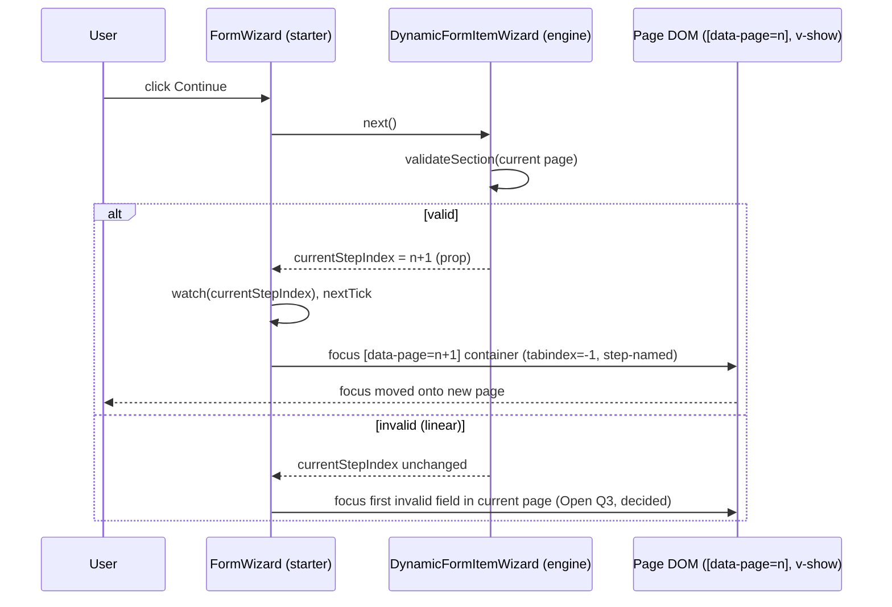

<!-- epic: optional. Set to the parent EPIC-XXX id when this feature belongs to an
     epic; leave "" for a standalone feature. Features are never nested under the
     epic folder, they only reference it here (flat model). -->

# Feature: Starter template accessibility (WCAG 2.2 AA)

## Decided without Jeroen (research)

Settled from research during the pre-approval chain, not reviewed by Jeroen. Override any of these freely.

- AR-1 (partial) → the "focus the wizard heading" option is dropped as not implementable (the only `<h1>` is constant, outside `[data-page]`, sometimes absent); the remaining choice was settled by Jeroen at Open question 2 (focus the named `[data-page]` container)
- AR-2 → behavioural focus/keyboard unit tests are mandatory alongside axe (axe under jsdom asserts static ARIA only)
- AR-3 → `CheckboxField`'s error and description move out of the clickable `<label>` (clicking a `role="alert"` error must not toggle the control)
- AR-4 (nit) → "private package" claims corrected: no `private` field, `publishConfig.access: "public"`, version `0.0.0`
- Q6 → axe violations fail `pnpm ci` (blocking), per the feature's own goal statement; test shape is both per-component and a whole-template render (complementary, not a tradeoff)

## Problem & goal

`@bach.software/vue-dynamic-form-starter` exists so a consumer can hand `DynamicForm` a template and get a complete, good-looking form with no CSS framework and no template of their own to write. Right now that form is not reliably usable by keyboard-only or screen-reader users, which means anyone who adopts the starter package to save themselves the work of writing a template is also, unknowingly, shipping an inaccessible form to their own end users. A form library's whole value is that the consumer doesn't have to think about this field-by-field; accessibility gaps in the one template meant to be dropped in as-is undermine that promise for every consumer who uses it, and for every end user who fills in a form built on it.

The goal is for every control the starter template renders (inputs, selects, checkboxes, toggle switches, password fields, choice cards, repeatable arrays, the wizard and its stepper) to meet WCAG 2.2 AA from a keyboard and screen-reader perspective, and for that to be checked automatically going forward rather than relying on manual review each time the template changes.

This is for:
- **Consumers of the starter package**, who get an accessible form without doing any accessibility work themselves.
- **End users of those consumers' forms**, specifically keyboard-only users and screen-reader users, who are the ones who actually hit these gaps today.

## Scope

### In scope

- **Label, description, and error association on every control**: every input, select, checkbox, toggle switch, and password field gets a correct `aria-describedby` chain covering its description and its error message, and `aria-invalid` reflecting its actual validation state. `ErrorMessage.vue` gets an `id` so it can be the target of that `aria-describedby`.
- **Error announcements**: `ErrorMessage.vue` currently renders a bare `` with no `role="alert"`/`aria-live`, so a screen reader never hears a validation error appear. Give per-field errors a live announcement, consistent with how `FormWizard.vue`'s step-errors banner already uses `role="alert"`.
- **Async/dynamic status announcements**: `PasswordStrengthBar.vue` updates a strength label as the user types with no announcement; decide and implement an appropriate `aria-live` treatment (politeness level, debouncing so it doesn't spam the user on every keystroke).
- **Full keyboard operability** across:
  - Wizard navigation (`FormWizard.vue`) and the stepper (`Stepper.vue`): already largely keyboard-reachable (native `<button>`s); confirm and close any remaining gaps.
  - Choice cards (`ChoiceCard.vue`, `ChoiceSectionCard.vue`): the `radiogroup`/`radio` ARIA roles are already in place, but there is no roving-tabindex/arrow-key navigation between cards, which is the native keyboard pattern screen reader users expect from that role combination. Decide whether to implement the full pattern or document the deviation (see Open questions).
  - Repeatable arrays, add and remove (`ArrayField.vue`, array/repeater chrome): add/remove buttons are native buttons and already reachable; the gap is what happens to focus after a remove, since the removed item's button disappears and focus is currently dropped to the document body.
  - Toggle switch (`ToggleSwitch.vue`): already has `role="switch"`, keyboard handlers for Space/Enter, and a `tabindex` that respects `disabled`; confirm there is no remaining gap.
  - Password reveal (`PasswordInput.vue`): the toggle button has `tabindex="-1"`, making it keyboard-unreachable. Remove that and make it a normal tab stop.
- **Focus management**:
  - On wizard step change: move focus to a sensible target on the new page (the page heading or its first focusable field) so a keyboard/screen-reader user isn't left focused on a `Back`/`Continue` button that just moved pages without feedback.
  - On validation failure: move focus to the first invalid field so the user is taken straight to what needs fixing instead of having to hunt for it.
- **Visible focus indicators and sufficient contrast**, in both light and dark mode, for every interactive control the template renders, including ones that currently have no explicit focus style defined (for example the password reveal button, which has no `focus-visible` rule in `style.css` today).
- **Automated axe-core checks** added to the existing Vitest suite (`packages/starter`), so a future regression is caught by `pnpm ci` rather than by manual review.

### Out of scope (explicit)

- **Formal conformance documentation or statements** (e.g. a VPAT or accessibility conformance report). This feature fixes the engineering gaps; writing a formal statement about the result is a separate concern.
- **Third-party accessibility audits.** Automated axe-core coverage plus the manual fixes above is the bar for this feature; an external audit is not part of it.
- **WCAG AAA.** Target is AA.
- **The engine package (`packages/core`).** `DynamicFormItemWizard`'s "pages stay mounted, visibility toggled with `v-show`, never `v-if`" contract and vee-validate's own field registration/validation timing are constraints this feature works within, not things it changes. Where a gap genuinely originates in the engine rather than the starter template, this feature documents it as a constraint rather than patching engine behaviour; a true engine-level fix would be its own feature.
- **Consumer-authored slot overrides.** A consumer who overrides `default-input`, `#icon`, or any other slot with their own markup owns that markup's accessibility; this feature only fixes the built-in chrome the starter template renders itself.
- **The Element Plus template package** (`packages/element-plus`) and any accessibility already provided by Element Plus itself; `FEAT-004`'s spec already scoped that out for the same reason (it inherits whatever Element Plus provides).

## Functional overview

A consumer who drops `StarterFormTemplate` into their app, with no accessibility work of their own, gets a form where:

- Every field's label, help text, and validation error are all programmatically associated with the control, so a screen reader announces the full context, not just the bare input.
- A validation error appearing after a blur or a failed submit is announced immediately, without the user needing to discover it visually or re-focus the field.
- A password strength change is announced as the user types, without being so chatty that it talks over every keystroke.
- Every interactive element, including the password reveal toggle and the choice cards, can be reached and operated with the keyboard alone, in a sensible order.
- Moving between wizard steps, or submitting a form with errors, moves keyboard focus to where the user needs to act next, rather than leaving it stranded.
- Every focused element has a visible focus indicator with sufficient contrast, in both light and dark mode.
- This behaviour is covered by automated axe-core checks that run as part of the existing Vitest suite, so a later change that regresses any of the above fails CI instead of shipping silently.

## Design (feature level)

Prototype: [`prototype.html`](./prototype.html) (self-contained, open in any browser; light/dark toggle top-right). It is a faithful flattening of the shipped `packages/starter/src/style.scss` with the real `--sft-*` tokens on `:root`/`:root.dark`, plus this feature's visual delta grouped under a clearly marked `FEAT-011 ADDITIONS` block. Keyboard-focus states are painted statically via a `.demo-focus` helper that mirrors the real `:focus-visible` rules; live-region copy (errors, password strength) is shown with a blue bar marking what a screen reader announces (offscreen in production). Sections carry stable anchor ids for story deep-links: `#text-field`, `#select-field`, `#password-field`, `#choice-cards`, `#array-remove`, `#wizard-step`, `#toggle-field`.

This feature is almost entirely attribute-level (`aria-*`, `role`, `id`, focus management in script). It touches the visual surface in only two ways: **focus indicators** (new rules for controls that had none, and a shared token) and **two small contrast corrections** to focus colours. No new visible UI element is introduced; error text and the password strength bar keep their exact shipped appearance.

### States policy (one policy, applied everywhere)

- **Focus indicator (new, unified).** Every interactive control shows a `:focus-visible` indicator: a 2px solid outline in a shared focus colour with a 2px offset (3px on the small stepper dot, 4px on a heading). `:focus-visible`, never `:focus`, so a mouse click never paints the ring, consistent with the package's existing primary-button/toggle use. Two focus colours, one per accent family: `--sft-focus-visible` (sky) for inputs, selects, buttons, toggle, stepper and the password toggle; `--sft-focus-visible-choice` (indigo) for choice cards.
- **Error (unchanged visual, new semantics).** Per-field errors keep the `.sft-error` look. `ErrorMessage.vue` gains an `id` and `role="alert"` and is wired as the tail of the control's `aria-describedby`. The visible red invalid-border state on inputs/selects/toggle field is unchanged.
- **Valid / pristine / disabled.** Unchanged from today (the opt-in `showValidState` green border; disabled dims to 0.6 opacity). Shown for completeness in `#text-field`.
- **Loading / empty.** No new loading state (the package's only spinner lives in `SubmissionSuccess`, out of this feature's surface). The array empty state is unchanged visually; the only change is that removing the last item moves focus to its `Add a {item}` button.

### Contrast corrections (the only colour changes)

Measured against the 3:1 non-text-contrast bar (WCAG 2.2 SC 1.4.11 / focus-appearance), three shipped focus colours fall short on a white card in light mode; dark mode already clears all three (near-black card gives 8:1+). The prototype shows the corrected rings:

- **Input/select/toggle focus border.** Shipped `#00a6f4` is ~2.7:1 on white. Light-mode focus indicator uses `#0084d1` (the existing accent, ~4.0:1); the pale `--sft-focus-ring` companion ring is kept. Dark mode uses `#38bdf8`.
- **Choice-card focus ring.** Shipped ring reused the pale hover colour `#a3b3ff` (~2.0:1 on white). Focus-visible now uses the strong indigo `#4f39f6`; dark mode keeps `#a3b3ff` (high contrast on the dark card).
- These are expressed as two new tokens (`--sft-focus-visible`, `--sft-focus-visible-choice`) declared on `:root` and `:root.dark`, so both modes come from the token and no rule hardcodes a mode-specific colour.

Everything else in the prototype renders identically in both modes because it uses the existing `--sft-*` tokens untouched; no section needs dark-specific styling beyond the two new tokens above (verified by walking the whole prototype under the dark toggle).

### Per-section design notes (maps to the spec's required coverage)

- **`#text-field` / `#select-field`.** Label stays associated via the existing `for`/`id` (`id = fieldMetadata.path`). New: the error span gets an `id`; the control's `aria-describedby` chains description then error (`"<path>-desc <path>-error"`), present only for the parts that exist. Focus ring shown on one field; invalid state shows `aria-invalid="true"` plus the announced error.
- **`#password-field`.** The reveal button loses `tabindex="-1"` and becomes a normal tab stop with the shared focus ring (it had no focus style at all). Its `aria-label` still toggles "Show password" / "Hide password". The strength bar becomes decorative (`aria-hidden`) and the tier is mirrored into an `aria-live="polite"` region (`"Password strength: Good"`), announced on blur per Open question 5's decision.
- **`#choice-cards`.** Keyboard focus ring strengthened to the indigo token; `radiogroup`/`radio` roles unchanged. `DECIDED (Jeroen, Open question 1)`: the group becomes one tab stop with arrow-key roving (ARIA APG pattern), matching the roles already in place. The ring looks identical either way, so the visual design needed no change.
- **`#array-remove`.** Remove buttons gain the shared focus ring. Focus target after a remove (a decision, not an open question): move to the **previous** item's Remove button; when the removed item was the first/only one, move to the array's `Add {item}` button (empty-state `Add a {item}` button when the list becomes empty). Both end states are drawn.
- **`#wizard-step`.** After navigation (pages stay mounted, `v-show`-toggled per the engine contract), focus moves to the new page. `DECIDED (Jeroen, Open question 2)`: the target is the `[data-page]` container itself (`tabindex="-1"`), given an accessible name tied to the stepper's current-step label, so the step transition is announced before the first field. The prototype's page-heading target drawing is superseded; the heading-focus ring styling carries over to the container instead. Stepper step buttons gain their own focus ring (shown on the current step).
- **`#toggle-field`.** Toggle focus ring routed through the shared sky token so light mode clears 3:1. `role="switch"`, Space/Enter handlers and the disabled-aware `tabindex` are unchanged. New: `aria-invalid` + `aria-describedby` to the error, matching the text inputs (the spec notes `aria-invalid` is not yet on `ToggleSwitch`/`CheckboxField`).

### Component / pattern mapping (`specs/components.md`)

All affected chrome is the starter package's internal, non-exported components (listed under "Non-published surfaces"). No change maps to the published `packages/core` surface. Mapping of design to existing components:

- `ErrorMessage.vue` — add `id` + `role="alert"` (semantics only, visual unchanged).
- `TextInput.vue`, `SelectInput.vue`, `PasswordInput.vue` — `aria-describedby`; `PasswordInput.vue` also removes `tabindex="-1"` on the reveal button.
- `ToggleSwitch.vue` / `CheckboxField.vue` — add `aria-invalid` + `aria-describedby`.
- `PasswordStrengthBar.vue` — `aria-hidden` on the visual bar + a new `aria-live` region.
- `ChoiceCard.vue` / `ChoiceSectionCard.vue` — focus ring colour; keyboard pattern per Open question 1's decision: full APG roving-tabindex.
- `RepeaterCard.vue` / `ArraySectionCard.vue` / `ArrayField.vue` — focus management after remove (script).
- `FormWizard.vue` / `Stepper.vue` — focus on step change (script) + stepper focus ring.
- `StarterFormTemplate.vue` — wires the `aria-describedby` id composition from `fieldMetadata.path` into the per-type input slots.
- `style.scss` — the `FEAT-011 ADDITIONS` block: two new focus tokens on `:root`/`:root.dark`, a `.sft-sr-only` utility, and `:focus-visible` rules for the password toggle, all `.sft-btn` variants, `.sft-step`, and the corrected input/toggle/choice-card rings.

**New component / utility genuinely needed:** a visually-hidden `.sft-sr-only` CSS utility. The package has no offscreen-text helper today, and the password-strength live region (and any script-driven announcement) needs one. This is a new class in `style.scss`, not a new Vue component.

## Architecture (feature level)

Verified against the installed tree: `vue ^3.5.44`, `vee-validate >=4.12`, `vitest 3.2.6` + `jsdom 26.0.0`, `@lucide/vue >=1 <2`. The starter is `version: 0.0.0` and unpublished (no release has run; `package.json` has no `private` field and sets `publishConfig.access: "public"`), so there is no installed-consumer constraint; its only consumer-observable surface is the exported components, `StarterFormTemplate`'s slot contract, and the shipped `dist/style.css` (classes + `--sft-*` tokens). Confirmed in code: `aria-invalid` is already on `TextInput`/`SelectInput`/`PasswordInput`; `role=radiogroup/radio` on `ChoiceSectionCard`/`ChoiceCard`; `role=switch` + Space/Enter + disabled-aware `tabindex` on `ToggleSwitch`; the only `role="alert"` today is `FormWizard`'s step-errors banner; no `.focus()`, `autofocus`, or `aria-describedby` anywhere. The `<form>` and the submit handler are the **consumer's**, not the template's (see the `TestForm.vue` / docs examples): `handleSubmit`/`onInvalidSubmit` live outside this package. This single fact drives the biggest architecture call below and feeds a new Open question (7).

### Component / composable plan

Reused as-is: `AppButton`, `OptionalRequiredTag`, `StarterIcon`, `SelectInput` (its `$attrs` passthrough already carries a new `aria-describedby`), `SectionCard`, `GroupField`, `ArrayField`.

Modified (all backward compatible, all additive props/attributes with safe defaults):
- `ErrorMessage.vue` — gains an optional `id` prop and emits `role="alert"`. Visual unchanged. When `id` is absent it behaves exactly as today.
- `TextInput.vue` — no prop change; `aria-describedby` flows through the existing `$attrs` spread.
- `PasswordInput.vue` — removes `tabindex="-1"` on the reveal button (becomes a normal tab stop). `aria-describedby` flows through `$attrs`.
- `PasswordStrengthBar.vue` — adds `aria-hidden="true"` to the visual bar and renders a sibling `.sft-sr-only` live region mirroring the tier ("Password strength: {label}"), `aria-live="polite"`. `DECIDED (Jeroen, Open question 5)`: announces on blur, not debounced-while-typing. Gains an `announce` prop defaulting to `'blur'`.
- `ToggleSwitch.vue` — gains optional `ariaInvalid?: boolean` and `ariaDescribedby?: string` props bound onto the `role=switch` span. Default off, so today's render is unchanged.
- `CheckboxField.vue` — gives its `ErrorMessage` an `id` (`${inputId}-error`). `DECIDED (research)`, from adversarial review finding 3: move `ErrorMessage` (and ideally the description `
`) *out* of the `<label>` element and render them as siblings inside `.sft-switch-field`, keeping the `id` for the `aria-describedby` target. As shipped the error and description are children of the clickable `<label>`, so once the error carries `role="alert"` a user clicking it to read it toggles the control (accept-the-terms, 2FA). The prototype's `#toggle-field` invalid card has the same structure and should be redrawn the same way.
- `FormField.vue` — gives its description `
` and `ErrorMessage` deterministic ids derived from the existing `inputId` (`${inputId}-desc` / `${inputId}-error`). No new prop.
- `ChoiceCard.vue` / `ChoiceSectionCard.vue` — `DECIDED (Jeroen, Open question 1)`: full APG pattern. `ChoiceSectionCard` owns group-level arrow-key handling and roving `tabindex`, skipping disabled cards (adversarial review finding 7); `ChoiceCard` gains an optional `tabindex` prop (default `0`, overridden to `-1`/`0` by the roving logic).
- `RepeaterCard.vue` / `ArraySectionCard.vue` — no markup change; focus-after-remove is handled by the shared util below, triggered from `StarterFormTemplate`'s remove wiring.
- `FormWizard.vue` — gains a template ref on `<main>` and a `watch(currentStepIndex)` that, after `nextTick`, focuses the now-visible `[data-page="<index>"]` container itself (`tabindex="-1"`, accessible name tied to the stepper's current-step label, per Open question 2's decision). Skips its first run so mount never steals focus. No prop/slot change.
- `StarterFormTemplate.vue` — composes the conditional `aria-describedby` string per field and binds it onto the per-type input slots; wraps `s.removeItem` so focus is restored after a remove. No slot-contract change.
- `style.scss` — the `FEAT-011 ADDITIONS` block exactly as prototyped: `.sft-sr-only`, two tokens on `:root`/`:root.dark`, and the `:focus-visible` rules.

Genuinely new (justified against `specs/components.md`, which lists no focus helper):
- `focus.ts` (internal util module, not a component) — `focusWithTemporaryTabindex(el)` (adds `tabindex="-1"`, focuses, removes it on blur, so a non-interactive container can be a landing target without permanent markup), `firstFocusableWithin(container)`, `firstInvalidWithin(container)`. Reused by `FormWizard` (step change), the array-remove handler, and the wizard's own focus-first-invalid (Open questions 3/7). `firstInvalidWithin` is additionally wrapped and re-exported from `index.ts` as `focusFirstInvalid(containerEl)` per Open question 7's decision, for non-wizard forms; the rest of the module stays internal.
- `.sft-sr-only` CSS utility (new class in the shipped stylesheet, as the Design states). Consumer-observable, documented.

No new Vue component is required: `FormWizard` already owns navigation state, so the step-change watch lives there rather than in a new per-page wrapper (the inline `default-wizard-page` div stays markup-only).

### Public API impact

- **Exports:** one added. `DECIDED (Jeroen, Open question 7)`: `index.ts` exports a `focusFirstInvalid(containerEl)` helper (backed by `focus.ts`'s `firstInvalidWithin`) so a consumer can wire it into their own non-wizard form's `onInvalidSubmit`. Everything else is unchanged.
- **Exported type shape:** `DECIDED (Jeroen, ST-06)`: the exported `ChoiceOption` type (`ChoiceSectionCard.vue`, re-exported from `index.ts`, used to type a consumer's own choice-card option list) gains one new optional field, `disabled?: boolean`, forwarded from the engine's existing per-branch `FieldMetadata.disabled` (`StarterFormTemplate.vue`'s `heading-choice` mapping, which drops it today). Additive: an existing consumer's `ChoiceOption` literals keep satisfying the type unchanged. This closes an asymmetry where the group-level `disabled` was already forwarded but the per-branch one was not, and makes ST-06's disabled-skip roving behavior (AC3) reachable end-to-end by a real consumer, not only by synthetic component props.
- **`StarterFormTemplate` slot contract:** unchanged. Slot prop shapes and `defineMetadata` generics are unchanged. The new behavior is internal chrome + attributes.
- **`defineMetadata` / `FieldMetadata` / `DynamicFormSettings`:** no new metadata or settings property, per Open question 4's decision (no opt-out). If Open question 5 wants the password timing consumer-configurable, it is one optional property under the existing `starterMetadata` `password` group (`password.announce`), again additive.
- **Validation rules:** none changed.
- **Consumer-observable CSS:** two new `--sft-*` tokens (retheme-able, additive) and one new `.sft-sr-only` utility class in `dist/style.css`; three shipped focus colours are corrected for contrast. Existing custom properties are untouched, so an existing consumer theme keeps working.
- **Backwards compatibility:** every change is additive or a pure fix. The only behavior a consumer could theoretically have relied on is the password toggle being skipped in tab order; making it tabbable is a correctness fix, not a contract. **No breaking change.**
- **Changeset bump: minor.** Rationale: a new consumer-visible capability (the template now ships accessible markup + focus management + the two new retheme tokens), fully backward compatible. (CLAUDE.md step 7 requires a changeset because `packages/starter/src` changes; the package is publishable, not private, so Changesets will track it, and "new capability" maps to minor.) `specs/components.md` needs a one-line note on the new `.sft-sr-only` utility, the two focus tokens, and that the starter now emits an accessible label/description/error chain and manages focus; no core-surface edit.

### Documentation impact

- `docs/guide/starter-template.md` — add an "Accessibility" section: what the template guarantees out of the box (label/description/error association, error + strength announcements, keyboard operability, focus management, no opt-out per Open question 4), the two new retheme tokens (`--sft-focus-visible`, `--sft-focus-visible-choice`) in the theming subsection, and the `focusFirstInvalid` helper with an `onInvalidSubmit` wiring example for non-wizard forms (Open question 7). Required because this is consumer-facing behavior, not just a signature.
- `packages/starter/README.md` — mirror a short "Accessibility" subsection (it ships in the tarball and is the primary consumer doc). It currently has none.
- `docs/reference/*` — **no change**: no core (`packages/core`) public API changes, and the reference pages document the core surface, not the starter's internal chrome.
- `docs/examples/wizard.md` — worth updating: Open questions 2 and 3 landed concrete, demonstrable behavior (focus moves to the named step container on navigation; focus moves to the first invalid field on a failed step transition, not only final submit).

### Data flow

State lives where it already does; this feature adds no new reactive store.

1. **aria-describedby composition.** Ids are a deterministic convention off `fieldMetadata.path`: description = `${path}-desc`, error = `${path}-error`. `FormField`/`CheckboxField` stamp those ids on the elements they render; `StarterFormTemplate` (which renders the actual control into those wrappers' slots) computes the `aria-describedby` string from the same `path`, including a token **only when that part exists** (`fieldMetadata.description` present; `fieldContext.errorMessage.value` truthy). This avoids a dangling idref, which axe flags as `aria-valid-attr-value`. The string reaches the control through the existing `$attrs` passthrough (`TextInput`/`SelectInput`/`PasswordInput`) or the new explicit props (`ToggleSwitch`). The split (ids rendered by the wrapper, attribute set by the template) is reconciled purely by the shared `path` convention, no new prop plumbing.
2. **Error announcement.** `role="alert"` on `ErrorMessage` is an implicit assertive live region; vee-validate already drives `errorMessage` reactively, so the span mounting/updating is the announcement trigger. No debounce needed (errors appear on blur/submit, not per keystroke). Mirrors the existing wizard banner precedent.
3. **Password strength announcement.** `PasswordStrengthBar` already computes the tier reactively from `password`. The `.sft-sr-only` region re-renders with the tier string, `aria-live="polite"`. `DECIDED (Jeroen, Open question 5)`: announce on blur, not debounced-while-typing. The trigger comes from the input's blur, so `StarterFormTemplate` passes an `announce="blur"` signal and the input's `@blur` drives it (the bar cannot see the input's blur itself).
4. **Focus on wizard step change.** The engine (`DynamicFormItemWizard`, out of scope) owns `currentStepIndex` and passes it as a prop to the starter's `FormWizard`; pages never unmount (`v-show` on `isCurrent`). `FormWizard` `watch(() => props.currentStepIndex)` (skipping the first run) → `nextTick` → focus the `[data-page="<index>"]` container itself, via `focusWithTemporaryTabindex`. This satisfies the Constraints' "react to the prop, not to mount/unmount" requirement: `currentStepIndex` is the reactive equivalent of `isCurrent` and is a prop.

   `DECIDED (research)`, from adversarial review finding 1 — correct the heading target: The `<h1 class="sft-wizard-title">` is *not* inside `[data-page]`: it lives in `FormWizard`'s header, outside `<main>`, is bound to the wizard-level `subTitle` (constant across steps), and is `v-if`-gated so it may be absent. There is no guaranteed per-page heading inside `[data-page]`. "Focus the wizard `<h1>`" is dropped: it is constant, often absent, and conveys no step change.

   `DECIDED (Jeroen, Open question 2)`: focus the `[data-page]` container itself, given `tabindex="-1"` and an accessible name tied to the stepper's current-step label (`aria-labelledby` pointing at the step title the stepper already tracks), so a screen reader announces *which* step the user landed on before reaching the first field. This achieves the screen-reader announcement without a new visible element, consistent with the Design's "no new visible UI element" constraint.
5. **Focus after array remove.** `StarterFormTemplate` wraps the engine's `s.removeItem`: at click time the triggering remove button is `document.activeElement`; the wrapper records its position among the section's remove buttons, calls the engine remove, then on `nextTick` focuses the previous item's remove button, or the section's Add button when the removed item was first/only, or the empty-state Add button when the list is now empty (all three states drawn in the prototype). Uses `focus.ts` DOM queries scoped to the array section; no engine change, no new component.
6. **Focus first invalid field.** Within the wizard, the template controls the step-transition case directly: `next()`'s forward-validation failure (Open question 3, decided: yes, also fires here). A failed **final** submit is not something `FormWizard` can see either: it renders no `<form>` (its last-step button is a bare `type="submit"`, left to whatever `<form>` the consumer wraps the template in), so the final-submit case is consumer-owned exactly like a plain non-wizard form's failed submit. For both, the submit and its validation are the consumer's `handleSubmit`/`onInvalidSubmit`, which this package cannot intercept; `DECIDED (Jeroen, Open question 7)`: export `focusFirstInvalid(containerEl)` from `index.ts` (backed by `firstInvalidWithin`) for the consumer to call from their own `onInvalidSubmit`, covering the wizard's final submit and the non-wizard case identically.

### axe-core test integration plan

- **Engine:** `axe-core` `4.14.0` (MPL-2.0, zero runtime dependencies) added as a **devDependency of `packages/starter`** only, so it never reaches consumers. Chosen over `vitest-axe`: the stable `vitest-axe` is `0.1.0` (stale, peer `vitest >=0.16.0`, pulls `chalk`/`lodash-es`/`redent`); a ~15-line in-repo matcher/helper over `axe-core.run(container)` avoids that transitive surface and the pre-release gamble, and runs cleanly under the existing `jsdom` + `vitest 3.2.6` setup (added to `src/tests/test-setup.ts` or a dedicated helper).
- **jsdom limitation (verified):** axe's `color-contrast` rule cannot be computed under jsdom (no layout engine), so the test helper disables it explicitly in the run options. It does not auto-disable: left enabled it returns `incomplete` results and can error (corrected per ST-07 adversarial review finding 1; `jest-axe` applies the same explicit disable). Therefore the two contrast corrections and focus-ring visibility are **not** covered by the axe unit tests; they are verified by `prototype.html`, the existing `prototypeParity.test.ts`, and a Playwright screenshot in both modes. The axe suite covers roles, names, `aria-*` validity, idref integrity, and the describedby chain.
- **Shape is Open question 6.** Designed for either: a per-component assertion inside the relevant `*.test.ts`, and/or a whole-template `StarterFormTemplate` render with representative metadata (closest to what ships). `DECIDED (research)`: the blocking half of Q6 is settled, axe violations fail `pnpm ci` outright. Why: the feature's own goal statement and Functional overview already promise that a regression "fails CI instead of shipping silently"; a warn-only mode would contradict the spec's stated goal. Source: this spec's Problem & goal, Functional overview.
- `DECIDED (research)`, from adversarial review finding 2 — behavioural focus/keyboard tests, not only axe: axe under jsdom asserts static ARIA only. It cannot verify the behaviour that is the bulk of this feature: focus moving on step change, focus after an array remove, focus-first-invalid, roving tabindex, or that `Space`/`Enter`/arrow keys operate a control. So the "regression caught by `pnpm ci`" promise only covers the attribute layer unless the automated-check story *also* mandates behavioural unit tests: `@vue/test-utils` with `document.activeElement` assertions after each focus move, and `trigger('keydown.*')` for the keyboard handlers. These run cleanly in jsdom (no layout needed) and belong alongside the axe assertions. The contrast/focus-ring visibility remains screenshot-only, as already stated.

### ADR notes

- **ADR 1 - Step-change focus in starter `FormWizard`, watching `currentStepIndex`.** Context: pages never unmount (engine `v-show` contract), so lifecycle hooks cannot drive focus. Decision: a `watch` in `FormWizard`, which already owns navigation and contains all `[data-page]` DOM. Alternative: a new per-page wrapper component watching `isCurrent` (closer to the Constraints' wording) - rejected as an extra component for no gain; `currentStepIndex` is the same reactive signal and the single-locus watch avoids N watchers and per-page initial-mount false triggers.
- **ADR 2 - Temporary `tabindex="-1"` for non-interactive focus targets.** Context: the `[data-page]` container landing target (Open Q2, decided: focus the container) must be programmatically focusable without entering tab order. Decision: the helper adds `tabindex="-1"` at focus time and removes it on blur. Alternative: permanent `tabindex="-1"` in `SectionCard`/`GroupField` markup - rejected as markup noise on every page for a rarely-used target.
- **ADR 3 - Deterministic path-derived idrefs, conditionally emitted.** Context: description/error live in the field wrapper, the control in the template slot. Decision: both sides derive `${path}-desc`/`${path}-error`; the `aria-describedby` string includes a token only when that element is actually rendered. Alternative: pass ids as props through the slot - rejected as plumbing the shared `path` convention already makes unnecessary; emitting ids unconditionally - rejected because a dangling idref is itself an axe violation.
- **ADR 4 - `role="alert"` on `ErrorMessage`, not a standalone `aria-live` region.** Context: per-field errors must announce. Decision: `role="alert"` matches the existing wizard-banner precedent and needs no polite/debounce handling because errors do not fire per keystroke. Alternative: `aria-live="assertive"` wrapper - equivalent semantics, more markup, no precedent in the package.
- **ADR 5 - `axe-core` direct as devDependency over `vitest-axe`.** Context/decision/alternative covered in the test plan above; recorded here as the auditable call. Key facts: `axe-core` MPL-2.0, no runtime deps, dev-only so zero consumer bundle impact; `vitest-axe` stable is stale `0.1.0`.

### Slicing seams (input for the scrum-master)

Largely independent, dependency noted:
1. **Attribute wiring (label/description/error association + `aria-invalid` on toggle/checkbox).** `ErrorMessage` id + `role=alert`, `FormField`/`CheckboxField` ids, `StarterFormTemplate` describedby composition, `ToggleSwitch` props. Self-contained, no new util. Highest-value, lowest-risk; good first slice.
2. **Focus-visible CSS + contrast tokens + `.sft-sr-only`.** Pure `style.scss` delta; depends on nothing; verified by prototype parity + screenshot. Slices alone.
3. **Password strength announcement.** `PasswordStrengthBar` + `.sft-sr-only` (needs slice 2's utility). Timing decided (Open question 5: announce on blur); no longer blocked.
4. **Focus management util (`focus.ts`) + wizard step-change + array-remove focus.** Shared util first, then the two consumers. Independent of slices 1-3. Array-remove and step-change can be separate stories over the same util.
5. **Choice-card keyboard pattern.** Per Open question 1's decision (full APG), a self-contained `ChoiceSectionCard`/`ChoiceCard` script slice (group-level arrow-key handling + roving `tabindex`), on top of slice 2's ring.
6. **axe-core test harness + coverage.** Depends on slices 1-5 landing the markup it asserts. Shape and blocking are both decided (Open question 6: both per-component and whole-template assertions, blocking). Natural last slice.
7. **Docs (guide + README accessibility sections, including the `focusFirstInvalid` wiring example).** Depends on the behavior being final; slices after 1-6. All of Open questions 1-5 and 7 are now decided, so the copy can be written directly rather than hedged.

Slices 1 and 2 are immediately deliverable. Per Open question 7's decision, the non-wizard `focusFirstInvalid` export is now in scope and can be sliced together with slice 4 (it shares `focus.ts`'s `firstInvalidWithin`), with a docs note in `docs/guide/starter-template.md` showing the `onInvalidSubmit` wiring.

## Adversarial review

Filled by adversarial-reviewer at feature level. Findings and resolutions.

Verification done against the shipped components (`packages/starter/src/*.vue`), the prototype, and `package.json`. Confirmed true: `aria-invalid` already on Text/Select/Password inputs; `role=radiogroup/radio` on choice cards; `role=switch` + Space/Enter + disabled-aware tabindex on `ToggleSwitch`; `tabindex="-1"` on the password reveal button; the only `role="alert"` is the wizard banner; `$attrs` passes through to the `<input>`/`<select>`/password input (so `aria-describedby` will land on the control); `[data-page]` exists on the wizard page wrapper; `prototypeParity.test.ts` exists. The axe-core jsdom `color-contrast` limitation is also confirmed (jsdom has no layout engine, so the rule cannot run). Open question 7's premise is correct: `StarterFormTemplate` renders no `<form>` and no submit handler, so the non-wizard submit path genuinely belongs to the consumer. Q7 is well-posed.

1. **(should-fix) The wizard step-change "page heading" focus target does not exist as drawn.** Data flow 4, ADR 1, the prototype `#wizard-step`, and Open question 2 all present "focus the page heading" as a viable option on a par with "first focusable field". But the only heading element is `<h1 class="sft-wizard-title">` in `FormWizard.vue`, which (a) is bound to `subTitle = fieldMetadata.description`, a single value fixed for the whole wizard, (b) is rendered *outside* `<main>`, so it is outside every `[data-page]`, and (c) is conditionally rendered (`v-if="subTitle"`), so it may not exist at all. There is no per-page heading inside `[data-page]`; a page is a bare `
` of fields (as the prototype itself draws). The prototype depicting the constant wizard `<h1>` "Your profile" as the per-step target is misleading: focusing it on every step change announces the same text each time and conveys no step change to a screen-reader user. The architect's own CSS hedges this by also adding `:focus-visible` to `.sft-section-title` (an `<h2>` that *is* inside `[data-page]` when the page's top node is a `heading`-shape group), but that is not guaranteed either. Resolution routed into Data flow 4 and Open question 2 below. `DECIDED (research)`, partial: the wizard-`<h1>` option is dropped (verified not implementable as drawn); choosing between first-field and the named `[data-page]` container stays Open question 2.
2. **(should-fix) The axe-core suite cannot verify the feature's core behaviour; focus-movement and keyboard operability need explicit behavioural tests.** Under jsdom axe covers static ARIA only (roles, names, `aria-*` validity, idref integrity). It cannot evaluate focus order, roving tabindex, whether `Space`/`Enter`/arrow keys operate a control, or whether focus actually moved after a step change, an array remove, or a failed submit, which is the majority of this feature. The "caught by `pnpm ci` instead of manual review" promise in the goal and functional overview only holds for the attribute layer unless the plan also mandates behavioural unit tests (`@vue/test-utils` + `document.activeElement` assertions and `trigger('keydown.*')`). Resolution routed into the axe-core test integration plan below. `DECIDED (research)`: accepted; without behavioural tests the goal's CI promise is false for the feature's core, and the tests run cleanly under the existing jsdom setup.
3. **(should-fix) The per-field `role="alert"` error is rendered inside a clickable `<label>` on the checkbox/toggle field.** `CheckboxField.vue` (and the prototype's `#toggle-field` invalid example) renders `ErrorMessage` inside `<label>`, which wraps the label text, description, and error. Adding `role="alert"` makes a live region a child of a clickable label whose click toggles the control, so a user clicking the error text to read it flips 2FA / "accept the terms". The description has the same problem. Resolution routed into the component plan below. `DECIDED (research)`: accepted; a clickable live region that toggles the control is a concrete defect with no defensible alternative.
4. **(nit) The starter package is not `private`.** The architecture (lines 116, 228) calls it "private, unpublished". `package.json` has no `"private": true` and sets `publishConfig.access: public`; it is publishable, merely at `version: 0.0.0`. This makes the "patch/minor line is academic" aside slightly off (changesets *will* track it), though the `minor` bump is still the right call. No change required beyond not relying on "private". `DECIDED (research)`: the "private" wording in the Architecture section is corrected.
5. **(nit) Public API impact "Exports: none added" is conditional on Open question 7.** Option (a) of Q7 (an exported focus-first-invalid helper/composable) would add an export to `index.ts`, contradicting the flat "none added or removed" claim. The section already carries the Q4/Q5 exceptions inline; Q7(a) deserves the same caveat so the API-impact summary is not read as final before Q7 is settled. Resolved: Jeroen chose option (a); the Public API impact section now states the export directly rather than as a caveat.
6. **(nit) Double announcement risk when focus-first-invalid lands on a `role="alert"` field.** When focus moves to the first invalid field whose error is both a `role="alert"` live region and the tail of its `aria-describedby`, some screen readers announce the message twice (once as the alert fired, once as the description on focus). Acceptable and common; worth a line in the focus-management story so it is a known trade-off, not a surprise.
7. **(nit) If Open question 1 adopts the APG radio pattern, roving tabindex must handle disabled cards.** `ChoiceCard` is a native `<button :disabled>`, which cannot hold roving focus; the group must always keep exactly one tab stop and arrow-key roving must skip disabled options. Flag for the choice-card story if Q1 chooses APG.

## Constraints & assumptions

- **The engine's wizard page contract cannot change.** `DynamicFormItemWizard` keeps every page mounted and toggles visibility via `v-show` on `isCurrent`; it is documented in `packages/starter/README.md` that a consumer overriding `default-wizard-page` must preserve this. Focus management on step change must therefore react to the `isCurrent` prop changing (e.g. a `watch`), not to mount/unmount lifecycle hooks, since pages never unmount on navigation.
- **No existing focus-management code exists anywhere in `packages/core` or `packages/starter` today** (confirmed: no `.focus()` call, no `autofocus` attribute, no `aria-live` attribute outside `FormWizard.vue`'s step-errors banner). This is new behaviour, not a fix to something half-built.
- **`aria-invalid` is already wired** on `TextInput.vue`, `SelectInput.vue`, and `PasswordInput.vue` (all three set it from `!!errorMessage`). The gap is `aria-describedby`, the live announcement, and extending the same `aria-invalid` coverage to `ToggleSwitch.vue`/`CheckboxField.vue`, not introducing `aria-invalid` from scratch everywhere.
- **`role="radiogroup"`/`role="radio"` are already wired** on `ChoiceSectionCard.vue`/`ChoiceCard.vue`. The gap is the keyboard interaction pattern (arrow-key roving tabindex) that ARIA authoring practice expects alongside those roles, not the roles themselves.
- **The toggle switch's accessible name gap was already fixed** in FEAT-007 at Jeroen's request (`StarterFormTemplate.vue` now passes `:label` to `ToggleSwitch`); this feature does not need to repeat that fix, only verify it holds.
- **`packages/starter` is not yet published** (per its README: "The package is not published yet"), so there is no installed-consumer backwards-compatibility constraint blocking a markup or attribute change the way there would be for the published `packages/core`. The architecture phase should still note whether the fixes amount to a public-surface change worth flagging in `specs/components.md`.
- Any CSS changes (new focus-visible rules, contrast adjustments) should follow the existing `--sft-*` custom-property theming convention in `style.css` (`:root` plus `:root.dark` overrides) rather than introducing a parallel styling mechanism.

## Open questions

Questions for Jeroen. Must be resolved before approval.

1. **Choice-card keyboard pattern**: implement the full ARIA APG radio pattern (single Tab stop into the group, arrow keys move selection among cards) to match the `radiogroup`/`radio` roles already present, or keep today's "every card is its own Tab stop, Enter/Space activates" behaviour and document it as an intentional, simpler deviation? The former is more correct for the roles used but is a bigger, more invasive change to `ChoiceCard.vue`/`ChoiceSectionCard.vue`.

   `DECIDED (Jeroen)`: full APG roving-tabindex pattern. `ChoiceCard.vue`/`ChoiceSectionCard.vue` implement a single Tab stop into the group with arrow-key roving selection, skipping disabled cards (per adversarial review finding 7).
2. **Focus target on wizard step change**: focus the new page's heading, or its first focusable field? Different libraries make different calls here; whichever is chosen should probably be consistent with the "focus first invalid field on validation failure" behaviour below rather than picked independently. **(Reframed by adversarial review, finding 1.)** The "page heading" option as drawn is not implementable: the only heading is the wizard-level `<h1>` (constant, outside `[data-page]`, sometimes absent), and pages have no guaranteed per-page heading. The real choice is (a) first focusable field in `[data-page]`, or (b) the `[data-page]` container with `tabindex="-1"` and an accessible name naming the step (so the screen reader announces the step change). See the PROPOSED note in Data flow 4.

   `DECIDED (Jeroen)`: option (b). Focus the `[data-page]` container (`tabindex="-1"`) with an accessible name tied to the stepper's current-step label, so the step transition itself is announced before the user reaches the first field.
3. **Should focus-on-first-invalid-field fire only on a failed submit, or also on a step's forward-navigation validation failure (`FormWizard`'s `next()`)?** The wizard already surfaces per-step errors via the stepper and the last-step banner; whether a failed step transition should also move focus, or only final submit should, is a product decision.

   `DECIDED (Jeroen)`: yes, also on a failed step transition. `next()`'s existing `validateSection(current page)` call becomes the trigger: on failure, focus moves to the first invalid field within the current page via `firstInvalidWithin` (the same `focus.ts` helper the final-submit path uses).
4. **Should any of this be an opt-out setting** (consistent with this package's existing pattern of opt-in/opt-out flags like `showValidState`, `falseAsUndefined`), or should it be unconditional default behaviour with no escape hatch? An opt-out adds API surface for a feature meant to be "on by default and correct"; no opt-out is simpler but removes a consumer's ability to roll their own focus management if they want to.

   `DECIDED (Jeroen)`: unconditional, no opt-out. This is a correctness bar ("accessible with no accessibility work of the consumer's own"), not a style preference like `showValidState`. No new `DynamicFormSettings` property is added for this.
5. **Password strength announcement politeness and timing**: `aria-live="polite"` announced on every keystroke risks being disruptive; is a debounce (and if so, roughly how long) acceptable, or should the strength tier only be announced on blur?

   `DECIDED (Jeroen)`: announce on blur, `aria-live="polite"`. No debounce needed since the announcement fires once, on blur, not while typing. `PasswordStrengthBar`'s `announce` prop defaults to `'blur'`.
6. **axe-core integration shape**: run it as assertions inside the existing `*.test.ts` files component-by-component, or as a small number of broader "render the whole starter template with representative metadata and run axe against the mounted DOM" tests? The former gives more precise failure attribution; the latter more closely matches what a consumer actually ships. Also: should an axe violation fail `pnpm ci` outright (blocking), or only the dedicated accessibility test file in a non-blocking warn mode? The feature's own goal statement wants it blocking; confirming that is still desired once the real tool is wired in is worth a deliberate yes.

   `DECIDED (research)`, partial: blocking. The goal statement and Functional overview already promise regressions "fail CI instead of shipping silently"; warn-only would contradict the spec itself. The shape half (per-component vs whole-template render, or both) stays open for Jeroen.

   `DECIDED (research)`: do both. This is a pure test-organization choice, invisible to consumers and the public API, so it clears the clear-winner bar on its own merits rather than needing Jeroen's priority call. Per-component assertions inside each `*.test.ts` give precise failure attribution (a broken `aria-describedby` chain on `TextInput` fails the `TextInput` test, not a generic template-wide failure), while one broader `StarterFormTemplate` render with representative metadata catches composition-level issues neither side catches alone (wrong slot wiring, an idref that only collides when multiple fields share a prefix, etc.) and matches what a consumer actually ships. The two are complementary, not alternatives, and the cost of adding both is a handful of extra assertions, not a design decision. Standard testing practice (unit-level + one integration-level smoke test) backs this.
7. **Focus-first-invalid on a non-wizard form submit** (surfaced by the architecture): the `<form>` and its submit/`onInvalidSubmit` are the consumer's, not this package's, so for a plain (non-wizard) form the starter template cannot intercept submit to move focus to the first invalid field. The wizard case is fully in-template (via `next()` / Open question 3). For the non-wizard case, which do we want: (a) a small exported helper/composable the consumer calls in their own `onInvalidSubmit` (adds API surface and breaks "zero consumer work" for this one path), (b) scope focus-first-invalid to the wizard only and document the non-wizard case as the consumer's responsibility, or (c) something else? This blocks nothing in slices 1-6 but must be settled before any focus-first-invalid-on-submit story is scheduled.

   `DECIDED (Jeroen)`: option (a). Export a small helper (working name `focusFirstInvalid(containerEl)`, backed by `focus.ts`'s `firstInvalidWithin`) that a consumer calls from their own `onInvalidSubmit` callback, e.g. `handleSubmit(onValid, ({ errors }) => focusFirstInvalid(formRef.value))`. This adds one new export to `index.ts` and one line of consumer code for a non-wizard form, kept because the Functional overview's "submitting a form with errors moves focus" promise should hold for every form this template renders, not just the wizard.

## Stories

Split along the seven slicing seams above, with seam 4 (focus util + wizard focus + array-remove focus) carried as two stories since the seam's own text allows it ("Array-remove and step-change can be separate stories over the same util"). Implementation order below matches dependency order.

1. **[ST-01: Label, description, and error association across all controls](stories/ST-01-attribute-wiring-label-description-error/spec.md)** - `ErrorMessage` id + `role=alert`, `FormField`/`CheckboxField` ids (including moving the checkbox error/description out of the clickable `<label>`), `StarterFormTemplate`'s `aria-describedby` composition, `ToggleSwitch` props, and the password reveal button's tab-stop fix. Self-contained, no dependencies; highest-value, lowest-risk first slice.
2. **[ST-02: Focus-visible rings, contrast corrections, and the screen-reader-only utility](stories/ST-02-focus-visible-css-and-contrast-tokens/spec.md)** - the `FEAT-011 ADDITIONS` CSS block: two new focus tokens, `.sft-sr-only`, and every corrected/new `:focus-visible` rule. Pure `style.scss` delta, no dependencies.
3. **[ST-03: Password strength announced to screen readers on blur](stories/ST-03-password-strength-announcement/spec.md)** - `PasswordStrengthBar`'s decorative bar + `aria-live="polite"` region, announced on blur. Depends on ST-02 for `.sft-sr-only`.
4. **[ST-04: Focus management utility, wizard step-change focus, and focus-first-invalid](stories/ST-04-focus-util-and-wizard-focus-management/spec.md)** - the shared `focus.ts` module, `FormWizard`'s step-change and failed-validation focus moves, and the exported `focusFirstInvalid` helper for non-wizard forms. Independent of ST-01/02/03.
5. **[ST-05: Focus restored after removing a repeatable array item](stories/ST-05-array-remove-focus-management/spec.md)** - `StarterFormTemplate`'s wrapped `removeItem` focus restoration (previous item, section Add button, or empty-state Add button). Depends on ST-04 for `focus.ts`.
6. **[ST-06: Choice cards implement the full APG radio keyboard pattern](stories/ST-06-choice-card-keyboard-pattern/spec.md)** - `ChoiceSectionCard`/`ChoiceCard` roving-tabindex and arrow-key handling, skipping disabled cards. Depends on ST-02 for the indigo focus-ring token; carries the feature's single changeset as the last story to change shipped runtime behavior.
7. **[ST-07: axe-core test harness, blocking in `pnpm ci`](stories/ST-07-axe-core-test-harness-and-coverage/spec.md)** - `axe-core` devDependency, the run helper, per-component and whole-template assertions, blocking. Depends on ST-01 through ST-06 landing the markup it asserts.
8. **[ST-08: Document the starter template's accessibility guarantees](stories/ST-08-accessibility-docs/spec.md)** - the guide's Accessibility section, the two retheme tokens, the `focusFirstInvalid` example, and the README mirror. Depends on ST-01 through ST-07 for final, accurate behavior to describe.

**Deviation from the feature's own seam grouping:** `docs/examples/wizard.md` (listed under the feature's Documentation impact) is assigned to **ST-04**, not bundled with ST-08, because the split's own rule is to assign each documentation page to the story that ships the behavior it describes, and that page documents wizard step-change and first-invalid focus exactly as ST-04 implements it. ST-08 covers the remaining two pages (`docs/guide/starter-template.md`, `packages/starter/README.md`), which are general cross-cutting summaries that do need all prior stories to be final.

## Final review

Filled by the final-reviewer after all stories reached `done`. Branch-level audit of the combined diff; story-level acceptance criteria were not re-walked.

**Verdict: findings.** Three should-fix bugs (all in the seams between stories, none inside a single story's ACs), four test gaps, one manual-test gap, one docs nit. The whole suite (672 tests, 81 files), `vue-tsc`, and `eslint` are green on the branch.

### Bugs

| # | Severity | Where | Failure scenario | Evidence | Suggested fix |
| --- | --- | --- | --- | --- | --- |
| 1 | should-fix | `StarterFormTemplate.vue`, `handleRemoveItem` | The array section is resolved with `document.querySelector('[data-testid="<arrayPath>"]')`, so when two forms (or two templates) on one page render the same array path, removing an item in the second form moves focus into the **first** form's section. | Reproduced in a scratch test: two `mountInForm` instances with `headingArrayMetadata`; after removing the middle item of form B, `document.activeElement` is inside form A (`first.wrapper.element.contains(target) === true`). | Resolve the section from the triggering button instead of the document: `const sectionRoot = (document.activeElement as HTMLElement | null)?.closest(\`[data-testid="${arrayPath}"]\`) ?? document.querySelector(...)`. The remove button is always a descendant of its own section's chrome root, so `closest` stays inside the right form. |
| 2 | should-fix | `focus.ts` `firstInvalidWithin` + `ChoiceSectionCard.vue` / `ArrayField.vue` / section chrome | A blocked `next()` (and a consumer's `focusFirstInvalid`) never moves focus when the page's only invalid control is a required choice group or array/group section: nothing in that chrome carries `aria-invalid="true"` except the stepper's step **button**, which `firstInvalidWithin` deliberately skips. The feature's Functional overview promises focus moves "to what needs fixing" for every validation failure. | Reproduced in a scratch test: a wizard page whose only field is a required `explicitChoiceSelection` group; after a blocked Continue, the only `[aria-invalid="true"]` in the DOM is a `BUTTON` (stepper) and `document.activeElement` stays on `body`. The `role="alert"` error still announces, but focus does not move. | Set `:aria-invalid` on the `role="radiogroup"` element (the role supports it) when `errorMessage` is present, and teach `focusFirstInvalid` / the wizard's failed-next path that a matched element that is not itself focusable gets `firstFocusableWithin(el)` focused instead (which lands on the group's roving tab stop card). Same treatment can cover array sections if desired. |
| 3 | should-fix | `focus.ts` `firstInvalidWithin` / `focusFirstInvalid` | `querySelector('[aria-invalid="true"]')` can match a field inside a `v-show`-hidden wizard page (pages never unmount). Browsers refuse to focus an element with `display: none`, so focus silently stays on the submit button, and a hidden invalid field **shadows** a later visible one. Reachable through the shipped docs example: `FormExampleWizard.vue` combines `allowForwardJump: true` with `focusFirstInvalid` on failed submit, so jumping past an untouched required page and submitting hits exactly this path. | Static trace: `DynamicFormItemWizard` keeps pages mounted with `v-show`; the WHATWG focus steps make `focus()` a no-op for an element that is not being rendered. jsdom focuses hidden elements, so the existing tests cannot see it. | In `firstInvalidWithin`, iterate `querySelectorAll` and skip candidates where `el.checkVisibility?.() === false` (guarded call keeps jsdom working; `v-show` writes an inline `display: none`, which jsdom's `checkVisibility` does evaluate). Add a unit test with one hidden and one visible invalid field. |
| 4 | nice-to-have | `PasswordStrengthBar.vue` | The `announce?: 'blur'` prop is declared, defaulted, documented, and passed by the template (`announce="blur"`), but never read at runtime; the behaviour is driven entirely by the exposed `announce()` method. Dead API surface that suggests a configurability that does not exist. | Code read: `props.announce` has no usage in the component. | Either drop the prop (the exposed method is the real contract) or read it so a future `'input'`/`'off'` value has a seam. |

**Unverified questions** (not substantiated, listed for awareness, no action required):

- Choice-array remove focus: `handleRemoveItem` uses `item.index`, which for a `default-choice-array-item` is the branch-local occurrence index, against `removeButtonsOf`'s DOM-ordered list. This is believed consistent because the stripped `arrayPath` is itself branch-scoped, but no test pins the choice-array shape down (see test gap 1), so it was not traced to the end.
- `[data-page]:focus-visible` after a mouse-driven step change: browsers derive `:focus-visible` for programmatic focus from the preceding input modality, so the ring may intentionally not paint after a mouse click on Continue while painting after a keyboard Enter. Likely the desired behaviour; worth one manual glance, not a code change.

### Test gaps

1. **Remove-focus is untested for two of the three array shapes ST-05's own algorithm names.** `StarterFormTemplate.arrayRemoveFocus.logic.test.ts` covers only `heading-array` (`RepeaterCard` in `ArraySectionCard`). The `default-choice-array-item` shape (no single Add button; must fall back to `firstFocusableWithin` → first per-option add-bar button) and the `GroupField` `#default` array shape (header Add button) have no test. Suggested: two cases in the same file, one mounting `explicitChoiceArrayMetadata` and removing an occurrence, one mounting a `default`-slot array, asserting where `document.activeElement` lands.
2. **Bug 1's scenario:** after fixing, add a case mounting two forms with identical array paths and asserting focus stays inside the form the removal happened in.
3. **Bug 2's scenario:** after fixing, a wizard page whose only invalid control is a required choice group; blocked Continue must move focus into the group.
4. **Bug 3's scenario:** after fixing, `focusFirstInvalid` on a container holding a hidden (`display: none`) invalid field and a visible one must focus the visible one.

### Manual test gaps

1. **`focusFirstInvalid` on a plain non-wizard form has no live surface.** It exists as a guide code snippet and is wired only into the wizard example (`FormExampleWizard.vue`). Suggested: wire it into one plain-form docs example with a submit button (e.g. give `docs/.vitepress/theme/components/FormExampleValidation.vue` a submit that calls `handleSubmit(onValid, () => focusFirstInvalid(formRoot.value))`), so a human can hand-test the non-wizard path the guide documents. Everything else on the branch is hand-reachable through the existing docs examples: wizard focus moves (`examples/wizard`), array remove focus and roving choice cards (`examples/advanced`, checkout example incl. a disabled choice card), password strength live region (`examples/validation`), and every focus ring on any example plus `prototype.html`.

### Docs gaps

1. (nice-to-have) The exported `ChoiceOption` type's new `disabled?: boolean` field, and the fact that a choice **branch**'s `disabled` metadata now greys out and skips its card, is only implied by the guide's "skipping any disabled card" line. Suggested: one sentence in `docs/guide/starter-template.md` under the field-properties paragraph (or the Accessibility section) stating that `disabled` on a choice branch disables that card and removes it from the arrow-key rotation.

### What was reviewed

- Merge base `43a5a82` (origin/main); one branch commit (`a03856a`, spec/research cleanup) plus the entire uncommitted working tree, including the five untracked test files (`StarterFormTemplate.axe.test.ts`, `axeHelper.logic.test.ts`, `helpers/axe.ts`, `fixtures/axeMetadata.ts`, `PasswordStrengthBar.test.ts`).
- Code surface read in full with context: all 17 changed `packages/starter/src` source files plus `focus.ts`, `index.ts`, `style.scss`, the engine's `DynamicFormItemWizard.vue` (unchanged, consumer context), all new/changed test files, docs pages, changeset, `specs/components.md`, and the workspace/package manifests.
- Verified by execution: full starter suite (672 passing), `vue-tsc --noEmit`, `eslint`, and two scratch probe tests for bugs 1 and 2 (removed afterwards).
- Deliberately skipped: the spec-only churn in `a03856a` (new FEAT-012/013/014 spec documents, research folder deletions, FEAT-007 archive moves) — no runtime code; and re-running the per-story AC walks already done by the qa-verifier. Coverage baseline, docs preview build, and screenshots remain pre-push steps for the developer.

### Fix round 1

1. (should-fix, bug 1) Resolved the array section from the button that triggered the removal (`document.activeElement` at click time, via `closest()`), falling back to the document-wide lookup only when there is no such triggering element. `packages/starter/src/StarterFormTemplate.vue` (`handleRemoveItem`). This stops two forms rendering the same array path from stealing focus into each other's section. Verified the suggested fix is load-bearing by reverting it locally and re-running the new test, which failed as expected, then restoring it.
2. (should-fix, bug 2) `ChoiceSectionCard.vue`'s `role="radiogroup"` wrapper now carries `aria-invalid="true"` when the choice has a validation error (read via `useAttrs()`, since `errorMessage` reaches this component through attrs fallthrough, not through its own declared props). `focus.ts`'s `firstInvalidWithin` is unchanged in what it matches, but `focusFirstInvalid` now focuses the nearest focusable descendant (`firstFocusableWithin`) when the matched invalid element is not itself focusable, landing on the group's roving tab stop card instead of nowhere. `FormWizard.vue`'s `handleNext` now calls `focusFirstInvalid` directly instead of duplicating the old focus-the-match-only logic, so the wizard's failed-Continue path gets the same fallback for free. `packages/starter/src/ChoiceSectionCard.vue`, `packages/starter/src/focus.ts`, `packages/starter/src/FormWizard.vue`.
3. (should-fix, bug 3) `firstInvalidWithin` now skips a candidate hidden by `display: none` on itself or an ancestor. `checkVisibility()` is used where available; the actual jsdom version pinned in this workspace (26.0.0) does not implement `checkVisibility` at all, so a fallback walks the ancestor chain checking `getComputedStyle(...).display`, which correctly reads the inline `display: none` a `v-show`-hidden wizard page writes. Confirmed this fallback is necessary, not cosmetic: without it the new jsdom-based tests cannot see the bug either, since `checkVisibility` being simply absent would make the guard a no-op under this test setup. `packages/starter/src/focus.ts`.
4. Test gap 2 (bug 1): added a case in `StarterFormTemplate.arrayRemoveFocus.logic.test.ts` mounting two separate forms with the identical array path and asserting a removal in the second form never moves focus into the first.
5. Test gap 3 (bug 2): added a case in `StarterFormTemplate.wizard.logic.test.ts` building a two-page wizard whose first page's only field is a required explicit-choice group (`explicitChoiceMetadata`); a blocked Continue now focuses into the group's roving tab stop card. Added matching lower-level cases in `focus.logic.test.ts` (`firstInvalidWithin`/`focusFirstInvalid` against a synthetic non-focusable `aria-invalid` wrapper) and `FormWizard.logic.test.ts` (the same shape via raw slot HTML), plus a direct `ChoiceSectionCard.test.ts` case asserting the new `aria-invalid` attribute.
6. Test gap 4 (bug 3): added cases in `focus.logic.test.ts` (a hidden and a visible invalid candidate in the same container) and `FormWizard.logic.test.ts` (the same shape inside a real wizard page, via a blocked Continue).
7. Test gap 1 (lower priority, partially addressed): added one of the two named cases, a default-slot (`GroupField`) array in `StarterFormTemplate.arrayRemoveFocus.logic.test.ts` (new `groupArrayMetadata` fixture), confirming the remove-focus algorithm also works when the chrome is `GroupField` rather than `RepeaterCard`. The second named case (`explicitChoiceArrayMetadata`) surfaced a real, previously unverified bug outside this round's three: `handleRemoveItem`'s stripped, branch-scoped `arrayPath` (e.g. `channels.email`) never matches any element's `data-testid` for a choice-array section (only the unscoped `channels` exists), so `sectionRoot` resolves to `null` and focus is dropped entirely (lands on `document.body`) after removing a choice-array item, worse than the "last resort" fallback the Unverified questions note assumed. Left unfixed as out of this round's scope; flagging for Jeroen to decide whether it needs its own follow-up fix.
8. Manual test gap 1 and the docs nit: left to Jeroen, as instructed.
9. Nice-to-have (dead `announce` prop on `PasswordStrengthBar`): left to Jeroen, as instructed.

Full gate set re-run after the fixes: `pnpm run ci:test` (core 973, starter 685 — up from the pre-round 672 — docs 78, all green), `pnpm run ci:lint`, `pnpm run ci:typecheck` (all three workspace packages plus the Storybook playground), and `pnpm -r ci:test:coverage` (starter 99.65/94.93/95.71/99.65, no drop against the pre-round baseline; the one new branch gap is `focus.ts`'s native `checkVisibility` call, which this jsdom version cannot exercise).

### Final review (round 2)

Re-audit of the branch after fix round 1. The three should-fix bugs were re-verified against the actual diff, not the fix notes; this was the second and final fix round, so everything below marked still-open goes to Jeroen.

**Verdict: findings.** Round 1's three should-fix bugs are genuinely resolved. One confirmed should-fix bug remains open (surfaced by the developer during the fix round, deliberately not fixed), plus the round-1 nice-to-have, manual-test gap, and docs nit, all awaiting Jeroen.

#### Round-1 findings, re-verified

- **Bug 1 (cross-form focus hijack) — resolved.** `handleRemoveItem` now resolves the section via `closest()` from the triggering button, falling back to the document-wide lookup only when no element is focused. Verified load-bearing by reverting the `closest()` line and re-running `StarterFormTemplate.arrayRemoveFocus.logic.test.ts`: the two-forms test fails without it, passes with it. The fallback path (no focused trigger, e.g. a browser that does not focus buttons on click) degrades to the old behaviour, which is acceptable.
- **Bug 2 (invalid choice group invisible to `firstInvalidWithin`) — resolved.** The `role="radiogroup"` wrapper now carries `aria-invalid="true"` when the choice has an error, and `focusFirstInvalid` falls back to `firstFocusableWithin` when the matched element is not itself focusable, landing on the group's roving tab stop card. The `useAttrs()` reactivity concern (does `aria-invalid` appear when the error arrives *after* mount?) is settled by the new end-to-end wizard test: a blocked Continue on a page whose only field is a required explicit choice produces `aria-invalid="true"` on the grid and focuses the first card. `FormWizard.handleNext` now routes through `focusFirstInvalid`, so the wizard failure path and the consumer helper share one code path.
- **Bug 3 (hidden wizard-page fields shadowing visible invalid fields) — resolved.** `firstInvalidWithin` skips candidates hidden by `display: none` on themselves or an ancestor. Confirmed the installed jsdom 26.0.0 has no `checkVisibility` implementation at all (grep of its `lib/`), so the `getComputedStyle` ancestor-walk fallback is the path the new tests actually exercise, exactly as the fix notes claim; the native `checkVisibility` branch is the one uncovered line.
- **Test gaps 2-4 — resolved** (two-forms case, blocked-Continue-into-choice-group case at three levels, hidden-vs-visible invalid case at two levels). **Test gap 1 — half resolved**: the `GroupField` default-slot array case was added (`groupArrayMetadata`); the choice-array case was not, because it exposes the still-open bug below.
- **Bug 4 (dead `announce` prop), manual test gap 1, docs gap 1 — still open by instruction**, for Jeroen.

#### Bugs (round 2)

| # | Severity | Where | Failure scenario | Evidence | Suggested fix |
| --- | --- | --- | --- | --- | --- |
| 5 | should-fix (still open, deferred by the developer in fix round 1) | `StarterFormTemplate.vue`, `handleRemoveItem` | Removing a choice-array occurrence drops focus to `document.body`: the stripped `arrayPath` is branch-scoped (`channels.email`), but no element carries that `data-testid` (the section is `channels`, the items `channels.email[0]`...), so `sectionRoot` resolves to `null` and `focusAfterArrayRemove` bails out. Hand-reachable in the shipped docs examples (`FormExampleChoiceExplicitRepeatable.vue` and others with per-branch Add buttons). | Reproduced in a scratch probe test: mount `explicitChoiceArrayMetadata`, add two email occurrences, focus and click the second occurrence's remove button; `document.activeElement` ends on `BODY`, and the dumped `data-testid` list contains no `channels.email`. | When the `arrayPath` lookup finds nothing, retry with the branch segment stripped (`channels.email` → `channels`), both in the `closest()` and the fallback lookup. `removeButtonsOf` already filters by the branch-scoped pattern, so the previous-occurrence math keeps working inside the wider section, and the existing `firstFocusableWithin` last resort covers the per-branch add bar. Add the missing `explicitChoiceArrayMetadata` case to `StarterFormTemplate.arrayRemoveFocus.logic.test.ts` with the fix. |

**Unverified question** (not substantiated, no action required): a `default`-shape choice (`ChoiceField`) whose only error is the group-level `xsd_choiceMinOccurs` has no `aria-invalid` carrier either (the fix covered `ChoiceSectionCard` only). This looks unreachable in practice, because a default-shape choice has no picker cards and its active branch's own fields carry their own `aria-invalid`, but it was not traced through every choice mode.

#### Test gaps (round 2)

1. The choice-array remove-focus case (`explicitChoiceArrayMetadata` in `StarterFormTemplate.arrayRemoveFocus.logic.test.ts`) is still missing; it belongs with the fix for bug 5 above.

#### Manual test gaps (round 2)

1. Round-1 manual gap 1 (no live surface for `focusFirstInvalid` on a plain non-wizard form) is still open and now also carries bug 2's fix: no docs example lets a human see focus land on a choice card when the invalid control is a required choice group (the wizard example has no choice; the checkout example has required explicit choices but no `focusFirstInvalid` wiring). Wiring `focusFirstInvalid` into `CheckoutFormExample.vue`'s submit would cover both in one place.
2. Accepted as test-only: bug 1's two-forms-same-path scenario (an artificial edge state; a dedicated docs example would demonstrate nothing a consumer needs) and bug 3's hidden-field skip (already hand-reachable via the wizard example's `allowForwardJump` + failed submit).

#### Docs gaps (round 2)

None new. The fix round adds no public surface (`aria-invalid` on the radiogroup is internal chrome already covered by the guide's association guarantees). Round-1 docs gap 1 (`ChoiceOption.disabled` sentence) remains open for Jeroen.

#### What was reviewed (round 2)

- Same merge base (`43a5a82`); the full fix-round delta on the four fixed source files (`StarterFormTemplate.vue`, `focus.ts`, `ChoiceSectionCard.vue`, `FormWizard.vue`, each re-read in full) and all new/changed test files (`arrayRemoveFocus`, `wizard.logic`, `FormWizard.logic`, `focus.logic`, `ChoiceSectionCard`, `fixtures/metadata.ts`).
- Verified by execution: the seven affected test files (75 passing), the full starter suite (685 passing, 81 files), `pnpm run ci:lint`, `pnpm run ci:typecheck`, the fix-1 revert check, and the bug-5 reproduction probe (both scratch artifacts removed afterwards).
- Not redone: the round-1 full-branch audit (unchanged files), per-story AC walks, coverage baseline, docs preview build, and screenshots.

### Fix round 2

Second and final fix round, scoped to bug 5 and the two lower-priority gaps the round-2 review left open for a developer rather than for Jeroen.

1. (should-fix, bug 5) `StarterFormTemplate.vue`'s `handleRemoveItem` now retries the section lookup with the trailing branch segment stripped (`channels.email` to `channels`) whenever the branch-scoped `data-testid` lookup finds nothing, in both the `closest()`-scoped lookup and the document-wide fallback. The branch-scoped `arrayPath` itself is unchanged and still passed on to `focusAfterArrayRemove`, so `removeButtonsOf`'s previous-occurrence matching keeps working inside the wider section, and the existing `firstFocusableWithin` last resort still covers the per-branch add bar when there is no previous occurrence to land on. `packages/starter/src/StarterFormTemplate.vue`. Verified the fix is load-bearing by reverting it and re-running the new test, which failed exactly as the round-2 reproduction described (`document.activeElement` on `BODY`), then restoring it.
2. Test gap round 2, #1: added a case to `StarterFormTemplate.arrayRemoveFocus.logic.test.ts` mounting `explicitChoiceArrayMetadata`, adding two occurrences of the same branch through its add button, removing one, and asserting focus lands inside the section's chrome root rather than on `document.body`.
3. Manual test gap round 2, #1: wired `focusFirstInvalid` into `docs/.vitepress/theme/components/CheckoutFormExample.vue`'s submit handler, following the same pattern `FormExampleWizard.vue` already uses (a `formRoot` template ref on the `<form>`, `handleSubmit(onValid, onInvalid)` calling `focusFirstInvalid(formRoot.value)` on a failed submit). The checkout example's top-level "How would you like to check out?" choice is a required explicit choice group, so a human can now submit the checkout form empty and see focus land on that group's first card, giving the gap a real, hand-reachable docs example instead of only test coverage.
4. Left open for Jeroen, as instructed: bug 4 (the dead `announce` prop on `PasswordStrengthBar`) and docs gap 1 (the `ChoiceOption.disabled` sentence).

Full gate set re-run after the fixes: `pnpm run ci:test` (core 973, starter 686, up from round 1's 685, docs 78, all green), `pnpm run ci:lint`, `pnpm run ci:typecheck` (all three workspace packages plus the Storybook playground and `docs/` directly), and `pnpm run ci:test:coverage` (core unchanged at 98.47/92.93/98.37/98.47; starter 99.65/94.78/97.18/99.65, statements and lines unchanged against round 1's baseline, functions up, branches essentially flat; the single remaining gap in `StarterFormTemplate.vue` is the same last-resort `firstFocusableWithin` fallback line that was already uncovered before this round, not a new one the fix introduced). `pnpm docs:build` succeeds against the changed `CheckoutFormExample.vue`; `docs/` typecheck and lint were also run directly and are clean.

### Final review (round 3)

Final confirmation audit after fix round 2, the second and last fix round for this feature. Scope: the fix-round-2 delta only (`StarterFormTemplate.vue`'s branch-segment-stripped section lookup, the new choice-array case in `StarterFormTemplate.arrayRemoveFocus.logic.test.ts`, and `CheckoutFormExample.vue`'s `focusFirstInvalid` wiring). The rest of the branch is unchanged since the round 2 audit and was not re-walked.

**Verdict: clean.** Bug 5 is genuinely resolved, the fix delta introduces no new bugs, and both manual-test gaps are closed by the checkout wiring. Everything still open is listed at the end for Jeroen; nothing left qualifies for a further fix round.

#### Round-2 findings, re-verified

- **Bug 5 (choice-array remove drops focus to `document.body`): resolved.** `handleRemoveItem` retries the section lookup with the trailing branch segment stripped (`channels.email` to `channels`), in both the `closest()`-scoped lookup and the document-wide fallback, while `focusAfterArrayRemove` still receives the branch-scoped path, so `removeButtonsOf`'s occurrence math stays branch-filtered inside the wider section. Verified three ways. (1) An independent revert check: removing only the retry expression makes exactly the new choice-array test fail (`document.activeElement` on `BODY`) and nothing else; restoring it leaves the file byte-identical and the suite green. (2) The committed test covers the previous-occurrence branch (removing occurrence 1 of 2 keeps focus inside the `channels` section). (3) A scratch probe for the branch the test does not pin down, removing a branch's sole occurrence, lands on that branch's own add-bar button (`channels-add-email`), the designed `firstFocusableWithin` last resort and arguably the ideal target; probe removed afterwards. The retry also cannot regress the plain shapes: a dot-less top-level array skips the retry entirely (`unscopedArrayPath === arrayPath`), a nested regular array matches its own branch-scoped testid first so the retry never runs, and if it ever did run, the branch-filtered button pattern keeps the focus math correct inside the wider root.
- **Test gap round 2, #1: resolved.** The `explicitChoiceArrayMetadata` case is in `StarterFormTemplate.arrayRemoveFocus.logic.test.ts` (ten cases, all passing). One non-actionable nit: the assertion is containment (inside the section, not body) rather than pinning the exact target button, but the revert check proves it fails without the fix, so it does its job.
- **Manual test gaps round 2, #1 and round 1, #1: both resolved by one change.** `CheckoutFormExample.vue`, embedded on `docs/examples/checkout.md`, now calls `focusFirstInvalid(formRoot.value)` from its `handleSubmit` failure path, same pattern as the wizard example. The checkout form is itself a plain non-wizard form with its own submit button, so this closes round 1's "no live surface for `focusFirstInvalid` on a non-wizard form" and round 2's "no example shows focus landing on a choice card" in one place. Chain verified end to end in code: the checkout template wraps `StarterFormTemplate`, so the required "How would you like to check out?" explicit choice renders `ChoiceSectionCard` with the round-1 `aria-invalid` fix, and `focusFirstInvalid` falls through to the group's roving tab stop card; the helper is a safe no-op when the ref is unset; the submit wrapper still forwards the event so `preventDefault` fires; and the docs' linked starter dist exports `focusFirstInvalid` (symlink to `packages/starter`, export present in the built bundle). A human can open the checkout example, submit it empty, and watch focus land on the first choice card.

#### Bugs (round 3)

None. A hostile pass over the fix delta found no new defects.

#### Test gaps (round 3)

None (the containment-assertion nit above is noted, not actionable).

#### Manual test and docs gaps (round 3)

None new. `CheckoutFormExample.vue` is example code under `docs/.vitepress/`, which does not count as documentation, but it was closing a manual-test gap (a hand-reachable surface), not a docs gap, so no prose change was owed for it.

#### What was reviewed (round 3)

- Same merge base (`43a5a82`). The fix-round-2 delta read in full with context: `StarterFormTemplate.vue`'s whole script region around `handleRemoveItem`, the complete `StarterFormTemplate.arrayRemoveFocus.logic.test.ts`, and the `CheckoutFormExample.vue` diff plus `focus.ts` and `CheckoutFormTemplate.vue` as its consumers.
- Verified by execution: the remove-focus test file (10 passing), the full starter suite (686 passing, 81 files), eslint on the three changed files (starter and docs configs, clean), the independent revert check, and the sole-occurrence scratch probe (all scratch artifacts removed).
- Not redone: rounds 1 and 2's full-branch audit (no other file changed since), per-story AC walks, the coverage baseline and docs build (developer-reported green in Fix round 2; the only docs change this round is example code), and screenshots.

#### Open for Jeroen (final)

Both fix rounds are used; these are the only items still open, all previously reported, none a blocker:

1. **Bug 4 (nice-to-have):** the dead `announce` prop on `PasswordStrengthBar.vue`. Declared, defaulted, documented, and passed by the template, but never read; the behaviour is driven entirely by the exposed `announce()` method. Drop it or read it.
2. **Docs gap 1 (nice-to-have):** one sentence in `docs/guide/starter-template.md` stating that `disabled` on a choice branch (`ChoiceOption.disabled`) greys out its card and removes it from the arrow-key rotation.
3. **Round-2 unverified question, unchanged:** whether a `default`-shape choice can ever surface a group-level-only error with no `aria-invalid` carrier (believed unreachable in practice).

The feature is otherwise ready for Jeroen's final call. The remaining pre-push steps (screenshots, coverage check against main, Cloudflare preview) are the standard workflow, not findings.
