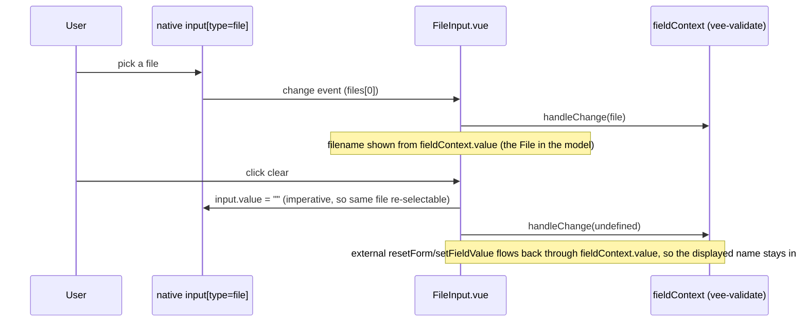

<!-- epic: optional. Set to the parent EPIC-XXX id when this feature belongs to an
     epic; leave "" for a standalone feature. Features are never nested under the
     epic folder, they only reference it here (flat model). -->


# Feature: Additional starter template field types

## Decided without Jeroen (research)

Settled from research during `/spec:continue`, not reviewed by Jeroen. Override any of these freely.

- Finding 1 → RadioGroup needs a `name`/`id` prop sourced from the field path, confirmed as the PROPOSED fix (MDN: shared `name` is what makes native radio grouping, single-selection, and arrow-key navigation work at all)
- Finding 2 → FileInput needs a visible focus style on its trigger, confirmed as the PROPOSED fix (WCAG 2.4.7 Focus Visible, Level AA: hiding the native focusable element without an author-supplied focus indicator is a documented failure mode)
- Finding 4 → RadioGroup's `id` prop (same one that fixes finding 1) also fixes the label association, with no `FormField.vue` change: assign it to the first radio's `id` and the label already works, exactly like `select`/`text`/`password` (confirmed against `StarterFormTemplate.vue`/`FormField.vue`)
- Finding 5 → ratify ADR-3; the Design section's "component's own local state" wording is superseded, the filename is derived from the model (confirmed against `xsd_required`'s semantics and the reset/prefill flows ADR-3 already analyzed)
- Finding 7 → guide's `number` row must say explicitly the model stays a `string`, pure documentation completeness, no tradeoff

## Problem & goal

Anyone building a real form with `@bach.software/vue-dynamic-form-starter` (a contact form, a registration flow, a checkout, a survey) reaches for a small set of field types that the starter does not ship today: a multi-line text area, a radio button group, a number input, a date input, a file upload, and the HTML5 "mode" variants of a text input (email, phone, URL). The starter's own pitch, in both its README and the docs guide, is "hand it to `DynamicForm` and every field... renders with a finished look, no template to write yourself." That promise currently breaks the moment a form needs any of these common types: the consumer has to reach for `extendMetadata` and hand-write the component, the slot, and the styling themselves, in every project that needs it. The docs site even demonstrates this gap directly: its own "Extending The Starter Template" example builds a custom `textarea` type from scratch because the starter does not have one.

The goal is to round out the starter's built-in leaf-field catalogue with the small set of additions that give the best coverage of real-world forms for the least added surface, each following the conventions the existing fields (`TextInput`, `SelectInput`, `CheckboxField`, `PasswordInput`, `ToggleSwitch`) already established: a thin, unstyled-but-themed component, a dedicated `<type>-input` slot (or, where no new rendering is needed at all, just a new entry in the typed catalogue), and the same `FormField`/chrome wrapper every other control gets for free (label, description, required/optional tag, error message, grid placement).

This is explicitly not an attempt to grow the starter into a general-purpose UI kit. Structural shapes (groups, arrays, choices, wizards, review screens) are untouched; this feature is scoped to leaf input fields only.

## Scope

### In scope

- A small, deliberately short list of new or extended leaf field types for `packages/starter/src/`, chosen for coverage-to-effort ratio in typical contact/registration/checkout/survey forms (see Functional overview for the candidate analysis and the recommended shortlist).
- For each candidate: either a new Vue component + a new named slot (`<type>-input`) following the existing `TextInput`/`SelectInput`/`PasswordInput` pattern, or a type-only addition to `StarterValueTypes` where the existing `TextInput` + `default-input` dispatch already renders it correctly via the native `type` attribute (no new component, no new slot).
- Wiring each new type into `StarterFormTemplate.vue`'s dispatch (new named slot in the `handledSlotNames` set and a matching `<template #...>` block, or nothing at all beyond the `StarterValueTypes`/`StarterFieldProperties` entry for a type-only addition).
- Updating `packages/starter/README.md` (Supported slots table, Exports table if a new component becomes a standalone export) and `docs/guide/starter-template.md` ("What you get" field-types table) to reflect the new catalogue, per `CLAUDE.md`'s public-API documentation rule.
- Updating `specs/components.md`'s starter entry.
- New Storybook/docs coverage for each new visible control (states: empty, filled, error, disabled, and for text-mode variants, the native browser affordance).

### Out of scope (explicit)

- **Structural shapes.** `GroupField`, `ArrayField`, `ChoiceField`/`ChoiceSectionCard`/`ChoiceArraySectionCard`, `RepeaterCard`, `ReviewGroup`, `Stepper`/`FormWizard` are not touched. A field added by this feature is always a leaf input.
- **A general-purpose UI kit.** Combobox/autocomplete, multi-select, a rich text editor, a signature pad, an OTP/one-time-code input, a masked input, a phone input with a country-code picker, a multi-handle slider, and a star rating (the docs already demonstrate the last one as a hand-rolled `extendMetadata` example and it stays that way) are all explicitly cut. If a consumer needs one of these, `extendMetadata` plus a wrapper component remains the documented path, exactly as it is today.
- **New validation rules.** The existing `xsd_*` rules (`xsd_pattern`, `xsd_minInclusive`/`xsd_maxInclusive`, `xsd_enumeration`, `xsd_totalDigits`/`xsd_fractionDigits`, etc.) already cover every new type's validation needs. This feature does not add or change a validation rule in `packages/core/src/core/validation.ts`.
- **Changes to `DynamicFormTemplate`, `DynamicFormItem`, or any core engine slot-dispatch mechanism.** This feature works entirely within the starter's own template-of-slots layer, the same way `PasswordInput`/`PasswordStrengthBar` were added without touching the core package.
- **Color picker and range/slider.** Considered and cut from this feature; see Functional overview for why.
- **Retrofitting the `docs/examples/extending-starter.md` custom-`textarea`/custom-`rating` example beyond what's needed to avoid a naming collision.** See Open questions.

## Functional overview

### What already exists today

- `TextInput.vue` renders a native `<input>` and forwards every attribute it does not declare as a prop (including `type`) straight through to the DOM via `v-bind="$attrs"`, overriding its own hardcoded `type="text"`. `StarterFormTemplate.vue`'s `#default-input` block already passes `:type="s.fieldMetadata.type"` to it, and already reads the raw string from the input event (`($event.target as HTMLInputElement).value`) rather than letting vee-validate's own value reader run, specifically so a native `type="number"` input does not silently coerce the model to a JS number via `valueAsNumber`.
- In other words: the *rendering* mechanism for email/tel/url/number/date/time/color/range already works today, because it only depends on what string is forwarded as `fieldMetadata.type`. What is actually missing is that `StarterValueTypes` only declares `text` (plus `select`, `checkbox`, `password`, `heading`, `grid`, `wizardSummaryPage`), so a metadata author cannot write `type: 'email'` against the built-in `starterMetadata` catalogue without first going through `extendMetadata` themselves, even though the engine would render it correctly with zero new code.
- The `options` field property (`{ key, value }[]`) already exists at the root of `StarterFieldProperties` and is already read by `select`. A radio button group over the same option shape is a different rendering of the same data, not a new data shape.
- `choice` is a structural, engine-level concept: a set of mutually exclusive branches, each of which can itself carry `children`/its own sub-fields, rendered via `DynamicFormItemChoice`. It answers "which of these differently-shaped things is the user filling in" (e.g. "pay by card" vs "pay by bank transfer", each with its own fields). A flat radio button group answers a narrower question: "which one of these options is the value of this one field", exactly the question `select` already answers today, just with a different control. The two are not interchangeable and this feature does not build `radio` on top of `choice`.

### Candidate analysis

| Candidate | Mechanism | Notes |
| --- | --- | --- |
| `textarea` | New component (`Textarea.vue`) + new slot `textarea-input` | Multi-line text. Already hand-built once as the docs' own `extendMetadata` example, which is itself a signal of how commonly it is needed. |
| `number` | Type-only: add `number` to `StarterValueTypes`/the type union, render through existing `TextInput`/`default-input` | No new component. Value stays a string in the model (matching the existing number-input coercion guard); `xsd_minInclusive`/`xsd_maxInclusive`/`xsd_totalDigits`/`xsd_fractionDigits` already validate it. |
| `date`, `time`, `datetime-local` | Type-only, same mechanism as `number` | Native browser date/time pickers. Value is whatever ISO-ish string format the native control produces; parsing it into a `Date` is left to the consumer, same as today's `text` fields. |
| `email`, `tel`, `url` | Type-only, same mechanism | Mainly a native-UX win (mobile keyboard layout, basic built-in browser validation); explicit validation still runs through `xsd_pattern`. |
| `radio` | New component (`RadioGroup.vue`) + new slot `radio-input` | Driven by the same root `options` property `select` already uses. See the `choice` clarification above. |
| `file` | New component (`FileInput.vue`) + new slot `file-input` | Genuinely different from every control shipped so far: a native `<input type="file">` cannot be given a `:value`, so this is this feature's one truly uncontrolled field. Value shape (single `File` vs multiple) is an open question below. |
| `color` | Type-only mechanism exists, but recommended **cut** | Low frequency in contact/registration/checkout/survey forms; a consumer who wants it can add it today via `extendMetadata` with zero new rendering code, so not shipping it built-in only narrows typed autocomplete, nothing is actually blocked. |
| `range`/slider | Same as `color` | Same reasoning; also the native single-handle range slider usually wants a visible current-value readout to be usable, which would make it not truly "type-only" and raises its effort past this feature's bar. |

### Recommended shortlist

Subject to Jeroen's call (see Open questions): **`textarea`, `radio`, `number`, `date` (+`time`, `datetime-local`), `email`/`tel`/`url`, `file`**. This is six new catalogue entries behind two new rendered components (`Textarea`, `RadioGroup`) plus one more complex new component (`FileInput`) plus a batch of type-only additions that need no new component at all. `color` and `range` are recommended cuts.

### Consumer-facing behavior

A metadata author picks one of the new `type` values exactly like any existing one (`{ name: 'bio', type: 'textarea', fieldOptions: { label: 'Bio' } }`), gets full chrome (label, description, required/optional tag, error message, grid placement, dark mode) for free, and can still override the per-type slot (e.g. `#textarea-input`) the same way `#default-input` is overridden today, with no change to that mechanism.

## Design (feature level)

**Prototype:** [`prototype.html`](./prototype.html) in this folder. Single self-contained file, no build step, opens in any browser. The fixed top-right button toggles `.dark` on `<html>` exactly as VitePress does. Each section is wrapped in an element with a stable anchor id so stories can deep-link their slice: `#textarea`, `#radio`, `#file`, `#text-modes`.

This feature invents no new look. The prototype ports the starter's existing `--sft-*` theme tokens (surfaces, text, inputs, sky accent, danger reds/roses) verbatim from `packages/starter/src/style.scss`, including the `:root.dark` block, and dresses the three new controls in the same `FormField` chrome every other leaf field already gets (label, `OptionalRequiredTag`, description, one `sft-error` line). The architect and developer should treat the existing starter components (`TextInput.vue`, `SelectInput.vue`, `CheckboxField.vue`, `PasswordInput.vue`, `FormField.vue`) as the behavioural source of truth and this prototype as the visual target.

### What the design is (so it can be built from text alone)

Three new rendered components, each a thin control that sits inside `FormField`'s `.sft-field-control` slot (same as `TextInput`/`SelectInput`/`PasswordInput` do today), plus a batch of type-only additions that render through the existing `TextInput`/`default-input` with no new component.

**Textarea (`Textarea.vue`, slot `textarea-input`).** A native `<textarea class="sft-textarea">`. New class `sft-textarea` carries the identical chrome tokens as `.sft-input` (border, radius, `--sft-input-bg`, `--sft-text`, focus ring, `is-invalid`, disabled) with three differences: no fixed `height` (it uses `min-height: 104px`), `resize: vertical` (removed when disabled), and `line-height: 1.5`. It mirrors `.sft-input`'s mobile-first font-size rule (`inherit` below 768px to avoid iOS focus-zoom, `14px` from 768px up). Value binds from `fieldContext.value` like the text input. The architect may implement `sft-textarea` either as its own rule block (as the prototype does) or by adding `textarea` selectors to the existing `.sft-input` group and overriding height; either is acceptable as long as the resting, focus, invalid and disabled states match the text input one-for-one.

**RadioGroup (`RadioGroup.vue`, slot `radio-input`).** Renders the same flat root `options: { key, value }[]` that `select` already uses. It is a sibling of `select` ("which one value does this field hold"), deliberately **not** built on the structural `choice` concept (indigo branch cards that each own sub-fields). To keep that distinction legible it uses the **sky** accent (`--sft-accent`), reserving indigo (`--sft-choice`) for `DynamicFormItemChoice`, and it is visually lighter than a choice card: a small 16px radio circle (mirroring `.sft-choice-radio`/`-dot` but sky, not indigo), no icon, no per-option description, thinner padding. Markup: a `.sft-radio-group[role=radiogroup]` holding one `<label class="sft-radio-option">` per option; each option wraps a visually-hidden native `<input type="radio" class="sft-radio-input">` (the real, keyboard-navigable control), a `.sft-radio-control` circle containing a `.sft-radio-dot`, and a `.sft-radio-label`. The selected option carries `is-selected` (sky border + scaled-in dot), derived from the field value, never from local state. Full-width option rows are tap targets analogous to the switch/select chrome; hover raises the sky border. Keyboard focus rings the circle via `.sft-radio-input:focus-visible + .sft-radio-control`. Each option `key` is the stored value.

**FileInput (`FileInput.vue`, slot `file-input`).** The one uncontrolled control: a native `<input type="file">` cannot take a `:value`, so the native element is visually hidden and triggered by a `<label>` styled with the existing `sft-btn sft-btn-default` classes. Only the native element's own `value` attribute is uncontrolled (it must be cleared imperatively); the *displayed* filename is derived from the model (`fieldContext.value.value?.name`), not from component-local state, per ADR-3 below, which supersedes the prototype's "component's own local state" copy (**DECIDED (research)**, finding 5: see Adversarial review). Markup: `.sft-file` row holding the labelled trigger, a `.sft-file-name` (muted `is-empty` "No file chosen" placeholder, or the real `File.name`), and, once a file is chosen, a `.sft-file-clear` button that resets it; the trigger label reads "Choose file" when empty and "Change file" when a file is held. v1 is single-file (`File | undefined`); multi-file, drag-and-drop and preview thumbnails are out of scope (Open question 3). The architect owns the exact value shape and the `handleChange` wiring (how the `File` reaches the form model).

**HTML5 text-mode types (`number`, `email`, `tel`, `url`, `date`, `time`, `datetime-local`).** Type-only additions to `StarterValueTypes`; no new component, no new slot. `TextInput` already forwards `fieldMetadata.type` to the native `type` attribute, so the browser supplies the affordance and mobile keyboard. They inherit the `FormField` + `.sft-input` chrome identically to today's `text` type, so the prototype's `#text-modes` section only confirms the native control renders inside that wrapper (with one shared invalid example) rather than a full state matrix per type. `number` keeps the documented raw-string coercion guard: the model stays a string, validated by `xsd_minInclusive`/`xsd_maxInclusive`/`xsd_totalDigits`/`xsd_fractionDigits`; date/time values are the browser's ISO-ish strings, parsing left to the consumer exactly as `text` is today. `number` additionally gets a `number?: { min?: number, max?: number, step?: number }` group property on `StarterFieldProperties` (see finding 3's resolution below), forwarded to the native input's `min`/`max`/`step` attributes so the prototype's spinner/bounds affordance is actually reachable; `TextInput` needs no change to carry them, since it already extends `InputHTMLAttributes` and forwards every attribute it does not declare as a prop straight through `v-bind="$attrs"` onto the DOM `<input>` (`TextInput.vue:5,13,20`), so `#default-input` just needs to bind `:min`, `:max`, `:step` from `s.fieldMetadata.number?.*` alongside the existing props.

> **DECIDED (Jeroen) — finding 3.** Larger-scope resolution: add the `number` group property above rather than fixing the prototype down to "not wired". The native bounds are a real, reachable affordance, forwarded as attrs with no new component and no change to `TextInput`.

### States policy (one policy, applied everywhere)

Unchanged from the starter's existing policy (FEAT-007), extended to the new controls:

- **pristine** is the resting state with no message and no reserved error row.
- **invalid** adds the danger border (`--sft-danger-border`, red light / rose dark) to the control plus one `sft-error` line below. For the radio group, which has no single border, the danger border lands on the resting radio circles via `.sft-radio-group.is-invalid`; for the file input it lands on the trigger button. The error line sits below the whole group/control, never per option.
- **valid** is a filled value with no error. As in the rest of the package, there is deliberately **no** green success state for these controls (the `showValidState` opt-in `is-valid` border is scoped to the text/select/password inputs; the new controls do not join it unless the architect decides otherwise, and the prototype does not show one).
- **focus** is the 2px sky ring on textarea (same as the text input's `box-shadow: 0 0 0 2px var(--sft-focus-ring)` in `style.scss`) and a 2px sky outline on the radio circle; invalid focus swaps to the rose ring. **DECIDED (research):** corrected from "3px" during story prep. The prototype's own CSS (`.sft-textarea:focus`, `.sft-radio-input:focus-visible + .sft-radio-control`) and the shipped `.sft-input:focus` rule are both 2px; "3px" was a stale prose figure (the same typo already exists in FEAT-007's archived spec text, never corrected to match what actually shipped). No visual change from the prototype as built; this is a documentation correction with no public-API impact.

  > **PROPOSED (adversarial review) — finding 2.** The file input is missing a focus state entirely (the prototype's `#file` section has no focus cell). The real focusable element is the visually-hidden `.sft-file-native`, so focus must be surfaced on the visible trigger: add `.sft-file-native:focus-visible + .sft-file-trigger` (or `:focus-within` on the trigger label) carrying the same sky ring the textarea uses, and add a focus cell to the design so the state is signed off in both color modes. Without it, keyboard focus on the file field is invisible (WCAG 2.4.7).
- **disabled** dims the whole `sft-field` to 60% and makes controls `not-allowed` (textarea also drops its resize handle; the file trigger goes inert).
- **loading/empty** are not field-level concepts here: there is no per-field spinner, and "empty" for these leaf fields is simply the pristine state (the dashed `sft-empty` card belongs to repeatable arrays, out of scope). The file input's "no file chosen" is its pristine display, not a separate empty-state card.

Error messages follow the project copy rules: they state the fix in plain language ("Your cover letter needs at least 50 characters.", "Choose how you heard about us.", "Attach your resume before submitting.", "Enter a valid email address, like you@company.com.").

### Component / pattern mapping (against `specs/components.md`)

| Prototype section (anchor) | New component + slot | Existing pattern reused | New `sft-` classes |
| --- | --- | --- | --- |
| `#textarea` | `Textarea.vue` + `textarea-input` | `FormField`, `OptionalRequiredTag`, `ErrorMessage`; `.sft-input` token set | `sft-textarea` |
| `#radio` | `RadioGroup.vue` + `radio-input` | `FormField` chrome; root `options` (shared with `select`); `.sft-choice-radio`/`-dot` visual, re-tinted sky | `sft-radio-group`, `sft-radio-option` (+ `is-selected`/`is-disabled`), `sft-radio-input`, `sft-radio-control`, `sft-radio-dot`, `sft-radio-label` |
| `#file` | `FileInput.vue` + `file-input` | `FormField` chrome; `sft-btn`/`sft-btn-default` for the trigger | `sft-file`, `sft-file-native`, `sft-file-trigger`, `sft-file-name` (+ `is-empty`), `sft-file-clear` |
| `#text-modes` | none (type-only) | existing `TextInput` + `default-input`, `.sft-input` | none |

No existing component needs structural change. The three new controls are pure presentational slot targets, internal to the package (precedent: `TextInput`/`SelectInput`/`CheckboxField`/`PasswordInput` all stay internal, reachable only through slots); whether any becomes a standalone export is the architect's call (default: internal, like its siblings). The `StarterFormTemplate.vue` wiring (three new named slots added to `handledSlotNames` plus matching `<template #...>` blocks) is the architect's to specify; the prototype assumes the existing per-type-slot dispatch with no change to that mechanism.

### Dark mode sign-off

The whole prototype was built in both modes using the package's own `:root`/`:root.dark` token blocks ported verbatim, so every colour-carrying surface flips through the same variables the shipped package already proved. Reviewed per new class: `sft-textarea`, `sft-radio-option` and the file trigger all read from `--sft-input-bg`/`--sft-card-bg`/`--sft-text*` (dark overrides present), the invalid treatments read from `--sft-danger-*` (dark overrides present), and the sky accent (`--sft-accent`, `--sft-focus-*`) is intentionally identical in both modes. One faithful-port carryover: the resting border on the textarea, radio options and inputs stays light-gray in dark mode because `--sft-input-border` has no dark variant in the source, matching today's text/select inputs exactly (noted in the prototype). Purely structural rules (the radio/file flex rows, the field grid) are intentionally silent on dark. No section needs a dark-specific fix beyond the shared variable block.

> Screenshots were not produced: this environment has no Playwright-capable browser available to the designer. The developer's "Before Every Push" screenshot step still applies once the components are built.

## Architecture (feature level)

This feature lives entirely in `packages/starter/src/` plus docs. It touches no core engine code, no `xsd_*` rule, and no slot-dispatch mechanism: it adds three thin presentational components, three new named slots, and a batch of type-only catalogue entries, all through the channels the existing starter controls already established.

### How the dispatch already carries these types (grounding)

The core `DynamicFormTemplate` resolves a leaf field's slot purely from its `fieldMetadata.type` string (`typeWithFallback` in `DynamicFormTemplate.vue`, lines 292-300): a leaf's resolved `attrs.type` is `${type}-input`, matched exactly against the available slots, falling back to `default-input` then `default`. That is why `select`/`password`/`checkbox` reach `select-input`/`password-input`/`checkbox-input` today and `text` reaches `default-input`. Shape detection (array/choice/parent/input) is driven by `children`/`choice`/`maxOccurs`/`attributes`, never by the type string, so a new leaf type name needs no engine change to be classified as an input.

Two consequences settle the mechanism:

- **The runtime dispatch is string-based and already works.** `textarea` → `textarea-input`, `radio` → `radio-input`, `file` → `file-input`, and `number`/`email`/`tel`/`url`/`date`/`time`/`datetime-local` → (no dedicated slot) → `default-input` → `TextInput`. Nothing in the engine changes.
- **The `StarterValueTypes` entries are a TypeScript-authoring concern, not a runtime one.** They exist so a metadata author can write `type: 'textarea'` against the default `starterMetadata` without first going through `extendMetadata`. This is exactly the gap the feature closes.

### `StarterValueTypes` additions (metadata.ts)

`StarterValueTypes` is a flat map of `type name → stored value type`; there is no "shared typed group" shape it could collapse into, so each new type is its own entry. Add, to the interface:

```ts
textarea: string
radio: string
number: string
email: string
tel: string
url: string
date: string
time: string
'datetime-local': string
file: File | undefined
```

- **`number`/`date`/`time`/`datetime-local`/`email`/`tel`/`url` map to `string`.** `TextInput`'s `#default-input` block already passes the raw event string to `handleChange` (`($event.target as HTMLInputElement).value`), never `valueAsNumber`/`valueAsDate`, so the model stays a string for every mode. This preserves the documented number-input coercion guard with zero new code and lets `xsd_minInclusive`/`xsd_maxInclusive`/`xsd_totalDigits`/`xsd_fractionDigits`/`xsd_pattern` validate the lexical value (all confirmed present in `packages/core/src/core/validation.ts`).
- **`'datetime-local'` is quoted because of the hyphen.** It is a valid interface key and produces the template-literal slot type `datetime-local-input`; that slot is never provided by the starter (it falls to `default-input`), so the extra union member only widens consumer slot scopes harmlessly.
- **Naming matches the native `type` attribute 1:1** (Open question 4's proposed default). Clear winner on the merits: the value is forwarded verbatim to the DOM `type` attribute, so any divergent catalogue name would need a translation layer for no benefit. Recommended ratification; the final say on the name set stays OQ4.
- **`file` maps to `File | undefined`** (see the FileInput decision below; the shape itself is OQ3, Jeroen's call).

### `StarterFieldProperties` additions (metadata.ts)

- **`radio` adds nothing.** It reuses the existing root `options: { key, value }[]` that `select` already reads. Confirmed: the data shape is identical, only the control differs (Open question 2's framing, which this architecture ratifies: `radio` is a sibling of `select`, not built on the structural `choice`).
- **`file` adds one optional group property**, mirroring the existing `password`/`checkbox` group pattern:

  ```ts
  /** Extras of a `file` field. */
  file?: {
    /** Native accept filter forwarded to the input, e.g. ".pdf,.doc,.docx". */
    accept?: string
    /** Aria label of the clear button; `{name}` is the chosen filename. Defaults to "Remove {name}". */
    clearAriaLabel?: string
  }
  ```

  Both optional, additive, safe-defaulted. `accept` is a genuinely useful native affordance the prototype's copy already implies ("PDF or Word document"); `clearAriaLabel` is needed for the `.sft-file-clear` button's accessible name. This is a (small) public-API addition, so the exact `file` group shape is folded into OQ3 for Jeroen rather than silently fixed; the recommendation is the two fields above. `clearAriaLabel`'s default is `"Remove {name}"` (filename interpolated), not a static string, per **DECIDED (Jeroen)** in Open question 3.

- **`number` adds one optional group property**, same additive pattern, per **DECIDED (Jeroen)** on adversarial review finding 3:

  ```ts
  /** Extras of a `number` field. */
  number?: {
    /** Native minimum forwarded to the input's `min` attribute. */
    min?: number
    /** Native maximum forwarded to the input's `max` attribute. */
    max?: number
    /** Native step forwarded to the input's `step` attribute. */
    step?: number
  }
  ```

  All optional, additive, forwarded as plain DOM attributes to the native `<input type="number">` via `TextInput`'s existing attrs passthrough (no `TextInput` change). These are native-affordance hints only (the spinner buttons, the browser's own scroll/arrow-key stepping); they do not replace `xsd_minInclusive`/`xsd_maxInclusive`/`xsd_totalDigits`/`xsd_fractionDigits` as the actual validation, so a consumer still needs the matching `restriction` for enforced bounds. `#default-input`'s two `TextInput` blocks bind `:min="s.fieldMetadata.number?.min"`, `:max="s.fieldMetadata.number?.max"`, `:step="s.fieldMetadata.number?.step"` alongside the existing props; harmless `undefined` on every other type, since an `undefined` attribute binding in Vue omits the attribute.

- **`textarea` adds nothing new.** It reuses `placeholder` and the shared chrome props. (A `rows`/`minHeight` property is deliberately not added: the prototype fixes height via CSS `min-height` + `resize: vertical`; adding a sizing property is scope the feature did not ask for.)

### The three new components (component / composable plan against `specs/components.md`)

All three are new, thin, presentational slot targets, internal to the package. None matches an existing component in `specs/components.md`: `TextInput` is single-line only, `SelectInput` is a native `<select>`, `CheckboxField`/`ToggleSwitch` are boolean, and no file/multiline/radio-list control exists. Each reuses `FormField`'s chrome and the shared `--sft-*` tokens; no existing component changes structurally.

- **`Textarea.vue` (slot `textarea-input`).** Native `<textarea class="sft-textarea">`. Controlled exactly like `TextInput`: `:value="fieldContext.value.value"`, `@input="handleChange(($event.target as HTMLTextAreaElement).value)"`, `@blur="handleBlur"`. Props mirror `TextInput` (`id`, `dataTestid`, `value`, `disabled`, `errorMessage`, `placeholder`), plus the `is-invalid`/`is-valid` class wiring the siblings use. New class `sft-textarea` (per the prototype) carries the `.sft-input` token set with `min-height: 104px`, `resize: vertical` (dropped when disabled), and `line-height: 1.5`; it mirrors the mobile-first font-size rule. The `showValidState` opt-in is extended to the textarea for parity with text/select/password (the prototype shows no green state, but joining `data-field-state` keeps the one input-state helper uniform; flagged for review, default: join it).
- **`RadioGroup.vue` (slot `radio-input`).** Renders `options` as a `.sft-radio-group[role=radiogroup]` of `<label>` rows, each wrapping a visually-hidden native `<input type="radio">` (the real keyboard control), a `.sft-radio-control` circle and `.sft-radio-dot`, and a `.sft-radio-label`. Props: `id`, `value`, `options`, `disabled`, `errorMessage`, `dataTestid`. Selection is derived from the value only (`:checked="value === option.key"`, `is-selected` when equal), never local state. `id` is sourced from `s.fieldMetadata.path` in the `#radio-input` wiring, exactly how `TextInput`/`SelectInput`/`PasswordInput` already receive `:id="s.fieldMetadata.path"`; `RadioGroup` assigns it to the *first* option's native `id` and to every option's `name` (one assignment serves both: shared `name` is what makes the browser treat the set as one group for single-selection and arrow-key roving focus, and a real element carrying `id=path` is what `FormField`'s existing `<label :for="inputId">` associates with, instead of dangling). No `aria-label`/`aria-labelledby` and no `FormField.vue` change needed: the field's visible label already names the group correctly once a real element carries its `id`, the same as `select`. `@change="handleChange(option.key)"`, `@blur="handleBlur"`. Uses the **sky** accent, ratifying the prototype's call to reserve indigo (`--sft-choice`) for structural `DynamicFormItemChoice`.
- **`FileInput.vue` (slot `file-input`).** The one uncontrolled control. See the dedicated decision and ADR below.

### `StarterFormTemplate.vue` slot wiring

Add `textarea-input`, `radio-input`, `file-input` to the `handledSlotNames` set (so `passthroughSlotNames()` does not double-render them), and add three `<template #...>` blocks modelled on the existing `#select-input`/`#password-input` blocks: each wraps a `<slot name="..." v-bind="s">` whose default content is the new component, wired to `s.fieldContext`/`s.fieldMetadata`/`s.disabled`/`s.settings` exactly as the siblings are. No change to the dispatch mechanism, to `chromeSlotName`, or to any other block. The `#textarea-input` and `#radio-input` blocks follow the `#select-input` pattern verbatim; `#file-input` is the one with bespoke change wiring.

### FileInput value shape and data flow (proposal for OQ3; Jeroen's call)

**Proposed:** v1 is single-file, model value `File | undefined`. Multi-file, drag-and-drop and preview thumbnails are a later feature. Reasoning: a `File | undefined` model is the smallest shape that satisfies the common case (one attachment per field), it keeps `xsd_required` meaningful (undefined fails required, a `File` passes), and widening to `File[]` later is an additive, opt-in change driven by a new `file.multiple` property rather than a reshape of the single-file default. This stays OQ3 because it is a public-API/value-type decision with semver weight.

Data flow for the uncontrolled control:



**Disagreement with the prototype, flagged for review.** The prototype and Design section state the displayed filename comes from the component's **own local state**, reasoning that `input[type=file]` is uncontrolled. The uncontrolled part is only the native element's `value` attribute (which indeed cannot be bound and must be cleared imperatively). The *displayed* filename is a separate concern and should be derived from `fieldContext.value.value?.name` (the `File` already stored in the model), not a parallel local ref. Deriving it from the model keeps a single source of truth and makes the display correct after a `resetForm`, a `resetField`, or a programmatic `setFieldValue`; a local-state copy would silently go stale on all three (a real bug: the form value is cleared but the UI still shows the old filename). The native input still needs an imperative `input.value = ""` on clear/reset, which a small `watch` on `fieldContext.value` can trigger when the model drops to `undefined`. This does not change the public value shape (still `File | undefined`), so it is an implementation improvement within the architecture's remit, but because it contradicts a Design-section statement it is surfaced here rather than applied silently. **Recommendation: read the filename from the model value; keep the native input imperatively reset.**

### Standalone export decision

**Keep all three components internal** (no `index.ts` export), reachable only through their slots. Clear winner from the codebase pattern (`specs/components.md` and `index.ts`): every leaf-control component to date (`TextInput`, `SelectInput`, `CheckboxField`, `ToggleSwitch`, `PasswordInput`, `PasswordStrengthBar`) is internal; only composite/standalone-usable pieces (`ReviewGroup`, `SubmissionSuccess`, `AppButton`, `ChoiceArraySectionCard`) are exported. These three are pure slot defaults with no standalone use case, so exporting them would add public surface (and a semver commitment) for no consumer benefit. Overriding is already served by the `#textarea-input`/`#radio-input`/`#file-input` slots.

### Public API impact and changeset

Purely additive, backwards compatible:

- New `StarterValueTypes` keys and two optional `StarterFieldProperties` groups (`file`, `number`). No existing key changes; existing metadata keeps compiling and rendering unchanged.
- No new exports, no changed signatures, no engine/validation change.
- **Changeset: `minor`** on `@bach.software/vue-dynamic-form-starter`. One cohesive changeset for the whole feature (business purpose first: the starter now ships textarea, radio, file upload, and the common HTML5 input modes out of the box), with sub-bullets for the distinct controls, per `CLAUDE.md`'s "one entry per user-facing capability" rule. Release shape (OQ6) is left to Jeroen; this architecture assumes one feature/one changeset and the story seams below allow `file` to be deferred without reworking the rest if he splits it.

### Documentation impact

Derived from the public-API impact above. Every item is consumer-visible, so each maps to a prose page:

- **`packages/starter/README.md`** — "Supported slots" table: add `textarea-input`, `radio-input`, `file-input` to the "Input, one per control" row. "Exports" table: no change (components stay internal).
- **`docs/guide/starter-template.md`** — "What you get" field-types table: add rows for `textarea`, `radio`, `number`, `email`, `tel`, `url`, `date`, `time`, `datetime-local`, and `file`, and note the `file.accept`/`file.clearAriaLabel` and `number.min`/`number.max`/`number.step` properties alongside the existing grouped-property prose. The `number` row must say explicitly that the model stays a `string` (the documented coercion guard), not a JS number, per finding 7: this is the one row where a consumer's default expectation (many form libraries hand back a numeric model for `type: 'number'`) would otherwise diverge silently from actual behaviour, and must also note that `number.min`/`max`/`step` are native-affordance hints only, not a substitute for `xsd_minInclusive`/`xsd_maxInclusive` validation. **DECIDED (research):** add the sentence; it is a pure documentation-completeness fix with no tradeoff.
- **`docs/examples/extending-starter.md` collision (OQ5).** The example currently teaches adding a custom `textarea` via `extendMetadata` specifically because the starter lacked one; once `textarea` ships built-in that rationale is gone. **Proposed resolution (recommended direction, stays OQ5 for Jeroen because it is visible docs content):** keep the example as an "add a new type" demo (its pedagogical purpose), keep the `rating` custom type, and replace the custom `textarea` with a custom `range`/slider type with a visible value readout. This is honest: `range` is a type this feature deliberately **cut** (Functional overview) precisely because it needs a value readout, which makes it a genuinely non-trivial custom control and therefore a good extension example. It requires editing the three docs example files (`ProjectFormTemplate.ts`, `ProjectFormTemplate.vue`, `FormExampleProjectFields.vue`) plus the prose. Alternative if Jeroen prefers less work: drop to a single custom type (`rating` only) and reword the "two field types" prose.
- **`specs/components.md` correction (not an edit the architect makes; planned for the developer).** The starter entry currently sits under a `## Non-published surfaces` heading and is labelled "(private package)". That is inaccurate: `packages/starter` has `publishConfig.access: public`, is documented as an installable npm dependency, and is already part of the release pipeline ("RELEASING: Releasing 2 package(s)"). When the developer updates the starter entry for this feature (new types, new `file` property, three new internal components and slots), the entry should be moved out of "Non-published surfaces" / relabelled as a published package whose changes need a changeset, correcting the public-API-impact framing.

### ADR notes

**ADR-1 — HTML5 modes are type-only, no per-mode component.**
Context: `number`/`email`/`tel`/`url`/`date`/`time`/`datetime-local` differ from `text` only in the native `type` attribute and the keyboard/picker the browser supplies.
Decision: add them as `StarterValueTypes` entries that render through the existing `TextInput`/`#default-input`; no new component, no new slot.
Alternative considered: a dedicated component or slot per mode. Rejected: `TextInput` already forwards `fieldMetadata.type` to the DOM and already reads the raw event string, so a per-mode component would duplicate it for zero behavioural difference.

**ADR-2 — `radio` is a rendering of `options`, not a `choice`.**
Context: a flat "pick one value" control and the structural `choice` concept both present mutually exclusive options.
Decision: `RadioGroup` reads the same root `options` as `select` and stores the chosen `key`; it is not built on `DynamicFormItemChoice`.
Alternative considered: model radio as a `select` rendering-variant property (e.g. `select` + `display: 'radio'`) instead of a new `type`. Rejected at architecture level as the default but surfaced as OQ2: a new `type` matches how every other control is selected (by `type`) and keeps the slot-override story uniform.

**ADR-3 — FileInput displays from the model value, native input reset imperatively.**
Context: `input[type=file]` cannot be value-bound; the prototype proposed tracking the filename in component-local state.
Decision: derive the displayed filename from `fieldContext.value.value?.name`; reset the native element's `value` imperatively on clear and on external model reset (via a `watch`).
Alternative considered: a local `ref<File>`. Rejected: it duplicates state and goes stale on `resetForm`/`resetField`/`setFieldValue`, showing a filename for a value the form no longer holds. (Contradicts a Design-section statement; flagged above for Jeroen rather than applied silently.)

**ADR-4 — new controls stay internal.**
Context: whether `Textarea`/`RadioGroup`/`FileInput` become standalone exports.
Decision: internal, slot-only, matching every existing leaf control.
Alternative considered: export them. Rejected: no standalone use case, and each export is a permanent semver commitment; the override slots already cover customization.

### Slicing seams (input for the scrum-master)

Independently deliverable, minimal shared surface (all touch only `metadata.ts` for a few lines and `StarterFormTemplate.vue` for one block each; these edits do not conflict):

1. **Type-only HTML5 batch** — `StarterValueTypes` entries for `number`/`email`/`tel`/`url`/`date`/`time`/`datetime-local`, the guide field-types table rows, and Storybook/docs coverage (`#text-modes`). No new component. Smallest, no dependencies.
2. **Textarea** — `Textarea.vue`, `sft-textarea` styles, `#textarea-input` wiring, docs row, story (`#textarea`). Depends on nothing.
3. **RadioGroup** — `RadioGroup.vue`, `sft-radio-*` styles, `#radio-input` wiring, docs row, story (`#radio`). Depends on nothing.
4. **FileInput** — `FileInput.vue`, `sft-file-*` styles, `file` group property, `#file-input` wiring, docs row, story (`#file`). Carries OQ3; the most complex slice and the natural follow-up if OQ6 splits the release.
5. **extending-starter collision fix** — depends on slice 2 (textarea must ship first). Edits the three docs example files plus prose per OQ5's resolution.

The single feature changeset is written once, covering whichever slices ship together.

## Adversarial review

Verified against the real code (`StarterFormTemplate.vue`, `TextInput.vue`, `metadata.ts`, `FormField.vue`, `packages/core/src/core/validation.ts`), the prototype, and vee-validate `>=4.12` (the installed catalog range). Factual claims that held up, stated so they are not re-litigated: the string-based slot dispatch carries the new type names with no engine change; `xsd_required` (`value !== null && value !== undefined && value !== ''`) treats a `File` as present and `undefined` as absent, so `File | undefined` keeps required meaningful; `xsd_minInclusive`/`xsd_maxInclusive` map to vee-validate `min_value`/`max_value`, which coerce with `Number(value)` and short-circuit `true` on empty, so a string-valued `number` validates correctly and an empty optional number does not false-fail; `xsd_totalDigits`/`xsd_fractionDigits` already operate on `String(value)`; the `minor` bump is correct, because `extendMetadata`'s `Omit<StarterValueTypes, keyof Extra> & Extra` means a consumer who already declared `textarea`/`file`/etc. keeps their declaration (no collision), and every addition only widens what is allowed. ADR-3 is sound (see finding 5). The architecture's catch that `specs/components.md` mislabels the starter as a private/non-published surface is correct and confirmed (`publishConfig.access: public`).

1. **RadioGroup has no source for the native `name`, so keyboard grouping breaks. (should-fix)** The Architecture promises "each native input's `name` is the field path so the browser groups them and arrow-key navigation works", and the prototype states "arrow keys move within the group natively". But the listed `RadioGroup.vue` props are `value, options, disabled, errorMessage, dataTestid` and the field label only: nothing carries the path/name into the component. Without a shared `name` across the option `<input type="radio">` elements, native single-selection roving-tabindex and arrow-key navigation do not happen (every radio becomes its own one-button group and a tab stop), defeating the prototype's accessibility claim. Routed as a PROPOSED edit in the RadioGroup architecture bullet.

   **DECIDED (research):** confirmed as the fix. A radio group is defined by giving each `<input type="radio">` in it the same `name`; that shared name is what makes the browser treat them as one group for single-selection and arrow-key navigation, per MDN's `<input type="radio">` reference. This is an internal prop-wiring fix with no public API impact, so it passes the pre-approval clear-winner bar and does not need Jeroen's ratification. Source: [MDN, `<input type="radio">`](https://developer.mozilla.org/en-US/docs/Web/HTML/Reference/Elements/input/radio).

2. **FileInput has no keyboard focus indicator. (should-fix, accessibility)** Textarea and RadioGroup both ship a focus treatment (`.sft-textarea:focus`, `.sft-radio-input:focus-visible + .sft-radio-control`) and the prototype gives each a "Focus (simulated)" cell. The file control has neither: the real focusable element is the visually-hidden `.sft-file-native`, and nothing paints a visible ring on the `.sft-file-trigger` when it receives focus. A keyboard user tabbing onto the file field sees no indication of focus, a WCAG 2.4.7 failure. The prototype's `#file` section has no focus cell at all, so the state is simply undesigned. Routed as a PROPOSED edit in the states policy and the FileInput styling note.

   **DECIDED (research):** confirmed as the fix. WCAG 2.4.7 Focus Visible (Level AA) explicitly lists "the user agent's default visual indication of keyboard focus is turned off or rendered non-visible by other styling, without providing an author-supplied visual focus indicator" as a failure; hiding the native file input without styling its trigger is exactly that failure. This is a CSS-only fix with no public API impact, so it passes the pre-approval clear-winner bar. Source: [W3C, Understanding SC 2.4.7 Focus Visible](https://www.w3.org/WAI/WCAG22/Understanding/focus-visible.html).

3. **Native `number` bounds (`min`/`max`/`step`) are shown in the prototype but nothing wires them. (should-fix)** The `#text-modes` number cell renders `<input type="number" min="0" max="50">`, but `#default-input` forwards only `type`, `value`, `disabled`, `errorMessage`, `placeholder` to `TextInput`, and no `StarterFieldProperties` entry supplies `min`/`max`/`step`. So a built-in `number` field cannot express native numeric bounds or a spinner step; the browser affordance in the prototype is unreachable through the catalogue. This is a Design-vs-Architecture inconsistency (the prototype implies an affordance the plan does not deliver). Routed as a PROPOSED edit in the HTML5 text-mode section: state that native numeric bounds are intentionally not forwarded (validation is via `xsd_minInclusive`/`xsd_maxInclusive`) and drop the misleading `min`/`max` from the prototype, OR (larger scope) add a `number` group property that forwards them. Flagging for Jeroen because "add a property" touches the public API.

4. **RadioGroup label association dangles and duplicates. (should-fix, accessibility)** `FormField` renders `<label class="sft-field-label" :for="inputId">` with `inputId = fieldMetadata.path`. For text/select/file an element carries `id=path`; for the radio group no element does (the architecture assigns no `id=path` to any radio), so the visible field label's `for` points at nothing, and the group is instead named by a *duplicated* `aria-label` string that can drift from the visible label. Routed as a PROPOSED edit in the RadioGroup architecture bullet: give the first option `id=path` so the visible label associates, or name the group with `aria-labelledby` referencing the field label's id rather than a copied `aria-label`. Note this interacts with the "no existing component needs structural change" claim if `FormField` must expose a label id.

   **DECIDED (research):** resolved together with finding 1, no `FormField.vue` change needed. Checked against the real code: `StarterFormTemplate.vue` already threads `:id="s.fieldMetadata.path"` into `TextInput`, `SelectInput`, and `PasswordInput`, and `FormField.vue:41`'s `<label :for="inputId">` always receives that same path from the wrapping `FormField` call. `RadioGroup` only needs to accept that same `id` prop (sourced the identical way) and apply it to the first option's native `id` and to every option's `name`; the one prop serves both findings 1 and 4 at once, needs no `aria-label`/`aria-labelledby`, and matches the established codebase pattern exactly (no new mechanism). This is internal prop-wiring with no public API impact, so it passes the pre-approval clear-winner bar. Sources: `packages/starter/src/StarterFormTemplate.vue` (the `:id="s.fieldMetadata.path"` wiring on `TextInput`/`SelectInput`/`PasswordInput`), `packages/starter/src/FormField.vue:41`.

5. **ADR-3 (FileInput displays from the model, not local state) holds up; reconcile the Design so the spec is not self-contradictory. (should-fix, already PROPOSED by the architect)** The concern is real and correctly reasoned: a parallel `ref<File>` goes stale on `resetForm`/`resetField`/`setFieldValue` (the model clears but the UI keeps the old name), and a native file input's value cannot be set programmatically, so on an edit/prefill the *only* correct name source is the model (`fieldContext.value.value?.name`); the native element's uncontrolled part is just its `value`, cleared imperatively via a `watch`. This is the right call and the architect correctly surfaced it rather than overriding the Design silently. The residual problem is that the Design section and the prototype's `#file` copy still instruct building from "the component's own local state", so as written the spec ships two contradictory instructions to the developer. Resolution (Jeroen's to ratify via the ADR, no new PROPOSED edit needed): adopt ADR-3 and treat the Design/prototype local-state wording as superseded.

   **DECIDED (research):** ratified. This is not a tradeoff: ADR-3's reasoning is strictly better on the merits (the local-state alternative has a named, concrete bug: a stale filename after `resetForm`/`resetField`/`setFieldValue`), it keeps the same `File | undefined` value shape (no public-API change, OQ3 stays open only on the shape itself), and it is a local edit to reverse. The Design section above has been reworded to derive the filename from `fieldContext.value.value?.name` and note only the native element's `value` attribute is imperatively uncontrolled; `prototype.html`'s commentary is superseded by this spec text and does not need a prototype edit for a non-visual implementation detail.

6. **`clearAriaLabel` default disagrees with the prototype. (nit)** The architecture defaults `file.clearAriaLabel` to "Remove file"; the prototype's clear button reads `aria-label="Remove jeroen-bach-resume.pdf"` (filename interpolated). The filename-inclusive form is better for screen-reader users with several file fields. Suggest the default interpolate the filename (e.g. "Remove {name}") rather than a static string.

7. **`number` staying a string may surprise consumers. (nit)** Many form libraries hand back a numeric model for `type: 'number'`. Storing the raw string is a deliberate, documented choice here (the coercion guard), but the guide field-types row should say so explicitly so a consumer does not expect `typeof value === 'number'`. Covered if the Documentation impact row calls it out; flagging so it is not lost.

Status rationale (as originally reviewed): six Open questions were unresolved (final shortlist, radio-vs-choice framing, file value shape, type naming, extending-starter collision, release shape), so the mechanical rule landed this at `awaiting-discussion` regardless of findings. The should-fixes above were routed as PROPOSED edits (or, for ADR-3, already carried a concrete resolution), so they did not independently add to the queue; they were there for Jeroen to ratify alongside the questions. No blockers.

All six Open questions and all should-fix findings (1, 2, 3, 4, 5) are now resolved, per `/spec:discuss`: see the inline `DECIDED (research)`/`DECIDED (Jeroen)` notes above and in Open questions. Nits 6 and 7 are resolved too (folded into the OQ3 and Documentation impact decisions, though as nits they never blocked status).

## Constraints & assumptions

- **Keep in sync with FEAT-013 (starter theme tokens).** `DECIDED (Jeroen)`: the new CSS this feature adds (`sft-textarea`, `sft-radio-*`, `sft-file-*`) must use FEAT-013's `--sft-radius-*`/`--sft-font-*` custom properties for every border-radius, font-size, and font-weight value, not hardcoded literals, the same way it already must use the existing colour tokens. FEAT-013's three stories are `approved` but not yet implemented as of this discussion (no `--sft-radius`/`--sft-font` variables exist in `style.scss` yet), so by the time FEAT-014 reaches implementation those tokens should exist; the developer checks `packages/starter/src/style.scss` for FEAT-013's actual token names at implementation time rather than this spec guessing names that don't exist yet. If FEAT-014 implementation starts before FEAT-013 ships, hardcode to match today's convention and flag a follow-up so FEAT-013's retrofit picks up the new call sites rather than missing them.
- Every new chrome component follows existing conventions: `sft-` prefixed classes only, no Tailwind, no scoped `<style>`, no inline `:style` bindings (per `CLAUDE.md`), themed via the existing `--sft-*` custom properties.
- `packages/starter/src/` is a published package (`@bach.software/vue-dynamic-form-starter`); per `CLAUDE.md`'s "Before Every Push" rule a changeset is required for this feature, written for someone skimming the CHANGELOG (business purpose first).
- The `number` type-only addition must keep the existing number-input coercion guard (pass the raw event string to `handleChange`, never vee-validate's own value reader), per the project's documented vee-validate number-input coercion pitfall.
- No change to any `xsd_*` validation rule or to the core `packages/core/src/` engine; this is entirely a `packages/starter/` change.
- `radio` reuses the existing root `options: { key, value }[]` property; it does not introduce a second, differently-shaped option list.

## Open questions

1. **Final shortlist.** Confirm (or amend) the recommended set: `textarea`, `radio`, `number`, `date`/`time`/`datetime-local`, `email`/`tel`/`url`, `file`, with `color` and `range`/slider cut. Is this the right scope, or should any of these move in or out (for example, shipping only `textarea` + `radio` + `number` + `date` now and deferring `file` to a follow-up feature given its added complexity)?

   **DECIDED (Jeroen):** ship the full shortlist as recommended (`textarea`, `radio`, `number`, `date`/`time`/`datetime-local`, `email`/`tel`/`url`, `file`; `color`/`range` stay cut). New constraint added as a result: keep the new components' CSS in sync with FEAT-013 (starter theme tokens), using its `--sft-radius-*`/`--sft-font-*` tokens instead of hardcoded literals (see Constraints & assumptions).
2. **`radio` vs `choice`.** Confirm the framing above: `radio` is a new rendering of the same flat `options` data `select` already uses (a sibling of `select`, not built on the structural `choice` concept). Is that the right mental model, or does Jeroen want it positioned differently (e.g. as a `select`-rendering-variant property instead of a brand-new `type`)?

   **DECIDED (Jeroen):** `radio` is a new type, a sibling of `select`, not built on `choice`. Ratifies ADR-2 as written.
3. **`file` value shape.** A native `<input type="file">` is uncontrolled (no `:value`). Should v1 support only a single file (`File | undefined`) and leave multiple-file selection, drag-and-drop, and preview thumbnails for a later feature, or does Jeroen want multi-file support from the start? This is a public-API/value-type decision with semver weight.

   **DECIDED (Jeroen):** single file, `File | undefined`, per the architecture's proposal. Multi-file stays a later, additive feature (`file.multiple`). Also settled alongside this: `file.clearAriaLabel`'s default interpolates the filename (e.g. "Remove jeroen-bach-resume.pdf"), matching the prototype, rather than the architecture's static "Remove file" (adversarial review finding 6).
4. **Type-only naming.** Should the new HTML5 text-mode types be named to match the native `type` attribute exactly (`email`, `tel`, `url`, `number`, `date`, `time`, `datetime-local`), or does Jeroen want different catalogue names? Matching the native attribute 1:1 is the proposed default.

   **DECIDED (Jeroen):** match the native `type` attribute 1:1, as proposed.
5. **`docs/examples/extending-starter.md` collision.** That example currently teaches adding a custom `textarea` type via `extendMetadata`, specifically because the starter does not have one. Once `textarea` ships built-in, that example needs to change, either by swapping its custom type to something else (keeping `rating` and picking a new second type) or by repurposing the example into an "override a built-in slot" demo instead of an "add a new type" demo. Which direction, or is this left to the architect's Documentation impact section to decide?

   **DECIDED (Jeroen):** swap the custom `textarea` for a custom `range`/slider type, per the architecture's recommended direction. Keeps `rating` and the "two custom types" lesson; `range` needing a value readout makes it a genuinely non-trivial extension example, which is the more honest teaching point.
6. **Release shape.** Ship this as one feature/changeset, or split (e.g. the type-only batch + `textarea` + `radio` first, `file` as its own follow-up feature given its distinct value-shape questions)? Default assumption is one feature; flagging since `file`'s complexity is materially different from the rest.

   **DECIDED (Jeroen):** one feature, one changeset, covering all slices. Follows directly from OQ1 (full shortlist ships together).

## Stories

Split along the architecture's Slicing seams, in dependency order:

1. [ST-01: HTML5 text-mode field types and the `number` bounds property](./stories/ST-01-html5-text-mode-types/spec.md) — `number`/`email`/`tel`/`url`/`date`/`time`/`datetime-local` as type-only `StarterValueTypes` additions plus the `number.min`/`max`/`step` group, rendered through the existing `TextInput`/`default-input` with no new component. No dependencies; smallest slice.
2. [ST-02: Textarea field type](./stories/ST-02-textarea/spec.md) — `Textarea.vue`, `sft-textarea` styles, `#textarea-input` wiring. No dependencies.
3. [ST-03: RadioGroup field type](./stories/ST-03-radio-group/spec.md) — `RadioGroup.vue`, `sft-radio-*` styles, `#radio-input` wiring, including the `id`/`name` fix for native keyboard grouping and label association (findings 1 and 4). No dependencies.
4. [ST-04: FileInput field type](./stories/ST-04-file-input/spec.md) — `FileInput.vue`, `sft-file-*` styles, the `file` group property, `#file-input` wiring, the model-derived filename display (ADR-3), the keyboard focus fix (finding 2), and the feature's single changeset covering all four functional slices. No dependencies on the other field-type stories; the most complex slice.
5. [ST-05: Fix the extending-starter.md custom-type collision](./stories/ST-05-extending-starter-collision-fix/spec.md) — swaps the docs example's custom `textarea` type for a custom `range` type with a value readout, keeping `rating`. Depends on ST-02 (the collision only exists once `textarea` ships built-in).

Implementation order: ST-01, ST-02, ST-03, ST-04 can proceed in any order or in parallel (independent, minimal shared surface per the architecture); ST-05 follows ST-02.

## Final review

Re-audited twice after two fix rounds; this is the final state (the fix loop is closed, anything still open is Jeroen's to rule on). **Verdict: findings, none blocking.** All should-fix findings are resolved and verified: bugs 1, 2, and 3, test gaps 1, 2, and 4, and docs gaps 1 and 2. What remains open is nice-to-have only: bugs 4, 5, and 6, and test gap 3, deliberately left unfixed per policy and documented for Jeroen. Nothing new was found in the second fix round's diff.

### Bugs

| # | Severity | Status | Where | Failure scenario | Evidence | Suggested fix |
| --- | --- | --- | --- | --- | --- | --- |
| 1 | should-fix | **resolved** | `packages/starter/src/FileInput.vue:53`, `packages/starter/src/metadata.ts` (`file.clearAriaLabel` JSDoc) | The JSDoc promised `{name}` placeholder support but a consumer-supplied string was used verbatim, so a localized label (`'Verwijder {name}'`) read a literal `{name}` to screen-reader users. | Original trace of `FileInput.vue:53`. | Fix verified: `(clearAriaLabel ?? 'Remove {name}').replace('{name}', value.name)` interpolates both the default and a consumer string; new `FileInput.test.ts` cases cover the default, an explicit label without the placeholder, and `'Verwijder {name}'` → `'Verwijder resume.pdf'`; guide and JSDoc now agree on the `{name}` spelling. Remaining edge noted as bug 6. |
| 2 | should-fix | **resolved** | `packages/starter/src/style.scss` (`.sft-file*` block), `packages/starter/src/FileInput.vue` | A disabled `file` field's trigger kept `cursor: pointer` and the ungated `.sft-btn-default:hover` restyle, so it still looked fully interactive. | Original grep: no `.sft-file` disabled rule existed. | Fix verified: `.sft-file` binds `is-disabled`; `.sft-file.is-disabled .sft-file-trigger` sets `cursor: not-allowed` and its `:hover` gate restores the resting border/background. The dark-mode half checks out by specificity math on the compiled CSS: the gate compiles to `:root.dark .sft-file.is-disabled .sft-file-trigger:hover` (0,5,0), which beats `:root.dark .sft-btn-default:hover` (0,4,0) regardless of declaration order, and its `#45556c` border matches the dark resting value; the light gate (0,4,0) beats `.sft-btn-default:hover` (0,2,0). The developer's Playwright check against the Storybook `File` story confirms it visually. See test gap 4 for the one untested slice. |
| 3 | should-fix | **resolved** | `specs/FEAT-012-starter-i18n/spec.md` (uncommitted amendment in this same working tree) | The FEAT-012 amendment attributed the HTML5 value types (`date` et al.) to commit `00e6ba6`, which `git show 00e6ba6:packages/starter/src/metadata.ts` disproves; after the first fix round the corrected sentence at line 56 was fixed but the same false claim survived at lines 152, 272, and 286. | Second fix round verified by grep: all four remaining `00e6ba6` mentions now attribute the types to FEAT-014 and describe `00e6ba6` only as the commit that created the starter template, with the FEAT-014 merge-order dependency recorded; line 286's narrative of the review's own history is preserved, only the factual claim reworded. | None, closed. |
| 4 | nice-to-have | open (for Jeroen) | `packages/starter/src/FileInput.vue` | Clearing a file with the keyboard removes the clear button from the DOM (`v-if`), so focus falls back to the document body; a keyboard user loses their place. FEAT-011 established focus management for the analogous array-remove case. | Code read: no focus handling after `$emit('change', undefined)`. | After clear, move focus to the native file input (the trigger), mirroring the array-remove pattern. |
| 5 | nice-to-have | open (for Jeroen) | `packages/starter/src/RadioGroup.vue` | `id` is optional; mounted without it (only possible for a consumer rendering the markup pattern themselves, never through the template, which always binds the path), every radio gets no `name` and the browser treats each as its own group. | Code read; unreachable through `StarterFormTemplate`, so recorded for completeness only. | Consider making `id` required on the component, or leave as is since the component is internal. |
| 6 | nice-to-have | open (for Jeroen) | `packages/starter/src/FileInput.vue:53` | The `{name}` interpolation uses string `replace`, which has two quirks: `$`-patterns in the filename are expanded (a file named `weird$&file.pdf` yields the aria-label "Remove weird{name}file.pdf", verified by direct evaluation), and only the first `{name}` occurrence in a custom label is replaced. A filename containing a literal `{name}` is handled correctly (appears verbatim, no re-scan). | Node evaluation of the exact expression with `weird$&file.pdf` and with a two-placeholder label. | `.split('{name}').join(value.name)` fixes both: it treats the replacement literally and covers every occurrence. |

No unverified suspicions remain. The fix-round diff beyond the findings above traced clean: the `is-disabled` class binding, the three new tests, the guide's Settings sentence (its claimed coverage list, text/select/password/textarea, matches the five `showValidState` call sites in `StarterFormTemplate.vue`: the two `#default-input` branches, select, textarea, password), and the `{name}` wording in both guide locations and both JSDoc blocks.

### Test gaps

1. ~~`clearAriaLabel` containing `{name}`~~ **Resolved**: `FileInput.test.ts` now mounts with `clearAriaLabel: 'Verwijder {name}'` and asserts the interpolated aria-label, plus the explicit-label-wins and default-interpolation cases. Ran green.
2. ~~Disabled file trigger styling~~ **Resolved**: `FileInput.test.ts` asserts `.sft-file` carries `is-disabled` when disabled; `FileInput.style.test.ts` asserts the `.sft-file.is-disabled .sft-file-trigger` rule sets `cursor: not-allowed` and that the hover gate exists. Ran green.
3. nice-to-have (unchanged, for Jeroen): the field-label association test (`label.sft-field-label[for]` resolves to a real element) exists only for radio; the equivalent assertion for `textarea` and `file` would pin the shared mechanism for the two other new controls (already flagged as a follow-up in ST-03's QA plan).
4. ~~Dark-mode half of the bug-2 fix unpinned~~ **Resolved**: `FileInput.style.test.ts` now asserts the compiled `:root.dark .sft-file.is-disabled .sft-file-trigger:hover` rule exists, restores `var(--sft-card-bg)`, and sets no cursor. Verified against the compiled stylesheet (the rule lives in the `.sft-file.is-disabled` block of `style.scss` with its specificity rationale in a comment) and ran green.

### Manual test gaps

None. All four behavior slices are reachable by hand: Storybook stories `TextModes`, `Textarea`, `Radio`, and `File` (each with an empty required field whose error state is reachable via Submit, a pre-filled one, and a disabled one, in both color modes), and the swapped `/examples/extending-starter` docs page exercises the custom-range extension path live. The fixed disabled-trigger treatment is observable in the `File` story's disabled example in both color modes (the developer's fix-round Playwright check used exactly that surface).

### Docs gaps

1. ~~`showValidState` undocumented~~ **Resolved**: `docs/guide/starter-template.md`'s Settings paragraph now documents `showValidState` and lists the controls it covers (text, select, password, textarea), verified accurate against the template's call sites.
2. ~~`clearAriaLabel` wording drift~~ **Resolved**: the guide now uses the `{name}` spelling in both places and states explicitly that a custom label supports the placeholder, matching the implemented contract and the JSDoc.

### What was reviewed

Original audit: merge base with `origin/main` at `43a5a82`; the FEAT-014 delta entirely uncommitted (the committed `167103b` in between is Jeroen's own cleanup/spec commit, skimmed only). Reviewed all 34 modified and 24 new files; full reads of `FileInput.vue`, `RadioGroup.vue`, `Textarea.vue`, the `StarterFormTemplate.vue`/`metadata.ts`/`style.scss`/`metadata.golden.ts` diffs with surrounding context, every new or extended test file, the Storybook story additions, the ST-05 docs example swap, the changeset, and `specs/components.md`. Deliberately skipped: re-walking per-story acceptance criteria (done by the qa-verifier), and the pre-existing `docs/guide/starter-template.md` markdown-lint/prettier issues (identical on `main`, out of scope). The FEAT-013 token TODOs are consistently recorded at all three call sites with matching Implementation-notes entries; no silent divergence.

Re-audit (first fix round): re-read the fix diff in full (`FileInput.vue`, the `.sft-file` block of `style.scss` including the compiled output via `sass-embedded`, `FileInput.test.ts`, `FileInput.style.test.ts`, `docs/guide/starter-template.md`, the FEAT-012 amendment, ST-04's Implementation notes). Verified the dark-mode specificity fix by compiling the stylesheet and comparing selector specificity and resting color values, and the `{name}` interpolation edge cases by direct evaluation. Full pipeline re-run on the combined tree: `ci:lint` pass, `ci:typecheck` pass, `ci:test` pass (core 973, starter 635, docs 85), `pnpm -r ci:test:coverage` pass with no drop (starter 99.7% stmts / 94.68% branch, `FileInput.vue` 100 across the board; core 98.47% stmts), `pnpm docs:build` pass.

Re-audit (second and final fix round): verified bug 3's remaining three attributions by grepping the FEAT-012 amendment (all four `00e6ba6` mentions now correct), read the new dark-mode gate test in `FileInput.style.test.ts` against the `style.scss` rule it pins and ran it green, and confirmed its comment carries no spec references. Full pipeline re-run: `ci:lint` pass, `ci:typecheck` pass, `ci:test` pass (core 973, starter 636, docs 85), coverage unchanged (starter 99.7% stmts / 94.68% branch, `FileInput.vue` 100 across the board; core 98.47% stmts), `pnpm docs:build` pass. Nothing new found. Remaining open items for Jeroen: bugs 4, 5, and 6 (all nice-to-have) and test gap 3 (nice-to-have).
